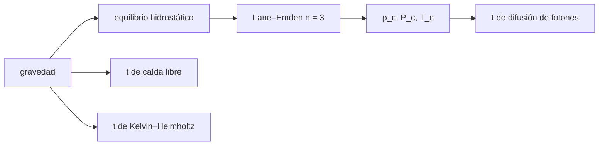

# B30-C01 — Estructura interna del Sol

<!-- nav:top -->
[🏠 Programa](../../../../README.md) · [📚 Bloque B30](../../../tronco-comun/B30-heliofisica-y-fisica-de-plasmas.md) · [← Anterior: B29-C20 — Proyecto de detección exoplanetaria](../../B29/B29-C20-proyecto-de-deteccion-exoplanetaria/CLASE.md) · [Siguiente: B30-C02 — Fotosfera, cromosfera y corona →](../B30-C02-fotosfera-cromosfera-y-corona/CLASE.md)
<!-- /nav -->

## 1. Ubicación, nivel y alcance

Clase 1 del bloque B30. Nivel N3. Para saber por qué el Sol brilla y cuánto tarda la luz en salir de él hace falta un modelo de su interior. Aquí resuelves la ecuación de Lane–Emden para un **politropo de índice `n = 3`** por integración numérica, obtienes densidad, presión y temperatura centrales y comparas tres tiempos característicos: **caída libre**, **difusión de fotones** y **Kelvin–Helmholtz**. Usas el equilibrio hidrostático de [B05](../../../tronco-comun/B05-fisica-fundamental-para-el-espacio.md) y la integración con RK4 de [B11-C08](../../B11/B11-C08-integradores-de-paso-adaptativo/CLASE.md). Se supone un Sol esférico, estático, de gas ideal y composición uniforme.

## 2. Por qué esta clase existe

Un Sol que pudiera colapsar en media hora, que tardara miles de años en dejar salir su luz y cuya energía no pudiera venir de la gravedad obliga a entender qué sostiene a una estrella. Sin un modelo mínimo de estructura, la actividad de las demás clases queda sin base. La decisión central: **¿qué escala de tiempo corresponde a cada proceso y qué dice cada una sobre la energía del Sol?**

## 3. Lo que podrás hacer al terminar

1. Integrar la ecuación de Lane–Emden `θ'' + (2/ξ)θ' + θⁿ = 0` con RK4 hasta su primer cero `ξ₁`.
2. Obtener `ρ_c/ρ̄ = ξ₁/(3|θ'₁|)` y de ahí la densidad y la presión centrales.
3. Estimar la temperatura central con el politropo y con el teorema del virial, y compararlas.
4. Calcular los tiempos de caída libre, de difusión de fotones y de Kelvin–Helmholtz.
5. Reconocer qué es del modelo y qué es una cifra ilustrativa.
6. Explicar por qué los tiempos no coinciden con la vida del Sol.

La evidencia es la **ficha de la estructura solar** del ejercicio 12 (sección 20).

## 4. Con qué llegas y cómo comprobarlo

1. ¿Qué dice el equilibrio hidrostático?
2. ¿Qué es un gas ideal y cuál es su presión?
3. ¿Qué es la masa molecular media `μ`?
4. ¿Cómo se integra una ecuación diferencial con RK4?
5. ¿Qué es el teorema del virial?

<details>
<summary>Ver respuestas</summary>

1. `dP/dr = −ρg`. 2. `P = ρkT/(μu)`. 3. La masa media por partícula en unidades de `u`. 4. Con cuatro pendientes por paso. 5. En equilibrio, la energía térmica es del orden de la energía gravitatoria.
</details>

Con cuatro o cinco aciertos, sigue; si no, repasa los prerrequisitos.

## 5. Un caso de contexto y casos de referencia

Con los valores nominales de la UAI (S1) la masa solar sale de `GM_☉/G`: `1,9884 × 10³⁰ kg`, y la densidad media es `1409,8 kg/m³`, algo mayor que la del agua. Es el **ejemplo conductor**. Los cuatro casos de referencia son el politropo `n = 3`, el tiempo de caída libre, el de difusión de fotones y el de Kelvin–Helmholtz. Los valores de `μ = 0,6` y del camino libre de los fotones (1 cm) son **ilustrativos**.

## 6. Vocabulario

Un **politropo** satisface `P = Kρ^(1+1/n)`. La **ecuación de Lane–Emden** describe su estructura con variables adimensionales `θ` y `ξ`. El **tiempo de caída libre** es el de colapso sin presión. La **difusión de fotones** es la salida lenta de la radiación por un medio opaco. El **tiempo de Kelvin–Helmholtz** es el de radiar la energía gravitatoria a la luminosidad actual. La **estimación virial** da la temperatura típica `T ~ GMμu/(kR)`.

## 7. Modelo mental: una multitud en un estadio

Una multitud densa en un estadio: el empuje del centro sostiene a las capas de arriba (equilibrio), un grito tarda en cruzarla porque cada persona lo repite al vecino (difusión), y si todos dejaran de empujar el estadio se hundiría en minutos (caída libre).



*Descripción textual:* la gravedad y el equilibrio dan el politropo, del que salen las condiciones centrales; la gravedad también fija los tiempos de caída libre y de Kelvin–Helmholtz, y la estructura fija la difusión de fotones.

Analogía: una multitud en un estadio. Límite: la estructura real tiene capas de composición y opacidad distintas.

## 8. La explicación, paso a paso

### 8.1 El politropo n = 3

La integración con RK4 da `ξ₁ = 6,8968`, `−θ'(ξ₁) = 0,04243` y `−ξ₁²θ'(ξ₁) = 2,0182`. La razón entre la densidad central y la media es `ρ_c/ρ̄ = ξ₁/(3|θ'₁|) = 54,18`.

### 8.2 Condiciones centrales

| magnitud | valor |
|---|---|
| densidad media | `1409,78 kg/m³` |
| densidad central del politropo | `7,6385 × 10⁴ kg/m³` (76,4 g/cc) |
| presión central | `1,2449 × 10¹⁶ Pa` |
| temperatura central (politropo, `μ = 0,6`) | `1,176 × 10⁷ K` |
| estimación virial `GMμu/(kR)` | `1,3766 × 10⁷ K` |
| cociente politropo / virial | `0,854` |

La presión central coincide con `ρ_c kT_c/(μu)` a seis cifras: el modelo es autoconsistente con el gas ideal. No se contrasta con un modelo solar estándar porque no se consultó ninguno.

### 8.3 Tres escalas de tiempo

| proceso | tiempo |
|---|---|
| caída libre `√(3π/(32Gρ̄))` | `1769,2 s` (29,5 min) |
| difusión de fotones `R²/(lc)` con `l = 1 cm` | `1,614 × 10¹¹ s` (≈ 5,1 × 10³ años) |
| Kelvin–Helmholtz `(3/2)GM²/(RL)` | `4,710 × 10⁷ años` |

### 8.4 Lectura

Que el Sol no colapse en 30 minutos dice que hay equilibrio con la presión. Que la luz tarde miles de años en salir dice que el interior es opaco y que el camino libre es corto (la cifra de 1 cm es ilustrativa). Que el tiempo de Kelvin–Helmholtz sea de decenas de millones de años dice que, en este cálculo, la gravedad por sí sola no sostiene la luminosidad durante la vida que se atribuye al Sol: hace falta otra fuente de energía, tema de [B31](../../../tronco-comun/B31-fisica-cuantica-nuclear-y-astroparticulas.md). La luminosidad por unidad de masa es `L/M = 1,925 × 10⁻⁴ W/kg`.

## 9. Magnitudes, símbolos y unidades

| Símbolo | Qué es | Unidad | Valor / nota |
|---|---|---|---|
| `G`, `k_B`, `u` | constantes | SI | S2 |
| `M_☉` | masa solar | kg | `1,9884 × 10³⁰` (de `GM_☉/G`) |
| `R_☉`, `L_☉` | radio y luminosidad nominales | m; W | `6,957 × 10⁸`; `3,828 × 10²⁶` (S1) |
| `n` | índice politrópico | — | 3 (ilustrativo) |
| `ξ₁` | primer cero de `θ` | — | 6,8968 |
| `μ` | masa molecular media | — | 0,6 (ilustrativa) |
| `ρ_c`, `P_c`, `T_c` | condiciones centrales | kg/m³; Pa; K | ver 8.2 |

## 10. Convenciones y referencias

Politropo `n = 3`, gas ideal sin radiación aparte, composición uniforme; `l = 1 cm` y `μ = 0,6` son **ilustrativos**; los valores de `ξ₁` y `θ'₁` son los de la integración del laboratorio.

## 11. De dónde sale lo que afirmamos

| ID | Fuente | Localizador | Respalda | Estado |
|---|---|---|---|---|
| S1 | UAI, Resolución B3 de 2015 | https://arxiv.org/abs/1510.07674 | valores nominales solares y planetarios (`R_☉`, `GM_☉`, `L_☉`, `T_eff`, `S_☉`) | Consultada el 2026-11-09 |
| S2 | NIST, *Fundamental Physical Constants* (CODATA 2022) | https://physics.nist.gov/cuu/Constants/Table/allascii.txt | `G`, `k_B`, `u`, `c`, `μ₀`, `ε₀`, `e`, `m_e`, `m_p`, `σ_SB` | Consultada el 2026-11-09 |

Límites: no se consultó ningún modelo solar estándar, por lo que las condiciones centrales no se contrastan con valores publicados; `ξ₁ = 6,8968` es el valor estándar de la ecuación de Lane–Emden (no consultado) y el laboratorio lo reproduce a `10⁻³`.

## 12. Cómo ver la estructura

| Magnitud | Valor |
|---|---|
| `ρ_c/ρ̄` | 54,18 |
| `T_c` (politropo) | `1,176 × 10⁷ K` |
| `T` (virial) | `1,377 × 10⁷ K` |
| caída libre | 29,5 min |
| difusión | ≈ 5 100 años |
| Kelvin–Helmholtz | `4,7 × 10⁷` años |

Descripción larga: los tres tiempos difieren en nueve órdenes de magnitud; la caída libre es la más corta y la de Kelvin–Helmholtz la mayor de las tres.

## 13. Ejemplo trabajado: densidad media y tiempo de caída libre

**Paso 1 · Masa.** `M = GM_☉/G = 1,9884 × 10³⁰ kg`.

**Paso 2 · Volumen.** `4πR_☉³/3 = 1,4105 × 10²⁷ m³`.

**Paso 3 · Densidad media.** `M/V = 1409,8 kg/m³`.

**Paso 4 · Tiempo.** `t = (π/2)√(R³/(2GM)) = 1769 s`, unos 29,5 minutos. Es el tiempo en el que el Sol colapsaría si la presión desapareciera.

## 14. Distintas formas de describir el interior del Sol

**Por equilibrio:** presión frente a gravedad. **Por modelo:** politropo. **Por escalas de tiempo:** caída libre, difusión, Kelvin–Helmholtz. **Por energía:** gravitatoria frente a nuclear.

## 15. Práctica guiada

**Ejercicio 1 · con los pasos indicados.** Calcula la densidad media del Sol. *Pasos:* `M/(4πR³/3)`.

<details><summary>Solución comentada</summary>

`1,9884 × 10³⁰/(1,4105 × 10²⁷) = 1409,8 kg/m³`.
</details>

**Ejercicio 2 · con una pista.** Calcula el tiempo de caída libre. *Pista:* `(π/2)√(R³/(2GM))`.

<details><summary>Solución comentada</summary>

`R³/(2GM) = 3,3673 × 10²⁶/(2,6542 × 10²⁰) = 1,2686 × 10⁶ s²`; raíz `1126 s`; por `π/2`: `1769 s`.
</details>

**Ejercicio 3 · casi autónomo.** Convierte el tiempo de difusión de `1,614 × 10¹¹ s` a años.

<details><summary>Solución comentada</summary>

`1,614 × 10¹¹/3,15576 × 10⁷ = 5,1 × 10³` años.
</details>

## 16. Práctica autónoma, transferencia e integrador

**Ejercicio 4.** ¿Cuánto tardaría la difusión con `l = 0,1 cm`?

<details><summary>Solución comentada</summary>

Es proporcional a `1/l`: diez veces más, `5,1 × 10⁴` años.
</details>

**Ejercicio 5.** Cociente entre la temperatura del politropo y la virial.

<details><summary>Solución comentada</summary>

`1,176 × 10⁷/1,3766 × 10⁷ = 0,854`.
</details>

**Ejercicio 6.** Presión central a partir del gas ideal.

<details><summary>Solución comentada</summary>

`ρ_c kT_c/(μu) = 7,6385 × 10⁴ × 1,3806 × 10⁻²³ × 1,176 × 10⁷/(0,6 × 1,6605 × 10⁻²⁷) = 1,245 × 10¹⁶ Pa`.
</details>

**Ejercicio 7.** Luminosidad por unidad de masa del Sol.

<details><summary>Solución comentada</summary>

`3,828 × 10²⁶/1,9884 × 10³⁰ = 1,925 × 10⁻⁴ W/kg`.
</details>

**Ejercicio 8.** Cociente entre la densidad central y la media.

<details><summary>Solución comentada</summary>

`ξ₁/(3|θ'₁|) = 6,8968/(3 × 0,04243) = 54,2`.
</details>

**Ejercicio 9 · transferencia.** **Transferencia.** Un compañero dice que, según este laboratorio, el Sol tiene `7,6 × 10⁴ kg/m³` en el centro. Responde con la sección 10.

<details><summary>Solución comentada</summary>

Es el valor de un politropo `n = 3` con `μ = 0,6` ilustrativo; no se contrastó con un modelo solar publicado, así que no es un dato del Sol.
</details>

**Ejercicio 10 · transferencia.** **Transferencia.** El tiempo de Kelvin–Helmholtz es de `4,7 × 10⁷` años. ¿Se concluye algo sobre la edad del Sol?

<details><summary>Solución comentada</summary>

No: la clase no consultó la edad del Sol. Solo muestra que ese cálculo gravitatorio da una escala mucho menor que las de la vida estelar, de modo que se necesita otra fuente de energía (B31).
</details>

**Ejercicio 11 · transferencia.** **Transferencia.** ¿Por qué el tiempo de difusión depende tanto de un valor ilustrativo?

<details><summary>Solución comentada</summary>

Porque es inversamente proporcional al camino libre; con `l` desconocido solo se obtiene un orden de magnitud.
</details>

**Ejercicio 12.** **Integrador.** Elabora tu *ficha de la estructura solar*: `ξ₁`, condiciones centrales, los tres tiempos y la lectura de cada uno.

<details><summary>Solución comentada</summary>

Secciones 8.1–8.4.
</details>

**Ejercicio 12 · integrador.** **Integrador.** Elabora tu *ficha de la estructura solar*: `ξ₁`, condiciones centrales, los tres tiempos y la lectura de cada uno.

<details><summary>Solución modelo</summary>

Secciones 8.1–8.4.
</details>

## 17. Laboratorio: politropo, condiciones centrales y escalas de tiempo

El script [estructura.py](estructura.py) resuelve Lane–Emden con RK4, calcula densidad, presión y temperatura centrales y los tres tiempos (**comprueba** `ξ₁` a `10⁻³` y la densidad media por dos vías).

**Datos:** `G`, `k_B`, `u` de NIST; `GM_☉`, `R_☉`, `L_☉` de la UAI; `n`, `μ` y `l` **ilustrativos**. **Predice antes de ejecutar:** ¿cuánto vale `ρ_c/ρ̄`? (≈54.) **Ejecución del 2026-11-09 (Python 3.12.9):**

```text
Python 3.12.9 (biblioteca estandar)
politropo n = 3: xi_1 = 6.8968 ; -theta'(xi_1) = 0.04243 ; -xi_1^2 theta' = 2.0182 ; rho_c/rho_medio = 54.18
masa solar = 1.9884e+30 kg ; densidad media = 1409.78 kg/m3 ; densidad central (politropo) = 7.6385e+04 kg/m3 = 76.4 g/cc
temperatura central (politropo, mu = 0.6) = 1.1760e+07 K ; estimacion virial G M mu u/(k R) = 1.3766e+07 K ; cociente = 0.854
tiempo de caida libre = 1769.2 s = 29.5 min ; tiempo de difusion de fotones (l = 1 cm) = 1.614e+11 s = 5.116e+03 anios
luminosidad especifica L/M = 1.925e-04 W/kg ; energia de ligadura gravitatoria ~ (3/2)GM^2/R: tiempo de Kelvin-Helmholtz = 4.710e+07 anios (con coeficiente 3/2)
presion central (politropo) = 1.2449e+16 Pa ; comprobacion gas ideal: rho_c k T_c/(mu u) = 1.2449e+16 Pa
Pruebas superadas.
```

```bash
python programa/clases/B30/B30-C01-estructura-interna-del-sol/estructura.py
```

**Límites:** politropo, composición uniforme, sin transporte de energía.

## 18. Errores frecuentes y cómo corregirlos

**Tomar `μ = 0,6` y `l = 1 cm` como datos solares.** Se corrige con la sección 10.

**Confundir los tres tiempos.** Se corrige con la tabla 8.3.

**Olvidar que el politropo no tiene energía.** Se corrige con 8.4.

**Comparar con un modelo solar real.** No se consultó ninguno; se corrige con la sección 11.

## 19. Cómo sabrás que vas bien

Tras 8.1: ¿qué es `ξ₁`? Si dudas, repasa la integración. Tras 8.3: ¿cuál de los tiempos es el menor? (la caída libre). Tras el laboratorio: ¿qué comprueba? (el cero de Lane–Emden y la densidad media).

## 20. Qué entregas y cómo se evalúa

El producto es tu **ficha de la estructura solar** (ejercicio 12).

| Criterio | Inicial | En desarrollo | Logrado | Destacado |
|---|---|---|---|---|
| Conceptos | Los confunde | Parciales | `ξ₁`, equilibrio, tiempos | Explica qué sostiene al Sol |
| Cálculo | Sin unidades | Con errores | Tablas completas | Estima el efecto de `l` |
| Numérico | Sin comprobar | Un caso | Dos vías | Interpreta el cociente 0,854 |
| Fuentes | Sin fuente | Sin fecha | S1 y S2 con fecha | Declara que no hay modelo solar consultado |
| Límites | No los nombra | Uno | Tres | Discute qué falta del modelo |

**Condiciones críticas (no se compensan con promedio):** rotular las cifras ilustrativas; no presentar el politropo como el interior real; citar solo lo consultado.

## 21. Ética, seguridad y límites

Clase educativa: el modelo no describe el interior real del Sol. Accesibilidad: tablas equivalentes a las gráficas, fórmulas en texto, ejercicios sin conexión.

## 22. Para cerrar y seguir

El Sol sale con densidad media `1410 kg/m³`, un politropo de `ρ_c/ρ̄ = 54` y tiempos de 30 minutos, miles de años y decenas de millones de años. Queda una pregunta: ¿cómo cambia la temperatura y la densidad desde la superficie hacia la corona?

**Glosario español–inglés.** politropo · *polytrope*; ecuación de Lane–Emden · *Lane–Emden equation*; equilibrio hidrostático · *hydrostatic equilibrium*; caída libre · *free fall*; difusión de fotones · *photon diffusion*; tiempo de Kelvin–Helmholtz · *Kelvin–Helmholtz timescale*; virial · *virial*.

**Continuidad.** [B30-C02](../B30-C02-fotosfera-cromosfera-y-corona/CLASE.md) estudia las capas externas: fotosfera, cromosfera y corona.

**Referencias:** ver sección 11.

<!-- nav:bottom -->
---

[← Anterior: B29-C20 — Proyecto de detección exoplanetaria](../../B29/B29-C20-proyecto-de-deteccion-exoplanetaria/CLASE.md) · [📚 Bloque B30](../../../tronco-comun/B30-heliofisica-y-fisica-de-plasmas.md) · [Siguiente: B30-C02 — Fotosfera, cromosfera y corona →](../B30-C02-fotosfera-cromosfera-y-corona/CLASE.md)
<!-- /nav -->
