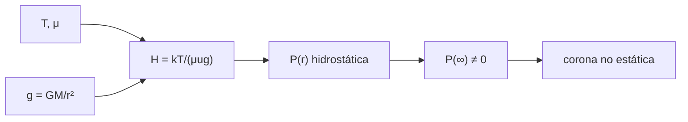

# B30-C02 — Fotosfera, cromosfera y corona

<!-- nav:top -->
[🏠 Programa](../../../../README.md) · [📚 Bloque B30](../../../tronco-comun/B30-heliofisica-y-fisica-de-plasmas.md) · [← Anterior: B30-C01 — Estructura interna del Sol](../B30-C01-estructura-interna-del-sol/CLASE.md) · [Siguiente: B30-C03 — Ciclo de actividad solar →](../B30-C03-ciclo-de-actividad-solar/CLASE.md)
<!-- /nav -->

## 1. Ubicación, nivel y alcance

Clase 2 del bloque B30. Nivel N3. Las capas externas del Sol cambian de temperatura y densidad en pocos miles de kilómetros. Aquí calculas la **gravedad superficial**, la **altura de escala** de cada capa, la presión hidrostática con gravedad variable (forma cerrada frente a integración numérica) y el **argumento de Parker**: una corona hidrostática de `1,5 × 10⁶ K` no puede conectar con un medio de presión casi nula. Usas [B05](../../../tronco-comun/B05-fisica-fundamental-para-el-espacio.md) y el equilibrio de [B30-C01](../B30-C01-estructura-interna-del-sol/CLASE.md). Se suponen capas isotermas y esféricas.

## 2. Por qué esta clase existe

La corona caliente es el origen del viento solar y de gran parte de la actividad. Entender por qué no puede estar en reposo conecta el Sol con el medio interplanetario. La decisión central: **¿qué dice la altura de escala de cada capa y por qué una corona estática es imposible?**

## 3. Lo que podrás hacer al terminar

1. Calcular `g = GM/R²` en la superficie.
2. Calcular la altura de escala `H = kT/(μug)` de cada capa.
3. Integrar numéricamente `dP/dr = −ρg` y comparar con la forma cerrada.
4. Reconocer que `P(∞)` de una corona hidrostática no se anula.
5. Calcular la velocidad del sonido y el radio sónico `r_c = GM/(2c_s²)`.
6. Distinguir lo nominal de lo ilustrativo.

La evidencia es la **ficha de las capas solares** del ejercicio 12 (sección 20).

## 4. Con qué llegas y cómo comprobarlo

1. ¿Qué es una altura de escala?
2. ¿Qué es la velocidad del sonido isoterma?
3. ¿Cómo varía `g` con `r`?
4. ¿Qué es una integral numérica?
5. ¿Qué es la presión hidrostática?

<details>
<summary>Ver respuestas</summary>

1. La distancia en que la presión cae un factor `e`. 2. `√(kT/(μu))`. 3. Como `1/r²`. 4. Una suma de áreas de trapecios o parábolas. 5. La que equilibra el peso de la columna de gas.
</details>

Con cuatro o cinco aciertos, sigue; si no, repasa los prerrequisitos.

## 5. Un caso de contexto y casos de referencia

Con los valores nominales de la UAI (S1), la gravedad en la superficie es `274,2 m/s²`, unas 28 veces la terrestre. Es el **ejemplo conductor**. Las temperaturas (5772 K nominal de la fotosfera; 10⁴ K y 1,5 × 10⁶ K ilustrativas para cromosfera y corona) y las masas moleculares medias (1,3; 1,2; 0,6) son **ilustrativas**.

## 6. Vocabulario

La **altura de escala** `H`. El **equilibrio hidrostático isotermo** da `P ∝ exp(−z/H)` en capa delgada. La **velocidad del sonido isoterma**. El **radio sónico** es donde el flujo de Parker pasa de subsónico a supersónico. La **fotosfera** es la capa que emite la luz visible; la **cromosfera** y la **corona** están encima.

## 7. Modelo mental: la atmósfera de un planeta con la gravedad de un gigante

Como una atmósfera planetaria con gravedad 28 veces mayor: la columna de gas se comprime en una capa delgada. La corona, 260 veces más caliente que la fotosfera, es un gas que se extiende tanto que su presión a gran distancia no desaparece.



*Descripción textual:* la temperatura y la gravedad dan la altura de escala y la presión hidrostática; en la corona esa presión no se anula en el infinito, lo que obliga a un flujo.

Analogía: una atmósfera con gravedad grande. Límite: capas reales no isotermas.

## 8. La explicación, paso a paso

### 8.1 Altura de escala

| capa (ilustrativa) | `T` (K) | `μ` | `H` (km) | `c_s` (km/s) | `r_c` (`R_☉`) |
|---|---|---|---|---|---|
| fotosfera | 5772 | 1,3 | 134,6 | 6,08 | 2583,7 |
| cromosfera | 10⁴ | 1,2 | 252,7 | 8,32 | 1376,6 |
| corona | 1,5 × 10⁶ | 0,6 | 75 806 | 144,17 | 4,589 |

### 8.2 Presión hidrostática

Con gravedad variable y gas isotermo, `P(r)/P(R) = exp[−(GMμu/(kT))(1/R − 1/r)]`. Para la corona de `1,5 × 10⁶ K` el exponente en el infinito es `GMμu/(kTR) = 9,18`.

| `r` (`R_☉`) | `P/P₀` cerrada | `P/P₀` numérica |
|---|---|---|
| 1,5 | 0,0469297 | 0,0469297 |
| 2 | 0,0101665 | 0,0101665 |
| 5 | 6,47852 × 10⁻⁴ | 6,47852 × 10⁻⁴ |
| 20 | 1,63541 × 10⁻⁴ | 1,63541 × 10⁻⁴ |

### 8.3 El argumento de Parker

`P(∞)/P(R_☉) = 1,0336 × 10⁻⁴`: la presión de la corona estática no se anula lejos del Sol. Un medio interestelar de presión muy inferior no podría contenerla, de modo que la corona no puede estar en reposo y se expande (B30-C10). Para la corona, `r_c = 4,589 R_☉`.

### 8.4 Lectura

`H` crece con la temperatura y baja con la gravedad; la fotosfera, fría, tiene una columna de unos centenares de kilómetros y la corona, 560 veces mayor, ocupa varios radios solares.

## 9. Magnitudes, símbolos y unidades

| Símbolo | Qué es | Unidad | Valor / nota |
|---|---|---|---|
| `g` | gravedad superficial | m/s² | 274,20 (S1, S2) |
| `H` | altura de escala | km | ver 8.1 |
| `c_s` | velocidad del sonido isoterma | km/s | `√(kT/(μu))` |
| `r_c` | radio sónico | `R_☉` | `GM/(2c_s²)` |
| `P/P₀` | presión relativa | — | ver 8.2 |

## 10. Convenciones y referencias

Capas isotermas, esféricas y en reposo (salvo en el argumento de Parker); `T` de cromosfera y corona y todos los `μ` son **ilustrativos**.

## 11. De dónde sale lo que afirmamos

| ID | Fuente | Localizador | Respalda | Estado |
|---|---|---|---|---|
| S1 | UAI, Resolución B3 de 2015 | https://arxiv.org/abs/1510.07674 | valores nominales solares y planetarios (`R_☉`, `GM_☉`, `L_☉`, `T_eff`, `S_☉`) | Consultada el 2026-11-09 |
| S2 | NIST, *Fundamental Physical Constants* (CODATA 2022) | https://physics.nist.gov/cuu/Constants/Table/allascii.txt | `G`, `k_B`, `u`, `c`, `μ₀`, `ε₀`, `e`, `m_e`, `m_p`, `σ_SB` | Consultada el 2026-11-09 |

Límites: las temperaturas de cromosfera y corona y los `μ` no provienen de una fuente consultada; las fórmulas son estándar.

## 12. Cómo ver la presión

| `r` (`R_☉`) | `P/P₀` |
|---|---|
| 1,5 | 0,0469 |
| 2 | 0,0102 |
| 5 | 6,5 × 10⁻⁴ |
| 20 | 1,6 × 10⁻⁴ |
| ∞ | 1,0 × 10⁻⁴ |

Descripción larga: la presión cae rápidamente cerca del Sol y se estabiliza en un valor no nulo.

## 13. Ejemplo trabajado: gravedad y altura de escala de la fotosfera

**Paso 1 · Gravedad.** `g = 1,3271244 × 10²⁰/(6,957 × 10⁸)² = 274,2 m/s²`.

**Paso 2 · Masa por partícula.** `μu = 1,3 × 1,6605 × 10⁻²⁷ = 2,159 × 10⁻²⁷ kg`.

**Paso 3 · Energía térmica.** `kT = 1,3806 × 10⁻²³ × 5772 = 7,969 × 10⁻²⁰ J`.

**Paso 4 · Cociente.** `H = 7,969 × 10⁻²⁰/(2,159 × 10⁻²⁷ × 274,2) = 1,346 × 10⁵ m ≈ 135 km`.

## 14. Distintas formas de describir una atmósfera

**Por altura de escala:** grosor de cada capa. **Por presión:** `P(r)`. **Por velocidad del sonido:** `c_s`. **Por radio sónico:** `r_c`.

## 15. Práctica guiada

**Ejercicio 1 · con los pasos indicados.** Gravedad en la superficie solar. *Pasos:* `GM/R²`.

<details><summary>Solución comentada</summary>

`1,3271244 × 10²⁰/4,840 × 10¹⁷ = 274,2 m/s²`.
</details>

**Ejercicio 2 · con una pista.** Altura de escala de la fotosfera. *Pista:* `kT/(μug)`.

<details><summary>Solución comentada</summary>

`134,6 km`.
</details>

**Ejercicio 3 · casi autónomo.** Cociente entre las alturas de escala de la corona y de la fotosfera.

<details><summary>Solución comentada</summary>

`75 806/134,6 ≈ 563`.
</details>

## 16. Práctica autónoma, transferencia e integrador

**Ejercicio 4.** Velocidad del sonido en la corona.

<details><summary>Solución comentada</summary>

`√(kT/(μu)) = √(2,0710 × 10⁻¹⁷/9,963 × 10⁻²⁸) = 144,2 km/s`.
</details>

**Ejercicio 5.** Porcentaje que cae la presión entre `R_☉` y `2R_☉`.

<details><summary>Solución comentada</summary>

`1 − 0,010167 = 98,98 %`.
</details>

**Ejercicio 6.** Exponente `GMμu/(kTR)` de la corona y `P(∞)/P₀`.

<details><summary>Solución comentada</summary>

`9,18`; `e^(−9,18) = 1,03 × 10⁻⁴`.
</details>

**Ejercicio 7.** Radio sónico de la corona en `R_☉`.

<details><summary>Solución comentada</summary>

`r_c = λ₀/2` con `λ₀ = 9,18`: `4,59 R_☉`.
</details>

**Ejercicio 8.** ¿Qué pasa con `r_c` si la corona tuviera el doble de temperatura?

<details><summary>Solución comentada</summary>

`r_c ∝ 1/T`: `2,29 R_☉`.
</details>

**Ejercicio 9 · transferencia.** **Transferencia.** Un compañero dice que la corona está a `1,5 × 10⁶ K`. Responde con la sección 10.

<details><summary>Solución comentada</summary>

Es un valor ilustrativo del laboratorio, no una medición consultada.
</details>

**Ejercicio 10 · transferencia.** **Transferencia.** ¿Por qué `P(∞) ≠ 0` implica que la corona no está en reposo?

<details><summary>Solución comentada</summary>

Porque una presión no nula a gran distancia exigiría un medio externo que la contenga, y el medio interplanetario tiene una presión mucho menor; el equilibrio estático fallaría.
</details>

**Ejercicio 11 · transferencia.** **Transferencia.** La integral `∫e^(−z/H)dz/H` sobre 20 alturas de escala vale `1 − e⁻²⁰`. ¿Qué significa?

<details><summary>Solución comentada</summary>

Casi toda la columna de gas está en las primeras alturas de escala.
</details>

**Ejercicio 12.** **Integrador.** Elabora tu *ficha de las capas solares*: `g`, tabla de `H`, presión y argumento de Parker.

<details><summary>Solución comentada</summary>

Secciones 8.1–8.4.
</details>

**Ejercicio 12 · integrador.** **Integrador.** Elabora tu *ficha de las capas solares*: `g`, tabla de `H`, presión y argumento de Parker.

<details><summary>Solución modelo</summary>

Secciones 8.1–8.4.
</details>

## 17. Laboratorio: alturas de escala y corona hidrostática

El script [capas.py](capas.py) calcula `g`, `H`, `c_s`, `r_c`, integra la presión hidrostática y la compara con la forma cerrada (**comprueba** `10⁻⁶`).

**Datos:** constantes de NIST; valores nominales de la UAI; `T` y `μ` de cromosfera y corona **ilustrativos**. **Predice antes de ejecutar:** ¿qué fracción de la presión queda a `2R_☉`? (≈1 %.) **Ejecución del 2026-11-09 (Python 3.12.9):**

```text
Python 3.12.9 (biblioteca estandar)
gravedad en la superficie nominal g = GM/R^2 = 274.200 m/s2 (la de la Tierra es 9.80)
capa (ilustrativa)          T [K]    mu     H [km]  c_s [km/s]  r_c [R_sol]
fotosfera                    5772   1.3      134.6        6.08     2583.702
cromosfera                  1e+04   1.2      252.7        8.32     1376.597
corona                    1.5e+06   0.6    75806.5      144.17        4.589
 r [R_sol]  P/P_0 (cerrada)  P/P_0 (numerica)
       1.0      1.00000e+00       1.00000e+00
       1.5      4.69297e-02       4.69297e-02
       2.0      1.01665e-02       1.01665e-02
       5.0      6.47852e-04       6.47852e-04
      20.0      1.63541e-04       1.63541e-04
corona hidrostatica de 1.5e6 K: P(infinito)/P(R_sol) = 1.0336e-04 (no se anula: una corona estatica no puede conectar con un medio de presion ~0)
columna de densidad exponencial: Int exp(-z/H) dz / H = 1.000000 (esperado 1 - e^-20 = 1.000000)
Pruebas superadas.
```

```bash
python programa/clases/B30/B30-C02-fotosfera-cromosfera-y-corona/capas.py
```

**Límites:** capas isotermas, sin campo magnético.

## 18. Errores frecuentes y cómo corregirlos

**Usar `g` terrestre.** Se corrige con el ejercicio 1.

**Olvidar `μ`.** Se corrige con 13.

**Creer que la presión coronal se anula.** Se corrige con 8.3.

**Presentar las `T` ilustrativas como medidas.** Se corrige con la sección 10.

## 19. Cómo sabrás que vas bien

Tras 8.1: ¿qué capa tiene mayor `H`? (la corona). Tras 8.3: ¿qué implica `P(∞) ≠ 0`? Ejercicio 10. Tras el laboratorio: ¿qué comprueba? (la integración frente a la forma cerrada).

## 20. Qué entregas y cómo se evalúa

El producto es tu **ficha de las capas solares** (ejercicio 12).

| Criterio | Inicial | En desarrollo | Logrado | Destacado |
|---|---|---|---|---|
| Conceptos | Los confunde | Parciales | `H`, `c_s`, `r_c` | Explica el argumento de Parker |
| Cálculo | Sin unidades | Con errores | Tablas completas | Estima la sensibilidad a `T` |
| Numérico | Sin comprobar | Un caso | Forma cerrada y numérica | Interpreta la presión residual |
| Fuentes | Sin fuente | Sin fecha | S1 y S2 con fecha | Declara los valores ilustrativos |
| Límites | No los nombra | Uno | Tres | Discute qué falta del modelo |

**Condiciones críticas (no se compensan con promedio):** rotular `T` y `μ` ilustrativos; no atribuir a la corona un valor medido; citar solo lo consultado.

## 21. Ética, seguridad y límites

Clase educativa: los perfiles son ilustrativos. Accesibilidad: tablas equivalentes a las gráficas, fórmulas en texto, ejercicios sin conexión.

## 22. Para cerrar y seguir

La fotosfera tiene `H = 135 km`, la corona `H = 7,6 × 10⁴ km` y una corona estática conservaría `10⁻⁴` de su presión en el infinito: tiene que fluir. Queda una pregunta: ¿cómo varía la actividad del Sol en el tiempo?

**Glosario español–inglés.** altura de escala · *scale height*; fotosfera · *photosphere*; cromosfera · *chromosphere*; corona · *corona*; velocidad del sonido · *sound speed*; radio sónico · *sonic radius*.

**Continuidad.** [B30-C03](../B30-C03-ciclo-de-actividad-solar/CLASE.md) estudia el ciclo de actividad solar.

**Referencias:** ver sección 11.

<!-- nav:bottom -->
---

[← Anterior: B30-C01 — Estructura interna del Sol](../B30-C01-estructura-interna-del-sol/CLASE.md) · [📚 Bloque B30](../../../tronco-comun/B30-heliofisica-y-fisica-de-plasmas.md) · [Siguiente: B30-C03 — Ciclo de actividad solar →](../B30-C03-ciclo-de-actividad-solar/CLASE.md)
<!-- /nav -->
