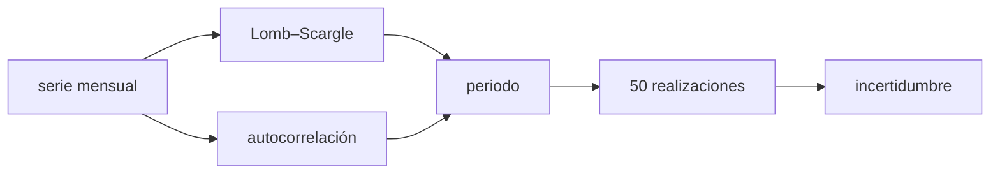

# B30-C03 — Ciclo de actividad solar

<!-- nav:top -->
[🏠 Programa](../../../../README.md) · [📚 Bloque B30](../../../tronco-comun/B30-heliofisica-y-fisica-de-plasmas.md) · [← Anterior: B30-C02 — Fotosfera, cromosfera y corona](../B30-C02-fotosfera-cromosfera-y-corona/CLASE.md) · [Siguiente: B30-C04 — Manchas solares →](../B30-C04-manchas-solares/CLASE.md)
<!-- /nav -->

## 1. Ubicación, nivel y alcance

Clase 3 del bloque B30. Nivel N3. El Sol alterna entre épocas con muchas manchas y épocas casi sin ellas. Aquí construyes una **serie sintética** de manchas con ciclos de unos 11 años, recuperas su periodo con un **periodograma de Lomb–Scargle** y con la **autocorrelación**, y repites el análisis con 50 realizaciones para medir la incertidumbre. Usas la estadística de [B12](../../../tronco-comun/B12-probabilidad-estadistica-e-incertidumbre.md) y el análisis de frecuencias de [B29-C14](../../B29/B29-C14-estrellas-variables-periodicas/CLASE.md). La serie no reproduce ningún registro real.

## 2. Por qué esta clase existe

Predecir cuándo llegará el máximo de actividad depende de reconocer un periodo en una serie ruidosa y de saber cuán fiable es. La decisión central: **¿cómo se mide el periodo del ciclo y con qué incertidumbre?**

## 3. Lo que podrás hacer al terminar

1. Generar una serie de ciclos con duración y amplitud aleatorias.
2. Calcular un periodograma de Lomb–Scargle y leer el periodo.
3. Calcular la autocorrelación y leer el retardo del ciclo.
4. Estimar la incertidumbre del periodo con Monte Carlo.
5. Reconocer la resolución en frecuencia de una serie de 130 años.
6. Distinguir una serie sintética de un registro histórico.

La evidencia es la **ficha del ciclo solar** del ejercicio 12 (sección 20).

## 4. Con qué llegas y cómo comprobarlo

1. ¿Qué es un periodo?
2. ¿Qué es una autocorrelación?
3. ¿Qué es un periodograma?
4. ¿Qué es una simulación Monte Carlo?
5. ¿Qué es la resolución en frecuencia?

<details>
<summary>Ver respuestas</summary>

1. El tiempo de una repetición. 2. La correlación de la serie consigo misma desplazada un retardo. 3. La potencia en función de la frecuencia. 4. Repetir con números aleatorios. 5. `1/T` para una serie de duración `T`.
</details>

Con cuatro o cinco aciertos, sigue; si no, repasa los prerrequisitos.

## 5. Un caso de contexto y casos de referencia

El ciclo solar de unos 11 años se caracteriza por la subida y bajada del número y del área de manchas, y otros indicadores (flujo a 10,7 cm, irradiancia total, campo magnético, fulguraciones, eyecciones de masa, actividad geomagnética y flujo de rayos cósmicos) varían en asociación con ellas (S1, solo resumen). El **ejemplo conductor** es una serie **sintética** de 1560 valores mensuales (130 años) con `x² e^(−x)` por ciclo.

## 6. Vocabulario

Un **ciclo** de unos 11 años. El **número de manchas** mide la actividad. El **periodograma de Lomb–Scargle** sirve para series con muestreo irregular. La **autocorrelación** mide la repetición. La **resolución en frecuencia** es `1/T`. El **Monte Carlo** repite el análisis con ruido nuevo.

## 7. Modelo mental: el pulso de un corredor

El ciclo es como el pulso de un corredor cuyo ritmo varía un poco: se puede medir el periodo medio, y su variación fija cuánto se puede confiar en la predicción.



*Descripción textual:* la serie mensual se analiza con el periodograma y la autocorrelación, que dan el periodo; 50 realizaciones dan su incertidumbre.

Analogía: el pulso de un corredor. Límite: los ciclos reales no son independientes.

## 8. La explicación, paso a paso

### 8.1 La serie sintética

Hay 1560 valores mensuales en 130 años, con máximo `270,7`, media `72,0` y una fracción de `0,15` de meses por debajo del 10 % del máximo. La forma de cada ciclo es `A((t − t₀)/τ)² e^(−(t−t₀)/τ)` con `τ = 2` años (máximo a 4 años), duraciones `11 ± 1` años y amplitudes lognormales: todo **ilustrativo**.

### 8.2 Periodograma

El pico de Lomb–Scargle cae en `f = 0,0885 año⁻¹`, es decir, un periodo de `11,30` años.

### 8.3 Autocorrelación

| retardo (años) | autocorrelación |
|---|---|
| 2,0 | 0,535 |
| 5,5 | −0,186 |
| 8,0 | −0,036 |
| 11,0 | 0,369 |
| 22,0 | 0,323 |

La autocorrelación vuelve a subir cerca de 11 años y de 22 años: la serie se parece a sí misma desplazada por un ciclo.

### 8.4 Incertidumbre

En 50 realizaciones el periodo recuperado es `10,953 ± 0,277` años (verdadero `11`): la media difiere en `0,047` años, es decir, `1,2` errores de la media (`0,277/√50 = 0,039`).

### 8.5 Lectura

Con 130 años la resolución es `1/130 = 0,0077 año⁻¹`, equivalente a ≈1 año en el periodo cerca de 11. Por eso `11,30` y `10,95` son indistinguibles de 11 dentro de la resolución.

## 9. Magnitudes, símbolos y unidades

| Símbolo | Qué es | Unidad | Valor / nota |
|---|---|---|---|
| `s(t)` | número de manchas sintético | — | ver 8.1 |
| `f`, `P` | frecuencia y periodo | año⁻¹; año | `P = 1/f` |
| `τ` | escala de subida | año | 2 (ilustrativo) |
| `ρ(k)` | autocorrelación | — | ver 8.3 |
| `σ_P` | incertidumbre del periodo | año | 0,277 (50 realizaciones) |

## 10. Convenciones y referencias

Serie sintética con semilla `20261109`; sin constantes físicas; la forma del ciclo, la duración y el ruido son **ilustrativos**.

## 11. De dónde sale lo que afirmamos

| ID | Fuente | Localizador | Respalda | Estado |
|---|---|---|---|---|
| S1 | Hathaway, arXiv:1502.07020 | https://arxiv.org/abs/1502.07020 | el ciclo solar de unos 11 años y los indicadores asociados | Solo resumen, consultado el 2026-11-09 |

Límites: solo resumen; la serie y los ciclos son sintéticos y no reproducen un registro histórico; las cifras de este laboratorio no son del Sol.

## 12. Cómo ver el ciclo

| Método | Periodo |
|---|---|
| Lomb–Scargle (una serie) | 11,30 años |
| 50 realizaciones | 10,95 ± 0,28 años |
| verdadero | 11 años |

Descripción larga: los dos métodos recuperan el periodo dentro de la resolución de la serie.

## 13. Ejemplo trabajado: leer el periodo de un pico

**Paso 1 · Pico.** `f = 0,0885 año⁻¹`.

**Paso 2 · Inversa.** `P = 1/0,0885 = 11,30` años.

**Paso 3 · Resolución.** `Δf = 1/130 = 0,0077 año⁻¹` y `ΔP = Δf/f² ≈ 1` año.

**Paso 4 · Lectura.** `11,30` es compatible con 11 años.

## 14. Distintas formas de describir un ciclo

**Por frecuencia:** periodograma. **Por retardo:** autocorrelación. **Por simulación:** Monte Carlo. **Por indicadores:** manchas, flujo a 10,7 cm, irradiancia.

## 15. Práctica guiada

**Ejercicio 1 · con los pasos indicados.** Periodo asociado a `f = 0,0885 año⁻¹`.

<details><summary>Solución comentada</summary>

`1/0,0885 = 11,30` años.
</details>

**Ejercicio 2 · con una pista.** ¿Qué indica la autocorrelación de 0,369 a 11 años frente a −0,186 a 5,5 años?

<details><summary>Solución comentada</summary>

Que la serie se parece a sí misma desplazada un ciclo y no media ciclo.
</details>

**Ejercicio 3 · casi autónomo.** Número de meses con valor menor del 10 % del máximo.

<details><summary>Solución comentada</summary>

`0,15 × 1560 ≈ 234`.
</details>

## 16. Práctica autónoma, transferencia e integrador

**Ejercicio 4.** Error de la media del periodo con `σ = 0,277` y 50 realizaciones.

<details><summary>Solución comentada</summary>

`0,277/√50 = 0,039` años.
</details>

**Ejercicio 5.** ¿A cuántos errores de la media está `10,953` de `11`?

<details><summary>Solución comentada</summary>

`0,047/0,039 = 1,2`.
</details>

**Ejercicio 6.** Resolución en periodo cerca de 11 años para 130 años.

<details><summary>Solución comentada</summary>

`ΔP = P²/T = 121/130 = 0,93` años.
</details>

**Ejercicio 7.** Frecuencia de Nyquist del muestreo mensual.

<details><summary>Solución comentada</summary>

`1/(2 × 1/12) = 6 año⁻¹`, periodos mínimos de 2 meses.
</details>

**Ejercicio 8.** Número aproximado de ciclos en 130 años.

<details><summary>Solución comentada</summary>

`130/11 = 11,8`.
</details>

**Ejercicio 9 · transferencia.** **Transferencia.** Un compañero usa el pico de 11,30 años como el ciclo real del Sol. Responde con la sección 10.

<details><summary>Solución comentada</summary>

La serie es sintética; el 11 está puesto por construcción.
</details>

**Ejercicio 10 · transferencia.** **Transferencia.** La autocorrelación a 22 años es positiva. ¿Prueba el ciclo magnético de 22 años?

<details><summary>Solución comentada</summary>

No: los ciclos de esta serie son independientes; el valor positivo solo refleja la repetición de dos ciclos.
</details>

**Ejercicio 11 · transferencia.** **Transferencia.** ¿Qué pasaría con la autocorrelación a 22 años si la duración tuviera una dispersión mayor?

<details><summary>Solución comentada</summary>

Bajaría, porque las fases se dispersan más al acumularse dos ciclos.
</details>

**Ejercicio 12.** **Integrador.** Elabora tu *ficha del ciclo solar*: serie, periodograma, autocorrelación, Monte Carlo y límites.

<details><summary>Solución comentada</summary>

Secciones 8.1–8.5.
</details>

**Ejercicio 12 · integrador.** **Integrador.** Elabora tu *ficha del ciclo solar*: serie, periodograma, autocorrelación, Monte Carlo y límites.

<details><summary>Solución modelo</summary>

Secciones 8.1–8.5.
</details>

## 17. Laboratorio: ciclo sintético de manchas

El script [ciclo.py](ciclo.py) genera la serie, calcula el periodograma de Lomb–Scargle y la autocorrelación y repite 50 veces (**comprueba** el periodo dentro de 0,4 años y la media dentro de 3 errores).

**Datos:** serie **sintética** con semilla `20261109`. **Predice antes de ejecutar:** ¿qué periodo recuperará el periodograma? (≈11 años.) **Ejecución del 2026-11-09 (Python 3.12.9):**

```text
Python 3.12.9 (biblioteca estandar)
1560 valores mensuales en 130 anios ; maximo = 270.7 ; media = 72.0 ; fraccion de meses con valor < 10 % del maximo = 0.15
periodograma de Lomb-Scargle: pico en f = 0.0885 /anio -> periodo = 11.30 anios
 lag [anios]  autocorrelacion
         2.0            0.535
         5.5           -0.186
         8.0           -0.036
        11.0            0.369
        22.0            0.323
50 realizaciones: periodo recuperado = 10.953 +/- 0.277 anios (verdadero 11)
Pruebas superadas.
```

```bash
python programa/clases/B30/B30-C03-ciclo-de-actividad-solar/ciclo.py
```

**Límites:** ciclos independientes y ruido multiplicativo.

## 18. Errores frecuentes y cómo corregirlos

**Tomar la serie por un registro.** Se corrige con la sección 10.

**Leer un periodo sin resolución.** Se corrige con 8.5.

**Confundir frecuencia y periodo.** Se corrige con el ejercicio 1.

**Concluir el ciclo de 22 años de la autocorrelación.** Se corrige con el ejercicio 10.

## 19. Cómo sabrás que vas bien

Tras 8.2: ¿qué periodo da el pico? Si dudas, ejemplo 13. Tras 8.4: ¿cuán incierto es? Tras el laboratorio: ¿qué comprueba? (el periodo recuperado).

## 20. Qué entregas y cómo se evalúa

El producto es tu **ficha del ciclo solar** (ejercicio 12).

| Criterio | Inicial | En desarrollo | Logrado | Destacado |
|---|---|---|---|---|
| Conceptos | Los confunde | Parciales | periodo, resolución | Explica el límite de la resolución |
| Cálculo | Sin unidades | Con errores | Tablas completas | Calcula `ΔP` |
| Numérico | Sin comprobar | Un caso | Dos métodos y Monte Carlo | Interpreta los 1,2 errores |
| Fuentes | Sin fuente | Sin fecha | S1 con fecha | Declara que es solo resumen |
| Límites | No los nombra | Uno | Tres | Discute qué falta del modelo |

**Condiciones críticas (no se compensan con promedio):** rotular la serie como sintética; no atribuir al Sol un periodo medido en la clase; citar solo lo consultado.

## 21. Ética, seguridad y límites

Clase educativa: no predice el ciclo solar real. Accesibilidad: tablas equivalentes a las gráficas, fórmulas en texto, ejercicios sin conexión.

## 22. Para cerrar y seguir

Una serie de 130 años con ciclos de `11 ± 1` años da un periodo de `11,30` años por el pico y `10,95 ± 0,28` por Monte Carlo. Queda una pregunta: ¿qué son las manchas que cuentan?

**Glosario español–inglés.** ciclo solar · *solar cycle*; número de manchas · *sunspot number*; periodograma · *periodogram*; autocorrelación · *autocorrelation*; resolución en frecuencia · *frequency resolution*.

**Continuidad.** [B30-C04](../B30-C04-manchas-solares/CLASE.md) estudia las manchas solares.

**Referencias:** ver sección 11.

<!-- nav:bottom -->
---

[← Anterior: B30-C02 — Fotosfera, cromosfera y corona](../B30-C02-fotosfera-cromosfera-y-corona/CLASE.md) · [📚 Bloque B30](../../../tronco-comun/B30-heliofisica-y-fisica-de-plasmas.md) · [Siguiente: B30-C04 — Manchas solares →](../B30-C04-manchas-solares/CLASE.md)
<!-- /nav -->
