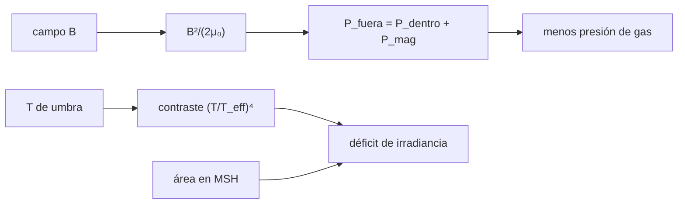

# B30-C04 — Manchas solares

<!-- nav:top -->
[🏠 Programa](../../../../README.md) · [📚 Bloque B30](../../../tronco-comun/B30-heliofisica-y-fisica-de-plasmas.md) · [← Anterior: B30-C03 — Ciclo de actividad solar](../B30-C03-ciclo-de-actividad-solar/CLASE.md) · [Siguiente: B30-C05 — Campos magnéticos solares →](../B30-C05-campos-magneticos-solares/CLASE.md)
<!-- /nav -->

## 1. Ubicación, nivel y alcance

Clase 4 del bloque B30. Nivel N3. Una mancha es una región oscura donde un campo intenso suprime parte de la presión del gas. Aquí aplicas el **equilibrio de presiones** `P_fuera = P_dentro + B²/(2μ₀)`, calculas el **contraste** con la ley de Stefan–Boltzmann, el **flujo magnético** y el **área** en millonésimas de hemisferio, y estimas el **déficit de irradiancia** de un grupo de manchas. Usas [B05](../../../tronco-comun/B05-fisica-fundamental-para-el-espacio.md) y [B30-C02](../B30-C02-fotosfera-cromosfera-y-corona/CLASE.md). Se supone un campo uniforme y vertical con simetría circular.

## 2. Por qué esta clase existe

Las manchas son la huella visible del campo magnético y las más fáciles de contar. Cuantificar su presión, su brillo y su flujo permite relacionarlas con la irradiancia. La decisión central: **¿cuánto menos brilla una mancha y cuánto reduce la irradiancia total?**

## 3. Lo que podrás hacer al terminar

1. Calcular la presión magnética `B²/(2μ₀)` y la presión de gas dentro de la mancha.
2. Calcular el contraste `(T/T_eff)⁴` de umbra y penumbra.
3. Calcular el flujo magnético `Φ = Bπr²`.
4. Convertir áreas a millonésimas de hemisferio.
5. Estimar el déficit de irradiancia de un grupo de manchas.
6. Reconocer que los valores del laboratorio son ilustrativos.

La evidencia es la **ficha de una mancha** del ejercicio 12 (sección 20).

## 4. Con qué llegas y cómo comprobarlo

1. ¿Qué es la presión magnética?
2. ¿Qué dice la ley de Stefan–Boltzmann?
3. ¿Qué es un flujo magnético?
4. ¿Cuánto vale el área de un círculo?
5. ¿Qué es la irradiancia solar?

<details>
<summary>Ver respuestas</summary>

1. `B²/(2μ₀)`. 2. `F = σT⁴`. 3. `Φ = BA`. 4. `πr²`. 5. El flujo de energía solar por metro cuadrado a 1 au.
</details>

Con cuatro o cinco aciertos, sigue; si no, repasa los prerrequisitos.

## 5. Un caso de contexto y casos de referencia

Con los valores nominales de la UAI (S1), `T_eff = 5772 K` y `S_☉ = 1361 W/m²`. Es el **ejemplo conductor**. Una mancha **ilustrativa** de `r = 10 Mm` y `B = 0,3 T` tiene un área de `3,14 × 10¹⁴ m²` (103 millonésimas de hemisferio) y un flujo de `9,42 × 10¹³ Wb`. El campo, las temperaturas de umbra (4000 K) y penumbra (5400 K) y la presión exterior (`10⁵ Pa`) son ilustrativos.

## 6. Vocabulario

La **umbra** es la parte central oscura. La **penumbra** es la corona más clara. La **presión magnética** es `B²/(2μ₀)`. El **contraste** compara el flujo con el de la fotosfera. El **flujo magnético** es `Φ = BA`. La **millonésima de hemisferio (MSH)** es la unidad de área de manchas. El **déficit de irradiancia** es la fracción de luz perdida.

## 7. Modelo mental: un tapón magnético

La mancha es como un tapón magnético en el gas: el campo intenso ocupa parte de la presión y el gas de dentro necesita menos, así que la región es más fría y emite menos.



*Descripción textual:* el campo da una presión magnética que, por el equilibrio, reduce la presión de gas interior; el contraste y el área dan el déficit de irradiancia.

Analogía: un tapón magnético. Límite: el equilibrio de presiones no explica por sí solo el enfriamiento.

## 8. La explicación, paso a paso

### 8.1 Equilibrio de presiones

Con `B = 0,3 T`, `P_mag = 3,581 × 10⁴ Pa`. Con `P_fuera = 10⁵ Pa` (ilustrativa), `P_dentro = 6,419 × 10⁴ Pa`, es decir, el 64,2 % de la exterior. El campo que anularía la presión de gas es `B = √(2μ₀P) = 0,501 T`.

### 8.2 Tamaño y flujo

| magnitud | valor |
|---|---|
| radio | 10 Mm |
| área | `3,1416 × 10¹⁴ m²` |
| millonésimas de hemisferio | 103,3 |
| flujo magnético | `9,425 × 10¹³ Wb` (`9,425 × 10²¹ Mx`) |

### 8.3 Contraste

| región | `T` (K) | `(T/T_eff)⁴` | flujo `σT⁴` (W/m²) |
|---|---|---|---|
| fotosfera | 5772 | 1,0000 | `6,2939 × 10⁷` |
| penumbra | 5400 | 0,7661 | `4,8216 × 10⁷` |
| umbra | 4000 | 0,2306 | `1,4516 × 10⁷` |

### 8.4 Déficit de irradiancia

Un grupo de 1000 MSH de umbra tiene un área de `3,041 × 10¹⁵ m²`. Con un factor de proyección ilustrativo de 1/2, cubre el `0,1000 %` del disco y reduce la irradiancia en `0,0769 %`, o sea `1,047 W/m²` sobre `1361 W/m²`.

### 8.5 Lectura

La umbra emite solo el 23 % de la fotosfera, y aun así un grupo grande de manchas quita menos del 0,1 % del flujo: las manchas son oscuras pero ocupan una parte pequeña del disco.

## 9. Magnitudes, símbolos y unidades

| Símbolo | Qué es | Unidad | Valor / nota |
|---|---|---|---|
| `B` | campo en la mancha | T | 0,3 (ilustrativo) |
| `P_mag` | presión magnética | Pa | `B²/(2μ₀)` |
| `T`, `T_eff` | temperatura de la región y efectiva | K | 4000; 5400; 5772 (S1) |
| `Φ` | flujo magnético | Wb | `Bπr²` |
| MSH | millonésima de hemisferio | — | `A/(2πR_☉²) × 10⁶` |
| `ΔS/S` | déficit de irradiancia | % | ver 8.4 |

## 10. Convenciones y referencias

Campo uniforme y vertical; `1 Wb = 10⁸ Mx`; el factor de proyección 1/2 es **ilustrativo**; ninguna mancha concreta se simula.

## 11. De dónde sale lo que afirmamos

| ID | Fuente | Localizador | Respalda | Estado |
|---|---|---|---|---|
| S1 | UAI, Resolución B3 de 2015 | https://arxiv.org/abs/1510.07674 | valores nominales solares y planetarios (`R_☉`, `GM_☉`, `L_☉`, `T_eff`, `S_☉`) | Consultada el 2026-11-09 |
| S2 | NIST, *Fundamental Physical Constants* (CODATA 2022) | https://physics.nist.gov/cuu/Constants/Table/allascii.txt | `G`, `k_B`, `u`, `c`, `μ₀`, `ε₀`, `e`, `m_e`, `m_p`, `σ_SB` | Consultada el 2026-11-09 |

Límites: los valores de la mancha son ilustrativos; el enfriamiento de la umbra no se explica con las fuentes consultadas.

## 12. Cómo ver el contraste

| Región | `F/F_fot` |
|---|---|
| fotosfera | 1,000 |
| penumbra | 0,766 |
| umbra | 0,231 |

Descripción larga: el flujo cae con la cuarta potencia de la temperatura; una umbra a 4000 K emite el 23 % de la fotosfera.

## 13. Ejemplo trabajado: contraste de la umbra

**Paso 1 · Cociente.** `4000/5772 = 0,6930`.

**Paso 2 · Cuarta potencia.** `0,6930⁴ = 0,2306`.

**Paso 3 · Flujo.** `σT⁴ = 1,4516 × 10⁷ W/m²`.

**Paso 4 · Lectura.** La umbra emite el 23 % del flujo de la fotosfera, es decir, un 77 % menos.

## 14. Distintas formas de describir una mancha

**Por presión:** `B²/(2μ₀)`. **Por brillo:** contraste. **Por tamaño:** MSH. **Por magnetismo:** flujo.

## 15. Práctica guiada

**Ejercicio 1 · con los pasos indicados.** Presión magnética con `B = 0,3 T`. *Pasos:* `B²/(2μ₀)`.

<details><summary>Solución comentada</summary>

`0,09/(2 × 1,2566 × 10⁻⁶) = 3,581 × 10⁴ Pa`.
</details>

**Ejercicio 2 · con una pista.** Presión de gas dentro con `P_fuera = 10⁵ Pa`. *Pista:* resta.

<details><summary>Solución comentada</summary>

`10⁵ − 3,581 × 10⁴ = 6,419 × 10⁴ Pa`.
</details>

**Ejercicio 3 · casi autónomo.** Contraste de la umbra a 4000 K.

<details><summary>Solución comentada</summary>

`(4000/5772)⁴ = 0,2306`.
</details>

## 16. Práctica autónoma, transferencia e integrador

**Ejercicio 4.** Flujo magnético de una mancha de `r = 5 Mm` con `B = 0,2 T`.

<details><summary>Solución comentada</summary>

`0,2 × π(5 × 10⁶)² = 1,571 × 10¹³ Wb`.
</details>

**Ejercicio 5.** Área de esa mancha en MSH.

<details><summary>Solución comentada</summary>

`7,854 × 10¹³/3,0412 × 10¹⁸ × 10⁶ = 25,8`.
</details>

**Ejercicio 6.** Campo que anula la presión de gas con `P_fuera = 5 × 10⁴ Pa`.

<details><summary>Solución comentada</summary>

`√(2 × 1,2566 × 10⁻⁶ × 5 × 10⁴) = 0,3545 T`.
</details>

**Ejercicio 7.** Cociente de flujos radiados umbra / fotosfera.

<details><summary>Solución comentada</summary>

`1,4516 × 10⁷/6,2939 × 10⁷ = 0,2306`.
</details>

**Ejercicio 8.** Déficit de irradiancia de un grupo de 500 MSH de umbra.

<details><summary>Solución comentada</summary>

Mitad de área: `0,0385 %` y `0,524 W/m²`.
</details>

**Ejercicio 9 · transferencia.** **Transferencia.** Un compañero afirma que la mancha de 10 Mm es una mancha real. Responde con la sección 10.

<details><summary>Solución comentada</summary>

Es una mancha ilustrativa; no se simula ninguna concreta.
</details>

**Ejercicio 10 · transferencia.** **Transferencia.** ¿Explica el equilibrio de presiones por qué la umbra es fría?

<details><summary>Solución comentada</summary>

No: solo dice que dentro hay menos presión de gas; el enfriamiento requiere otro argumento que esta clase no consultó.
</details>

**Ejercicio 11 · transferencia.** **Transferencia.** ¿Por qué la irradiancia baja menos del 0,1 %?

<details><summary>Solución comentada</summary>

Porque el área cubierta es una fracción mínima del disco.
</details>

**Ejercicio 12.** **Integrador.** Elabora tu *ficha de una mancha*: presiones, contraste, flujo, MSH y déficit de irradiancia.

<details><summary>Solución comentada</summary>

Secciones 8.1–8.5.
</details>

**Ejercicio 12 · integrador.** **Integrador.** Elabora tu *ficha de una mancha*: presiones, contraste, flujo, MSH y déficit de irradiancia.

<details><summary>Solución modelo</summary>

Secciones 8.1–8.5.
</details>

## 17. Laboratorio: presiones, contraste y flujo de una mancha

El script [mancha.py](mancha.py) calcula las presiones, el contraste, el flujo magnético, el área en MSH y el déficit de irradiancia (**comprueba** la conversión de área y el contraste de la fotosfera).

**Datos:** `μ₀` y `σ` de NIST; `R_☉`, `T_eff` y `S_☉` de la UAI; mancha **ilustrativa**. **Predice antes de ejecutar:** ¿cuánto vale el contraste de la umbra? (≈23 %.) **Ejecución del 2026-11-09 (Python 3.12.9):**

```text
Python 3.12.9 (biblioteca estandar)
presion magnetica B^2/(2 mu_0) con B = 0.3 T: 3.5810e+04 Pa ; presion gas fuera (ilustrativa) = 1.0e+05 Pa ; presion gas dentro = 6.4190e+04 Pa (64.2 % de la de fuera)
mancha de r = 10 Mm: area = 3.1416e+14 m2 = 103.3 millonesimos de hemisferio ; flujo magnetico = 9.4248e+13 Wb = 9.425e+21 Mx
region       T [K]  contraste (T/T_eff)^4  flujo [W/m2]
fotosfera     5772                 1.0000    6.2939e+07
penumbra      5400                 0.7661    4.8216e+07
umbra         4000                 0.2306    1.4516e+07
1000 MSH de umbra: area = 3.041e+15 m2 ; fraccion del disco proyectada (factor 1/2 ilustrativo) = 0.1000 % ; deficit de irradiancia = 0.0769 % = 1.047 W/m2
campo que anula la presion de gas en un entorno de 1e+05 Pa: B = 0.501 T
Pruebas superadas.
```

```bash
python programa/clases/B30/B30-C04-manchas-solares/mancha.py
```

**Límites:** campo uniforme, simetría circular.

## 18. Errores frecuentes y cómo corregirlos

**Olvidar el factor 2 de `B²/(2μ₀)`.** Se corrige con el ejercicio 1.

**Confundir `Wb` y `Mx`.** Se corrige con 8.2.

**Presentar la mancha como real.** Se corrige con la sección 10.

**Explicar el enfriamiento solo con la presión.** Se corrige con el ejercicio 10.

## 19. Cómo sabrás que vas bien

Tras 8.1: ¿cuánta presión de gas queda? Si dudas, repasa el ejemplo. Tras 8.3: ¿qué fracción emite la umbra? (23 %). Tras el laboratorio: ¿qué comprueba? (la conversión de área).

## 20. Qué entregas y cómo se evalúa

El producto es tu **ficha de una mancha** (ejercicio 12).

| Criterio | Inicial | En desarrollo | Logrado | Destacado |
|---|---|---|---|---|
| Conceptos | Los confunde | Parciales | presiones, contraste, flujo | Explica el límite del equilibrio |
| Cálculo | Sin unidades | Con errores | Tablas completas | Estima el déficit con otra área |
| Numérico | Sin comprobar | Un caso | Conversiones comprobadas | Interpreta el 0,077 % |
| Fuentes | Sin fuente | Sin fecha | S1 y S2 con fecha | Declara los valores ilustrativos |
| Límites | No los nombra | Uno | Tres | Discute qué falta del modelo |

**Condiciones críticas (no se compensan con promedio):** rotular la mancha como ilustrativa; no explicar el enfriamiento con lo no consultado; citar solo lo consultado.

## 21. Ética, seguridad y límites

Clase educativa: no se simula una mancha real. Accesibilidad: tablas equivalentes a las gráficas, fórmulas en texto, ejercicios sin conexión.

## 22. Para cerrar y seguir

Una mancha ilustrativa de 10 Mm y 0,3 T tiene una presión magnética de `3,6 × 10⁴ Pa`, un flujo de `9,4 × 10¹³ Wb` y una umbra que emite el 23 % de la fotosfera. Queda una pregunta: ¿cómo se comparan los campos magnéticos de las distintas capas?

**Glosario español–inglés.** mancha solar · *sunspot*; umbra · *umbra*; penumbra · *penumbra*; presión magnética · *magnetic pressure*; flujo magnético · *magnetic flux*; irradiancia · *irradiance*.

**Continuidad.** [B30-C05](../B30-C05-campos-magneticos-solares/CLASE.md) compara los campos magnéticos de las capas solares.

**Referencias:** ver sección 11.

<!-- nav:bottom -->
---

[← Anterior: B30-C03 — Ciclo de actividad solar](../B30-C03-ciclo-de-actividad-solar/CLASE.md) · [📚 Bloque B30](../../../tronco-comun/B30-heliofisica-y-fisica-de-plasmas.md) · [Siguiente: B30-C05 — Campos magnéticos solares →](../B30-C05-campos-magneticos-solares/CLASE.md)
<!-- /nav -->
