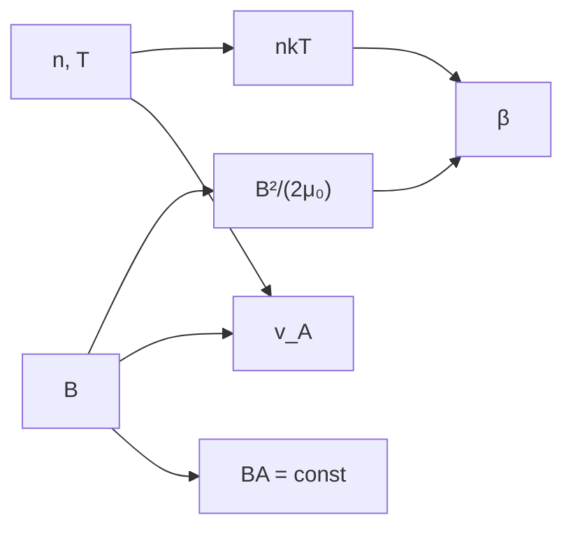

# B30-C05 — Campos magnéticos solares

<!-- nav:top -->
[🏠 Programa](../../../../README.md) · [📚 Bloque B30](../../../tronco-comun/B30-heliofisica-y-fisica-de-plasmas.md) · [← Anterior: B30-C04 — Manchas solares](../B30-C04-manchas-solares/CLASE.md) · [Siguiente: B30-C06 — Partículas cargadas y movimientos →](../B30-C06-particulas-cargadas-y-movimientos/CLASE.md)
<!-- /nav -->

## 1. Ubicación, nivel y alcance

Clase 5 del bloque B30. Nivel N3. El campo magnético organiza la atmósfera solar, pero su efecto depende del cociente entre presión de gas y presión magnética. Aquí calculas el **beta del plasma**, la **velocidad de Alfvén** y la energía magnética en fotosfera, cromosfera y corona, y verificas que el flujo se **conserva** en un tubo que se ensancha (`B ∝ 1/A`). Usas [B05](../../../tronco-comun/B05-fisica-fundamental-para-el-espacio.md) y [B30-C04](../B30-C04-manchas-solares/CLASE.md). Se suponen capas homogéneas de hidrógeno ionizado.

## 2. Por qué esta clase existe

Que el gas domine al campo en la fotosfera y el campo al gas en la corona explica por qué la corona se estructura en lazos y por qué las erupciones liberan energía magnética. La decisión central: **¿en qué capa manda el campo y cuánta energía guarda?**

## 3. Lo que podrás hacer al terminar

1. Calcular `β = nkT/(B²/(2μ₀))`.
2. Calcular `v_A = B/√(μ₀ρ)` por dos vías.
3. Aplicar la conservación del flujo `B₁A₁ = B₂A₂`.
4. Calcular la densidad de energía magnética `B²/(2μ₀)`.
5. Interpretar `β > 1` y `β < 1`.
6. Distinguir los valores ilustrativos.

La evidencia es la **ficha de los campos solares** del ejercicio 12 (sección 20).

## 4. Con qué llegas y cómo comprobarlo

1. ¿Qué es la presión magnética?
2. ¿Qué es la presión de un gas ideal `nkT`?
3. ¿Qué es la densidad de masa?
4. ¿Qué significa conservar el flujo?
5. ¿Qué es una velocidad de onda?

<details>
<summary>Ver respuestas</summary>

1. `B²/(2μ₀)`. 2. `nkT` para `n` partículas por volumen. 3. `ρ = n m_p` para hidrógeno. 4. Que `BA` es constante. 5. La rapidez con que viaja una perturbación.
</details>

Con cuatro o cinco aciertos, sigue; si no, repasa los prerrequisitos.

## 5. Un caso de contexto y casos de referencia

Con valores **ilustrativos** (sintéticos) de densidad, temperatura y campo en cada capa, el laboratorio da `β = 0,89` en la fotosfera, `0,035` en la cromosfera y `0,052` en la corona. Es el **ejemplo conductor**. La velocidad de Alfvén sube de `10,3 km/s` a `689,8 km/s`.

## 6. Vocabulario

El **beta del plasma** compara presiones. La **velocidad de Alfvén** es la rapidez de las ondas de tensión magnética. La **conservación del flujo** relaciona campo y sección. La **densidad de energía magnética** es `B²/(2μ₀)`. Un **tubo de flujo** es un haz de líneas de campo.

## 7. Modelo mental: una banda elástica en un fluido

Las líneas de campo son bandas elásticas: en un fluido denso (β grande) el gas las arrastra; en un gas muy tenue (β pequeño) las bandas mandan y el gas sigue su forma.



*Descripción textual:* la densidad, la temperatura y el campo dan las presiones y el beta; el campo y la densidad dan la velocidad de Alfvén; el campo se rige además por la conservación del flujo.

Analogía: bandas elásticas en un fluido. Límite: homogeneidad dentro de cada capa.

## 8. La explicación, paso a paso

### 8.1 Beta y velocidad de Alfvén

| capa (ilustrativa) | `n` (m⁻³) | `T` (K) | `B` (T) | `nkT` (Pa) | `B²/(2μ₀)` (Pa) | `β` | `v_A` (km/s) |
|---|---|---|---|---|---|---|---|
| fotosfera | 10²³ | 5772 | 0,15 | 7969 | 8952,5 | 0,890 | 10,3 |
| cromosfera | 10¹⁹ | 10⁴ | 0,01 | 1,38 | 39,79 | 0,0347 | 69,0 |
| corona | 10¹⁵ | 1,5 × 10⁶ | 0,001 | 0,0207 | 0,398 | 0,0520 | 689,8 |

### 8.2 Flujo conservado

Un tubo que parte de `0,15 T` y multiplica su sección por 10 queda en `1,5 × 10⁻² T`; por 100, `1,5 × 10⁻³ T`; por 10⁴, `1,5 × 10⁻⁵ T`. El campo cae como `1/A`.

### 8.3 Energía

Con `B = 0,01 T` la densidad de energía es `39,79 J/m³`; en un cubo de `10⁷ m` de lado (volumen `10²¹ m³`) hay `3,979 × 10²² J` (`3,979 × 10²⁹ erg`).

### 8.4 Lectura

En la fotosfera `β ≈ 1`: gas y campo se disputan el control. En cromosfera y corona `β ≪ 1`: el campo guía el plasma. La velocidad de Alfvén, de centenares de km/s en la corona, fija el tiempo que tarda una perturbación en recorrer un lazo.

## 9. Magnitudes, símbolos y unidades

| Símbolo | Qué es | Unidad | Valor / nota |
|---|---|---|---|
| `n` | densidad numérica de partículas | m⁻³ | ilustrativa |
| `β` | beta del plasma | — | `nkT/(B²/(2μ₀))` |
| `v_A` | velocidad de Alfvén | km/s | `B/√(μ₀ n m_p)` |
| `w_B` | densidad de energía magnética | J/m³ | `B²/(2μ₀)` |
| `A` | sección del tubo | m² | ilustrativa |

## 10. Convenciones y referencias

Se usa `nkT` con `n` el número total de partículas (para hidrógeno ionizado la presión sería `2nkT`, así que los `β` se duplicarían); todos los valores de capa son **ilustrativos**.

## 11. De dónde sale lo que afirmamos

| ID | Fuente | Localizador | Respalda | Estado |
|---|---|---|---|---|
| S1 | NIST, *Fundamental Physical Constants* (CODATA 2022) | https://physics.nist.gov/cuu/Constants/Table/allascii.txt | `G`, `k_B`, `u`, `c`, `μ₀`, `ε₀`, `e`, `m_e`, `m_p`, `σ_SB` | Consultada el 2026-11-09 |

Límites: no se consultó ningún modelo atmosférico solar; las densidades, temperaturas y campos son ilustrativos.

## 12. Cómo ver el beta

| Capa | `β` | `v_A` (km/s) |
|---|---|---|
| fotosfera | 0,890 | 10,3 |
| cromosfera | 0,035 | 69,0 |
| corona | 0,052 | 689,8 |

Descripción larga: el beta cae de ≈1 a ≈0,05 mientras la velocidad de Alfvén se multiplica por 67.

## 13. Ejemplo trabajado: velocidad de Alfvén en la cromosfera

**Paso 1 · Densidad.** `ρ = 10¹⁹ × 1,6726 × 10⁻²⁷ = 1,6726 × 10⁻⁸ kg/m³`.

**Paso 2 · Producto.** `μ₀ρ = 2,102 × 10⁻¹⁴`.

**Paso 3 · Raíz.** `√(2,102 × 10⁻¹⁴) = 1,450 × 10⁻⁷`.

**Paso 4 · Cociente.** `0,01/1,450 × 10⁻⁷ = 6,90 × 10⁴ m/s = 69,0 km/s`.

## 14. Distintas formas de describir el campo en la atmósfera

**Por beta:** quién manda. **Por velocidad de Alfvén:** escala de tiempo. **Por flujo:** cómo varía `B`. **Por energía:** cuánto se puede liberar.

## 15. Práctica guiada

**Ejercicio 1 · con los pasos indicados.** Beta de la corona. *Pasos:* `nkT/(B²/(2μ₀))`.

<details><summary>Solución comentada</summary>

`0,02071/0,39789 = 0,0520`.
</details>

**Ejercicio 2 · con una pista.** Velocidad de Alfvén en la cromosfera. *Pista:* ejemplo 13.

<details><summary>Solución comentada</summary>

`69,0 km/s`.
</details>

**Ejercicio 3 · casi autónomo.** Campo cuando la sección se multiplica por 10 desde `0,15 T`.

<details><summary>Solución comentada</summary>

`0,015 T`.
</details>

## 16. Práctica autónoma, transferencia e integrador

**Ejercicio 4.** Campo cuando la sección se multiplica por 10⁴.

<details><summary>Solución comentada</summary>

`1,5 × 10⁻⁵ T`.
</details>

**Ejercicio 5.** Densidad de energía magnética con `B = 0,01 T`.

<details><summary>Solución comentada</summary>

`39,79 J/m³`.
</details>

**Ejercicio 6.** Energía en un cubo de `10⁷ m` de lado.

<details><summary>Solución comentada</summary>

`39,79 × 10²¹ = 3,979 × 10²² J`.
</details>

**Ejercicio 7.** Cociente `v_A` corona / fotosfera.

<details><summary>Solución comentada</summary>

`689,8/10,3 ≈ 67`.
</details>

**Ejercicio 8.** ¿Quién domina en la fotosfera según `β = 0,89`?

<details><summary>Solución comentada</summary>

Ninguno: gas y campo tienen presiones comparables.
</details>

**Ejercicio 9 · transferencia.** **Transferencia.** Un compañero cita `β = 0,89` como el beta de la fotosfera. Responde con la sección 10.

<details><summary>Solución comentada</summary>

Es un valor con datos ilustrativos y con `nkT` de partículas totales; no es un dato consultado.
</details>

**Ejercicio 10 · transferencia.** **Transferencia.** Si la presión fuera `2nkT`, ¿cuánto sería el beta de la corona?

<details><summary>Solución comentada</summary>

El doble: `0,104`.
</details>

**Ejercicio 11 · transferencia.** **Transferencia.** ¿Por qué `v_A` crece al bajar la densidad?

<details><summary>Solución comentada</summary>

Porque `v_A ∝ 1/√ρ`.
</details>

**Ejercicio 12.** **Integrador.** Elabora tu *ficha de los campos solares*: tabla de `β` y `v_A`, flujo conservado y energía.

<details><summary>Solución comentada</summary>

Secciones 8.1–8.4.
</details>

**Ejercicio 12 · integrador.** **Integrador.** Elabora tu *ficha de los campos solares*: tabla de `β` y `v_A`, flujo conservado y energía.

<details><summary>Solución modelo</summary>

Secciones 8.1–8.4.
</details>

## 17. Laboratorio: beta, velocidad de Alfvén y flujo conservado

El script [campos.py](campos.py) calcula `β`, `v_A` y la energía magnética de tres capas y verifica `B₂ = B₁A₁/A₂` (**comprueba** `v_A` por dos vías a `10⁻¹²`).

**Datos:** `k_B`, `μ₀`, `m_p` de NIST; densidades, temperaturas y campos **ilustrativos**. **Predice antes de ejecutar:** ¿qué `β` tendrá la corona? (≈0,05.) **Ejecución del 2026-11-09 (Python 3.12.9):**

```text
Python 3.12.9 (biblioteca estandar)
capa (ilustrativa)   n [m-3]     T [K]    B [T]  p = n k T [Pa]  p_mag [Pa]      beta  v_A [km/s]
fotosfera            1.0e+23      5772     0.15      7.9691e+03  8.9525e+03    0.8902        10.3
cromosfera           1.0e+19     1e+04     0.01      1.3806e+00  3.9789e+01    0.0347        69.0
corona               1.0e+15   1.5e+06    0.001      2.0710e-02  3.9789e-01    0.0520       689.8
tubo con area x10: B = 1.500e-02 T (B ~ 1/A)
tubo con area x100: B = 1.500e-03 T (B ~ 1/A)
tubo con area x10000: B = 1.500e-05 T (B ~ 1/A)
densidad de energia magnetica con B = 0.01 T: 39.79 J/m3 ; en (1e7 m)^3 = 3.979e+22 J = 3.979e+29 erg
Pruebas superadas.
```

```bash
python programa/clases/B30/B30-C05-campos-magneticos-solares/campos.py
```

**Límites:** capas homogéneas, hidrógeno ionizado.

## 18. Errores frecuentes y cómo corregirlos

**Confundir `β` y su inverso.** Se corrige con 8.4.

**Olvidar el 2 de `B²/(2μ₀)`.** Se corrige con el ejercicio 5.

**Usar `n` por pares sin avisar.** Se corrige con la sección 10.

**Tomar los campos por medidos.** Se corrige con la sección 10.

## 19. Cómo sabrás que vas bien

Tras 8.1: ¿en qué capa domina el campo? Si dudas, ejemplo 13. Tras el laboratorio: ¿qué comprueba? (`v_A` por dos vías).

## 20. Qué entregas y cómo se evalúa

El producto es tu **ficha de los campos solares** (ejercicio 12).

| Criterio | Inicial | En desarrollo | Logrado | Destacado |
|---|---|---|---|---|
| Conceptos | Los confunde | Parciales | `β`, `v_A`, flujo | Explica quién manda en cada capa |
| Cálculo | Sin unidades | Con errores | Tablas completas | Analiza el factor 2 |
| Numérico | Sin comprobar | Un caso | Dos vías | Interpreta el cambio de `v_A` |
| Fuentes | Sin fuente | Sin fecha | S2 con fecha | Declara los valores ilustrativos |
| Límites | No los nombra | Uno | Tres | Discute qué falta del modelo |

**Condiciones críticas (no se compensan con promedio):** rotular los valores ilustrativos; declarar la convención de la presión; citar solo lo consultado.

## 21. Ética, seguridad y límites

Clase educativa: no es un modelo atmosférico. Accesibilidad: tablas equivalentes a las gráficas, fórmulas en texto, ejercicios sin conexión.

## 22. Para cerrar y seguir

El beta cae de `0,89` en la fotosfera a `0,05` en la corona y `v_A` sube de `10` a `690 km/s`. Queda una pregunta: ¿cómo se mueve una partícula cargada en esos campos?

**Glosario español–inglés.** beta del plasma · *plasma beta*; velocidad de Alfvén · *Alfvén speed*; flujo magnético · *magnetic flux*; tubo de flujo · *flux tube*; densidad de energía · *energy density*.

**Continuidad.** [B30-C06](../B30-C06-particulas-cargadas-y-movimientos/CLASE.md) estudia el movimiento de partículas cargadas.

**Referencias:** ver sección 11.

<!-- nav:bottom -->
---

[← Anterior: B30-C04 — Manchas solares](../B30-C04-manchas-solares/CLASE.md) · [📚 Bloque B30](../../../tronco-comun/B30-heliofisica-y-fisica-de-plasmas.md) · [Siguiente: B30-C06 — Partículas cargadas y movimientos →](../B30-C06-particulas-cargadas-y-movimientos/CLASE.md)
<!-- /nav -->
