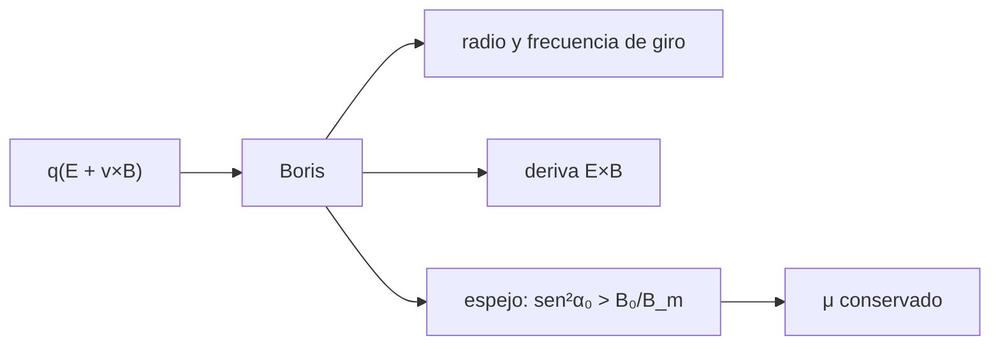

# B30-C06 — Partículas cargadas y movimientos

<!-- nav:top -->
[🏠 Programa](../../../../README.md) · [📚 Bloque B30](../../../tronco-comun/B30-heliofisica-y-fisica-de-plasmas.md) · [← Anterior: B30-C05 — Campos magnéticos solares](../B30-C05-campos-magneticos-solares/CLASE.md) · [Siguiente: B30-C07 — Longitud de Debye y plasma →](../B30-C07-longitud-de-debye-y-plasma/CLASE.md)
<!-- /nav -->

## 1. Ubicación, nivel y alcance

Clase 6 del bloque B30. Nivel N3. Una partícula cargada en un campo magnético gira, se desplaza con una deriva si hay un campo eléctrico y rebota en un espejo magnético. Aquí integras el movimiento con el **integrador de Boris**, comparas con el **radio de Larmor**, la **frecuencia de giro** y la **deriva E×B**, y pruebas la condición del **espejo**. Usas [B05](../../../tronco-comun/B05-fisica-fundamental-para-el-espacio.md) y [B11-C08](../../B11/B11-C08-integradores-de-paso-adaptativo/CLASE.md). Se supone movimiento no relativista.

## 2. Por qué esta clase existe

El movimiento de las partículas explica cómo se atrapan en los cinturones, cómo derivan y cómo se aceleran. La decisión central: **¿cuándo queda atrapada una partícula y cuánto vale su radio de giro?**

## 3. Lo que podrás hacer al terminar

1. Integrar con Boris y comprobar que conserva `|v|` en un campo magnético puro.
2. Calcular `ω = |q|B/m`, el periodo y el radio de Larmor.
3. Comprobar la deriva `E/B`.
4. Aplicar la condición del espejo `sen²α₀ > B₀/B_m`.
5. Comparar protones y electrones.
6. Reconocer el rango de validez no relativista.

La evidencia es la **ficha del movimiento de una partícula cargada** del ejercicio 12 (sección 20).

## 4. Con qué llegas y cómo comprobarlo

1. ¿Qué es la fuerza de Lorentz?
2. ¿Qué es una frecuencia ciclotrónica?
3. ¿Qué es un invariante adiabático?
4. ¿Qué es un producto vectorial?
5. ¿Cuándo es válida la mecánica no relativista?

<details>
<summary>Ver respuestas</summary>

1. `q(E + v×B)`. 2. La de giro en un campo magnético. 3. Una cantidad que se conserva si el campo varía lentamente. 4. Un vector perpendicular a los dos. 5. Cuando `v ≪ c`.
</details>

Con cuatro o cinco aciertos, sigue; si no, repasa los prerrequisitos.

## 5. Un caso de contexto y casos de referencia

Un protón de 1 keV en un campo ilustrativo de `10⁻⁷ T` (100 nT) tiene `v = 437,7 km/s`, `ω = 9,579 rad/s`, periodo `0,656 s` y radio de Larmor `45,69 km`. Es el **ejemplo conductor**. Un electrón de la misma energía tiene `v = 18 755 km/s` (β = 0,0626) y radio `1,07 km`.

## 6. Vocabulario

El **radio de Larmor** `r_L = mv_⊥/(|q|B)`. La **frecuencia de giro** `ω = |q|B/m`. La **deriva E×B** `E/B`. El **momento magnético** `μ = mv_⊥²/(2B)` se conserva. El **espejo magnético** refleja partículas con ángulo de paso grande. El **integrador de Boris** separa la aceleración eléctrica y la rotación magnética.

## 7. Modelo mental: un trompo en una pendiente

La partícula es como una canica sobre un carril cónico que se cierra: gira alrededor de la línea de campo y, si el campo crece lo bastante, rebota.



*Descripción textual:* la fuerza de Lorentz integrada con Boris da el giro, la deriva y el rebote en el espejo, con el momento magnético conservado.

Analogía: una canica en un carril que se estrecha. Límite: campos suaves y no relativistas.

## 8. La explicación, paso a paso

### 8.1 Giro

| partícula (1 keV, `B = 100 nT`) | `v` (km/s) | `r_L` (km) |
|---|---|---|
| protón | 437,7 | 45,69 |
| electrón | 18 755 | 1,07 |

Para el protón: `ω = 9,5788 rad/s` y periodo `0,656 s`.

### 8.2 Boris frente al análisis

Con 200 pasos por giro durante 3 giros el radio medio es `45,6996 km` (analítico `45,6939 km`), con variación relativa de `2,5 × 10⁻⁴`. El periodo medido es `0,6592 s` frente a `0,6559 s`: la diferencia de `0,0033 s` es un paso de tiempo.

### 8.3 Deriva E×B

Con `E = 10⁻³ V/m`, la velocidad media en x es `10,0008 km/s` frente a `E/B = 10,0000 km/s` (cociente `1,00008`).

### 8.4 Espejo

Con razón de espejo `B_m/B₀ = 1,5` el ángulo crítico cumple `sen²α₀ = 2/3` (`α₀ = 54,7°`):

| `α₀` | `sen²α₀` | reflejada (numérico) | reflejada (teoría) |
|---|---|---|---|
| 30° | 0,2500 | no | no |
| 50° | 0,5868 | no | no |
| 54° | 0,6545 | no | no |
| 56° | 0,6873 | sí | sí |
| 60° | 0,7500 | sí | sí |

### 8.5 Lectura

El radio de giro del electrón es 43 veces menor que el del protón a la misma energía (`√(m_p/m_e)`). La deriva E×B no depende de la carga ni de la masa. Las partículas con ángulo de paso grande quedan atrapadas.

## 9. Magnitudes, símbolos y unidades

| Símbolo | Qué es | Unidad | Valor / nota |
|---|---|---|---|
| `q`, `m` | carga y masa | C; kg | S1 |
| `B` | campo magnético | T | `10⁻⁷` (ilustrativo) |
| `ω` | frecuencia de giro | rad/s | `|q|B/m` |
| `r_L` | radio de Larmor | km | `mv_⊥/(|q|B)` |
| `v_E` | deriva E×B | km/s | `E/B` |
| `α₀` | ángulo de paso | ° | ver 8.4 |

## 10. Convenciones y referencias

No relativista; `E`, `B` y `R_m = 1,5` son **ilustrativos**; semilla `20261109` no se usa (el laboratorio es determinista).

## 11. De dónde sale lo que afirmamos

| ID | Fuente | Localizador | Respalda | Estado |
|---|---|---|---|---|
| S1 | NIST, *Fundamental Physical Constants* (CODATA 2022) | https://physics.nist.gov/cuu/Constants/Table/allascii.txt | `e`, `m_p`, `m_e`, `c` | Consultada el 2026-11-09 |

Límites: los campos son ilustrativos; el integrador de Boris es un método estándar, no una fuente consultada.

## 12. Cómo ver el movimiento

| Magnitud | Valor |
|---|---|
| `r_L` protón | 45,69 km |
| `r_L` electrón | 1,07 km |
| deriva E×B | 10,0 km/s |
| ángulo crítico (`R_m = 1,5`) | 54,7° |

Descripción larga: el electrón gira en círculos 43 veces menores y ambos derivan igual por E×B.

## 13. Ejemplo trabajado: frecuencia y radio del protón

**Paso 1 · Frecuencia.** `ω = eB/m_p = 1,602 × 10⁻¹⁹ × 10⁻⁷/1,6726 × 10⁻²⁷ = 9,579 rad/s`.

**Paso 2 · Periodo.** `T = 2π/ω = 0,656 s`.

**Paso 3 · Velocidad.** `v = √(2E/m) = 4,377 × 10⁵ m/s`.

**Paso 4 · Radio.** `r_L = v/ω = 45,7 km`.

## 14. Distintas formas de describir una partícula en un campo

**Por giro:** `ω`, `r_L`. **Por deriva:** `E/B`. **Por invariante:** `μ`. **Por geometría:** espejo.

## 15. Práctica guiada

**Ejercicio 1 · con los pasos indicados.** Frecuencia de giro de un protón en `100 nT`. *Pasos:* `eB/m_p`.

<details><summary>Solución comentada</summary>

`9,579 rad/s`.
</details>

**Ejercicio 2 · con una pista.** Periodo. *Pista:* `2π/ω`.

<details><summary>Solución comentada</summary>

`0,656 s`.
</details>

**Ejercicio 3 · casi autónomo.** Radio de Larmor del protón de 1 keV.

<details><summary>Solución comentada</summary>

`45,69 km`.
</details>

## 16. Práctica autónoma, transferencia e integrador

**Ejercicio 4.** Cociente de radios protón / electrón a la misma energía.

<details><summary>Solución comentada</summary>

`45,69/1,07 ≈ 43 = √(m_p/m_e)`.
</details>

**Ejercicio 5.** Deriva con `E = 10⁻³ V/m` y `B = 10⁻⁷ T`.

<details><summary>Solución comentada</summary>

`10⁴ m/s = 10 km/s`.
</details>

**Ejercicio 6.** Ángulo crítico para `R_m = 1,5`.

<details><summary>Solución comentada</summary>

`asen√(1/1,5) = 54,7°`.
</details>

**Ejercicio 7.** Ángulo crítico para `R_m = 4`.

<details><summary>Solución comentada</summary>

`asen√0,25 = 30°`.
</details>

**Ejercicio 8.** Si `B` se duplica con `μ` conservado, ¿cómo cambia `v_⊥`?

<details><summary>Solución comentada</summary>

`v_⊥² ∝ B`: sube un factor `√2`.
</details>

**Ejercicio 9 · transferencia.** **Transferencia.** ¿Es válido el tratamiento no relativista para el electrón de 1 keV (β = 0,0626)?

<details><summary>Solución comentada</summary>

Sí; la corrección es del orden de `β²/2 ≈ 0,2 %`.
</details>

**Ejercicio 10 · transferencia.** **Transferencia.** ¿Por qué Boris conserva `|v|` en un campo magnético puro?

<details><summary>Solución comentada</summary>

Porque la rotación es una transformación que conserva la norma.
</details>

**Ejercicio 11 · transferencia.** **Transferencia.** El periodo medido difiere un 0,5 % del analítico. ¿Es un error del integrador?

<details><summary>Solución comentada</summary>

No: es la resolución de un paso (`T/200`).
</details>

**Ejercicio 12.** **Integrador.** Elabora tu *ficha del movimiento de una partícula cargada*: giro, deriva, espejo y comparación con el análisis.

<details><summary>Solución comentada</summary>

Secciones 8.1–8.5.
</details>

**Ejercicio 12 · integrador.** **Integrador.** Elabora tu *ficha del movimiento de una partícula cargada*: giro, deriva, espejo y comparación con el análisis.

<details><summary>Solución modelo</summary>

Secciones 8.1–8.5.
</details>

## 17. Laboratorio: Boris, deriva y espejo

El script [boris.py](boris.py) integra con Boris el giro, la deriva E×B y el espejo (**comprueba** radio dentro de `10⁻³`, periodo dentro del 1 %, deriva a `10⁻³` y `|v|` a `10⁻¹²`).

**Datos:** `e`, `m_p`, `m_e`, `c` de NIST; campos **ilustrativos**. **Predice antes de ejecutar:** ¿reflejará el espejo a 54°? (no; a 56° sí.) **Ejecución del 2026-11-09 (Python 3.12.9):**

```text
Python 3.12.9 (biblioteca estandar)
proton de 1 keV en B = 1e-07 T: v = 437.69 km/s ; omega = 9.5788 rad/s ; periodo = 0.656 s ; radio de Larmor = 45.69 km
electron de 1 keV: v = 18755 km/s (beta = 0.0626) ; radio de Larmor = 1.07 km
3 giros con 200 pasos por giro: radio medio = 45.6996 km (r_L = 45.6939 km) ; variacion relativa = 2.47e-04
periodo numerico = 0.6592 s ; analitico = 0.6559 s
deriva E x B: velocidad media en x = 10.0008 km/s ; analitica E/B = 10.0000 km/s ; cociente = 1.00008
alpha_0 [deg]  sen^2 alpha_0    1/R_m  reflejada (numerico)  reflejada (teoria)
         30.0         0.2500   0.6667                 False               False
         40.0         0.4132   0.6667                 False               False
         50.0         0.5868   0.6667                 False               False
         54.0         0.6545   0.6667                 False               False
         56.0         0.6873   0.6667                  True                True
         60.0         0.7500   0.6667                  True                True
Pruebas superadas.
```

```bash
python programa/clases/B30/B30-C06-particulas-cargadas-y-movimientos/boris.py
```

**Límites:** no relativista, campos suaves.

## 18. Errores frecuentes y cómo corregirlos

**Confundir `r_L` del protón y del electrón.** Se corrige con el ejercicio 4.

**Olvidar que E×B no depende de la carga.** Se corrige con 8.5.

**Medir un periodo sin resolución.** Se corrige con el ejercicio 11.

**Usar Boris con pasos enormes.** Se corrige con el laboratorio.

## 19. Cómo sabrás que vas bien

Tras 8.1: ¿qué partícula gira más cerrado? (el electrón). Tras 8.4: ¿a qué ángulo se refleja? Tras el laboratorio: ¿qué comprueba? (la conservación de `|v|`).

## 20. Qué entregas y cómo se evalúa

El producto es tu **ficha del movimiento de una partícula cargada** (ejercicio 12).

| Criterio | Inicial | En desarrollo | Logrado | Destacado |
|---|---|---|---|---|
| Conceptos | Los confunde | Parciales | giro, deriva, espejo | Explica el invariante |
| Cálculo | Sin unidades | Con errores | Tablas completas | Calcula otros `R_m` |
| Numérico | Sin comprobar | Un caso | Contraste con el análisis | Interpreta el periodo |
| Fuentes | Sin fuente | Sin fecha | S1 con fecha | Declara los campos ilustrativos |
| Límites | No los nombra | Uno | Tres | Discute qué falta del modelo |

**Condiciones críticas (no se compensan con promedio):** rotular los campos ilustrativos; no presentar el espejo como los cinturones reales; citar solo lo consultado.

## 21. Ética, seguridad y límites

Clase educativa: no es un modelo de magnetosfera. Accesibilidad: tablas equivalentes a las gráficas, fórmulas en texto, ejercicios sin conexión.

## 22. Para cerrar y seguir

Un protón de 1 keV en 100 nT gira con radio `45,7 km` y un espejo de `R_m = 1,5` refleja a partir de `54,7°`. Queda una pregunta: ¿cuándo se comporta un conjunto de cargas como un plasma?

**Glosario español–inglés.** radio de Larmor · *Larmor radius*; deriva E×B · *E×B drift*; espejo magnético · *magnetic mirror*; momento magnético · *magnetic moment*; integrador de Boris · *Boris pusher*.

**Continuidad.** [B30-C07](../B30-C07-longitud-de-debye-y-plasma/CLASE.md) define el plasma con la longitud de Debye.

**Referencias:** ver sección 11.

<!-- nav:bottom -->
---

[← Anterior: B30-C05 — Campos magnéticos solares](../B30-C05-campos-magneticos-solares/CLASE.md) · [📚 Bloque B30](../../../tronco-comun/B30-heliofisica-y-fisica-de-plasmas.md) · [Siguiente: B30-C07 — Longitud de Debye y plasma →](../B30-C07-longitud-de-debye-y-plasma/CLASE.md)
<!-- /nav -->
