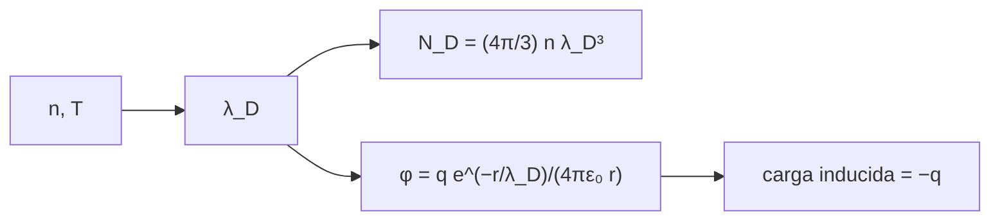

# B30-C07 — Longitud de Debye y plasma

<!-- nav:top -->
[🏠 Programa](../../../../README.md) · [📚 Bloque B30](../../../tronco-comun/B30-heliofisica-y-fisica-de-plasmas.md) · [← Anterior: B30-C06 — Partículas cargadas y movimientos](../B30-C06-particulas-cargadas-y-movimientos/CLASE.md) · [Siguiente: B30-C08 — Frecuencias y ondas de plasma →](../B30-C08-frecuencias-y-ondas-de-plasma/CLASE.md)
<!-- /nav -->

## 1. Ubicación, nivel y alcance

Clase 7 del bloque B30. Nivel N3. Un conjunto de cargas es un plasma solo si apantalla los campos eléctricos en una distancia corta frente a su tamaño y contiene muchas partículas en esa distancia. Aquí calculas la **longitud de Debye** `λ_D`, el **número de partículas** `N_D` en la esfera de Debye en cuatro entornos y resuelves numéricamente el **potencial apantallado** de una carga de prueba. Usas [B05](../../../tronco-comun/B05-fisica-fundamental-para-el-espacio.md) y el algoritmo de Thomas para sistemas tridiagonales. Se supone una respuesta lineal y estática.

## 2. Por qué esta clase existe

Sin apantallamiento no hay plasma, y sin muchas partículas en la esfera de Debye no hay comportamiento colectivo. La decisión central: **¿cuándo un gas ionizado es un plasma?**

## 3. Lo que podrás hacer al terminar

1. Calcular `λ_D = √(ε₀kT/(ne²))`.
2. Calcular `N_D = (4π/3)nλ_D³`.
3. Resolver `u'' = u/λ_D²` numéricamente y compararlo con `e^(−r/λ_D)`.
4. Comprobar la carga de apantallamiento `−q`.
5. Reconocer las escalas de `λ_D` con `n` y `T`.
6. Aplicar el criterio de plasma.

La evidencia es la **ficha de la longitud de Debye** del ejercicio 12 (sección 20).

## 4. Con qué llegas y cómo comprobarlo

1. ¿Qué es la ley de Coulomb?
2. ¿Qué es la ecuación de Poisson?
3. ¿Qué es una distribución de Boltzmann?
4. ¿Qué es un sistema tridiagonal?
5. ¿Qué es una densidad de carga?

<details>
<summary>Ver respuestas</summary>

1. `F = q₁q₂/(4πε₀r²)`. 2. `∇²φ = −ρ/ε₀`. 3. `n ∝ e^(−E/kT)`. 4. Uno con tres diagonales no nulas. 5. Carga por unidad de volumen.
</details>

Con cuatro o cinco aciertos, sigue; si no, repasa los prerrequisitos.

## 5. Un caso de contexto y casos de referencia

Con entornos **ilustrativos** (viento solar a 1 au: `5 × 10⁶ m⁻³` y `10⁵ K`; corona: `10¹⁵ m⁻³` y `1,5 × 10⁶ K`; ionosfera F: `10¹² m⁻³` y `1500 K`; laboratorio: `10¹⁸ m⁻³` y `10⁵ K`), la longitud de Debye va de `22 μm` a `9,76 m`. Es el **ejemplo conductor**.

## 6. Vocabulario

La **longitud de Debye** es la escala de apantallamiento. El **parámetro de plasma** `N_D` cuenta las partículas en la esfera de Debye. El **apantallamiento** es la cancelación del campo de una carga por las demás. La **cuasineutralidad** es la neutralidad a escalas mayores que `λ_D`.

## 7. Modelo mental: una multitud alrededor de una persona

Una persona con un cartel llama la atención solo de los más cercanos: la multitud la rodea y su señal se apaga a unos metros. La longitud de Debye es esa distancia.



*Descripción textual:* la densidad y la temperatura dan la longitud de Debye, de la que salen el número de partículas, el potencial apantallado y la carga inducida.

Analogía: una multitud alrededor de una persona. Límite: respuesta lineal y estática.

## 8. La explicación, paso a paso

### 8.1 Escalas

| entorno (ilustrativo) | `n` (m⁻³) | `T` (K) | `λ_D` (m) | `N_D` |
|---|---|---|---|---|
| viento solar (1 au) | 5 × 10⁶ | 10⁵ | 9,7593 | 1,9468 × 10¹⁰ |
| corona | 10¹⁵ | 1,5 × 10⁶ | 2,6727 × 10⁻³ | 7,9973 × 10⁷ |
| ionosfera F | 10¹² | 1500 | 2,6727 × 10⁻³ | 7,9973 × 10⁴ |
| plasma de laboratorio | 10¹⁸ | 10⁵ | 2,1823 × 10⁻⁵ | 4,3532 × 10⁴ |

La corona y la ionosfera F de este ejemplo tienen el mismo `T/n` y por eso el mismo `λ_D`, pero `N_D` es mil veces menor en la ionosfera por su menor densidad.

### 8.2 Potencial apantallado

Con `u = rφ`, `u'' = u/λ_D²`, `u(0) = 1`, `u(R) = 0`, resuelto con diferencias finitas:

| `r/λ_D` | `u` numérico | `e^(−r/λ_D)` | dif. relativa |
|---|---|---|---|
| 0,5 | 0,606531 | 0,606531 | 5,2 × 10⁻⁷ |
| 1 | 0,367880 | 0,367879 | 1,0 × 10⁻⁶ |
| 2 | 0,135336 | 0,135335 | 2,1 × 10⁻⁶ |
| 4 | 0,018316 | 0,018316 | 4,2 × 10⁻⁶ |

### 8.3 Carga inducida

La integral de la densidad inducida da `−1,00000 q`: el plasma apantalla exactamente la carga de prueba.

### 8.4 Lectura

Un gas ionizado es un plasma si `L ≫ λ_D` y `N_D ≫ 1`. En el viento solar `λ_D ≈ 10 m` y `N_D ≈ 2 × 10¹⁰`: es un plasma casi no colisional a todas las escalas de interés.

## 9. Magnitudes, símbolos y unidades

| Símbolo | Qué es | Unidad | Valor / nota |
|---|---|---|---|
| `λ_D` | longitud de Debye | m | `√(ε₀kT/(ne²))` |
| `N_D` | partículas en la esfera de Debye | — | `(4π/3)nλ_D³` |
| `φ` | potencial | V | `q e^(−r/λ_D)/(4πε₀ r)` |
| `u` | `rφ` normalizado | — | ver 8.2 |

## 10. Convenciones y referencias

Plasma de electrones con iones de fondo, respuesta lineal (`eφ ≪ kT`), un solo tipo de carga móvil; los cuatro entornos son **ilustrativos**.

## 11. De dónde sale lo que afirmamos

| ID | Fuente | Localizador | Respalda | Estado |
|---|---|---|---|---|
| S1 | NIST, *Fundamental Physical Constants* (CODATA 2022) | https://physics.nist.gov/cuu/Constants/Table/allascii.txt | `G`, `k_B`, `u`, `c`, `μ₀`, `ε₀`, `e`, `m_e`, `m_p`, `σ_SB` | Consultada el 2026-11-09 |

Límites: los entornos son ilustrativos y no se contrastan con mediciones.

## 12. Cómo ver el apantallamiento

| `r/λ_D` | `φ r/(q/4πε₀)` |
|---|---|
| 0,5 | 0,607 |
| 1 | 0,368 |
| 2 | 0,135 |
| 4 | 0,018 |

Descripción larga: el potencial decae exponencialmente con la distancia en unidades de `λ_D`.

## 13. Ejemplo trabajado: longitud de Debye del viento solar

**Paso 1 · Energía térmica.** `kT = 1,3806 × 10⁻²³ × 10⁵ = 1,3806 × 10⁻¹⁸ J`.

**Paso 2 · Numerador.** `ε₀kT = 1,2224 × 10⁻²⁹`.

**Paso 3 · Denominador.** `ne² = 5 × 10⁶ × 2,567 × 10⁻³⁸ = 1,2835 × 10⁻³¹`.

**Paso 4 · Cociente y raíz.** `√95,24 = 9,76 m`.

## 14. Distintas formas de describir un plasma

**Por escala:** `λ_D`. **Por número:** `N_D`. **Por respuesta:** apantallamiento. **Por neutralidad:** cuasineutralidad.

## 15. Práctica guiada

**Ejercicio 1 · con los pasos indicados.** Longitud de Debye del viento solar ilustrativo. *Pasos:* ejemplo 13.

<details><summary>Solución comentada</summary>

`9,76 m`.
</details>

**Ejercicio 2 · con una pista.** Cómo cambia `λ_D` si `T` se cuadruplica. *Pista:* `λ_D ∝ √T`.

<details><summary>Solución comentada</summary>

Se duplica.
</details>

**Ejercicio 3 · casi autónomo.** Cómo cambia si `n` se cuadruplica.

<details><summary>Solución comentada</summary>

Se reduce a la mitad.
</details>

## 16. Práctica autónoma, transferencia e integrador

**Ejercicio 4.** `N_D` de la corona ilustrativa.

<details><summary>Solución comentada</summary>

`4,18879 × 10¹⁵ × (2,6727 × 10⁻³)³ = 7,997 × 10⁷`.
</details>

**Ejercicio 5.** Fracción del potencial no apantallado en `r = λ_D`.

<details><summary>Solución comentada</summary>

`e⁻¹ = 0,368`.
</details>

**Ejercicio 6.** Fracción a `r = 4λ_D`.

<details><summary>Solución comentada</summary>

`e⁻⁴ = 0,0183`.
</details>

**Ejercicio 7.** Carga total inducida por una carga `q`.

<details><summary>Solución comentada</summary>

`−q`.
</details>

**Ejercicio 8.** Cociente de `λ_D` entre viento solar y plasma de laboratorio.

<details><summary>Solución comentada</summary>

`9,7593/2,1823 × 10⁻⁵ = 4,47 × 10⁵`.
</details>

**Ejercicio 9 · transferencia.** **Transferencia.** Un compañero afirma que la ionosfera tiene `λ_D = 2,7 mm`. Responde con la sección 10.

<details><summary>Solución comentada</summary>

Es con valores ilustrativos de `n` y `T`; no se consultó una medición.
</details>

**Ejercicio 10 · transferencia.** **Transferencia.** ¿Por qué `N_D ≫ 1` es una condición independiente de `L ≫ λ_D`?

<details><summary>Solución comentada</summary>

Porque `L ≫ λ_D` es un criterio de escala y `N_D` cuenta cuántas partículas apantallan; un gas puede cumplir uno y no el otro.
</details>

**Ejercicio 11 · transferencia.** **Transferencia.** ¿Qué pasa con el apantallamiento a escalas menores que `λ_D`?

<details><summary>Solución comentada</summary>

Se pierde: el campo de la carga es el de Coulomb.
</details>

**Ejercicio 12.** **Integrador.** Elabora tu *ficha de la longitud de Debye*: tabla de escalas, apantallamiento y criterio de plasma.

<details><summary>Solución comentada</summary>

Secciones 8.1–8.4.
</details>

**Ejercicio 12 · integrador.** **Integrador.** Elabora tu *ficha de la longitud de Debye*: tabla de escalas, apantallamiento y criterio de plasma.

<details><summary>Solución modelo</summary>

Secciones 8.1–8.4.
</details>

## 17. Laboratorio: Debye y apantallamiento

El script [debye.py](debye.py) calcula `λ_D` y `N_D` y resuelve el potencial apantallado con el algoritmo de Thomas (**comprueba** `10⁻³` en `r = 0,5; 1; 2; 4 λ_D` y la carga inducida entre `−0,99q` y `−1,01q`).

**Datos:** `ε₀`, `k_B`, `e` de NIST; entornos **ilustrativos**. **Predice antes de ejecutar:** ¿cuánto vale `λ_D` en el viento solar ilustrativo? (≈10 m.) **Ejecución del 2026-11-09 (Python 3.12.9):**

```text
Python 3.12.9 (biblioteca estandar)
entorno (ilustrativo)      n [m-3]     T [K]  lambda_D [m]          N_D
viento solar (1 au)        5.0e+06     1e+05    9.7593e+00   1.9468e+10
corona                     1.0e+15   1.5e+06    2.6727e-03   7.9973e+07
ionosfera F                1.0e+12   1.5e+03    2.6727e-03   7.9973e+04
plasma de laboratorio      1.0e+18     1e+05    2.1823e-05   4.3532e+04
r/lambda_D   u numerico  u analitico = exp(-r/lambda)  dif. relativa
       0.5     0.606531                      0.606531       5.21e-07
       1.0     0.367880                      0.367879       1.04e-06
       2.0     0.135336                      0.135335       2.08e-06
       4.0     0.018316                      0.018316       4.17e-06
carga inducida total = -1.00000 q (esperada -1)
Pruebas superadas.
```

```bash
python programa/clases/B30/B30-C07-longitud-de-debye-y-plasma/debye.py
```

**Límites:** respuesta lineal y estática.

## 18. Errores frecuentes y cómo corregirlos

**Olvidar la raíz.** Se corrige con los ejercicios 2 y 3.

**Confundir `λ_D` con el radio de Larmor.** Se corrige con la sección 6.

**Creer que a escalas menores hay apantallamiento.** Se corrige con el ejercicio 11.

**Tomar los entornos por medidos.** Se corrige con la sección 10.

## 19. Cómo sabrás que vas bien

Tras 8.1: ¿qué entorno tiene mayor `λ_D`? Si dudas, ejemplo 13. Tras el laboratorio: ¿qué comprueba? (el potencial frente a la forma cerrada).

## 20. Qué entregas y cómo se evalúa

El producto es tu **ficha de la longitud de Debye** (ejercicio 12).

| Criterio | Inicial | En desarrollo | Logrado | Destacado |
|---|---|---|---|---|
| Conceptos | Los confunde | Parciales | `λ_D`, `N_D`, apantallamiento | Explica el criterio |
| Cálculo | Sin unidades | Con errores | Tablas completas | Estima el efecto de `n` y `T` |
| Numérico | Sin comprobar | Un caso | Numérico frente a analítico | Interpreta la carga inducida |
| Fuentes | Sin fuente | Sin fecha | S1 con fecha | Declara los entornos ilustrativos |
| Límites | No los nombra | Uno | Tres | Discute qué falta del modelo |

**Condiciones críticas (no se compensan con promedio):** rotular los entornos ilustrativos; no afirmar mediciones; citar solo lo consultado.

## 21. Ética, seguridad y límites

Clase educativa: no caracteriza un plasma real. Accesibilidad: tablas equivalentes a las gráficas, fórmulas en texto, ejercicios sin conexión.

## 22. Para cerrar y seguir

El viento solar ilustrativo tiene `λ_D = 9,8 m` y `N_D = 2 × 10¹⁰`, y el potencial apantallado sigue `e^(−r/λ_D)`. Queda una pregunta: ¿qué ondas puede sostener un plasma?

**Glosario español–inglés.** longitud de Debye · *Debye length*; apantallamiento · *screening*; cuasineutralidad · *quasineutrality*; parámetro de plasma · *plasma parameter*; esfera de Debye · *Debye sphere*.

**Continuidad.** [B30-C08](../B30-C08-frecuencias-y-ondas-de-plasma/CLASE.md) estudia las frecuencias y ondas de un plasma.

**Referencias:** ver sección 11.

<!-- nav:bottom -->
---

[← Anterior: B30-C06 — Partículas cargadas y movimientos](../B30-C06-particulas-cargadas-y-movimientos/CLASE.md) · [📚 Bloque B30](../../../tronco-comun/B30-heliofisica-y-fisica-de-plasmas.md) · [Siguiente: B30-C08 — Frecuencias y ondas de plasma →](../B30-C08-frecuencias-y-ondas-de-plasma/CLASE.md)
<!-- /nav -->
