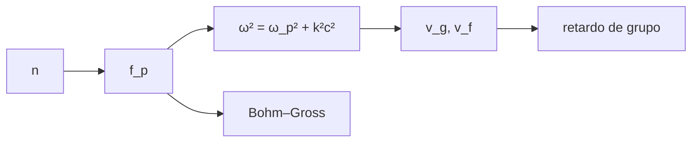

# B30-C08 — Frecuencias y ondas de plasma

<!-- nav:top -->
[🏠 Programa](../../../../README.md) · [📚 Bloque B30](../../../tronco-comun/B30-heliofisica-y-fisica-de-plasmas.md) · [← Anterior: B30-C07 — Longitud de Debye y plasma](../B30-C07-longitud-de-debye-y-plasma/CLASE.md) · [Siguiente: B30-C09 — Magnetohidrodinámica →](../B30-C09-magnetohidrodinamica/CLASE.md)
<!-- /nav -->

## 1. Ubicación, nivel y alcance

Clase 8 del bloque B30. Nivel N3. Un plasma responde a una perturbación con una oscilación propia, la **frecuencia de plasma**, y esa frecuencia fija qué ondas electromagnéticas lo atraviesan y cuáles se reflejan. Aquí calculas `f_p`, la **girofrecuencia**, la **relación de dispersión** `ω² = ω_p² + k²c²`, el **retardo de grupo** de una señal en el viento solar (la misma constante de dispersión de [B28-C01](../../B28/B28-C01-fundamentos-de-mensajeros-astronomicos/CLASE.md)) y la corrección de **Bohm–Gross**. Usas [B05](../../../tronco-comun/B05-fisica-fundamental-para-el-espacio.md). Se supone plasma frío para la onda electromagnética.

## 2. Por qué esta clase existe

La radiación de las erupciones se emite cerca de la frecuencia de plasma local, de modo que una frecuencia es una altura. La decisión central: **¿qué frecuencia corresponde a cada densidad y cuánto se retrasa una señal?**

## 3. Lo que podrás hacer al terminar

1. Calcular `f_p = (1/2π)√(ne²/(ε₀m_e))` y el coeficiente `8,98 kHz √(n[cm⁻³])`.
2. Calcular la girofrecuencia electrónica.
3. Calcular `v_g` y `v_f` y comprobar `v_g v_f = c²`.
4. Calcular el retardo de grupo por cuadratura y por columna.
5. Aplicar la corrección de Bohm–Gross.
6. Relacionar frecuencia y densidad.

La evidencia es la **ficha de las ondas de plasma** del ejercicio 12 (sección 20).

## 4. Con qué llegas y cómo comprobarlo

1. ¿Qué es una frecuencia angular?
2. ¿Qué es una velocidad de grupo?
3. ¿Qué es una relación de dispersión?
4. ¿Qué es una integral numérica?
5. ¿Qué es una columna de densidad?

<details>
<summary>Ver respuestas</summary>

1. `ω = 2πf`. 2. La velocidad de la envolvente de un paquete. 3. La relación entre `ω` y `k`. 4. Una suma ponderada de valores del integrando. 5. La integral de la densidad a lo largo del camino.
</details>

Con cuatro o cinco aciertos, sigue; si no, repasa los prerrequisitos.

## 5. Un caso de contexto y casos de referencia

Con `n = 1 cm⁻³` la frecuencia de plasma es `8978,66 Hz`, que reproduce el coeficiente `8,98 kHz`. Es el **ejemplo conductor**. Con densidades **ilustrativas**, la corona baja (`10¹⁵ m⁻³`) tiene `f_p = 283,9 MHz` y el viento solar a 1 au (`5 × 10⁶ m⁻³`) `20,08 kHz`.

## 6. Vocabulario

La **frecuencia de plasma** `f_p`. La **girofrecuencia** `f_c = eB/(2πm_e)`. La **velocidad de grupo** `v_g = c√(1−ω_p²/ω²)`. La **velocidad de fase** `v_f = c/√(1−ω_p²/ω²)`. El **retardo de grupo** respecto de la luz. La **relación de Bohm–Gross** `ω² = ω_p² + 3k²v_th²`.

## 7. Modelo mental: una cuerda de gomas

Los electrones son bolitas unidas a los iones por gomas: si los empujas oscilan a una frecuencia fija. Una onda más lenta que esa frecuencia no pasa; una más rápida pasa, pero más despacio que la luz.



*Descripción textual:* la densidad fija la frecuencia de plasma; de ella salen la relación de dispersión, las velocidades, el retardo y la corrección térmica.

Analogía: electrones atados por gomas. Límite: plasma frío y uniforme.

## 8. La explicación, paso a paso

### 8.1 Frecuencias

| entorno (ilustrativo) | `n` (m⁻³) | `f_p` |
|---|---|---|
| corona alta | 10¹⁴ | 89,787 MHz |
| corona baja | 10¹⁵ | 283,930 MHz |
| cromosfera superior | 10¹⁶ | 897,866 MHz |
| viento solar a 1 au | 5 × 10⁶ | 20,077 kHz |
| ionosfera F | 10¹² | 8,979 MHz |

La girofrecuencia electrónica con `B = 5 nT` es `140,0 Hz`.

### 8.2 Dispersión

| `f/f_p` | `v_g/c` | `v_f/c` | `v_g v_f/c²` |
|---|---|---|---|
| 1,01 | 0,14037 | 7,12399 | 1,00000000 |
| 2 | 0,86603 | 1,15470 | 1,00000000 |
| 5 | 0,97980 | 1,02062 | 1,00000000 |
| 20 | 0,99875 | 1,00125 | 1,00000000 |

### 8.3 Retardo

A 100 MHz, a lo largo de 1 au con `n = 5 × 10⁶ m⁻³` (con una modulación senoidal del 50 %), el retardo es `10,0570 μs` por cuadratura y `10,0570 μs` por la fórmula de columna `e²N/(8π²ε₀m_ec f²)`: coinciden a `10⁻⁴`.

### 8.4 Bohm–Gross

Con `T = 10⁵ K`, `v_th = 1231 km/s` y `λ_D = 9,76 m`:

| `kλ_D` | `ω/ω_p` |
|---|---|
| 0,05 | 1,00374 |
| 0,1 | 1,01489 |
| 0,3 | 1,12694 |
| 1,0 | 2,00000 |

### 8.5 Lectura

Una emisión a 89,8 MHz sale de una región con `10¹⁴ m⁻³`; el retardo cae con `1/f²`, de modo que el mismo recorrido retrasa cuatro veces más a 50 MHz que a 100 MHz.

## 9. Magnitudes, símbolos y unidades

| Símbolo | Qué es | Unidad | Valor / nota |
|---|---|---|---|
| `f_p` | frecuencia de plasma | Hz | `8,98 kHz√(n[cm⁻³])` |
| `f_c` | girofrecuencia electrónica | Hz | `eB/(2πm_e)` |
| `v_g`, `v_f` | velocidades de grupo y fase | m/s | ver 8.2 |
| `Δt` | retardo de grupo | μs | `e²N/(8π²ε₀m_ec f²)` |
| `v_th` | velocidad térmica | km/s | `√(kT/m_e)` |

## 10. Convenciones y referencias

Plasma frío y uniforme para la onda electromagnética; `ω > ω_p`; las densidades, la temperatura (`10⁵ K`) y el campo (5 nT) son **ilustrativos**.

## 11. De dónde sale lo que afirmamos

| ID | Fuente | Localizador | Respalda | Estado |
|---|---|---|---|---|
| S1 | NIST, *Fundamental Physical Constants* (CODATA 2022) | https://physics.nist.gov/cuu/Constants/Table/allascii.txt | `G`, `k_B`, `u`, `c`, `μ₀`, `ε₀`, `e`, `m_e`, `m_p`, `σ_SB` | Consultada el 2026-11-09 |

Límites: los entornos son ilustrativos y no se contrastan con mediciones; la relación de dispersión es estándar.

## 12. Cómo ver el retardo

| `f` | `Δt` |
|---|---|
| 50 MHz | 40,2 μs |
| 100 MHz | 10,06 μs |
| 200 MHz | 2,51 μs |

Descripción larga: el retardo cae con el cuadrado de la frecuencia.

## 13. Ejemplo trabajado: frecuencia de plasma para 1 cm⁻³

**Paso 1 · Densidad.** `n = 10⁶ m⁻³`.

**Paso 2 · Argumento.** `ne²/(ε₀m_e) = 10⁶ × 2,567 × 10⁻³⁸/(8,854 × 10⁻¹² × 9,109 × 10⁻³¹) = 3,183 × 10⁹ s⁻²`.

**Paso 3 · Raíz.** `ω_p = 5,642 × 10⁴ rad/s`.

**Paso 4 · Frecuencia.** `f_p = ω_p/2π = 8979 Hz`.

## 14. Distintas formas de describir una onda en un plasma

**Por frecuencia:** `f_p`. **Por velocidad:** `v_g`, `v_f`. **Por retardo:** columna. **Por temperatura:** Bohm–Gross.

## 15. Práctica guiada

**Ejercicio 1 · con los pasos indicados.** Frecuencia de plasma con `n = 10¹⁴ m⁻³`. *Pasos:* `8,98 kHz√(n[cm⁻³])` con `n = 10⁸ cm⁻³`.

<details><summary>Solución comentada</summary>

`8,98 × 10³ × 10⁴ = 89,8 MHz`.
</details>

**Ejercicio 2 · con una pista.** Relación entre `f_p` de `10¹⁵` y `10¹⁴ m⁻³`. *Pista:* `f_p ∝ √n`.

<details><summary>Solución comentada</summary>

`√10 = 3,16`.
</details>

**Ejercicio 3 · casi autónomo.** Velocidad de grupo con `f/f_p = 2`.

<details><summary>Solución comentada</summary>

`c√(1 − 1/4) = 0,866c`.
</details>

## 16. Práctica autónoma, transferencia e integrador

**Ejercicio 4.** Velocidad de fase para ese caso.

<details><summary>Solución comentada</summary>

`c/0,866 = 1,155c`.
</details>

**Ejercicio 5.** Retardo a 200 MHz por el mismo camino.

<details><summary>Solución comentada</summary>

`10,06/4 = 2,51 μs`.
</details>

**Ejercicio 6.** Retardo a 50 MHz.

<details><summary>Solución comentada</summary>

`10,06 × 4 = 40,2 μs`.
</details>

**Ejercicio 7.** Columna de densidad de 1 au con `n = 5 × 10⁶ m⁻³`.

<details><summary>Solución comentada</summary>

`5 × 10⁶ × 1,496 × 10¹¹ = 7,48 × 10¹⁷ m⁻²`.
</details>

**Ejercicio 8.** `ω/ω_p` de Bohm–Gross con `kλ_D = 0,3`.

<details><summary>Solución comentada</summary>

`√(1 + 3 × 0,09) = 1,127`.
</details>

**Ejercicio 9 · transferencia.** **Transferencia.** Un compañero dice que las ondas de 50 kHz atraviesan el viento solar a 1 au. Responde con la sección 8.1.

<details><summary>Solución comentada</summary>

`f_p = 20 kHz`: 50 kHz es mayor y pasa, pero con velocidad de grupo reducida (`f/f_p = 2,5`: `v_g = 0,92c`); el valor de `n` es ilustrativo.
</details>

**Ejercicio 10 · transferencia.** **Transferencia.** ¿Por qué `v_g v_f = c²` no viola la relatividad?

<details><summary>Solución comentada</summary>

La fase no transporta información; la velocidad de grupo es menor que `c`.
</details>

**Ejercicio 11 · transferencia.** **Transferencia.** ¿Qué pasa con una onda de frecuencia menor que `f_p`?

<details><summary>Solución comentada</summary>

No se propaga: se refleja.
</details>

**Ejercicio 12.** **Integrador.** Elabora tu *ficha de las ondas de plasma*: `f_p`, dispersión, retardo y corrección térmica.

<details><summary>Solución comentada</summary>

Secciones 8.1–8.5.
</details>

**Ejercicio 12 · integrador.** **Integrador.** Elabora tu *ficha de las ondas de plasma*: `f_p`, dispersión, retardo y corrección térmica.

<details><summary>Solución modelo</summary>

Secciones 8.1–8.5.
</details>

## 17. Laboratorio: frecuencia de plasma, dispersión y retardo

El script [ondas.py](ondas.py) calcula `f_p`, `f_c`, `v_g`, `v_f`, el retardo por cuadratura y por columna y la relación de Bohm–Gross (**comprueba** el coeficiente a `10⁻³` y el retardo a `10⁻⁴`).

**Datos:** `e`, `m_e`, `ε₀`, `c`, `k_B` de NIST y 1 au; densidades, `T` y `B` **ilustrativos**. **Predice antes de ejecutar:** ¿qué `f_p` tiene `n = 10⁶ m⁻³`? (≈9 kHz.) **Ejecución del 2026-11-09 (Python 3.12.9):**

```text
Python 3.12.9 (biblioteca estandar)
f_p para n = 1 cm^-3: 8978.66 Hz -> coeficiente 8.98 kHz sqrt(n[cm^-3]) (8.9787 kHz)
entorno (ilustrativo)        n [m-3]            f_p
corona alta                  1.0e+14     89.787 MHz
corona baja                  1.0e+15    283.930 MHz
cromosfera superior          1.0e+16    897.866 MHz
viento solar a 1 au          5.0e+06     20.077 kHz
ionosfera F                  1.0e+12      8.979 MHz
girofrecuencia electronica en el viento solar (B = 5 nT): f_c = 140.0 Hz
  f/f_p      v_g/c      v_f/c  v_g v_f/c^2
   1.01    0.14037    7.12399   1.00000000
   1.50    0.74536    1.34164   1.00000000
   2.00    0.86603    1.15470   1.00000000
   5.00    0.97980    1.02062   1.00000000
  20.00    0.99875    1.00125   1.00000000
retardo a 100 MHz por 1 au con n = 5e+06 m-3 (con modulacion senoidal de 50 %): por cuadratura = 10.0570 us ; por columna e^2 N/(8 pi^2 eps0 m c f^2) = 10.0570 us ; (medio uniforme exacto: 10.0570 us)
velocidad termica electronica = 1231.1 km/s ; longitud de Debye = 9.76 m
 k lambda_D   omega/omega_p (Bohm-Gross)
       0.05                      1.00374
       0.10                      1.01489
       0.30                      1.12694
       1.00                      2.00000
Pruebas superadas.
```

```bash
python programa/clases/B30/B30-C08-frecuencias-y-ondas-de-plasma/ondas.py
```

**Límites:** plasma frío y uniforme, `ω > ω_p`.

## 18. Errores frecuentes y cómo corregirlos

**Confundir `ω` y `f`.** Se corrige con el ejemplo 13.

**Creer que `v_f > c` viola la relatividad.** Se corrige con el ejercicio 10.

**Olvidar que el retardo cae como `1/f²`.** Se corrige con 8.5.

**Tomar las densidades por medidas.** Se corrige con la sección 10.

## 19. Cómo sabrás que vas bien

Tras 8.1: ¿qué frecuencia corresponde a `10¹⁵ m⁻³`? Si dudas, ejemplo 13. Tras 8.3: ¿cómo cae el retardo con `f`? Tras el laboratorio: ¿qué comprueba? (el retardo por cuadratura).

## 20. Qué entregas y cómo se evalúa

El producto es tu **ficha de las ondas de plasma** (ejercicio 12).

| Criterio | Inicial | En desarrollo | Logrado | Destacado |
|---|---|---|---|---|
| Conceptos | Los confunde | Parciales | `f_p`, dispersión, retardo | Explica `v_g v_f = c²` |
| Cálculo | Sin unidades | Con errores | Tablas completas | Estima el retardo a otra frecuencia |
| Numérico | Sin comprobar | Un caso | Cuadratura y columna | Interpreta Bohm–Gross |
| Fuentes | Sin fuente | Sin fecha | S1 con fecha | Declara los valores ilustrativos |
| Límites | No los nombra | Uno | Tres | Discute qué falta del modelo |

**Condiciones críticas (no se compensan con promedio):** rotular los valores ilustrativos; no afirmar densidades medidas; citar solo lo consultado.

## 21. Ética, seguridad y límites

Clase educativa: no es un diagnóstico de plasma. Accesibilidad: tablas equivalentes a las gráficas, fórmulas en texto, ejercicios sin conexión.

## 22. Para cerrar y seguir

La frecuencia de plasma sigue `8,98 kHz√(n[cm⁻³])`, el retardo a 100 MHz por 1 au es `10,06 μs` y Bohm–Gross añade `1,5 %` a `kλ_D = 0,1`. Queda una pregunta: ¿cómo se describe el plasma como un fluido conductor?

**Glosario español–inglés.** frecuencia de plasma · *plasma frequency*; girofrecuencia · *gyrofrequency*; velocidad de grupo · *group velocity*; velocidad de fase · *phase velocity*; retardo de grupo · *group delay*; Bohm–Gross · *Bohm–Gross dispersion*.

**Continuidad.** [B30-C09](../B30-C09-magnetohidrodinamica/CLASE.md) describe el plasma como fluido con la magnetohidrodinámica.

**Referencias:** ver sección 11.

<!-- nav:bottom -->
---

[← Anterior: B30-C07 — Longitud de Debye y plasma](../B30-C07-longitud-de-debye-y-plasma/CLASE.md) · [📚 Bloque B30](../../../tronco-comun/B30-heliofisica-y-fisica-de-plasmas.md) · [Siguiente: B30-C09 — Magnetohidrodinámica →](../B30-C09-magnetohidrodinamica/CLASE.md)
<!-- /nav -->
