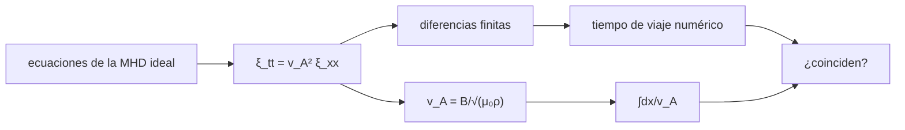

# B30-C09 — Magnetohidrodinámica

<!-- nav:top -->
[🏠 Programa](../../../../README.md) · [📚 Bloque B30](../../../tronco-comun/B30-heliofisica-y-fisica-de-plasmas.md) · [← Anterior: B30-C08 — Frecuencias y ondas de plasma](../B30-C08-frecuencias-y-ondas-de-plasma/CLASE.md) · [Siguiente: B30-C10 — Viento solar y heliosfera →](../B30-C10-viento-solar-y-heliosfera/CLASE.md)
<!-- /nav -->

## 1. Ubicación, nivel y alcance

Clase 9 del bloque B30. Nivel N3. La magnetohidrodinámica (MHD) trata el plasma como un fluido conductor que arrastra las líneas de campo. Aquí escribes las ecuaciones de la MHD ideal, simulas una **onda de Alfvén** con diferencias finitas en un medio uniforme y en uno estratificado y comparas con la **velocidad de Alfvén** `B/√(μ₀ρ)` y con el **tiempo de viaje WKB** `∫dx/v_A`. Usas [B05](../../../tronco-comun/B05-fisica-fundamental-para-el-espacio.md), [B30-C05](../B30-C05-campos-magneticos-solares/CLASE.md) y los esquemas de diferencias finitas de [B11-C08](../../B11/B11-C08-integradores-de-paso-adaptativo/CLASE.md). Se supone una onda lineal en un campo uniforme.

## 2. Por qué esta clase existe

La velocidad de Alfvén fija cuánto tarda una perturbación en recorrer un lazo coronal o una línea de campo del viento solar. La decisión central: **¿con qué velocidad viaja una perturbación magnética y cómo cambia el tiempo de viaje en un medio estratificado?**

## 3. Lo que podrás hacer al terminar

1. Escribir la ecuación de inducción y la de movimiento de la MHD ideal.
2. Deducir `v_A = B/√(μ₀ρ)` de la onda `ξ_tt = v_A²ξ_xx`.
3. Simular el pulso con un esquema de salto de rana y la condición CFL.
4. Comprobar la velocidad numérica frente a `v_A`.
5. Comparar el tiempo de viaje numérico con `∫dx/v_A`.
6. Reconocer el rango de validez de WKB.

La evidencia es la **ficha de las ondas de Alfvén** del ejercicio 12 (sección 20).

## 4. Con qué llegas y cómo comprobarlo

1. ¿Qué es una ecuación de onda?
2. ¿Qué es la condición CFL?
3. ¿Qué es la densidad de masa?
4. ¿Qué significa congelar el campo en el fluido?
5. ¿Qué es una integral de tiempo de viaje?

<details>
<summary>Ver respuestas</summary>

1. `ξ_tt = v²ξ_xx`. 2. `v dt/dx ≤ 1` para estabilidad. 3. `ρ = n m_p` para hidrógeno. 4. Que el fluido arrastra las líneas de campo. 5. `∫dx/v(x)`.
</details>

Con cuatro o cinco aciertos, sigue; si no, repasa los prerrequisitos.

## 5. Un caso de contexto y casos de referencia

Con los valores **ilustrativos** `B = 1 mT` y `n = 10¹⁵ m⁻³` (los de la corona de B30-C05), `v_A = 689,8 km/s`. Es el **ejemplo conductor**. Un pulso gaussiano viaja `260 Mm` en `376,9 s` en un medio uniforme; en un medio con `ρ ∝ e^(−x/H)` (`H = 50 Mm`), `v_A` va de `1029` a `13 854 km/s` y el tiempo baja a `90 s`.

## 6. Vocabulario

La **MHD ideal** es el modelo de fluido conductor con campo congelado. La **onda de Alfvén** es la oscilación transversal de las líneas de campo. El **esquema de salto de rana** avanza en tres niveles de tiempo. La **condición CFL** limita `dt`. La **aproximación WKB** supone longitudes de onda cortas frente a la escala del medio.

## 7. Modelo mental: una cuerda tensa

Las líneas de campo son como cuerdas tensas con masa: una sacudida transversal viaja a una velocidad que sube con la tensión (`B²/μ₀`) y baja con la densidad.



*Descripción textual:* las ecuaciones de la MHD dan la onda de Alfvén; la simulación y la fórmula WKB dan el tiempo de viaje y se comparan.

Analogía: una cuerda tensa. Límite: onda lineal y campo uniforme.

## 8. La explicación, paso a paso

### 8.1 Ecuaciones

En MHD ideal, `∂B/∂t = ∇×(v×B)` (el campo se mueve con el fluido) y `ρ dv/dt = −∇p + (∇×B)×B/μ₀`. Para una perturbación transversal pequeña `ξ` de un campo uniforme `B` a lo largo de `x`: `ρ ξ_tt = (B²/μ₀) ξ_xx`, es decir `v_A = B/√(μ₀ρ)`.

### 8.2 Medio uniforme

Con `B = 1 mT` y `n = 10¹⁵ m⁻³`: `v_A = 689,8 km/s`. El pulso de 12 Mm de anchura recorre `260 Mm` en `376,944 s`, de modo que `v = 689,8 km/s` (cociente `1,0000`) y la amplitud queda en `1,000`.

### 8.3 Medio estratificado

Con `ρ = ρ₀e^(−x/H)`, `H = 50 Mm`: `v_A` pasa de `1029,0` a `13 854,1 km/s` entre `x = 40 Mm` y `300 Mm`. El tiempo numérico es `90,020 s` y `∫dx/v_A = 89,964 s` (cociente `1,0006`).

### 8.4 La amplitud

La amplitud del pulso llega a `4,69`. La conservación del flujo de energía WKB daría `√(v_final/v_inicial) = 3,67`, pero el pulso mide `12 Mm`, que no es corto frente a `H = 50 Mm`: fuera de la validez de WKB. El laboratorio no comprueba la amplitud y no se investigó el desacuerdo.

### 8.5 Lectura

El tiempo de viaje es robusto (error de 0,06 %); la amplitud no lo es. Con una velocidad de Alfvén tan alta, una perturbación recorre un lazo de 100 Mm en unos 2 minutos a velocidades del orden de 10³ km/s.

## 9. Magnitudes, símbolos y unidades

| Símbolo | Qué es | Unidad | Valor / nota |
|---|---|---|---|
| `B` | campo | T | `10⁻³` (ilustrativo) |
| `ρ` | densidad de masa | kg/m³ | `n m_p` |
| `v_A` | velocidad de Alfvén | km/s | `B/√(μ₀ρ)` |
| `ξ` | desplazamiento transversal | m | ver 8.1 |
| `H` | escala de altura de la densidad | Mm | 50 (ilustrativa) |
| `dt` | paso de tiempo | s | `0,5 dx/v_max` |

## 10. Convenciones y referencias

Onda lineal, campo uniforme, sin disipación; los valores de `B`, `n`, `H` y de la forma del pulso son **ilustrativos**; el laboratorio es determinista.

## 11. De dónde sale lo que afirmamos

| ID | Fuente | Localizador | Respalda | Estado |
|---|---|---|---|---|
| S1 | NIST, *Fundamental Physical Constants* (CODATA 2022) | https://physics.nist.gov/cuu/Constants/Table/allascii.txt | `G`, `k_B`, `u`, `c`, `μ₀`, `ε₀`, `e`, `m_e`, `m_p`, `σ_SB` | Consultada el 2026-11-09 |

Límites: no se consultó ningún artículo de MHD; las ecuaciones de la sección 8.1 son estándar; el desacuerdo de amplitud de 8.4 no se investigó.

## 12. Cómo ver el tiempo de viaje

| Medio | Numérico | Teórico | Cociente |
|---|---|---|---|
| uniforme (260 Mm) | 376,944 s | 376,9 s | 1,0000 |
| estratificado | 90,020 s | 89,964 s | 1,0006 |

Descripción larga: en ambos medios el tiempo numérico coincide con la fórmula dentro de 0,1 %.

## 13. Ejemplo trabajado: tiempo de viaje en el medio uniforme

**Paso 1 · Velocidad.** `v_A = 689,8 km/s`.

**Paso 2 · Distancia.** `300 − 40 = 260 Mm`.

**Paso 3 · Tiempo.** `2,6 × 10⁸/6,898 × 10⁵ = 376,9 s`.

**Paso 4 · Lectura.** Unos seis minutos y medio.

## 14. Distintas formas de describir una onda MHD

**Por velocidad:** `v_A`. **Por tiempo de viaje:** `∫dx/v_A`. **Por amplitud:** conservación de energía. **Por esquema:** diferencias finitas.

## 15. Práctica guiada

**Ejercicio 1 · con los pasos indicados.** Velocidad de Alfvén con `B = 10⁻³ T` y `n = 10¹⁵ m⁻³`. *Pasos:* `B/√(μ₀ n m_p)`.

<details><summary>Solución comentada</summary>

`689,8 km/s`.
</details>

**Ejercicio 2 · con una pista.** ¿Y con `B = 2 × 10⁻³ T`? *Pista:* proporcional a `B`.

<details><summary>Solución comentada</summary>

`1379,6 km/s`.
</details>

**Ejercicio 3 · casi autónomo.** ¿Y con `n` cuatro veces mayor?

<details><summary>Solución comentada</summary>

La mitad: `344,9 km/s`.
</details>

## 16. Práctica autónoma, transferencia e integrador

**Ejercicio 4.** Tiempo para recorrer 260 Mm a 689,8 km/s.

<details><summary>Solución comentada</summary>

`376,9 s`.
</details>

**Ejercicio 5.** Cociente `v_A` final / inicial en el medio estratificado.

<details><summary>Solución comentada</summary>

`13 854,1/1029,0 = 13,46`.
</details>

**Ejercicio 6.** Desacuerdo entre el tiempo numérico y el WKB.

<details><summary>Solución comentada</summary>

`90,020/89,964 − 1 = 0,06 %`.
</details>

**Ejercicio 7.** Fracción de `c` de la mayor `v_A` del laboratorio.

<details><summary>Solución comentada</summary>

`13 854/299 792 = 4,6 %`.
</details>

**Ejercicio 8.** Número de pasos de tiempo si `dx = 10⁵ m` y `v_max = 1,4 × 10⁷ m/s`, con `dt = 0,5dx/v_max`.

<details><summary>Solución comentada</summary>

`dt = 3,6 × 10⁻³ s`; `90 s` son unos 25 000 pasos.
</details>

**Ejercicio 9 · transferencia.** **Transferencia.** Un compañero afirma que la corona tiene `v_A = 690 km/s`. Responde con la sección 10.

<details><summary>Solución comentada</summary>

Es el valor con `B` y `n` ilustrativos; no se midió.
</details>

**Ejercicio 10 · transferencia.** **Transferencia.** ¿Por qué la amplitud es 1,000 en el medio uniforme?

<details><summary>Solución comentada</summary>

Porque no hay dispersión ni disipación y el pulso se traslada sin cambiar.
</details>

**Ejercicio 11 · transferencia.** **Transferencia.** La amplitud WKB estima 3,67 y se obtiene 4,69. ¿Cómo lo interpretas?

<details><summary>Solución comentada</summary>

El pulso no es de longitud de onda corta frente a `H`; WKB no aplica; el laboratorio no lo comprueba.
</details>

**Ejercicio 12.** **Integrador.** Elabora tu *ficha de las ondas de Alfvén*: ecuaciones, velocidad, simulación y tiempos de viaje.

<details><summary>Solución comentada</summary>

Secciones 8.1–8.5.
</details>

**Ejercicio 12 · integrador.** **Integrador.** Elabora tu *ficha de las ondas de Alfvén*: ecuaciones, velocidad, simulación y tiempos de viaje.

<details><summary>Solución modelo</summary>

Secciones 8.1–8.5.
</details>

## 17. Laboratorio: onda de Alfvén en diferencias finitas

El script [alfven.py](alfven.py) simula un pulso con salto de rana y compara con `v_A` y con `∫dx/v_A` (**comprueba** 1 % en el medio uniforme y 3 % en el estratificado). Tarda unos dos minutos.

**Datos:** `μ₀` y `m_p` de NIST; `B`, `n`, `H` **ilustrativos**. **Predice antes de ejecutar:** ¿en cuánto tiempo recorre 260 Mm? (≈377 s.) **Ejecución del 2026-11-09 (Python 3.12.9):**

```text
Python 3.12.9 (biblioteca estandar)
velocidad de Alfven en la base (B = 1 mT, n = 1e+15 m-3): v_A = B/sqrt(mu_0 n m_p) = 689.8 km/s
medio uniforme: tiempo de viaje numerico = 376.944 s para 260 Mm -> v = 689.8 km/s ; analitica = 689.8 km/s ; cociente = 1.0000 ; amplitud del pulso = 1.000
medio estratificado (rho ~ exp(-x/H), H = 50 Mm): v_A de 1029.0 a 13854.1 km/s ; tiempo numerico = 90.020 s ; WKB Int dx/v_A = 89.964 s ; cociente = 1.0006 ; amplitud = 4.692
Pruebas superadas.
```

```bash
python programa/clases/B30/B30-C09-magnetohidrodinamica/alfven.py
```

**Límites:** onda lineal, campo uniforme, longitud de onda corta.

## 18. Errores frecuentes y cómo corregirlos

**Violar la condición CFL.** Se corrige con el ejercicio 8.

**Olvidar la raíz en `v_A`.** Se corrige con los ejercicios 2 y 3.

**Aplicar WKB a un pulso ancho.** Se corrige con 8.4.

**Tomar `B` y `n` por medidos.** Se corrige con la sección 10.

## 19. Cómo sabrás que vas bien

Tras 8.1: ¿cómo escala `v_A` con `B` y `ρ`? Si dudas, ejemplo 13. Tras 8.3: ¿qué tan bien coincide el tiempo? Tras el laboratorio: ¿qué comprueba? (la velocidad y el tiempo).

## 20. Qué entregas y cómo se evalúa

El producto es tu **ficha de las ondas de Alfvén** (ejercicio 12).

| Criterio | Inicial | En desarrollo | Logrado | Destacado |
|---|---|---|---|---|
| Conceptos | Los confunde | Parciales | MHD, `v_A`, WKB | Explica la condición de validez |
| Cálculo | Sin unidades | Con errores | Tablas completas | Cuenta los pasos |
| Numérico | Sin comprobar | Un caso | Dos medios | Interpreta la amplitud |
| Fuentes | Sin fuente | Sin fecha | S1 con fecha | Declara el desacuerdo no investigado |
| Límites | No los nombra | Uno | Tres | Discute qué falta del modelo |

**Condiciones críticas (no se compensan con promedio):** rotular los valores ilustrativos; no presentar la amplitud como comprobada; citar solo lo consultado.

## 21. Ética, seguridad y límites

Clase educativa: no es un modelo de oscilación coronal real. Accesibilidad: tablas equivalentes a las gráficas, fórmulas en texto, ejercicios sin conexión.

## 22. Para cerrar y seguir

Una perturbación de Alfvén recorre 260 Mm en 377 s en el medio uniforme y en 90 s en el estratificado, y el tiempo concuerda con `∫dx/v_A` al 0,06 %. Queda una pregunta: ¿cómo sale el plasma de la corona hacia el espacio?

**Glosario español–inglés.** magnetohidrodinámica · *magnetohydrodynamics*; onda de Alfvén · *Alfvén wave*; campo congelado · *frozen-in field*; condición CFL · *CFL condition*; aproximación WKB · *WKB approximation*.

**Continuidad.** [B30-C10](../B30-C10-viento-solar-y-heliosfera/CLASE.md) estudia el viento solar y la heliosfera.

**Referencias:** ver sección 11.

<!-- nav:bottom -->
---

[← Anterior: B30-C08 — Frecuencias y ondas de plasma](../B30-C08-frecuencias-y-ondas-de-plasma/CLASE.md) · [📚 Bloque B30](../../../tronco-comun/B30-heliofisica-y-fisica-de-plasmas.md) · [Siguiente: B30-C10 — Viento solar y heliosfera →](../B30-C10-viento-solar-y-heliosfera/CLASE.md)
<!-- /nav -->
