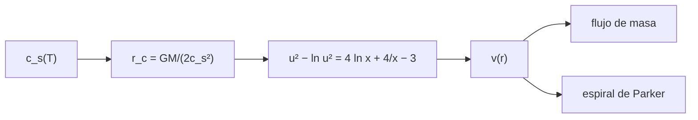

# B30-C10 — Viento solar y heliosfera

<!-- nav:top -->
[🏠 Programa](../../../../README.md) · [📚 Bloque B30](../../../tronco-comun/B30-heliofisica-y-fisica-de-plasmas.md) · [← Anterior: B30-C09 — Magnetohidrodinámica](../B30-C09-magnetohidrodinamica/CLASE.md) · [Siguiente: B30-C11 — Reconexión magnética →](../../../tronco-comun/B30-heliofisica-y-fisica-de-plasmas.md#b30-c11)
<!-- /nav -->

## 1. Ubicación, nivel y alcance

Clase 10 del bloque B30. Nivel N3. La corona caliente no puede estar en reposo (B30-C02) y se expande como un **viento**. Aquí resuelves el viento isotermo de **Parker**, que pasa de subsónico a supersónico en el **punto crítico**, con una ecuación trascendente `u² − ln u² = 4 ln x + 4/x + C` y bisección, y calculas la velocidad a 1 au, el flujo de masa y la **espiral de Parker**. Usas [B05](../../../tronco-comun/B05-fisica-fundamental-para-el-espacio.md), el radio sónico de [B30-C02](../B30-C02-fotosfera-cromosfera-y-corona/CLASE.md) y [B09-C11](../../B09/B09-C11-integrales-definidas/CLASE.md). Se supone un viento isotermo, esférico y estacionario sin campo en la dinámica.

## 2. Por qué esta clase existe

El viento solar es el vehículo que lleva la actividad del Sol a la Tierra. La decisión central: **¿cuándo pasa el viento a supersónico y qué velocidad alcanza a 1 au?**

## 3. Lo que podrás hacer al terminar

1. Escribir la ecuación de Parker adimensional con `u = v/c_s` y `x = r/r_c`.
2. Identificar la solución crítica (`C = −3`) y resolverla por bisección en la rama correcta.
3. Calcular `v` a 1 au para varias temperaturas.
4. Comprobar que el flujo de masa `r²ρv` es constante.
5. Calcular la espiral `tan ψ = Ωr/v`.
6. Distinguir el modelo de las mediciones.

La evidencia es la **ficha del viento de Parker** del ejercicio 12 (sección 20).

## 4. Con qué llegas y cómo comprobarlo

1. ¿Qué es la velocidad del sonido isoterma?
2. ¿Qué es un flujo estacionario?
3. ¿Qué es el flujo de masa?
4. ¿Cómo se resuelve una ecuación por bisección?
5. ¿Qué es una espiral de Arquímedes?

<details>
<summary>Ver respuestas</summary>

1. `√(kT/(μu))`. 2. Uno que no cambia con el tiempo. 3. La masa por unidad de tiempo, `4πr²ρv`. 4. Acotando la raíz y dividiendo el intervalo. 5. Una curva que se aleja del centro mientras gira.
</details>

Con cuatro o cinco aciertos, sigue; si no, repasa los prerrequisitos.

## 5. Un caso de contexto y casos de referencia

Para `T = 1,5 × 10⁶ K` (ilustrativa) y `μ = 0,6`: `c_s = 144,17 km/s`, radio crítico `r_c = 4,589 R_☉` y velocidad a 1 au de `562,0 km/s`. Es el **ejemplo conductor**. La densidad a 1 au (`5 × 10⁶ m⁻³`) y el periodo de rotación (25,4 d) son ilustrativos.

## 6. Vocabulario

El **punto crítico** `r_c = GM/(2c_s²)` donde `v = c_s`. El **viento subsónico/supersónico**. El **flujo de masa** `Ṁ = 4πr²ρv`. La **espiral de Parker** es la forma de la línea de campo arrastrada por el viento con el Sol rotando. El **ángulo** `ψ` es el que forma con la dirección radial.

## 7. Modelo mental: una boquilla de cohete

El viento es como un gas que sale por una tobera de Laval: acelera hasta la garganta (el punto crítico), donde alcanza la velocidad del sonido, y sigue acelerando aguas abajo.



*Descripción textual:* la temperatura da la velocidad del sonido y el radio crítico; la ecuación de Parker da `v(r)`, del que salen el flujo de masa y la espiral.

Analogía: una tobera de Laval. Límite: viento isotermo y sin campo en la dinámica.

## 8. La explicación, paso a paso

### 8.1 Velocidad a 1 au

| `T` (K) | `c_s` (km/s) | `r_c` (`R_☉`) | `v(1 au)` (km/s) | `v(10 R_☉)` (km/s) |
|---|---|---|---|---|
| 10⁶ | 117,72 | 6,883 | 432,5 | 161,3 |
| 1,5 × 10⁶ | 144,17 | 4,589 | 562,0 | 252,8 |
| 2 × 10⁶ | 166,48 | 3,441 | 674,2 | 334,6 |

### 8.2 Perfil para 1,5 × 10⁶ K

| `x = r/r_c` | `u = v/c_s` | `r` (`R_☉`) | `v` (km/s) | `n/n(1 au)` |
|---|---|---|---|---|
| 0,2 | 0,0051 | 0,92 | 0,7 | 4,2 × 10⁷ |
| 0,5 | 0,3490 | 2,29 | 50,3 | 9,8 × 10⁴ |
| 1,0 | 1,0000 | 4,59 | 144,2 | 8560 |
| 2,0 | 1,6743 | 9,18 | 241,4 | 1278 |
| 5,0 | 2,4567 | 22,94 | 354,2 | 139,4 |
| 46,86 (1 au) | 3,8981 | 215,0 | 562,0 | 1,0 |

El primer punto cae por debajo de `R_☉` y no es físico en este modelo; muestra solo la rama subsónica.

### 8.3 Flujo de masa y espiral

Con `n = 5 × 10⁶ m⁻³` a 1 au y `v = 562 km/s`: `Ṁ = 1,322 × 10⁹ kg/s = 2,1 × 10⁻¹⁴ M_☉/año`.

| `v` (km/s) | ángulo con la radial a 1 au |
|---|---|
| 300 | 55,0° |
| 400 | 47,0° |
| 600 | 35,5° |

### 8.4 Lectura

La velocidad a 1 au es muy sensible a la temperatura (432 a 674 km/s para 1 a 2 MK) y el viento rápido dibuja una espiral más abierta hacia la radial. El laboratorio no compara con mediciones de viento solar porque no se consultaron.

## 9. Magnitudes, símbolos y unidades

| Símbolo | Qué es | Unidad | Valor / nota |
|---|---|---|---|
| `c_s` | velocidad del sonido isoterma | km/s | `√(kT/(μu))` |
| `r_c` | radio crítico | `R_☉` | `GM/(2c_s²)` |
| `u`, `x` | `v/c_s`, `r/r_c` | — | ver 8.2 |
| `Ṁ` | flujo de masa | kg/s | `4πr²ρv` |
| `ψ` | ángulo de la espiral | ° | `arctan(Ωr/v)` |
| `Ω` | rotación solar | rad/s | `2π/(25,4 d)` (ilustrativa) |

## 10. Convenciones y referencias

Viento isotermo, esférico, estacionario y sin campo en la dinámica; `T` y `μ` son **ilustrativos**; la rama subsónica solo se muestra para `x < 1`.

## 11. De dónde sale lo que afirmamos

| ID | Fuente | Localizador | Respalda | Estado |
|---|---|---|---|---|
| S1 | UAI, Resolución B3 de 2015 | https://arxiv.org/abs/1510.07674 | valores nominales solares y planetarios (`R_☉`, `GM_☉`, `L_☉`, `T_eff`, `S_☉`) | Consultada el 2026-11-09 |
| S2 | NIST, *Fundamental Physical Constants* (CODATA 2022) | https://physics.nist.gov/cuu/Constants/Table/allascii.txt | `G`, `k_B`, `u`, `c`, `μ₀`, `ε₀`, `e`, `m_e`, `m_p`, `σ_SB` | Consultada el 2026-11-09 |

Límites: el modelo de Parker es clásico y no se consultó su artículo original; los resultados no se comparan con mediciones.

## 12. Cómo ver la velocidad del viento

| `r` (`R_☉`) | `v` (km/s) |
|---|---|
| 2,29 | 50,3 |
| 4,59 | 144,2 |
| 9,18 | 241,4 |
| 22,9 | 354,2 |
| 215 (1 au) | 562,0 |

Descripción larga: la velocidad sube de forma monótona y cruza `c_s` en `r_c`.

## 13. Ejemplo trabajado: radio crítico a 1,5 MK

**Paso 1 · Velocidad del sonido.** `c_s = √(kT/(μu)) = 144,17 km/s`.

**Paso 2 · Cuadrado.** `c_s² = 2,0786 × 10¹⁰ m²/s²`.

**Paso 3 · Radio.** `r_c = 1,3271 × 10²⁰/(2 × 2,0786 × 10¹⁰) = 3,192 × 10⁹ m`.

**Paso 4 · En `R_☉`.** `3,192 × 10⁹/6,957 × 10⁸ = 4,589`.

## 14. Distintas formas de describir el viento solar

**Por velocidad:** perfil `v(r)`. **Por flujo de masa:** `Ṁ`. **Por geometría:** espiral. **Por régimen:** subsónico/supersónico.

## 15. Práctica guiada

**Ejercicio 1 · con los pasos indicados.** `c_s` para `T = 10⁶ K` y `μ = 0,6`. *Pasos:* `√(kT/(μu))`.

<details><summary>Solución comentada</summary>

`117,72 km/s`.
</details>

**Ejercicio 2 · con una pista.** `r_c` para esa temperatura. *Pista:* `GM/(2c_s²)`.

<details><summary>Solución comentada</summary>

`6,883 R_☉`.
</details>

**Ejercicio 3 · casi autónomo.** Velocidad en el punto crítico.

<details><summary>Solución comentada</summary>

`v = c_s`.
</details>

## 16. Práctica autónoma, transferencia e integrador

**Ejercicio 4.** Velocidad a 1 au para `T = 2 × 10⁶ K`.

<details><summary>Solución comentada</summary>

`674,2 km/s`.
</details>

**Ejercicio 5.** `v/c_s` a 1 au para 1,5 MK.

<details><summary>Solución comentada</summary>

`3,898`.
</details>

**Ejercicio 6.** `Ṁ` si la densidad a 1 au fuera el doble.

<details><summary>Solución comentada</summary>

`2,644 × 10⁹ kg/s`.
</details>

**Ejercicio 7.** Ángulo de la espiral con `v = 400 km/s`.

<details><summary>Solución comentada</summary>

`arctan(428,3/400) = 47,0°`.
</details>

**Ejercicio 8.** Densidad relativa a `x = 5`.

<details><summary>Solución comentada</summary>

`139,4` veces la de 1 au.
</details>

**Ejercicio 9 · transferencia.** **Transferencia.** Un compañero afirma que el viento a 1 au es de 562 km/s. Responde con la sección 10.

<details><summary>Solución comentada</summary>

Es el resultado del modelo con `T` ilustrativa; no es una medición.
</details>

**Ejercicio 10 · transferencia.** **Transferencia.** ¿Por qué la solución crítica es la que va de subsónico a supersónico?

<details><summary>Solución comentada</summary>

Porque pasa por `x = 1`, `u = 1` con `C = −3` y es la que enlaza una corona casi en reposo con un viento supersónico.
</details>

**Ejercicio 11 · transferencia.** **Transferencia.** ¿Qué significa el punto `x = 0,2` de la tabla?

<details><summary>Solución comentada</summary>

Está bajo la superficie solar: el modelo no es físico ahí.
</details>

**Ejercicio 12.** **Integrador.** Elabora tu *ficha del viento de Parker*: tabla de velocidades, perfil, flujo de masa y espiral.

<details><summary>Solución comentada</summary>

Secciones 8.1–8.4.
</details>

**Ejercicio 12 · integrador.** **Integrador.** Elabora tu *ficha del viento de Parker*: tabla de velocidades, perfil, flujo de masa y espiral.

<details><summary>Solución modelo</summary>

Secciones 8.1–8.4.
</details>

## 17. Laboratorio: viento de Parker y espiral

El script [parker.py](parker.py) resuelve la ecuación de Parker por bisección y calcula `v(1 au)`, el perfil, el flujo de masa y la espiral (**comprueba** el residuo a `10⁻¹²` y `v(r_c) = c_s` a `10⁻⁹`).

**Datos:** `k_B`, `u` de NIST; `GM_☉`, `R_☉` de la UAI; `T`, `μ`, `n`, `Ω` **ilustrativos**. **Predice antes de ejecutar:** ¿qué velocidad da a 1 au con 1,5 MK? (≈560 km/s.) **Ejecución del 2026-11-09 (Python 3.12.9):**

```text
Python 3.12.9 (biblioteca estandar)
     T [K]  c_s [km/s]  r_c [R_sol]  v(1 au) [km/s]  v(10 R_sol) [km/s]
     1e+06      117.72        6.883           432.5               161.3
   1.5e+06      144.17        4.589           562.0               252.8
     2e+06      166.48        3.441           674.2               334.6
x = r/r_c  u = v/c_s  r [R_sol]  v [km/s]  n/n(1 au)
    0.200     0.0051       0.92       0.7 42071276.9
    0.500     0.3490       2.29      50.3    98125.8
    1.000     1.0000       4.59     144.2     8560.3
    2.000     1.6743       9.18     241.4     1278.2
    5.000     2.4567      22.94     354.2      139.4
   46.862     3.8981     215.03     562.0        1.0
flujo de masa con n(1 au) = 5e6 m-3 y v = 562 km/s: 1.322e+09 kg/s = 2.098e-14 M_sol/anio
espiral de Parker a 1 au con v = 300 km/s: angulo con la radial = 55.0 grados
espiral de Parker a 1 au con v = 400 km/s: angulo con la radial = 47.0 grados
espiral de Parker a 1 au con v = 600 km/s: angulo con la radial = 35.5 grados
Pruebas superadas.
```

```bash
python programa/clases/B30/B30-C10-viento-solar-y-heliosfera/parker.py
```

**Límites:** isotermo, esférico, estacionario.

## 18. Errores frecuentes y cómo corregirlos

**Elegir la rama equivocada.** Se corrige con 8.2.

**Confundir `r_c` y `R_☉`.** Se corrige con el ejemplo 13.

**Presentar el resultado como medido.** Se corrige con la sección 10.

**Olvidar el flujo de masa constante.** Se corrige con 8.3.

## 19. Cómo sabrás que vas bien

Tras 8.1: ¿qué efecto tiene la temperatura? Si dudas, ejemplo 13. Tras 8.2: ¿dónde cruza `c_s`? Tras el laboratorio: ¿qué comprueba? (el residuo).

## 20. Qué entregas y cómo se evalúa

El producto es tu **ficha del viento de Parker** (ejercicio 12).

| Criterio | Inicial | En desarrollo | Logrado | Destacado |
|---|---|---|---|---|
| Conceptos | Los confunde | Parciales | punto crítico, supersónico | Explica la elección de `C` |
| Cálculo | Sin unidades | Con errores | Tablas completas | Estima la sensibilidad a `T` |
| Numérico | Sin comprobar | Un caso | Residuo y punto crítico | Interpreta el perfil |
| Fuentes | Sin fuente | Sin fecha | S1 y S2 con fecha | Declara que no se compara con mediciones |
| Límites | No los nombra | Uno | Tres | Discute qué falta del modelo |

**Condiciones críticas (no se compensan con promedio):** rotular `T`, `μ`, `n` y `Ω` ilustrativos; no presentar `v(1 au)` como medido; citar solo lo consultado.

## 21. Ética, seguridad y límites

Clase educativa: no es un pronóstico del viento solar. Accesibilidad: tablas equivalentes a las gráficas, fórmulas en texto, ejercicios sin conexión.

## 22. Para cerrar y seguir

El viento de Parker a 1,5 MK pasa por `c_s` a `4,59 R_☉`, llega a `562 km/s` a 1 au y dibuja una espiral de `47°` con 400 km/s. Queda una pregunta: ¿cómo libera energía el campo cuando se reconecta?

**Glosario español–inglés.** viento solar · *solar wind*; punto crítico · *critical point*; flujo de masa · *mass flux*; espiral de Parker · *Parker spiral*; heliosfera · *heliosphere*.

**Continuidad.** [B30-C11](../B30-C11-reconexion-magnetica/CLASE.md) estudia la reconexión magnética.

**Referencias:** ver sección 11.

<!-- nav:bottom -->
---

[← Anterior: B30-C09 — Magnetohidrodinámica](../B30-C09-magnetohidrodinamica/CLASE.md) · [📚 Bloque B30](../../../tronco-comun/B30-heliofisica-y-fisica-de-plasmas.md) · [Siguiente: B30-C11 — Reconexión magnética →](../../../tronco-comun/B30-heliofisica-y-fisica-de-plasmas.md#b30-c11)
<!-- /nav -->
