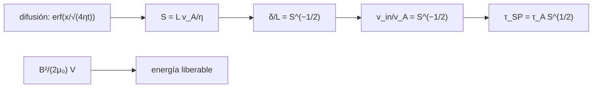

# B30-C11 — Reconexión magnética

<!-- nav:top -->
[🏠 Programa](../../../../README.md) · [📚 Bloque B30](../../../tronco-comun/B30-heliofisica-y-fisica-de-plasmas.md) · [← Anterior: B30-C10 — Viento solar y heliosfera](../B30-C10-viento-solar-y-heliosfera/CLASE.md) · [Siguiente: B30-C12 — Erupciones y fulguraciones solares →](../B30-C12-erupciones-y-fulguraciones-solares/CLASE.md)
<!-- /nav -->

## 1. Ubicación, nivel y alcance

Clase 11 del bloque B30. Nivel N3. La reconexión magnética cambia la conectividad de las líneas de campo y convierte energía magnética en energía del plasma. Aquí estudias la **difusión resistiva** de una hoja de corriente (numérica frente a la solución con `erf`) y el modelo de **Sweet–Parker**, donde la tasa de reconexión es `S^(−1/2)` con `S` el número de Lundquist. Usas [B05](../../../tronco-comun/B05-fisica-fundamental-para-el-espacio.md), [B30-C09](../B30-C09-magnetohidrodinamica/CLASE.md) y los esquemas implícitos de [B11-C08](../../B11/B11-C08-integradores-de-paso-adaptativo/CLASE.md). Se supone resistividad uniforme y geometría 1D.

## 2. Por qué esta clase existe

Las erupciones liberan en minutos una energía que el campo guardó durante mucho más tiempo, y el modelo más simple de reconexión es demasiado lento para eso. La decisión central: **¿qué tasa de reconexión hace falta y qué dice el modelo de Sweet–Parker?**

## 3. Lo que podrás hacer al terminar

1. Resolver `∂B/∂t = η∂²B/∂x²` con Crank–Nicolson y compararlo con `B₀ erf(x/√(4ηt))`.
2. Calcular el número de Lundquist `S = Lv_A/η`.
3. Aplicar Sweet–Parker: `v_in/v_A = S^(−1/2)` y `δ/L = S^(−1/2)`.
4. Calcular el tiempo de reconexión `τ_A S^(1/2)`.
5. Calcular la tasa necesaria para un evento de 100 s.
6. Estimar la energía magnética liberable.

La evidencia es la **ficha de la reconexión** del ejercicio 12 (sección 20).

## 4. Con qué llegas y cómo comprobarlo

1. ¿Qué es la difusión?
2. ¿Qué es una función de error?
3. ¿Qué es un número adimensional?
4. ¿Qué es la conservación de la masa?
5. ¿Qué es una densidad de energía magnética?

<details>
<summary>Ver respuestas</summary>

1. El esparcimiento de una cantidad por gradientes. 2. La integral gaussiana `erf`. 3. Un cociente sin unidades. 4. Que lo que entra por un lado sale por otro. 5. `B²/(2μ₀)`.
</details>

Con cuatro o cinco aciertos, sigue; si no, repasa los prerrequisitos.

## 5. Un caso de contexto y casos de referencia

Con una hoja **ilustrativa** de `L = 10⁷ m` y `v_A = 10⁶ m/s`, el tiempo de Alfvén vale `τ_A = 10 s`. Es el **ejemplo conductor**. Con `S = 10¹²`, Sweet–Parker da una tasa de `10⁻⁶` y un tiempo de `1,2 × 10⁷ s` (116 días).

## 6. Vocabulario

La **reconexión** es el cambio de conectividad del campo. La **hoja de corriente** es la capa donde el campo invierte su sentido. El **número de Lundquist** `S`. La **tasa de reconexión** `v_in/v_A`. El **tiempo de Alfvén** `τ_A = L/v_A`. La **difusión resistiva** `η = 1/(μ₀σ)`.

## 7. Modelo mental: una cinta que se corta y se une

Dos bandas elásticas con sentidos opuestos se acercan; en una capa estrecha se cortan y se vuelven a unir cruzadas, y salen disparadas. Cuanto más fina la capa, más lento entra el material.



*Descripción textual:* la difusión y la conservación de la masa dan el espesor de la hoja y la tasa de Sweet–Parker, de la que sale el tiempo; la energía magnética fija lo que se puede liberar.

Analogía: dos bandas que se cortan y se unen. Límite: resistividad uniforme y 1D.

## 8. La explicación, paso a paso

### 8.1 Difusión de un salto de campo

Con `η = 1`, `t = 1` y un salto inicial `B = ±B₀`:

| `x` | `B/B₀` numérico | `erf(x/2)` | \|dif\| |
|---|---|---|---|
| 0,25 | 0,140316 | 0,140316 | 2,8 × 10⁻⁷ |
| 1,0 | 0,520500 | 0,520500 | 4,5 × 10⁻⁷ |
| 2,0 | 0,842700 | 0,842701 | 8,6 × 10⁻⁷ |
| 3,0 | 0,966104 | 0,966105 | 1,3 × 10⁻⁶ |

La escala de difusión `√(4ηt)` vale `2` y en `x = 2` el campo es `erf(1) = 0,84270` de `B₀`.

### 8.2 Sweet–Parker

Con `L = 10⁷ m` y `v_A = 10⁶ m/s` (`τ_A = 10 s`):

| `S` | `δ/L` | `v_in/v_A` | `v_in` (m/s) | `τ_SP` |
|---|---|---|---|---|
| 10² | 0,10 | 0,10 | 10⁵ | 100 s |
| 10⁴ | 10⁻² | 10⁻² | 10⁴ | 16,7 min |
| 10⁸ | 10⁻⁴ | 10⁻⁴ | 100 | 1,16 d |
| 10¹² | 10⁻⁶ | 10⁻⁶ | 1 | 116 d |

La conservación de la masa `v_in L = v_A δ` se cumple a `10⁻¹²`.

### 8.3 Tasa necesaria y energía

Reconectar en 100 s exige `v_in/v_A = τ_A/100 = 0,1`, es decir `S = 100` en Sweet–Parker. Con `B = 0,01 T` y `V = 10²¹ m³` la energía magnética es `3,979 × 10²² J` (`3,979 × 10²⁹ erg`).

### 8.4 Lectura

Con números de Lundquist grandes, Sweet–Parker es demasiado lento para una erupción de minutos: una tasa de `10⁻⁶` da meses. Este laboratorio muestra el problema; no resuelve qué mecanismo aumenta la tasa, y esta clase no consultó una fuente al respecto.

## 9. Magnitudes, símbolos y unidades

| Símbolo | Qué es | Unidad | Valor / nota |
|---|---|---|---|
| `η` | difusividad magnética | m²/s | `1/(μ₀σ)` |
| `S` | número de Lundquist | — | `Lv_A/η` |
| `δ` | espesor de la hoja | m | `L S^(−1/2)` |
| `v_in` | velocidad de entrada | m/s | `v_A S^(−1/2)` |
| `τ_A` | tiempo de Alfvén | s | `L/v_A` |
| `W` | energía magnética | J | `B²V/(2μ₀)` |

## 10. Convenciones y referencias

Resistividad uniforme, 1D, incompresible en Sweet–Parker; `L`, `v_A`, `S`, `B` y `V` son **ilustrativos**; el laboratorio es determinista.

## 11. De dónde sale lo que afirmamos

| ID | Fuente | Localizador | Respalda | Estado |
|---|---|---|---|---|
| S1 | NIST, *Fundamental Physical Constants* (CODATA 2022) | https://physics.nist.gov/cuu/Constants/Table/allascii.txt | `μ₀`, `ε₀`, `e`, `m_e`, `m_p` | Consultada el 2026-11-09 |

Límites: el modelo de Sweet–Parker es clásico y no se consultó su fuente original; la clase no consultó ninguna fuente sobre la rapidez real de la reconexión; los números de Lundquist son ilustrativos.

## 12. Cómo ver la tasa de reconexión

| `S` | `v_in/v_A` | `τ_SP` |
|---|---|---|
| 10² | 0,1 | 100 s |
| 10⁴ | 0,01 | 16,7 min |
| 10⁸ | 10⁻⁴ | 1,16 d |
| 10¹² | 10⁻⁶ | 116 d |

Descripción larga: la tasa cae como `S^(−1/2)` y el tiempo de reconexión crece en la misma proporción.

## 13. Ejemplo trabajado: tasa y tiempo con S = 10⁸

**Paso 1 · Raíz.** `S^(1/2) = 10⁴`.

**Paso 2 · Tasa.** `v_in/v_A = 10⁻⁴`, es decir `v_in = 100 m/s`.

**Paso 3 · Espesor.** `δ = 10⁷ × 10⁻⁴ = 10³ m`.

**Paso 4 · Tiempo.** `τ_SP = 10 s × 10⁴ = 10⁵ s = 1,16 d`.

## 14. Distintas formas de describir la reconexión

**Por tasa:** `S^(−1/2)`. **Por geometría:** `δ/L`. **Por tiempo:** `τ_A S^(1/2)`. **Por energía:** `B²V/(2μ₀)`.

## 15. Práctica guiada

**Ejercicio 1 · con los pasos indicados.** Difusividad para `S = 10⁸` con `L = 10⁷ m` y `v_A = 10⁶ m/s`. *Pasos:* `η = Lv_A/S`.

<details><summary>Solución comentada</summary>

`10¹³/10⁸ = 10⁵ m²/s`.
</details>

**Ejercicio 2 · con una pista.** Tasa de reconexión con `S = 10⁸`. *Pista:* `S^(−1/2)`.

<details><summary>Solución comentada</summary>

`10⁻⁴`.
</details>

**Ejercicio 3 · casi autónomo.** Velocidad de entrada con `S = 10⁸`.

<details><summary>Solución comentada</summary>

`10⁻⁴ × 10⁶ = 100 m/s`.
</details>

## 16. Práctica autónoma, transferencia e integrador

**Ejercicio 4.** Tiempo de reconexión con `S = 10⁴`.

<details><summary>Solución comentada</summary>

`10 × 100 = 10³ s = 16,7 min`.
</details>

**Ejercicio 5.** Espesor de la hoja con `S = 10¹²`.

<details><summary>Solución comentada</summary>

`10⁷ × 10⁻⁶ = 10 m`.
</details>

**Ejercicio 6.** Tasa necesaria para un evento de 100 s.

<details><summary>Solución comentada</summary>

`τ_A/100 = 0,1`.
</details>

**Ejercicio 7.** Valor de `B/B₀` en `x = 2√(ηt)`.

<details><summary>Solución comentada</summary>

`erf(1) = 0,8427`.
</details>

**Ejercicio 8.** Energía magnética si `B` pasa a `0,02 T` con el mismo volumen.

<details><summary>Solución comentada</summary>

Cuatro veces: `1,59 × 10²³ J`.
</details>

**Ejercicio 9 · transferencia.** **Transferencia.** Un compañero afirma que la corona tiene `S = 10¹²`. Responde con la sección 10.

<details><summary>Solución comentada</summary>

Es un valor ilustrativo, no consultado.
</details>

**Ejercicio 10 · transferencia.** **Transferencia.** ¿Por qué Sweet–Parker no explica por sí solo una erupción de minutos con `S` grande?

<details><summary>Solución comentada</summary>

Porque su tiempo crece como `S^(1/2)` y da meses; hace falta un mecanismo con tasa mayor, que esta clase no consultó.
</details>

**Ejercicio 11 · transferencia.** **Transferencia.** ¿Qué indica que la difusión numérica coincida con `erf` a `10⁻⁶`?

<details><summary>Solución comentada</summary>

Que el esquema de Crank–Nicolson resuelve bien la difusión; no prueba el modelo de reconexión.
</details>

**Ejercicio 12.** **Integrador.** Elabora tu *ficha de la reconexión*: difusión, tabla de Sweet–Parker, tasa necesaria y energía.

<details><summary>Solución comentada</summary>

Secciones 8.1–8.4.
</details>

**Ejercicio 12 · integrador.** **Integrador.** Elabora tu *ficha de la reconexión*: difusión, tabla de Sweet–Parker, tasa necesaria y energía.

<details><summary>Solución modelo</summary>

Secciones 8.1–8.4.
</details>

## 17. Laboratorio: difusión resistiva y Sweet–Parker

El script [reconexion.py](reconexion.py) resuelve la difusión con Crank–Nicolson, la compara con `erf`, calcula la tabla de Sweet–Parker y la energía (**comprueba** `2 × 10⁻³` en el perfil y `10⁻¹²` en la masa).

**Datos:** `μ₀` de NIST; `L`, `v_A`, `S`, `B`, `V` **ilustrativos**. **Predice antes de ejecutar:** ¿qué tasa hace falta para 100 s? (0,1.) **Ejecución del 2026-11-09 (Python 3.12.9):**

```text
Python 3.12.9 (biblioteca estandar)
     x  B/B0 numerico   erf(x/sqrt(4 eta t))      |dif|
  0.25       0.140316               0.140316   2.75e-07
  0.50       0.276327               0.276326   4.74e-07
  1.00       0.520500               0.520500   4.46e-07
  1.50       0.711156               0.711156   1.32e-07
  2.00       0.842700               0.842701   8.64e-07
  3.00       0.966104               0.966105   1.30e-06
escala de difusion sqrt(4 eta t) = 2.000 (en unidades de sqrt(eta t) = 2.000); el campo en x = ancho vale erf(1) = 0.84270
hoja de L = 1e+07 m, v_A = 1e+06 m/s: tau_A = L/v_A = 10.0 s
       S    delta/L   v_in/v_A  v_in [m/s]   tau_SP [s]       tau_SP
   1e+02   1.00e-01   1.00e-01   1.000e+05    1.000e+02     1.67 min
   1e+04   1.00e-02   1.00e-02   1.000e+04    1.000e+03     16.7 min
   1e+08   1.00e-04   1.00e-04   1.000e+02    1.000e+05       1.16 d
   1e+12   1.00e-06   1.00e-06   1.000e+00    1.000e+07        116 d
tasa v_in/v_A para reconectar en 100 s: 0.100 -> S = 100 segun Sweet-Parker
energia magnetica B^2/(2 mu_0) V con B = 0.01 T y V = 1e+21 m3: 3.979e+22 J = 3.979e+29 erg
Pruebas superadas.
```

```bash
python programa/clases/B30/B30-C11-reconexion-magnetica/reconexion.py
```

**Límites:** resistividad uniforme y 1D.

## 18. Errores frecuentes y cómo corregirlos

**Confundir `S` con `1/S`.** Se corrige con el ejercicio 2.

**Olvidar la raíz.** Se corrige con 8.2.

**Tomar `S` por medido.** Se corrige con la sección 10.

**Concluir el mecanismo real.** Se corrige con 8.4.

## 19. Cómo sabrás que vas bien

Tras 8.1: ¿cuál es la escala de difusión? Si dudas, repasa `erf`. Tras 8.3: ¿qué tasa pide un evento de 100 s? Tras el laboratorio: ¿qué comprueba? (el perfil de difusión).

## 20. Qué entregas y cómo se evalúa

El producto es tu **ficha de la reconexión** (ejercicio 12).

| Criterio | Inicial | En desarrollo | Logrado | Destacado |
|---|---|---|---|---|
| Conceptos | Los confunde | Parciales | difusión, `S`, Sweet–Parker | Explica el problema de la lentitud |
| Cálculo | Sin unidades | Con errores | Tablas completas | Calcula la tasa necesaria |
| Numérico | Sin comprobar | Un caso | `erf` y masa | Interpreta la comprobación |
| Fuentes | Sin fuente | Sin fecha | S1 con fecha | Declara que no se consultó una fuente sobre la rapidez |
| Límites | No los nombra | Uno | Tres | Discute qué falta del modelo |

**Condiciones críticas (no se compensan con promedio):** rotular `S` ilustrativo; no atribuir a la corona un mecanismo no consultado; citar solo lo consultado.

## 21. Ética, seguridad y límites

Clase educativa: no pronostica erupciones. Accesibilidad: tablas equivalentes a las gráficas, fórmulas en texto, ejercicios sin conexión.

## 22. Para cerrar y seguir

Con `S` grande la tasa de Sweet–Parker es `10⁻⁶` y el tiempo, meses; para un evento de 100 s hace falta una tasa de `0,1`. Queda una pregunta: ¿cómo se clasifican y se cuentan las erupciones?

**Glosario español–inglés.** reconexión magnética · *magnetic reconnection*; hoja de corriente · *current sheet*; número de Lundquist · *Lundquist number*; difusión resistiva · *resistive diffusion*; Sweet–Parker · *Sweet–Parker*.

**Continuidad.** [B30-C12](../B30-C12-erupciones-y-fulguraciones-solares/CLASE.md) estudia las erupciones y fulguraciones.

**Referencias:** ver sección 11.

<!-- nav:bottom -->
---

[← Anterior: B30-C10 — Viento solar y heliosfera](../B30-C10-viento-solar-y-heliosfera/CLASE.md) · [📚 Bloque B30](../../../tronco-comun/B30-heliofisica-y-fisica-de-plasmas.md) · [Siguiente: B30-C12 — Erupciones y fulguraciones solares →](../B30-C12-erupciones-y-fulguraciones-solares/CLASE.md)
<!-- /nav -->
