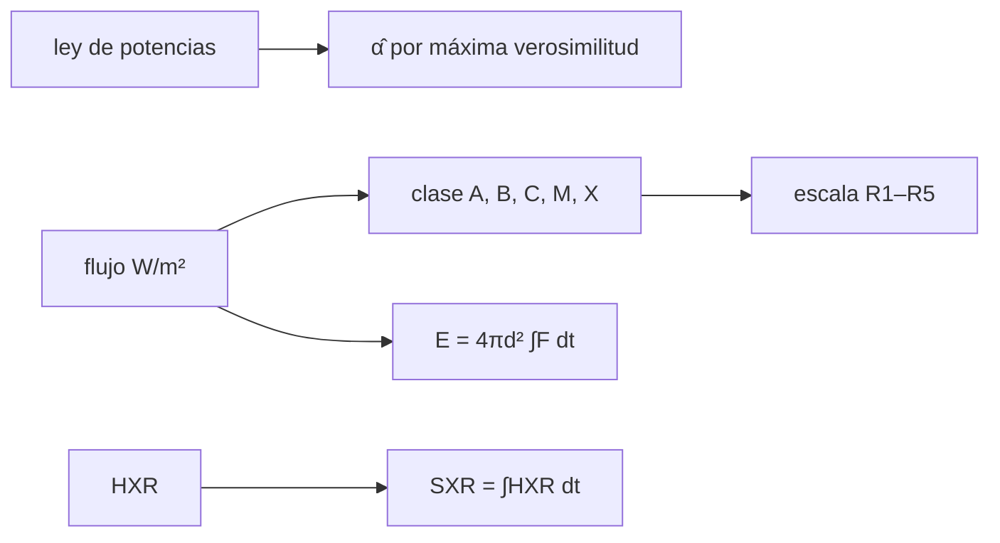

# B30-C12 — Erupciones y fulguraciones solares

<!-- nav:top -->
[🏠 Programa](../../../../README.md) · [📚 Bloque B30](../../../tronco-comun/B30-heliofisica-y-fisica-de-plasmas.md) · [← Anterior: B30-C11 — Reconexión magnética](../B30-C11-reconexion-magnetica/CLASE.md) · [Siguiente: B30-C13 — Eyecciones de masa coronal →](../B30-C13-eyecciones-de-masa-coronal/CLASE.md)
<!-- /nav -->

## 1. Ubicación, nivel y alcance

Clase 12 del bloque B30. Nivel N3. Las fulguraciones se clasifican por su pico de flujo de rayos X blandos. Aquí aplicas las **clases de NOAA** (A, B, C, M, X) y la escala **R1–R5**, generas picos con una **ley de potencias** y estimas su índice por máxima verosimilitud, verificas el **efecto Neupert** en una fulguración sintética y calculas la **energía radiada** en la banda. Usas la estadística de [B12](../../../tronco-comun/B12-probabilidad-estadistica-e-incertidumbre.md) y la integración numérica de [B09-C11](../../B09/B09-C11-integrales-definidas/CLASE.md). Se supone emisión isótropa.

## 2. Por qué esta clase existe

Para alertar de una erupción hay que saber qué magnitud tiene, con qué frecuencia ocurren eventos grandes y cuánta energía liberan. La decisión central: **¿cómo se clasifica una fulguración y qué dice una ley de potencias sobre la frecuencia de las grandes?**

## 3. Lo que podrás hacer al terminar

1. Clasificar un flujo en A, B, C, M o X con su número.
2. Relacionar M1, M5, X1, X10 y X20 con R1–R5.
3. Muestrear picos con ley de potencias y estimar su índice por máxima verosimilitud.
4. Verificar el efecto Neupert numéricamente.
5. Calcular la energía radiada de un pulso con Simpson.
6. Distinguir lo sintético de un catálogo.

La evidencia es la **ficha de una fulguración** del ejercicio 12 (sección 20).

## 4. Con qué llegas y cómo comprobarlo

1. ¿Qué es una ley de potencias?
2. ¿Qué es una máxima verosimilitud?
3. ¿Qué es una integral numérica?
4. ¿Qué es una distribución de Poisson?
5. ¿Qué es la emisión isótropa?

<details>
<summary>Ver respuestas</summary>

1. `dN/dF ∝ F^(−α)`. 2. El valor del parámetro que hace más probable la muestra. 3. Una suma que aproxima el área. 4. La de eventos independientes que ocurren con una tasa. 5. Que se emite igual en todas direcciones.
</details>

Con cuatro o cinco aciertos, sigue; si no, repasa los prerrequisitos.

## 5. Un caso de contexto y casos de referencia

NOAA clasifica las fulguraciones por el flujo de rayos X blandos de 0,1–0,8 nm: A `10⁻⁸`, B `10⁻⁷`, C `10⁻⁶`, M `10⁻⁵` y X `10⁻⁴ W/m²`, y asocia a la escala de radioapagones R1 a R5 los flujos de M1 (`10⁻⁵`), M5 (`5 × 10⁻⁵`), X1 (`10⁻⁴`), X10 (`10⁻³`) y X20 (`2 × 10⁻³ W/m²`) (S1). Es el **ejemplo conductor**. Los eventos son **sintéticos**.

## 6. Vocabulario

La **clase** es la letra y el número del pico. La **ley de potencias** describe el número de eventos con cada tamaño. El **estimador de máxima verosimilitud** `α̂ = 1 + n/Σln(F/F_min)`. El **efecto Neupert** es la relación entre rayos X blandos y duros. La **fluencia** es el flujo integrado en el tiempo.

## 7. Modelo mental: los terremotos

Como los terremotos: hay muchos pequeños y pocos grandes, y la razón entre ellos sigue una ley de potencias; la escala de clases va por potencias de diez.



*Descripción textual:* el flujo da la clase y la escala R; la ley de potencias da la estadística; el efecto Neupert relaciona los rayos X; el flujo integrado da la energía.

Analogía: los terremotos. Límite: eventos independientes.

## 8. La explicación, paso a paso

### 8.1 Clases

| flujo (W/m²) | clase |
|---|---|
| 5,0 × 10⁻⁹ | A0.5 |
| 3,4 × 10⁻⁶ | C3.4 |
| 1,0 × 10⁻⁵ | M1.0 |
| 1,2 × 10⁻⁴ | X1.2 |
| 2,8 × 10⁻³ | X28.0 |

### 8.2 Ley de potencias

Con 2000 picos de índice verdadero `2,0` y piso B1 (`10⁻⁷`), el estimador da `α̂ = 2,015 ± 0,023`: compatible a menos de un error.

| clase | eventos | esperados |
|---|---|---|
| B | 1808 | 1800,0 |
| C | 177 | 180,0 |
| M | 14 | 18,0 |
| X | 1 | 1,8 |

El único evento X frente a 1,8 esperados es una fluctuación de Poisson: `P(N ≤ 1) = e^(−1,8)(1 + 1,8) = 0,46`.

### 8.3 Efecto Neupert

Con un pulso duro gaussiano (`σ = 60 s`), el flujo blando es su integral; la derivada centrada del blando recupera el duro con un error máximo de `6,9 × 10⁻⁵` (el duro máximo vale 1) y el blando final vale `150,398`, igual a `σ√(2π)`.

### 8.4 Energía

Un pulso gaussiano de pico X1 (`10⁻⁴ W/m²`) y anchura completa a media altura de 600 s tiene `σ = 254,8 s` y fluencia `0,06387 J/m²` (Simpson y analítica coinciden a `10⁻⁶`). Con `4πd²` y `d = 1 au`, la energía radiada en la banda es `1,796 × 10²² J` (`1,796 × 10²⁹ erg`), un límite inferior de la energía total.

## 9. Magnitudes, símbolos y unidades

| Símbolo | Qué es | Unidad | Valor / nota |
|---|---|---|---|
| `F` | pico de flujo de rayos X blandos | W/m² | ver 8.1 |
| `α` | índice de la ley de potencias | — | 2,0 (ilustrativo) |
| `σ` | ancho del pulso | s | `FWHM/(2√(2 ln 2))` |
| `E` | energía radiada en la banda | J | `4πd² ∫F dt` |
| `d` | distancia | m | 1 au |

## 10. Convenciones y referencias

Banda de 0,1–0,8 nm; los eventos (semilla `20261109`), el índice 2,0 y el pulso son **ilustrativos**; emisión isótropa; la energía en banda es una cota inferior de la total.

## 11. De dónde sale lo que afirmamos

| ID | Fuente | Localizador | Respalda | Estado |
|---|---|---|---|---|
| S1 | NOAA, *Space Weather Scales* | https://www.spaceweather.gov/noaa-scales-explanation | clases de fulguración A–X por flujo de rayos X blandos GOES (0,1–0,8 nm) y escalas R1–R5 | Consultada el 2026-11-09 |
| S2 | IERS Technical Note 36, Tabla 1.1 | https://iers-conventions.obspm.fr/ | `au` | Consultada el 2026-11-09 |

Límites: no se consultó ningún catálogo de fulguraciones; el índice 2,0 y el pulso son sintéticos; el efecto Neupert se verifica como relación matemática y no con datos.

## 12. Cómo ver la estadística de picos

| Clase | Eventos | Esperados |
|---|---|---|
| B | 1808 | 1800,0 |
| C | 177 | 180,0 |
| M | 14 | 18,0 |
| X | 1 | 1,8 |

Descripción larga: los eventos disminuyen con la clase, de acuerdo con la ley de potencias dentro de las fluctuaciones de Poisson.

## 13. Ejemplo trabajado: clasificar y leer R

**Paso 1 · Flujo.** `3,4 × 10⁻⁶ W/m²`.

**Paso 2 · Clase.** Está entre `10⁻⁶` y `10⁻⁵`: clase C.

**Paso 3 · Número.** `3,4 × 10⁻⁶/10⁻⁶ = 3,4`: C3.4.

**Paso 4 · Escala R.** Menor que M1: no alcanza R1.

## 14. Distintas formas de describir una fulguración

**Por clase:** letra y número. **Por escala:** R1–R5. **Por estadística:** ley de potencias. **Por energía:** fluencia.

## 15. Práctica guiada

**Ejercicio 1 · con los pasos indicados.** Clasifica `3,4 × 10⁻⁶ W/m²`. *Pasos:* ejemplo 13.

<details><summary>Solución comentada</summary>

C3.4.
</details>

**Ejercicio 2 · con una pista.** Clasifica `1,2 × 10⁻⁴ W/m²`. *Pista:* umbral X.

<details><summary>Solución comentada</summary>

X1.2.
</details>

**Ejercicio 3 · casi autónomo.** Flujo de una M5.5. *Pasos:* número × umbral.

<details><summary>Solución comentada</summary>

`5,5 × 10⁻⁵ W/m²`.
</details>

## 16. Práctica autónoma, transferencia e integrador

**Ejercicio 4.** Cociente de flujos entre X1 y C1.

<details><summary>Solución comentada</summary>

`100`.
</details>

**Ejercicio 5.** `σ` de un pulso con FWHM de 600 s.

<details><summary>Solución comentada</summary>

`600/2,3548 = 254,8 s`.
</details>

**Ejercicio 6.** Fluencia de un pulso X1 de ese ancho.

<details><summary>Solución comentada</summary>

`10⁻⁴ × 254,8 × 2,5066 = 0,06387 J/m²`.
</details>

**Ejercicio 7.** Energía en banda si el pico fuera M1 con el mismo ancho.

<details><summary>Solución comentada</summary>

Diez veces menor: `1,8 × 10²¹ J`.
</details>

**Ejercicio 8.** Número esperado de X con `α = 2`, 2000 eventos y piso B1.

<details><summary>Solución comentada</summary>

`2000(10⁻³ − 10⁻⁴) = 1,8`.
</details>

**Ejercicio 9 · transferencia.** **Transferencia.** ¿Es el único evento X observado una contradicción con 1,8 esperados?

<details><summary>Solución comentada</summary>

No: `P(N ≤ 1) = 0,46`.
</details>

**Ejercicio 10 · transferencia.** **Transferencia.** Un compañero usa el índice 2 como el de las fulguraciones reales. Responde con la sección 10.

<details><summary>Solución comentada</summary>

El 2,0 es un valor ilustrativo del muestreo; no se consultó un catálogo.
</details>

**Ejercicio 11 · transferencia.** **Transferencia.** La energía en banda es `1,8 × 10²² J`. ¿Es la energía total de la fulguración?

<details><summary>Solución comentada</summary>

No: es una cota inferior, solo de la banda y con emisión isótropa.
</details>

**Ejercicio 12.** **Integrador.** Elabora tu *ficha de una fulguración*: clase, escala R, estadística de picos, efecto Neupert y energía.

<details><summary>Solución comentada</summary>

Secciones 8.1–8.4.
</details>

**Ejercicio 12 · integrador.** **Integrador.** Elabora tu *ficha de una fulguración*: clase, escala R, estadística de picos, efecto Neupert y energía.

<details><summary>Solución modelo</summary>

Secciones 8.1–8.4.
</details>

## 17. Laboratorio: clases, ley de potencias, Neupert y energía

El script [fulguraciones.py](fulguraciones.py) clasifica flujos, muestrea picos, estima el índice, verifica el efecto Neupert e integra la fluencia (**comprueba** el índice a 3 errores, la derivada a `10⁻³` y Simpson a `10⁻⁶`).

**Datos:** umbrales de NOAA; 1 au de IERS; eventos y pulso **sintéticos**. **Predice antes de ejecutar:** ¿qué índice recuperará el estimador? (≈2.) **Ejecución del 2026-11-09 (Python 3.12.9):**

```text
Python 3.12.9 (biblioteca estandar)
flujo 5.0e-09 W/m2 -> clase A0.5
flujo 3.4e-06 W/m2 -> clase C3.4
flujo 1.0e-05 W/m2 -> clase M1.0
flujo 1.2e-04 W/m2 -> clase X1.2
flujo 2.8e-03 W/m2 -> clase X28.0
2000 picos con indice verdadero 2.0 y piso B1: indice estimado = 2.015 +/- 0.023
 clase  eventos   esperados (ley de potencias)
     A        0                            0.0
     B     1808                         1800.0
     C      177                          180.0
     M       14                           18.0
     X        1                            1.8
efecto Neupert: max |d(SXR)/dt - HXR| = 6.94e-05 (HXR maximo 1); SXR final = 150.398 (analitico sigma sqrt(2 pi) = 150.398)
pulso X1 con FWHM = 600 s (sigma = 254.8 s): fluencia por Simpson = 0.06387 J/m2 ; F_pico sigma sqrt(2 pi) = 0.06387 J/m2
energia radiada en 0.1-0.8 nm (isotropa): 1.796e+22 J = 1.796e+29 erg
Pruebas superadas.
```

```bash
python programa/clases/B30/B30-C12-erupciones-y-fulguraciones-solares/fulguraciones.py
```

**Límites:** eventos independientes, emisión isótropa.

## 18. Errores frecuentes y cómo corregirlos

**Confundir el número con el exponente.** Se corrige con el ejemplo 13.

**Esperar exactamente el valor medio.** Se corrige con el ejercicio 9.

**Tomar la energía en banda por la total.** Se corrige con el ejercicio 11.

**Tomar el catálogo por real.** Se corrige con la sección 10.

## 19. Cómo sabrás que vas bien

Tras 8.1: ¿qué clase es 1,2 × 10⁻⁴? Si dudas, ejemplo 13. Tras 8.2: ¿qué índice sale? Tras el laboratorio: ¿qué comprueba? (el estimador y Simpson).

## 20. Qué entregas y cómo se evalúa

El producto es tu **ficha de una fulguración** (ejercicio 12).

| Criterio | Inicial | En desarrollo | Logrado | Destacado |
|---|---|---|---|---|
| Conceptos | Los confunde | Parciales | clases, R, ley de potencias | Explica la cota inferior |
| Cálculo | Sin unidades | Con errores | Tablas completas | Calcula la probabilidad de Poisson |
| Numérico | Sin comprobar | Un caso | Estimador y Simpson | Interpreta el error |
| Fuentes | Sin fuente | Sin fecha | S1 y S2 con fecha | Declara que no hay catálogo |
| Límites | No los nombra | Uno | Tres | Discute qué falta del modelo |

**Condiciones críticas (no se compensan con promedio):** rotular los eventos sintéticos; no presentar la energía en banda como total; citar solo lo consultado.

## 21. Ética, seguridad y límites

Clase educativa: no pronostica fulguraciones. Accesibilidad: tablas equivalentes a las gráficas, fórmulas en texto, ejercicios sin conexión.

## 22. Para cerrar y seguir

Una X1 de 10 minutos radia `1,8 × 10²² J` en banda y una ley de potencias de índice 2 da pocos eventos X entre miles. Queda una pregunta: ¿qué ocurre con el plasma que sale hacia el espacio?

**Glosario español–inglés.** fulguración · *flare*; clase de fulguración · *flare class*; ley de potencias · *power law*; efecto Neupert · *Neupert effect*; fluencia · *fluence*; máxima verosimilitud · *maximum likelihood*.

**Continuidad.** [B30-C13](../B30-C13-eyecciones-de-masa-coronal/CLASE.md) estudia las eyecciones de masa coronal.

**Referencias:** ver sección 11.

<!-- nav:bottom -->
---

[← Anterior: B30-C11 — Reconexión magnética](../B30-C11-reconexion-magnetica/CLASE.md) · [📚 Bloque B30](../../../tronco-comun/B30-heliofisica-y-fisica-de-plasmas.md) · [Siguiente: B30-C13 — Eyecciones de masa coronal →](../B30-C13-eyecciones-de-masa-coronal/CLASE.md)
<!-- /nav -->
