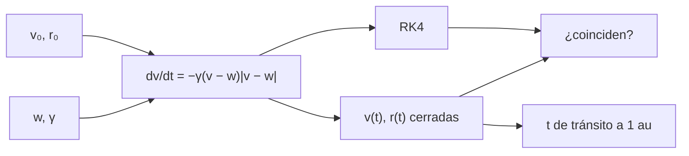

# B30-C13 — Eyecciones de masa coronal

<!-- nav:top -->
[🏠 Programa](../../../../README.md) · [📚 Bloque B30](../../../tronco-comun/B30-heliofisica-y-fisica-de-plasmas.md) · [← Anterior: B30-C12 — Erupciones y fulguraciones solares](../B30-C12-erupciones-y-fulguraciones-solares/CLASE.md) · [Siguiente: B30-C14 — Choques y aceleración de partículas →](../B30-C14-choques-y-aceleracion-de-particulas/CLASE.md)
<!-- /nav -->

## 1. Ubicación, nivel y alcance

Clase 13 del bloque B30. Nivel N3. Una eyección de masa coronal (CME) viaja por el viento solar y se frena o acelera hacia la velocidad del viento ambiente. Aquí usas el **modelo de arrastre** `dv/dt = −γ(v − w)|v − w|`, comparas la integración con **RK4** con su **solución cerrada** y calculas el **tiempo de tránsito a 1 au** para varias velocidades iniciales y valores del parámetro de arrastre. Usas la integración de [B11-C08](../../B11/B11-C08-integradores-de-paso-adaptativo/CLASE.md) y el viento de [B30-C10](../B30-C10-viento-solar-y-heliosfera/CLASE.md). Se supone un viento ambiente uniforme y movimiento radial.

## 2. Por qué esta clase existe

Saber cuándo llegará una CME determina el margen de alerta. La decisión central: **¿cuánto tarda en llegar y cuánto depende ese tiempo del arrastre?**

## 3. Lo que podrás hacer al terminar

1. Resolver la ecuación de arrastre con RK4.
2. Deducir y usar la solución cerrada para `v0 > w`.
3. Calcular el tiempo de tránsito por bisección.
4. Comparar con el tránsito a velocidad constante.
5. Medir la sensibilidad a `γ`.
6. Distinguir un modelo de un evento real.

La evidencia es la **ficha de una eyección de masa coronal** del ejercicio 12 (sección 20).

## 4. Con qué llegas y cómo comprobarlo

1. ¿Qué es un arrastre cuadrático?
2. ¿Qué es RK4?
3. ¿Qué es una solución cerrada?
4. ¿Qué es la bisección?
5. ¿Qué es un tiempo de tránsito?

<details>
<summary>Ver respuestas</summary>

1. Una fuerza proporcional al cuadrado de la velocidad relativa. 2. Un integrador de cuarto orden. 3. Una fórmula exacta. 4. Dividir un intervalo que contiene la raíz. 5. El tiempo entre dos posiciones.
</details>

Con cuatro o cinco aciertos, sigue; si no, repasa los prerrequisitos.

## 5. Un caso de contexto y casos de referencia

Las eyecciones de masa se observan con coronógrafos; un estudio de 909 CME de tipo *streamer-blowout* con LASCO/C2 forma parte del contexto (S3, solo resumen). Con valores **ilustrativos** (viento de `400 km/s`, `γ = 2 × 10⁻⁸ km⁻¹`, inicio a `20 R_☉`) una CME de `1000 km/s` llega a 1 au en `52,92 h`, frente a `37,69 h` a velocidad constante. Es el **ejemplo conductor**.

## 6. Vocabulario

El **viento ambiente** `w`. El **parámetro de arrastre** `γ`. El **modelo de arrastre** (DBM). El **tiempo de tránsito**. El **coronógrafo** bloquea el disco solar para ver la corona. Una **CME de tipo *streamer-blowout*** sale del casco coronal.

## 7. Modelo mental: una bola en una corriente

Como una pelota lanzada en una corriente de agua: se frena si va más rápido que la corriente y se acelera si va más lenta, y tiende a la velocidad del agua.



*Descripción textual:* la ecuación de arrastre se integra con RK4 y se resuelve en forma cerrada; ambas se comparan y la cerrada da el tránsito.

Analogía: una pelota en una corriente. Límite: viento uniforme.

## 8. La explicación, paso a paso

### 8.1 Solución cerrada

Con `k = γ(v₀ − w)`: `v(t) = w + (v₀ − w)/(1 + kt)` y `r(t) = r₀ + wt + ln(1 + kt)/γ`.

### 8.2 Tránsito a 1 au

Desde `r₀ = 20 R_☉ = 1,3914 × 10⁷ km` hasta `1 au = 1,4960 × 10⁸ km`:

| `v₀` (km/s) | tránsito (h) | `r` por RK4 (au) | `v(1 au)` (km/s) | a velocidad constante (h) |
|---|---|---|---|---|
| 500 | 78,65 | 1,000000 | 463,8 | 75,38 |
| 1000 | 52,92 | 1,000000 | 582,6 | 37,69 |
| 2000 | 36,75 | 1,000000 | 705,7 | 18,84 |

RK4 y la forma cerrada coinciden a `10⁻⁶`.

### 8.3 Sensibilidad al arrastre

| `γ` (km⁻¹) | tránsito de 1000 km/s (h) |
|---|---|
| 5 × 10⁻⁹ | 42,14 |
| 10⁻⁸ | 46,18 |
| 2 × 10⁻⁸ | 52,92 |
| 4 × 10⁻⁸ | 62,09 |

Un factor 8 en `γ` cambia el tránsito en 20 h.

### 8.4 Lectura

Con `v₀ = 2000 km/s` la velocidad cae al 10 % del exceso sobre el viento a las `78,1 h`, a `1,61 au`: la CME rápida llega con una velocidad mucho menor que la inicial (`705,7 km/s`). Una incertidumbre de `γ` pesa tanto como una de decenas de por ciento en `v₀`.

## 9. Magnitudes, símbolos y unidades

| Símbolo | Qué es | Unidad | Valor / nota |
|---|---|---|---|
| `w` | viento ambiente | km/s | 400 (ilustrativo) |
| `γ` | parámetro de arrastre | km⁻¹ | `2 × 10⁻⁸` (ilustrativo) |
| `r₀` | distancia inicial | km | `20 R_☉ = 1,3914 × 10⁷` |
| `v₀` | velocidad inicial | km/s | 500; 1000; 2000 |
| `t` | tiempo de tránsito | h | ver 8.2 |

## 10. Convenciones y referencias

Arrastre cuadrático, viento uniforme, 1D radial, `v₀ > w`; `w`, `γ`, `r₀` y `v₀` son **ilustrativos**; ninguna CME real se simula.

## 11. De dónde sale lo que afirmamos

| ID | Fuente | Localizador | Respalda | Estado |
|---|---|---|---|---|
| S1 | UAI, Resolución B3 de 2015 | https://arxiv.org/abs/1510.07674 | valores nominales solares (`R_☉`, `GM_☉`, `L_☉`, `T_eff`, `S_☉`) | Consultada el 2026-11-09 |
| S2 | IERS Technical Note 36, Tabla 1.1 | https://iers-conventions.obspm.fr/ | `au` | Consultada el 2026-11-09 |
| S3 | arXiv:1806.00644 | https://arxiv.org/abs/1806.00644 | estudio de 909 CME de tipo *streamer-blowout* con LASCO/C2 | Solo resumen, consultado el 2026-11-09 |

Límites: S3 solo resumen y no respalda los parámetros del modelo; `γ` y `w` son ilustrativos; el modelo de arrastre no se contrastó con eventos.

## 12. Cómo ver el tránsito

| `v₀` (km/s) | con arrastre (h) | constante (h) |
|---|---|---|
| 500 | 78,65 | 75,38 |
| 1000 | 52,92 | 37,69 |
| 2000 | 36,75 | 18,84 |

Descripción larga: el arrastre alarga mucho más el tránsito de las CME rápidas.

## 13. Ejemplo trabajado: tránsito a velocidad constante

**Paso 1 · Recorrido.** `1,4960 × 10⁸ − 1,3914 × 10⁷ = 1,3568 × 10⁸ km`.

**Paso 2 · Cociente.** `1,3568 × 10⁸/1000 = 1,3568 × 10⁵ s`.

**Paso 3 · Horas.** `1,3568 × 10⁵/3600 = 37,69 h`.

**Paso 4 · Comparación.** Con arrastre son `52,92 h`, un 40 % más.

## 14. Distintas formas de describir una CME

**Por velocidad:** `v₀`, `v(1 au)`. **Por tiempo:** tránsito. **Por modelo:** arrastre. **Por observación:** coronógrafo.

## 15. Práctica guiada

**Ejercicio 1 · con los pasos indicados.** Tránsito a velocidad constante de 1000 km/s. *Pasos:* ejemplo 13.

<details><summary>Solución comentada</summary>

`37,69 h`.
</details>

**Ejercicio 2 · con una pista.** Cociente tránsito con arrastre / constante para 1000 km/s. *Pista:* 8.2.

<details><summary>Solución comentada</summary>

`52,92/37,69 = 1,40`.
</details>

**Ejercicio 3 · casi autónomo.** Velocidad a 1 au para `v₀ = 2000 km/s`.

<details><summary>Solución comentada</summary>

`705,7 km/s`.
</details>

## 16. Práctica autónoma, transferencia e integrador

**Ejercicio 4.** Retraso por arrastre para `v₀ = 500 km/s`.

<details><summary>Solución comentada</summary>

`78,65 − 75,38 = 3,3 h`.
</details>

**Ejercicio 5.** Tránsito de 1000 km/s con `γ` doble del de referencia.

<details><summary>Solución comentada</summary>

`62,09 h`.
</details>

**Ejercicio 6.** Tránsito con `γ` mitad.

<details><summary>Solución comentada</summary>

`42,14 h`.
</details>

**Ejercicio 7.** Diferencia entre `γ = 4 × 10⁻⁸` y `5 × 10⁻⁹`.

<details><summary>Solución comentada</summary>

`62,09 − 42,14 = 19,95 h`.
</details>

**Ejercicio 8.** Llegada de una CME de 1000 km/s lanzada a las 12:00 UTC.

<details><summary>Solución comentada</summary>

`52,92 h = 2 d 4 h 55 min`: a las 16:55 UTC dos días después.
</details>

**Ejercicio 9 · transferencia.** **Transferencia.** Un compañero afirma que las CME tardan 53 h en llegar. Responde con la sección 10.

<details><summary>Solución comentada</summary>

Es el resultado con parámetros ilustrativos para una `v₀` de 1000 km/s; no es una estadística.
</details>

**Ejercicio 10 · transferencia.** **Transferencia.** ¿Qué hace el modelo si `v₀ < w`?

<details><summary>Solución comentada</summary>

La forma cerrada usada vale solo para `v₀ > w`; el caso contrario no se trata.
</details>

**Ejercicio 11 · transferencia.** **Transferencia.** ¿Respalda S3 el valor de `γ`?

<details><summary>Solución comentada</summary>

No: es solo un resumen sobre 909 eventos; `γ` es ilustrativo.
</details>

**Ejercicio 12.** **Integrador.** Elabora tu *ficha de una eyección de masa coronal*: ecuación, tránsitos, sensibilidad y límites.

<details><summary>Solución comentada</summary>

Secciones 8.1–8.4.
</details>

**Ejercicio 12 · integrador.** **Integrador.** Elabora tu *ficha de una eyección de masa coronal*: ecuación, tránsitos, sensibilidad y límites.

<details><summary>Solución modelo</summary>

Secciones 8.1–8.4.
</details>

## 17. Laboratorio: modelo de arrastre y tránsito

El script [cme.py](cme.py) integra con RK4, compara con la forma cerrada y calcula tránsitos y sensibilidad a `γ` (**comprueba** `10⁻⁶` entre RK4 y la forma cerrada).

**Datos:** `R_☉` de la UAI y 1 au de IERS; `w`, `γ`, `r₀`, `v₀` **ilustrativos**. **Predice antes de ejecutar:** ¿cuánto tarda una CME de 1000 km/s? (≈53 h.) **Ejecución del 2026-11-09 (Python 3.12.9):**

```text
Python 3.12.9 (biblioteca estandar)
r0 = 20 R_sol = 1.3914e+07 km ; 1 au = 1.4960e+08 km ; viento ambiente = 400 km/s ; gamma = 2.0e-08 km^-1
 v0 [km/s]  t cerrada [h]   r RK4 / 1 au  v(1 au) [km/s]  t const [h]
       500          78.65       1.000000           463.8        75.38
      1000          52.92       1.000000           582.6        37.69
      2000          36.75       1.000000           705.7        18.84
 gamma [km^-1]  t(1000 km/s) [h]
       5.0e-09             42.14
       1.0e-08             46.18
       2.0e-08             52.92
       4.0e-08             62.09
para v0 = 2000 km/s la velocidad cae al 10 % del exceso sobre el viento en t = 78.1 h, r = 1.61 au
Pruebas superadas.
```

```bash
python programa/clases/B30/B30-C13-eyecciones-de-masa-coronal/cme.py
```

**Límites:** viento uniforme, 1D, `v₀ > w`.

## 18. Errores frecuentes y cómo corregirlos

**Olvidar el valor absoluto del arrastre.** Se corrige con 8.1.

**Mezclar km y m.** Se corrige con la sección 9.

**Tomar los parámetros por medidos.** Se corrige con la sección 10.

**Extrapolar a `v₀ < w`.** Se corrige con el ejercicio 10.

## 19. Cómo sabrás que vas bien

Tras 8.2: ¿cuánto se alarga el tránsito de 2000 km/s? Si dudas, ejemplo 13. Tras el laboratorio: ¿qué comprueba? (RK4 frente a la cerrada).

## 20. Qué entregas y cómo se evalúa

El producto es tu **ficha de una eyección de masa coronal** (ejercicio 12).

| Criterio | Inicial | En desarrollo | Logrado | Destacado |
|---|---|---|---|---|
| Conceptos | Los confunde | Parciales | arrastre, tránsito | Explica la sensibilidad a `γ` |
| Cálculo | Sin unidades | Con errores | Tablas completas | Calcula la hora de llegada |
| Numérico | Sin comprobar | Un caso | RK4 y cerrada | Interpreta la velocidad de llegada |
| Fuentes | Sin fuente | Sin fecha | S1–S3 con fecha | Declara S3 como resumen |
| Límites | No los nombra | Uno | Tres | Discute qué falta del modelo |

**Condiciones críticas (no se compensan con promedio):** rotular `w` y `γ` ilustrativos; no presentar un tránsito como pronóstico; citar solo lo consultado.

## 21. Ética, seguridad y límites

Clase educativa: no es un pronóstico de llegada. Accesibilidad: tablas equivalentes a las gráficas, fórmulas en texto, ejercicios sin conexión.

## 22. Para cerrar y seguir

Con arrastre ilustrativo, una CME de 1000 km/s llega en `52,9 h` con 583 km/s, y la de 2000 km/s en `36,8 h`. Queda una pregunta: ¿cómo aceleran las partículas los choques que arrastran?

**Glosario español–inglés.** eyección de masa coronal · *coronal mass ejection*; modelo de arrastre · *drag-based model*; coronógrafo · *coronagraph*; tiempo de tránsito · *transit time*; viento ambiente · *ambient wind*.

**Continuidad.** [B30-C14](../B30-C14-choques-y-aceleracion-de-particulas/CLASE.md) estudia los choques y la aceleración de partículas.

**Referencias:** ver sección 11.

<!-- nav:bottom -->
---

[← Anterior: B30-C12 — Erupciones y fulguraciones solares](../B30-C12-erupciones-y-fulguraciones-solares/CLASE.md) · [📚 Bloque B30](../../../tronco-comun/B30-heliofisica-y-fisica-de-plasmas.md) · [Siguiente: B30-C14 — Choques y aceleración de partículas →](../B30-C14-choques-y-aceleracion-de-particulas/CLASE.md)
<!-- /nav -->
