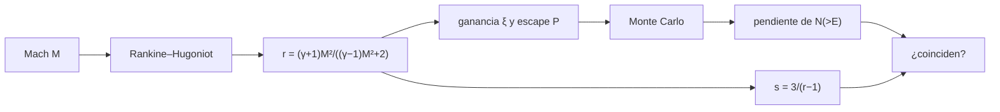

# B30-C14 — Choques y aceleración de partículas

<!-- nav:top -->
[🏠 Programa](../../../../README.md) · [📚 Bloque B30](../../../tronco-comun/B30-heliofisica-y-fisica-de-plasmas.md) · [← Anterior: B30-C13 — Eyecciones de masa coronal](../B30-C13-eyecciones-de-masa-coronal/CLASE.md) · [Siguiente: B30-C15 — Magnetosfera terrestre →](../B30-C15-magnetosfera-terrestre/CLASE.md)
<!-- /nav -->

## 1. Ubicación, nivel y alcance

Clase 14 del bloque B30. Nivel N3. Un choque comprime y calienta el plasma, y las partículas que cruzan una y otra vez su frente ganan energía. Aquí compruebas las **condiciones de Rankine–Hugoniot** para un gas ideal y simulas la **aceleración difusiva** (Bell) por Monte Carlo para recuperar el **índice espectral** `(r + 2)/(r − 1)`. Usas [B05](../../../tronco-comun/B05-fisica-fundamental-para-el-espacio.md), el ajuste de [B12](../../../tronco-comun/B12-probabilidad-estadistica-e-incertidumbre.md) y los choques de [B30-C13](../B30-C13-eyecciones-de-masa-coronal/CLASE.md). Se supone un choque plano y partículas de prueba relativistas.

## 2. Por qué esta clase existe

Las partículas energéticas solares son un riesgo para satélites y astronautas, y los choques de las CME son un origen. La decisión central: **¿qué espectro produce un choque de una compresión dada?**

## 3. Lo que podrás hacer al terminar

1. Calcular la razón de compresión `r` y el salto de presión para un Mach dado.
2. Comprobar las tres leyes de conservación.
3. Simular la ganancia de energía por ciclo y el escape.
4. Ajustar la pendiente de `N(>E)` y compararla con `3/(r − 1)`.
5. Obtener el índice diferencial `(r + 2)/(r − 1)`.
6. Reconocer el límite del choque fuerte `r = 4`.

La evidencia es la **ficha de un choque** del ejercicio 12 (sección 20).

## 4. Con qué llegas y cómo comprobarlo

1. ¿Qué es un número de Mach?
2. ¿Qué dicen las leyes de conservación?
3. ¿Qué es una partícula de prueba?
4. ¿Qué es una regresión lineal?
5. ¿Qué es una distribución geométrica?

<details>
<summary>Ver respuestas</summary>

1. `M = u/c_s`. 2. Que masa, momento y energía se conservan. 3. Una que no altera el choque. 4. Una recta de mínimos cuadrados. 5. La del número de ensayos hasta el primer éxito.
</details>

Con cuatro o cinco aciertos, sigue; si no, repasa los prerrequisitos.

## 5. Un caso de contexto y casos de referencia

Con `γ = 5/3` un choque de `M = 3` comprime el gas `r = 3` veces y la presión sube `11` veces; para `M → ∞`, `r → 4`. Es el **ejemplo conductor**. La aceleración difusiva da un índice integral `s = 3/(r − 1)`: `1,5` para `r = 3`. Los números de Mach y `u₁/c = 0,01` son **ilustrativos**.

## 6. Vocabulario

El **choque** es una discontinuidad que cruza el flujo. La **razón de compresión** `r = ρ₂/ρ₁`. Las **condiciones de Rankine–Hugoniot** son las leyes de conservación a ambos lados. La **aceleración difusiva** es la ganancia de energía al cruzar repetidamente. El **índice espectral** describe la ley de potencias de la energía. La **partícula de prueba** no retroalimenta al choque.

## 7. Modelo mental: una pelota entre dos paredes que se acercan

Una pelota que rebota entre dos paredes que se acercan gana energía en cada rebote, pero cada vez puede escapar: la combinación de ganancia y escape da una ley de potencias.



*Descripción textual:* el Mach da la compresión y de ella la ganancia y el escape por ciclo; el Monte Carlo y la fórmula dan la pendiente y se comparan.

Analogía: una pelota entre paredes que se acercan. Límite: partículas de prueba y choque plano.

## 8. La explicación, paso a paso

### 8.1 Rankine–Hugoniot

| `M` | `r` | `p₂/p₁` | `u₂/u₁` |
|---|---|---|---|
| 1,5 | 1,7143 | 2,562 | 0,5833 |
| 2 | 2,2857 | 4,750 | 0,4375 |
| 3 | 3,0000 | 11,000 | 0,3333 |
| 5 | 3,5714 | 31,000 | 0,2800 |
| 10 | 3,8835 | 124,75 | 0,2575 |
| 20 | 3,9702 | 499,75 | 0,2519 |

Los residuos de masa, momento y energía son del orden de `10⁻¹⁵` a `10⁻¹²`; `r = 1` para `M = 1` y `r → 4` para `M → ∞`.

### 8.2 Aceleración difusiva

Con `β = u₁/c = 0,01`: ganancia por ciclo `ξ = (4/3)β(r − 1)/r` y probabilidad de escape `P = 4β/r`. Con 40 000 partículas por caso:

| `M` | `r` | `ξ` | `P` | `s` teórico | `s` simulado | dif. |
|---|---|---|---|---|---|---|
| 2 | 2,286 | 0,00750 | 0,01750 | 2,333 | 2,306 | 1,2 % |
| 3 | 3,000 | 0,00889 | 0,01333 | 1,500 | 1,518 | 1,2 % |
| 20 | 3,970 | 0,00997 | 0,01008 | 1,010 | 1,026 | 1,6 % |

### 8.3 Índice diferencial

`(r + 2)/(r − 1)` vale `3,333`; `2,500` y `2,010` en los tres casos: un choque fuerte da un espectro de índice cercano a 2.

### 8.4 Lectura

Cuanto más fuerte el choque, más duro el espectro (índice menor). El Monte Carlo reproduce la teoría al 1–2 %, pero ambas usan los mismos supuestos de partícula de prueba y difusión isótropa.

## 9. Magnitudes, símbolos y unidades

| Símbolo | Qué es | Unidad | Valor / nota |
|---|---|---|---|
| `M` | número de Mach | — | 1,5–20 (ilustrativos) |
| `r` | razón de compresión | — | `(γ+1)M²/((γ−1)M²+2)` |
| `γ` | índice adiabático | — | 5/3 |
| `ξ`, `P` | ganancia y escape por ciclo | — | `(4/3)β(r−1)/r`; `4β/r` |
| `s` | índice integral | — | `3/(r−1)` |

## 10. Convenciones y referencias

Gas ideal con `γ = 5/3`, choque plano y estacionario, partículas relativistas de prueba; `M` y `β = 0,01` son **ilustrativos**; semilla `20261109`.

## 11. De dónde sale lo que afirmamos

| ID | Fuente | Localizador | Respalda | Estado |
|---|---|---|---|---|
| — | Sin fuente externa | — | las relaciones de Rankine–Hugoniot y de Bell son estándar y las verifica el laboratorio con residuos y con la pendiente | No se consultó una fuente para esta clase |

Límites: no se consultó ninguna fuente específica; el laboratorio valida la implementación frente a las fórmulas, no frente a observaciones.

## 12. Cómo ver el espectro

| `r` | `s` | índice diferencial |
|---|---|---|
| 2,286 | 2,333 | 3,333 |
| 3,000 | 1,500 | 2,500 |
| 3,970 | 1,010 | 2,010 |

Descripción larga: al crecer la compresión el espectro se endurece hacia el índice 2.

## 13. Ejemplo trabajado: compresión para M = 3

**Paso 1 · Numerador.** `(γ + 1)M² = (8/3) × 9 = 24`.

**Paso 2 · Denominador.** `(γ − 1)M² + 2 = (2/3) × 9 + 2 = 8`.

**Paso 3 · Cociente.** `r = 24/8 = 3`.

**Paso 4 · Índice.** `s = 3/(3 − 1) = 1,5` y el diferencial `(3 + 2)/(3 − 1) = 2,5`.

## 14. Distintas formas de describir un choque

**Por compresión:** `r`. **Por salto:** `p₂/p₁`. **Por espectro:** `s`. **Por simulación:** pendiente de Monte Carlo.

## 15. Práctica guiada

**Ejercicio 1 · con los pasos indicados.** Compresión de un choque de `M = 2`. *Pasos:* ejemplo 13.

<details><summary>Solución comentada</summary>

`2,2857`.
</details>

**Ejercicio 2 · con una pista.** Límite de `r` para `γ = 5/3`. *Pista:* `M → ∞`.

<details><summary>Solución comentada</summary>

`(γ+1)/(γ−1) = 4`.
</details>

**Ejercicio 3 · casi autónomo.** `u₂` si `u₁ = 400 km/s` y `M = 3`.

<details><summary>Solución comentada</summary>

`400/3 = 133,3 km/s`.
</details>

## 16. Práctica autónoma, transferencia e integrador

**Ejercicio 4.** Índices integral y diferencial para `r = 4`.

<details><summary>Solución comentada</summary>

`s = 1` y `(4+2)/(4−1) = 2`.
</details>

**Ejercicio 5.** Índices para `r = 3`.

<details><summary>Solución comentada</summary>

`1,5` y `2,5`.
</details>

**Ejercicio 6.** `P` para `β = 0,01` y `r = 2,286`.

<details><summary>Solución comentada</summary>

`0,04/2,286 = 0,0175`.
</details>

**Ejercicio 7.** `ξ` para ese caso.

<details><summary>Solución comentada</summary>

`(4/3) × 0,01 × 1,286/2,286 = 0,0075`.
</details>

**Ejercicio 8.** Número medio de ciclos antes de escapar.

<details><summary>Solución comentada</summary>

`1/P = 57`.
</details>

**Ejercicio 9 · transferencia.** **Transferencia.** Un compañero afirma que un choque da siempre índice 2. Responde con 8.3.

<details><summary>Solución comentada</summary>

Solo el choque fuerte (`r → 4`); un choque débil da índices mayores.
</details>

**Ejercicio 10 · transferencia.** **Transferencia.** ¿Qué supone la partícula de prueba?

<details><summary>Solución comentada</summary>

Que las partículas no modifican el choque ni la compresión.
</details>

**Ejercicio 11 · transferencia.** **Transferencia.** ¿Valida el Monte Carlo el mecanismo en el Sol?

<details><summary>Solución comentada</summary>

No: valida la implementación frente a la fórmula; no se consultaron observaciones.
</details>

**Ejercicio 12.** **Integrador.** Elabora tu *ficha de un choque*: tabla de Rankine–Hugoniot, espectro y límites.

<details><summary>Solución comentada</summary>

Secciones 8.1–8.4.
</details>

**Ejercicio 12 · integrador.** **Integrador.** Elabora tu *ficha de un choque*: tabla de Rankine–Hugoniot, espectro y límites.

<details><summary>Solución modelo</summary>

Secciones 8.1–8.4.
</details>

## 17. Laboratorio: Rankine–Hugoniot y aceleración difusiva

El script [choques.py](choques.py) comprueba las leyes de conservación y simula el Monte Carlo de Bell (**comprueba** residuos a `10⁻¹²` y pendiente al 5 % de `3/(r − 1)`).

**Datos:** sin constantes físicas; `M`, `β` **ilustrativos**. **Predice antes de ejecutar:** ¿qué pendiente da `r = 3`? (≈1,5.) **Ejecución del 2026-11-09 (Python 3.12.9):**

```text
Python 3.12.9 (biblioteca estandar)
    M  r = rho2/rho1    p2/p1    u2/u1  residuo masa  residuo momento  residuo energia
  1.0         1.0000    1.000   1.0000       0.0e+00          0.0e+00          0.0e+00
  1.5         1.7143    2.562   0.5833       2.2e-16          0.0e+00          1.8e-15
  2.0         2.2857    4.750   0.4375       0.0e+00          0.0e+00          3.6e-15
  3.0         3.0000   11.000   0.3333       0.0e+00          1.8e-15          7.1e-15
  5.0         3.5714   31.000   0.2800       0.0e+00          0.0e+00          2.8e-14
 10.0         3.8835  124.750   0.2575       0.0e+00          0.0e+00          0.0e+00
 20.0         3.9702  499.750   0.2519       0.0e+00          0.0e+00          1.8e-12
    M       r        xi    P_esc  s teorico 3/(r-1)  s simulado     dif
  2.0   2.286   0.00750  0.01750              2.333       2.306   1.19%
  3.0   3.000   0.00889  0.01333              1.500       1.518   1.20%
 20.0   3.970   0.00997  0.01008              1.010       1.026   1.57%
indice diferencial (r + 2)/(r - 1): r = 2.286 -> 3.333, r = 3.000 -> 2.500, r = 3.970 -> 2.010
Pruebas superadas.
```

```bash
python programa/clases/B30/B30-C14-choques-y-aceleracion-de-particulas/choques.py
```

**Límites:** choque plano, partículas de prueba.

## 18. Errores frecuentes y cómo corregirlos

**Confundir `r` con `p₂/p₁`.** Se corrige con 8.1.

**Creer que el índice es siempre 2.** Se corrige con 8.3.

**Usar `γ = 4/3` sin cambiar el límite.** Se corrige con el ejercicio 2.

**Presentar la simulación como observación.** Se corrige con la sección 11.

## 19. Cómo sabrás que vas bien

Tras 8.1: ¿cuánto vale `r` a `M = 3`? Si dudas, ejemplo 13. Tras 8.2: ¿cuánto difiere la simulación? Tras el laboratorio: ¿qué comprueba? (la pendiente).

## 20. Qué entregas y cómo se evalúa

El producto es tu **ficha de un choque** (ejercicio 12).

| Criterio | Inicial | En desarrollo | Logrado | Destacado |
|---|---|---|---|---|
| Conceptos | Los confunde | Parciales | Rankine–Hugoniot, índice | Explica los supuestos |
| Cálculo | Sin unidades | Con errores | Tablas completas | Calcula `ξ` y `P` |
| Numérico | Sin comprobar | Un caso | Residuos y pendiente | Interpreta la diferencia |
| Fuentes | Sin fuente | Sin fecha | Declara la ausencia de fuente | Distingue validar y observar |
| Límites | No los nombra | Uno | Tres | Discute qué falta del modelo |

**Condiciones críticas (no se compensan con promedio):** rotular `M` y `β` ilustrativos; no afirmar que se reproduce un espectro observado; citar solo lo consultado.

## 21. Ética, seguridad y límites

Clase educativa: no pronostica flujos de partículas. Accesibilidad: tablas equivalentes a las gráficas, fórmulas en texto, ejercicios sin conexión.

## 22. Para cerrar y seguir

Un choque de `M = 3` comprime 3 veces y da un índice diferencial de 2,5; el fuerte tiende a 2. Queda una pregunta: ¿cómo es la magnetosfera que protege a la Tierra?

**Glosario español–inglés.** choque · *shock*; razón de compresión · *compression ratio*; Rankine–Hugoniot · *Rankine–Hugoniot conditions*; aceleración difusiva · *diffusive shock acceleration*; índice espectral · *spectral index*; partícula de prueba · *test particle*.

**Continuidad.** [B30-C15](../B30-C15-magnetosfera-terrestre/CLASE.md) estudia la magnetosfera terrestre.

**Referencias:** ver sección 11.

<!-- nav:bottom -->
---

[← Anterior: B30-C13 — Eyecciones de masa coronal](../B30-C13-eyecciones-de-masa-coronal/CLASE.md) · [📚 Bloque B30](../../../tronco-comun/B30-heliofisica-y-fisica-de-plasmas.md) · [Siguiente: B30-C15 — Magnetosfera terrestre →](../B30-C15-magnetosfera-terrestre/CLASE.md)
<!-- /nav -->
