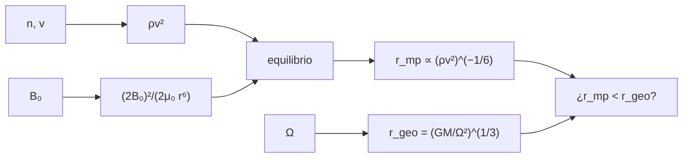

# B30-C15 — Magnetosfera terrestre

<!-- nav:top -->
[🏠 Programa](../../../../README.md) · [📚 Bloque B30](../../../tronco-comun/B30-heliofisica-y-fisica-de-plasmas.md) · [← Anterior: B30-C14 — Choques y aceleración de partículas](../B30-C14-choques-y-aceleracion-de-particulas/CLASE.md) · [Siguiente: B30-C16 — Cinturones de Van Allen →](../B30-C16-cinturones-de-van-allen/CLASE.md)
<!-- /nav -->

## 1. Ubicación, nivel y alcance

Clase 15 del bloque B30. Nivel N3. La magnetosfera es la región donde domina el campo terrestre, con un borde, la **magnetopausa**, que fija la presión del viento solar. Aquí calculas el campo de un **dipolo**, las **líneas de campo** `r = L R_⊕ cos²λ`, la **distancia a la magnetopausa** por equilibrio de presiones (biseccion frente a forma cerrada) y el **radio geosíncrono**. Usas [B05](../../../tronco-comun/B05-fisica-fundamental-para-el-espacio.md) y el viento de [B30-C10](../B30-C10-viento-solar-y-heliosfera/CLASE.md). Se supone un dipolo centrado y alineado.

## 2. Por qué esta clase existe

Los satélites geosíncronos están cerca del borde de la magnetosfera cuando el viento es fuerte. La decisión central: **¿dónde está la magnetopausa y qué pasa cuando se comprime?**

## 3. Lo que podrás hacer al terminar

1. Calcular `B(r, λ) = B₀(R_⊕/r)³√(1 + 3 sen²λ)`.
2. Relacionar `L` con la latitud de pie de una línea de campo.
3. Resolver el equilibrio `ρv² = (2B)²/(2μ₀)` por biseccion y compararlo con la forma cerrada.
4. Comprobar el exponente `1/6` de la presión dinámica.
5. Calcular el radio geosíncrono `(GM/Ω²)^(1/3)`.
6. Comparar la magnetopausa con la órbita geosíncrona.

La evidencia es la **ficha de la magnetosfera** del ejercicio 12 (sección 20).

## 4. Con qué llegas y cómo comprobarlo

1. ¿Qué es un dipolo magnético?
2. ¿Qué es la presión dinámica?
3. ¿Qué es el periodo sideral?
4. ¿Qué es la tercera ley de Kepler?
5. ¿Qué es la biseccion?

<details>
<summary>Ver respuestas</summary>

1. Una fuente de campo con simetría de eje cuyo campo cae como `1/r³`. 2. `ρv²`. 3. El periodo de rotación respecto de las estrellas. 4. `T² ∝ a³`. 5. Dividir un intervalo que contiene la raíz.
</details>

Con cuatro o cinco aciertos, sigue; si no, repasa los prerrequisitos.

## 5. Un caso de contexto y casos de referencia

Con un campo ecuatorial superficial **ilustrativo** `B₀ = 31 200 nT` y un viento de `5 × 10⁶ m⁻³` a `400 km/s` (presión dinámica `1,338 nPa`) la magnetopausa queda a `10,25 R_⊕`. Es el **ejemplo conductor**. La órbita geosíncrona queda a `6,611 R_⊕` (S1).

## 6. Vocabulario

El **dipolo** es el campo de orden más bajo. La **capa `L`** es el conjunto de líneas que cruzan el ecuador a `L R_⊕`. La **magnetopausa** es la frontera con el viento solar. La **presión dinámica** del viento es `ρv²`. La **órbita geosíncrona** tiene el periodo de rotación terrestre.

## 7. Modelo mental: una burbuja en una corriente

La magnetosfera es una burbuja en una corriente: el viento la comprime por delante hasta que la presión del campo iguala a la del viento; si el viento arrecia, la burbuja se achica.



*Descripción textual:* el viento y el campo dan la distancia de equilibrio; la rotación da el radio geosíncrono; ambos se comparan.

Analogía: una burbuja en una corriente. Límite: dipolo centrado y sin plasma magnetosférico.

## 8. La explicación, paso a paso

### 8.1 El dipolo

| `L` | `B` ecuatorial (nT) | latitud de pie (°) | `B` en la superficie (nT) |
|---|---|---|---|
| 2 | 3900,0 | 45,00 | 49 332 |
| 4 | 487,5 | 60,00 | 56 247 |
| 6,6 | 108,5 | 67,09 | 58 748 |
| 10 | 31,2 | 71,57 | 60 014 |

En el polo (`λ = 90°`) el campo es el doble del ecuatorial: `62 400 nT`.

### 8.2 Magnetopausa

| `n` (m⁻³) | `v` (km/s) | `P_din` (nPa) | `r_mp` (`R_⊕`), biseccion | cerrada |
|---|---|---|---|---|
| 5 × 10⁶ | 300 | 0,753 | 11,279 | 11,279 |
| 5 × 10⁶ | 400 | 1,338 | 10,247 | 10,247 |
| 5 × 10⁶ | 600 | 3,011 | 8,952 | 8,952 |
| 5 × 10⁶ | 800 | 5,352 | 8,133 | 8,133 |
| 2 × 10⁷ | 400 | 5,352 | 8,133 | 8,133 |
| 2 × 10⁷ | 800 | 21,410 | 6,455 | 6,455 |
| 5 × 10⁷ | 1000 | 83,631 | 5,144 | 5,144 |

Multiplicar la presión por 64 divide `r_mp` por exactamente 2 (`64^(1/6)`), y dos casos de igual `ρv²` dan la misma distancia.

### 8.3 Órbita geosíncrona

`r = (GM_⊕/Ω²)^(1/3) = 42 164,2 km = 6,611 R_⊕`, a `35 786,1 km` de altura; el periodo de rotación es `86 164,1 s`. El campo dipolar ilustrativo ahí es `108,0 nT`.

### 8.4 Lectura

Con `21 nPa` ilustrativos la magnetopausa (`6,455 R_⊕`) queda dentro del radio geosíncrono (`6,611 R_⊕`): un satélite ahí quedaría expuesto al viento. La tasa de cambio es lenta (`P^(−1/6)`): hacen falta presiones muy superiores para comprimir mucho la magnetosfera.

## 9. Magnitudes, símbolos y unidades

| Símbolo | Qué es | Unidad | Valor / nota |
|---|---|---|---|
| `B₀` | campo ecuatorial superficial | T | `3,12 × 10⁻⁵` (ilustrativo) |
| `L` | capa de McIlwain | `R_⊕` | `r/cos²λ` |
| `ρv²` | presión dinámica | nPa | ver 8.2 |
| `r_mp` | distancia a la magnetopausa | `R_⊕` | `[2B₀²/(μ₀ρv²)]^(1/6)` |
| `Ω` | rotación terrestre | rad/s | `7,2921150 × 10⁻⁵` (estándar, no consultado) |

## 10. Convenciones y referencias

Dipolo centrado y alineado, magnetopausa subsolar, sin presión del plasma magnetosférico; `B₀`, `n` y `v` son **ilustrativos**.

## 11. De dónde sale lo que afirmamos

| ID | Fuente | Localizador | Respalda | Estado |
|---|---|---|---|---|
| S1 | UAI, Resolución B3 de 2015 | https://arxiv.org/abs/1510.07674 | valores nominales (`GM_⊕`, `R_⊕` ecuatorial, `R_☉`) | Consultada el 2026-11-09 |
| S2 | NIST, *Fundamental Physical Constants* (CODATA 2022) | https://physics.nist.gov/cuu/Constants/Table/allascii.txt | `μ₀`, `m_p`, `m_e`, `e`, `c`, `h` | Consultada el 2026-11-09 |

Límites: `B₀` y `Ω` no provienen de una fuente consultada; las fórmulas son estándar; no se contrastó con modelos de magnetopausa publicados.

## 12. Cómo ver la magnetopausa

| `P_din` (nPa) | `r_mp` (`R_⊕`) |
|---|---|
| 0,753 | 11,28 |
| 1,338 | 10,25 |
| 5,352 | 8,13 |
| 21,41 | 6,46 |
| 83,63 | 5,14 |

Descripción larga: la distancia baja lentamente, como la potencia `−1/6` de la presión.

## 13. Ejemplo trabajado: campo en el ecuador de L = 4

**Paso 1 · Cubo.** `L³ = 64`.

**Paso 2 · Cociente.** `B = B₀/L³ = 31 200/64`.

**Paso 3 · Valor.** `487,5 nT`.

**Paso 4 · Lectura.** A `4 R_⊕` el campo es 64 veces menor que en el ecuador superficial.

## 14. Distintas formas de describir la magnetosfera

**Por campo:** dipolo. **Por capa:** `L`. **Por frontera:** magnetopausa. **Por órbita:** geosíncrona.

## 15. Práctica guiada

**Ejercicio 1 · con los pasos indicados.** Campo ecuatorial en `L = 4`. *Pasos:* ejemplo 13.

<details><summary>Solución comentada</summary>

`487,5 nT`.
</details>

**Ejercicio 2 · con una pista.** Campo en `L = 6,6`. *Pista:* `B₀/L³`.

<details><summary>Solución comentada</summary>

`31 200/287,5 = 108,5 nT`.
</details>

**Ejercicio 3 · casi autónomo.** Campo en el polo.

<details><summary>Solución comentada</summary>

`2B₀ = 62 400 nT`.
</details>

## 16. Práctica autónoma, transferencia e integrador

**Ejercicio 4.** Latitud de pie de la línea `L = 2`.

<details><summary>Solución comentada</summary>

`arccos√(1/2) = 45°`.
</details>

**Ejercicio 5.** Presión dinámica con `5 × 10⁶ m⁻³` y `400 km/s`.

<details><summary>Solución comentada</summary>

`8,363 × 10⁻²¹ × 1,6 × 10¹¹ = 1,338 nPa`.
</details>

**Ejercicio 6.** `r_mp` si la presión se duplica desde 10,247.

<details><summary>Solución comentada</summary>

`10,247 × 2^(−1/6) = 9,13 R_⊕`.
</details>

**Ejercicio 7.** Radio geosíncrono por la tercera ley de Kepler.

<details><summary>Solución comentada</summary>

`(GM T²/(4π²))^(1/3) = 42 164 km`.
</details>

**Ejercicio 8.** ¿Queda la órbita geosíncrona dentro de la magnetopausa con `21,4 nPa`?

<details><summary>Solución comentada</summary>

No: `6,455 < 6,611 R_⊕`; la magnetopausa queda dentro de la órbita.
</details>

**Ejercicio 9 · transferencia.** **Transferencia.** Un compañero afirma que la magnetopausa suele estar a 10,2 `R_⊕`. Responde con la sección 10.

<details><summary>Solución comentada</summary>

Es el resultado con parámetros ilustrativos; no se consultó una estadística.
</details>

**Ejercicio 10 · transferencia.** **Transferencia.** ¿Por qué `5 × 10⁶` a 800 km/s y `2 × 10⁷` a 400 km/s dan igual distancia?

<details><summary>Solución comentada</summary>

Porque tienen igual `ρv²` (5,352 nPa).
</details>

**Ejercicio 11 · transferencia.** **Transferencia.** ¿Qué supone el factor 2 del campo en la magnetopausa?

<details><summary>Solución comentada</summary>

Un dipolo comprimido que duplica el campo en el borde; es una aproximación.
</details>

**Ejercicio 12.** **Integrador.** Elabora tu *ficha de la magnetosfera*: dipolo, magnetopausa, órbita geosíncrona y comparación.

<details><summary>Solución comentada</summary>

Secciones 8.1–8.4.
</details>

**Ejercicio 12 · integrador.** **Integrador.** Elabora tu *ficha de la magnetosfera*: dipolo, magnetopausa, órbita geosíncrona y comparación.

<details><summary>Solución modelo</summary>

Secciones 8.1–8.4.
</details>

## 17. Laboratorio: dipolo, magnetopausa y órbita geosíncrona

El script [magnetosfera.py](magnetosfera.py) calcula el campo dipolar, resuelve el equilibrio por biseccion y compara con la forma cerrada (**comprueba** `10⁻⁹` y el exponente `1/6`).

**Datos:** `μ₀`, `m_p` de NIST; `GM_⊕`, `R_⊕` de la UAI; `B₀`, `n`, `v` **ilustrativos**. **Predice antes de ejecutar:** ¿dónde queda la magnetopausa con 1,3 nPa? (≈10 `R_⊕`.) **Ejecución del 2026-11-09 (Python 3.12.9):**

```text
Python 3.12.9 (biblioteca estandar)
    L  B ecuatorial [nT]  lat en superficie [deg]  B superficie [nT]
  2.0             3900.0                    45.00              49332
  4.0              487.5                    60.00              56247
  6.6              108.5                    67.09              58748
 10.0               31.2                    71.57              60014
campo en el ecuador superficial B_0 = 31200 nT ; en el polo (lat = 90) = 62400 nT (el doble)
viento solar ilustrativo: n = 5e+06 m-3, v = 400 km/s -> presion dinamica rho v^2 = 1.338 nPa
  n [m-3]  v [km/s]  P_din [nPa]  r_mp [R_E] biseccion   cerrada
    5e+06       300        0.753                11.279    11.279
    5e+06       400        1.338                10.247    10.247
    5e+06       600        3.011                 8.952     8.952
    5e+06       800        5.352                 8.133     8.133
    2e+07       400        5.352                 8.133     8.133
    2e+07       800       21.410                 6.455     6.455
    5e+07      1000       83.631                 5.144     5.144
presion dinamica x64 -> r_mp /2.0000 (esperado 64^(1/6) = 2.0000)
radio geosincrono: 42164.2 km = 6.611 R_E ; altitud = 35786.1 km ; periodo = 86164.1 s
campo dipolar ilustrativo en el ecuador geosincrono: 108.0 nT
Pruebas superadas.
```

```bash
python programa/clases/B30/B30-C15-magnetosfera-terrestre/magnetosfera.py
```

**Límites:** dipolo centrado, sin plasma magnetosférico.

## 18. Errores frecuentes y cómo corregirlos

**Olvidar el exponente `1/6`.** Se corrige con el ejercicio 6.

**Confundir `L` y `r`.** Se corrige con 8.1.

**Tomar `B₀` por medido.** Se corrige con la sección 10.

**Pensar que la magnetopausa nunca llega a la órbita geosíncrona.** Se corrige con 8.4.

## 19. Cómo sabrás que vas bien

Tras 8.1: ¿cuánto vale `B` en `L = 4`? Si dudas, ejemplo 13. Tras 8.2: ¿cómo baja `r_mp`? Tras el laboratorio: ¿qué comprueba? (la biseccion).

## 20. Qué entregas y cómo se evalúa

El producto es tu **ficha de la magnetosfera** (ejercicio 12).

| Criterio | Inicial | En desarrollo | Logrado | Destacado |
|---|---|---|---|---|
| Conceptos | Los confunde | Parciales | dipolo, `L`, magnetopausa | Explica la lentitud de `P^(−1/6)` |
| Cálculo | Sin unidades | Con errores | Tablas completas | Calcula casos nuevos |
| Numérico | Sin comprobar | Un caso | Biseccion y cerrada | Interpreta el cruce con la órbita |
| Fuentes | Sin fuente | Sin fecha | S1 y S2 con fecha | Declara los valores ilustrativos |
| Límites | No los nombra | Uno | Tres | Discute qué falta del modelo |

**Condiciones críticas (no se compensan con promedio):** rotular `B₀`, `n` y `v` ilustrativos; no presentar la magnetopausa como medida; citar solo lo consultado.

## 21. Ética, seguridad y límites

Clase educativa: no es un modelo de magnetopausa. Accesibilidad: tablas equivalentes a las gráficas, fórmulas en texto, ejercicios sin conexión.

## 22. Para cerrar y seguir

Con 1,3 nPa la magnetopausa queda a `10,2 R_⊕`, la órbita geosíncrona a `6,6 R_⊕`, y solo con presiones del orden de 20 nPa se cruzan. Queda una pregunta: ¿qué partículas quedan atrapadas dentro?

**Glosario español–inglés.** dipolo · *dipole*; magnetopausa · *magnetopause*; capa L · *L-shell*; presión dinámica · *dynamic pressure*; órbita geosíncrona · *geosynchronous orbit*.

**Continuidad.** [B30-C16](../B30-C16-cinturones-de-van-allen/CLASE.md) estudia los cinturones de Van Allen.

**Referencias:** ver sección 11.

<!-- nav:bottom -->
---

[← Anterior: B30-C14 — Choques y aceleración de partículas](../B30-C14-choques-y-aceleracion-de-particulas/CLASE.md) · [📚 Bloque B30](../../../tronco-comun/B30-heliofisica-y-fisica-de-plasmas.md) · [Siguiente: B30-C16 — Cinturones de Van Allen →](../B30-C16-cinturones-de-van-allen/CLASE.md)
<!-- /nav -->
