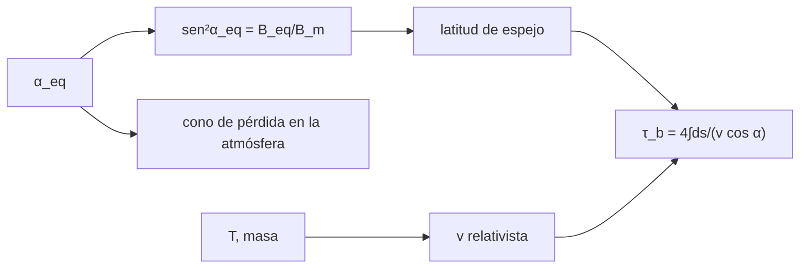

# B30-C16 — Cinturones de Van Allen

<!-- nav:top -->
[🏠 Programa](../../../../README.md) · [📚 Bloque B30](../../../tronco-comun/B30-heliofisica-y-fisica-de-plasmas.md) · [← Anterior: B30-C15 — Magnetosfera terrestre](../B30-C15-magnetosfera-terrestre/CLASE.md) · [Siguiente: B30-C17 — Auroras y corrientes ionosféricas →](../B30-C17-auroras-y-corrientes-ionosfericas/CLASE.md)
<!-- /nav -->

## 1. Ubicación, nivel y alcance

Clase 16 del bloque B30. Nivel N3. Las partículas atrapadas en el dipolo giran, rebotan entre espejos y derivan. Aquí calculas la **latitud de espejo** a partir del ángulo de paso ecuatorial, el **cono de pérdida** en la base de una línea de campo, el **periodo de rebote** por dos integrales distintas y el **radio de giro** relativista. Usas [B30-C06](../B30-C06-particulas-cargadas-y-movimientos/CLASE.md) y [B30-C15](../B30-C15-magnetosfera-terrestre/CLASE.md). Se supone un dipolo centrado y la conservación del momento magnético.

## 2. Por qué esta clase existe

Las partículas con ángulo de paso pequeño se pierden en la atmósfera; las demás quedan atrapadas y dañan satélites. La decisión central: **¿qué partículas quedan atrapadas y con qué periodo rebotan?**

## 3. Lo que podrás hacer al terminar

1. Resolver la latitud de espejo con `sen²α_eq = B_eq/B_m`.
2. Calcular el cono de pérdida en la base de la línea.
3. Integrar el periodo de rebote con dos sustituciones que eliminan la singularidad.
4. Calcular la velocidad relativista de un protón de 10 MeV y de un electrón de 1 MeV.
5. Calcular el radio de giro relativista.
6. Reconocer la dependencia con el ángulo de paso.

La evidencia es la **ficha de los cinturones de radiación** del ejercicio 12 (sección 20).

## 4. Con qué llegas y cómo comprobarlo

1. ¿Qué es un ángulo de paso?
2. ¿Qué es un invariante adiabático?
3. ¿Qué es un cono de pérdida?
4. ¿Qué es el factor de Lorentz?
5. ¿Qué es una integral impropia?

<details>
<summary>Ver respuestas</summary>

1. El ángulo entre la velocidad y el campo. 2. Una cantidad que se conserva si el campo varía despacio. 3. El conjunto de ángulos que llegan a la atmósfera. 4. `γ = 1 + T/(mc²)`. 5. Una integral con un integrando que diverge en un extremo.
</details>

Con cuatro o cinco aciertos, sigue; si no, repasa los prerrequisitos.

## 5. Un caso de contexto y casos de referencia

En un dipolo con `B₀` ilustrativo y `L = 4`, el campo ecuatorial es `487,5 nT` y el cono de pérdida tiene `5,47°`. Es el **ejemplo conductor**. El estudio de ondas EMIC con las Van Allen Probes (33 meses) es el contexto observacional (S3, solo resumen).

## 6. Vocabulario

El **ángulo de paso ecuatorial** `α_eq`. El **punto de espejo** es donde `v_∥ = 0`. El **cono de pérdida** es el rango de `α_eq` con espejo bajo la atmósfera. El **periodo de rebote** `τ_b` es el de ida y vuelta. Los **cinturones de Van Allen** son las regiones de partículas atrapadas.

## 7. Modelo mental: una canica en un cuenco

Una partícula atrapada es como una canica en un cuenco: rebota entre las paredes; si va casi recta hacia abajo (ángulo de paso pequeño) se sale por el fondo.



*Descripción textual:* el ángulo de paso fija el espejo y la latitud; con la velocidad relativista da el periodo de rebote; el cono de pérdida separa lo atrapado de lo perdido.

Analogía: una canica en un cuenco. Límite: dipolo y momento magnético conservado.

## 8. La explicación, paso a paso

### 8.1 Latitud de espejo

| `α_eq` | latitud de espejo | `B_m/B_eq` |
|---|---|---|
| 10° | 52,453° | 33,163 |
| 30° | 33,153° | 4,000 |
| 60° | 14,692° | 1,333 |
| 80° | 4,734° | 1,031 |

### 8.2 Cono de pérdida

En `L = 4` la línea toca la atmósfera (100 km) en `λ = 59,74°`, donde `B = 53 585 nT`; el cono de pérdida es `α_LC = 5,47°`. La fracción de una distribución isótropa dentro de los dos conos es `1 − cos α_LC = 0,455 %`.

### 8.3 Periodo de rebote

| partícula | `T` (MeV) | `v/c` | `α_eq` | `τ_b` (s), método 1 | método 2 | `L R_⊕/v` (s) |
|---|---|---|---|---|---|---|
| protón | 10 | 0,1448 | 30° | 2,349 | 2,349 | 0,588 |
| protón | 10 | 0,1448 | 60° | 1,893 | 1,893 | 0,588 |
| protón | 10 | 0,1448 | 85° | 1,744 | 1,744 | 0,588 |
| electrón | 1 | 0,9411 | 30° | 0,362 | 0,362 | 0,090 |
| electrón | 1 | 0,9411 | 60° | 0,291 | 0,291 | 0,090 |
| electrón | 1 | 0,9411 | 85° | 0,268 | 0,268 | 0,090 |

Los dos métodos coinciden a `10⁻⁶`. `τ_b` va de unas 4 a unas 3 veces `L R_⊕/v` según el ángulo.

### 8.4 Radio de giro

Un electrón de 1 MeV tiene `pc = 1,4220 MeV` y, a 90° en el ecuador de `L = 4`, un radio de giro de `9,73 km`, mucho menor que `L R_⊕ = 25 512 km`.

## 9. Magnitudes, símbolos y unidades

| Símbolo | Qué es | Unidad | Valor / nota |
|---|---|---|---|
| `α_eq` | ángulo de paso ecuatorial | ° | ver 8.1 |
| `λ_m` | latitud de espejo | ° | ver 8.1 |
| `α_LC` | cono de pérdida | ° | 5,47 (`L = 4`) |
| `τ_b` | periodo de rebote | s | ver 8.3 |
| `r_g` | radio de giro | km | `p_⊥/(eB)` |

## 10. Convenciones y referencias

Dipolo centrado, momento magnético conservado, partículas relativistas; `B₀`, las energías, `L = 4` y la atmósfera a 100 km son **ilustrativos**.

## 11. De dónde sale lo que afirmamos

| ID | Fuente | Localizador | Respalda | Estado |
|---|---|---|---|---|
| S1 | UAI, Resolución B3 de 2015 | https://arxiv.org/abs/1510.07674 | valores nominales (`GM_⊕`, `R_⊕` ecuatorial, `R_☉`) | Consultada el 2026-11-09 |
| S2 | NIST, *Fundamental Physical Constants* (CODATA 2022) | https://physics.nist.gov/cuu/Constants/Table/allascii.txt | `μ₀`, `m_p`, `m_e`, `e`, `c`, `h` | Consultada el 2026-11-09 |
| S3 | arXiv:1901.00656 | https://arxiv.org/abs/1901.00656 | estudio de ondas EMIC con las Van Allen Probes durante 33 meses | Solo resumen, consultado el 2026-11-09 |

Límites: S3 solo resumen y no respalda ningún cálculo; no se contrastó con modelos de cinturones.

## 12. Cómo ver el rebote

| `α_eq` | `λ_m` | `τ_b` protón 10 MeV (s) |
|---|---|---|
| 30° | 33,2° | 2,349 |
| 60° | 14,7° | 1,893 |
| 85° | < 4,7° | 1,744 |

Descripción larga: las partículas de ángulo de paso menor llegan más lejos en latitud y tardan más en rebotar.

## 13. Ejemplo trabajado: razón de espejo para 30°

**Paso 1 · Seno.** `sen 30° = 0,5`.

**Paso 2 · Cuadrado.** `sen²α_eq = 0,25`.

**Paso 3 · Razón.** `B_m/B_eq = 1/0,25 = 4,000`.

**Paso 4 · Latitud.** Se resuelve `f_B(λ) = 4` y da `λ_m = 33,15°`.

## 14. Distintas formas de describir una partícula atrapada

**Por ángulo:** `α_eq`. **Por latitud:** `λ_m`. **Por tiempo:** `τ_b`. **Por pérdida:** cono.

## 15. Práctica guiada

**Ejercicio 1 · con los pasos indicados.** `B_m/B_eq` para `α_eq = 30°`. *Pasos:* ejemplo 13.

<details><summary>Solución comentada</summary>

`4,000`.
</details>

**Ejercicio 2 · con una pista.** Latitud de espejo para `α_eq = 60°`. *Pista:* 8.1.

<details><summary>Solución comentada</summary>

`14,69°`.
</details>

**Ejercicio 3 · casi autónomo.** `α_LC` para `L = 4`.

<details><summary>Solución comentada</summary>

`5,47°`.
</details>

## 16. Práctica autónoma, transferencia e integrador

**Ejercicio 4.** Fracción isótropa en los dos conos.

<details><summary>Solución comentada</summary>

`1 − cos 5,47° = 0,455 %`.
</details>

**Ejercicio 5.** Cociente de `τ_b` protón / electrón a 30°.

<details><summary>Solución comentada</summary>

`2,349/0,362 = 6,5`.
</details>

**Ejercicio 6.** Razón radio de giro / `L R_⊕` del electrón de 1 MeV.

<details><summary>Solución comentada</summary>

`9,73/25 512 = 3,8 × 10⁻⁴`.
</details>

**Ejercicio 7.** Latitud de espejo para `α_eq = 80°`.

<details><summary>Solución comentada</summary>

`4,73°`.
</details>

**Ejercicio 8.** `τ_b v/(L R_⊕)` del protón a 30°.

<details><summary>Solución comentada</summary>

`2,349/0,588 = 4,0`.
</details>

**Ejercicio 9 · transferencia.** **Transferencia.** Un compañero usa 5,47° como el cono de pérdida terrestre. Responde con la sección 10.

<details><summary>Solución comentada</summary>

Es el valor con `B₀` ilustrativo y atmósfera a 100 km en `L = 4`.
</details>

**Ejercicio 10 · transferencia.** **Transferencia.** ¿Por qué el periodo del electrón es menor?

<details><summary>Solución comentada</summary>

Por su mayor velocidad (`β = 0,94` frente a `0,14`).
</details>

**Ejercicio 11 · transferencia.** **Transferencia.** ¿Qué verifican las dos sustituciones?

<details><summary>Solución comentada</summary>

Que la integral con singularidad se calcula bien, sin validar el modelo físico.
</details>

**Ejercicio 12.** **Integrador.** Elabora tu *ficha de los cinturones de radiación*: espejo, cono de pérdida, rebote y radio de giro.

<details><summary>Solución comentada</summary>

Secciones 8.1–8.4.
</details>

**Ejercicio 12 · integrador.** **Integrador.** Elabora tu *ficha de los cinturones de radiación*: espejo, cono de pérdida, rebote y radio de giro.

<details><summary>Solución modelo</summary>

Secciones 8.1–8.4.
</details>

## 17. Laboratorio: espejo, cono de pérdida y rebote

El script [cinturones.py](cinturones.py) resuelve la latitud de espejo, el cono de pérdida y el periodo de rebote por dos integrales (**comprueba** `10⁻⁶` entre ambas y `10⁻⁹` en el espejo).

**Datos:** `e`, `m_p`, `m_e`, `c` de NIST; `R_⊕` de la UAI; `B₀`, energías y `L` **ilustrativos**. **Predice antes de ejecutar:** ¿cuánto vale el cono de pérdida en L = 4? (≈5°.) **Ejecución del 2026-11-09 (Python 3.12.9):**

```text
Python 3.12.9 (biblioteca estandar)
alpha_eq [deg]  lat. espejo [deg]   B_m/B_eq
          10.0             52.453     33.163
          30.0             33.153      4.000
          60.0             14.692      1.333
          80.0              4.734      1.031
L = 4: B_eq = 487.5 nT ; en la base (100 km) lat = 59.74 deg, B = 53585 nT ; cono de perdida alpha_LC = 5.47 deg
particula       T [MeV]     v/c  alpha_eq  tau_b met.1 [s]  met.2 [s]  L R_E/v [s]
proton             10.0  0.1448      30.0            2.349      2.349        0.588
proton             10.0  0.1448      60.0            1.893      1.893        0.588
proton             10.0  0.1448      85.0            1.744      1.744        0.588
electron            1.0  0.9411      30.0            0.362      0.362        0.090
electron            1.0  0.9411      60.0            0.291      0.291        0.090
electron            1.0  0.9411      85.0            0.268      0.268        0.090
electron de 1 MeV en el ecuador de L = 4: p c = 1.4220 MeV ; radio de giro (alpha = 90) = 9.73 km
Pruebas superadas.
```

```bash
python programa/clases/B30/B30-C16-cinturones-de-van-allen/cinturones.py
```

**Límites:** dipolo, momento conservado.

## 18. Errores frecuentes y cómo corregirlos

**Confundir `α_eq` con el ángulo local.** Se corrige con 8.1.

**Usar la velocidad no relativista para el electrón.** Se corrige con 8.3.

**Olvidar la singularidad.** Se corrige con el ejercicio 11.

**Tomar el cono por una cifra medida.** Se corrige con la sección 10.

## 19. Cómo sabrás que vas bien

Tras 8.1: ¿cómo cambia la latitud de espejo con `α_eq`? Si dudas, ejemplo 13. Tras el laboratorio: ¿qué comprueba? (las dos integrales).

## 20. Qué entregas y cómo se evalúa

El producto es tu **ficha de los cinturones de radiación** (ejercicio 12).

| Criterio | Inicial | En desarrollo | Logrado | Destacado |
|---|---|---|---|---|
| Conceptos | Los confunde | Parciales | espejo, cono, rebote | Explica el invariante |
| Cálculo | Sin unidades | Con errores | Tablas completas | Calcula otros ángulos |
| Numérico | Sin comprobar | Un caso | Dos integrales | Interpreta el periodo |
| Fuentes | Sin fuente | Sin fecha | S1–S3 con fecha | Declara S3 como resumen |
| Límites | No los nombra | Uno | Tres | Discute qué falta del modelo |

**Condiciones críticas (no se compensan con promedio):** rotular los valores ilustrativos; no presentar el cono como medido; citar solo lo consultado.

## 21. Ética, seguridad y límites

Clase educativa: no es un modelo de cinturones real. Accesibilidad: tablas equivalentes a las gráficas, fórmulas en texto, ejercicios sin conexión.

## 22. Para cerrar y seguir

En `L = 4` el cono de pérdida es de `5,5°`, un protón de 10 MeV rebota en 1,7 a 2,3 s y un electrón de 1 MeV gira con `9,7 km`. Queda una pregunta: ¿qué ocurre cuando las partículas precipitan en las auroras?

**Glosario español–inglés.** cinturones de Van Allen · *Van Allen belts*; ángulo de paso · *pitch angle*; cono de pérdida · *loss cone*; periodo de rebote · *bounce period*; punto de espejo · *mirror point*.

**Continuidad.** [B30-C17](../B30-C17-auroras-y-corrientes-ionosfericas/CLASE.md) estudia las auroras y las corrientes ionosféricas.

**Referencias:** ver sección 11.

<!-- nav:bottom -->
---

[← Anterior: B30-C15 — Magnetosfera terrestre](../B30-C15-magnetosfera-terrestre/CLASE.md) · [📚 Bloque B30](../../../tronco-comun/B30-heliofisica-y-fisica-de-plasmas.md) · [Siguiente: B30-C17 — Auroras y corrientes ionosféricas →](../B30-C17-auroras-y-corrientes-ionosfericas/CLASE.md)
<!-- /nav -->
