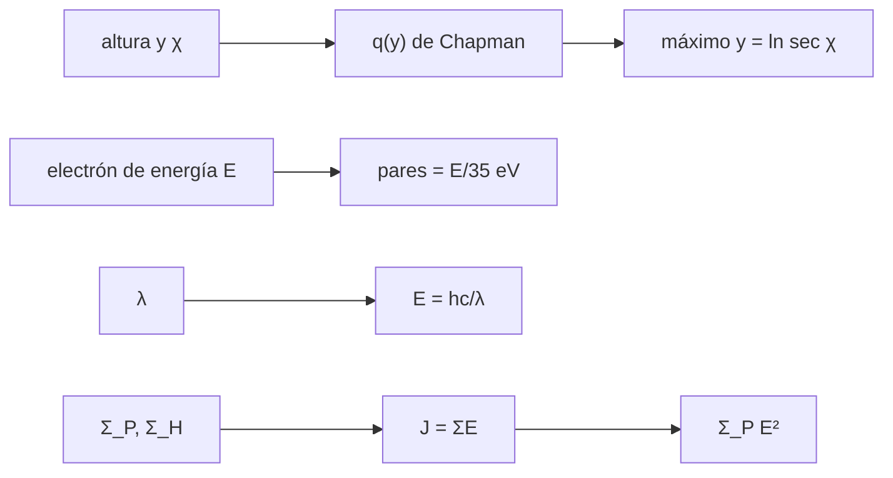

# B30-C17 — Auroras y corrientes ionosféricas

<!-- nav:top -->
[🏠 Programa](../../../../README.md) · [📚 Bloque B30](../../../tronco-comun/B30-heliofisica-y-fisica-de-plasmas.md) · [← Anterior: B30-C16 — Cinturones de Van Allen](../B30-C16-cinturones-de-van-allen/CLASE.md) · [Siguiente: B30-C18 — Tormentas geomagnéticas →](../B30-C18-tormentas-geomagneticas/CLASE.md)
<!-- /nav -->

## 1. Ubicación, nivel y alcance

Clase 17 del bloque B30. Nivel N3. Las auroras son la luz de la atmósfera excitada por partículas que precipitan. Aquí calculas la **capa de Chapman** (producción de ionización con la altura y el ángulo cenital), la **energía de las líneas aurorales** `hc/λ`, los **pares ion–electrón** por electrón y el **calentamiento Joule** de la ionosfera con la ley de Ohm con conductancias de Pedersen y de Hall. Usas [B05](../../../tronco-comun/B05-fisica-fundamental-para-el-espacio.md) y [B30-C16](../B30-C16-cinturones-de-van-allen/CLASE.md). Se supone una atmósfera isoterma exponencial.

## 2. Por qué esta clase existe

La aurora y las corrientes ionosféricas son la parte visible y eléctrica del acoplamiento entre la magnetosfera y la atmósfera. La decisión central: **¿dónde se produce la ionización y cuánta energía se disipa por efecto Joule?**

## 3. Lo que podrás hacer al terminar

1. Calcular el máximo de la capa de Chapman y su dependencia con `χ`.
2. Verificar que la integral de `q(y)` en `y` es `e`.
3. Calcular la energía de los fotones de las líneas aurorales.
4. Estimar pares por electrón y flujo de electrones.
5. Aplicar `J = ΣE` con Pedersen y Hall.
6. Calcular el calentamiento Joule.

La evidencia es la **ficha de la aurora** del ejercicio 12 (sección 20).

## 4. Con qué llegas y cómo comprobarlo

1. ¿Qué es una altura de escala?
2. ¿Qué es el ángulo cenital?
3. ¿Qué es la energía de un fotón?
4. ¿Qué es una conductancia?
5. ¿Qué es el efecto Joule?

<details>
<summary>Ver respuestas</summary>

1. La distancia de caída de la densidad por `e`. 2. El ángulo con la vertical. 3. `E = hc/λ`. 4. La corriente por campo eléctrico, en S. 5. El calentamiento `JE`.
</details>

Con cuatro o cinco aciertos, sigue; si no, repasa los prerrequisitos.

## 5. Un caso de contexto y casos de referencia

El fotón verde de `557,7 nm` tiene `2,223 eV`. Es el **ejemplo conductor**. Con valores **ilustrativos** (`Σ_P = 5 S`, `Σ_H = 8 S`, `E = 50 mV/m`) el calentamiento Joule es `12,5 mW/m²`, 12,5 veces la precipitación de `1 mW/m²`.

## 6. Vocabulario

La **capa de Chapman** `q(y)` tiene un máximo único. La **altura de escala** `H`. El **ángulo cenital** `χ`. La **conductancia de Pedersen** (a lo largo de `E`) y la **de Hall** (perpendicular). El **calentamiento Joule** `Σ_P E²`. Las **líneas aurorales** son las emisiones del oxígeno y del nitrógeno.

## 7. Modelo mental: una ducha en la ionosfera

La precipitación es como una lluvia que moja una capa a cierta altura: cuanto más energético el electrón, más profundo llega; la capa de Chapman describe dónde se concentra la ionización.



*Descripción textual:* la altura y el ángulo cenital dan la capa de Chapman; la energía de los electrones da los pares; la longitud de onda da la energía de los fotones; las conductancias dan la corriente y el calentamiento.

Analogía: una ducha en una capa de aire. Límite: atmósfera isoterma.

## 8. La explicación, paso a paso

### 8.1 Capa de Chapman

| `χ` | `y_max` numérico | `ln sec χ` | `q_max/q₀` | `cos χ` |
|---|---|---|---|---|
| 0° | 0,0000 | 0,0000 | 1,0000 | 1,0000 |
| 30° | 0,1440 | 0,1438 | 0,8660 | 0,8660 |
| 60° | 0,6930 | 0,6931 | 0,5000 | 0,5000 |
| 75° | 1,3515 | 1,3516 | 0,2588 | 0,2588 |

La integral de `q` para `χ = 0` es `2,718282` (analítica `e`). Con `H = 8 km` (ilustrativa) el máximo sube `5,55 km` para `χ = 60°`.

### 8.2 Líneas

| línea (valor estándar, no consultado) | `λ` (nm) | `E` (eV) |
|---|---|---|
| verde, O I | 557,7 | 2,223 |
| roja, O I | 630,0 | 1,968 |
| azul, N₂⁺ | 427,8 | 2,898 |

### 8.3 Precipitación

Con 35 eV por par (ilustrativo), un electrón de `1 keV` crea `28,6` pares; un flujo de energía de `1 mW/m²` equivale a `6,242 × 10¹² electrones/(m² s)`.

### 8.4 Corrientes y calentamiento

Con `Σ_P = 5 S`, `Σ_H = 8 S` y `E = 50 mV/m`: `J_P = 0,250 A/m`, `J_H = 0,400 A/m`, `|J| = 0,4717 A/m`. El calentamiento Joule es `12,50 mW/m²` y, sobre `10¹² m²`, `1,25 × 10¹⁰ W`.

## 9. Magnitudes, símbolos y unidades

| Símbolo | Qué es | Unidad | Valor / nota |
|---|---|---|---|
| `q(y)` | tasa de producción relativa | — | `exp(1 − y − sec χ e^(−y))` |
| `H` | altura de escala | km | 8 (ilustrativa) |
| `E_γ` | energía del fotón | eV | `hc/λ` |
| `Σ_P`, `Σ_H` | conductancias | S | 5; 8 (ilustrativas) |
| `Q_J` | calentamiento Joule | W/m² | `Σ_P E²` |

## 10. Convenciones y referencias

Atmósfera isoterma, conductancias uniformes; los 35 eV por par, el flujo de 1 mW/m², las conductancias, el campo, el área y `H` son **ilustrativos**; las longitudes de onda son valores estándar no consultados.

## 11. De dónde sale lo que afirmamos

| ID | Fuente | Localizador | Respalda | Estado |
|---|---|---|---|---|
| S2 | NIST, *Fundamental Physical Constants* (CODATA 2022) | https://physics.nist.gov/cuu/Constants/Table/allascii.txt | `μ₀`, `m_p`, `m_e`, `e`, `c`, `h` | Consultada el 2026-11-09 |

Límites: las longitudes de onda de las líneas no fueron consultadas; los demás valores son ilustrativos; no se contrastó con observaciones.

## 12. Cómo ver el calentamiento

| Término | Valor |
|---|---|
| `J_P` | 0,250 A/m |
| `J_H` | 0,400 A/m |
| `J` total | 0,4717 A/m |
| `Q_J` | 12,5 mW/m² |

Descripción larga: el calentamiento Joule supera con holgura a la energía aportada por los electrones en este ejemplo.

## 13. Ejemplo trabajado: energía del fotón verde

**Paso 1 · Constante.** `hc/e = 1239,84 eV nm`.

**Paso 2 · Cociente.** `1239,84/557,7`.

**Paso 3 · Valor.** `2,223 eV`.

**Paso 4 · Joules.** `2,223 × 1,6022 × 10⁻¹⁹ = 3,562 × 10⁻¹⁹ J`.

## 14. Distintas formas de describir la aurora

**Por altura:** Chapman. **Por color:** línea. **Por electrón:** pares. **Por corriente:** Pedersen y Hall.

## 15. Práctica guiada

**Ejercicio 1 · con los pasos indicados.** Energía del fotón de 557,7 nm. *Pasos:* ejemplo 13.

<details><summary>Solución comentada</summary>

`2,223 eV`.
</details>

**Ejercicio 2 · con una pista.** `λ` de un fotón de 2,0 eV. *Pista:* `1239,84/E`.

<details><summary>Solución comentada</summary>

`619,9 nm`.
</details>

**Ejercicio 3 · casi autónomo.** `ln sec 60°`.

<details><summary>Solución comentada</summary>

`0,693`.
</details>

## 16. Práctica autónoma, transferencia e integrador

**Ejercicio 4.** Subida del máximo con `H = 8 km` y `χ = 75°`.

<details><summary>Solución comentada</summary>

`8 × 1,3516 = 10,8 km`.
</details>

**Ejercicio 5.** `q_max` relativo a `χ = 30°`.

<details><summary>Solución comentada</summary>

`cos 30° = 0,866`.
</details>

**Ejercicio 6.** Pares de un electrón de 5 keV.

<details><summary>Solución comentada</summary>

`5000/35 = 143`.
</details>

**Ejercicio 7.** Calentamiento Joule con `E = 100 mV/m`.

<details><summary>Solución comentada</summary>

`5 × 0,01 = 50 mW/m²`.
</details>

**Ejercicio 8.** `|J|` con `Σ_H = 4 S`.

<details><summary>Solución comentada</summary>

`0,05√(25 + 16) = 0,320 A/m`.
</details>

**Ejercicio 9 · transferencia.** **Transferencia.** Un compañero afirma que la aurora verde es 557,7 nm según esta clase. Responde con la sección 10.

<details><summary>Solución comentada</summary>

El valor es estándar pero no se consultó una fuente.
</details>

**Ejercicio 10 · transferencia.** **Transferencia.** ¿Por qué el Joule supera a la precipitación?

<details><summary>Solución comentada</summary>

Porque el sistema recibe energía de la magnetosfera por corrientes, no solo de los electrones.
</details>

**Ejercicio 11 · transferencia.** **Transferencia.** ¿Por qué el máximo sube con `χ`?

<details><summary>Solución comentada</summary>

Porque el camino óptico a través de la atmósfera es mayor oblicuamente.
</details>

**Ejercicio 12.** **Integrador.** Elabora tu *ficha de la aurora*: Chapman, líneas, pares y calentamiento Joule.

<details><summary>Solución comentada</summary>

Secciones 8.1–8.4.
</details>

**Ejercicio 12 · integrador.** **Integrador.** Elabora tu *ficha de la aurora*: Chapman, líneas, pares y calentamiento Joule.

<details><summary>Solución modelo</summary>

Secciones 8.1–8.4.
</details>

## 17. Laboratorio: Chapman, líneas y calentamiento Joule

El script [auroras.py](auroras.py) calcula el máximo y la integral de Chapman, la energía de las líneas y el calentamiento Joule (**comprueba** `10⁻³` en `y_max` y `10⁻⁶` en la integral).

**Datos:** `h`, `c`, `e` de NIST; todo lo demás **ilustrativo** o estándar no consultado. **Predice antes de ejecutar:** ¿cuál es la integral de Chapman? (e.) **Ejecución del 2026-11-09 (Python 3.12.9):**

```text
Python 3.12.9 (biblioteca estandar)
chi [deg]  y_max numerico  ln sec(chi)  q_max/q_0  cos(chi)
      0.0          0.0000       0.0000     1.0000    1.0000
     30.0          0.1440       0.1438     0.8660    0.8660
     60.0          0.6930       0.6931     0.5000    0.5000
     75.0          1.3515       1.3516     0.2588    0.2588
integral de q(y) para chi = 0: 2.718282 (analitica e = 2.718282)
con H = 8 km: la altura del maximo sube 5.55 km para chi = 60 deg
linea (estandar)       lambda [nm]   E [eV]        E [J]
verde, O I                   557.7    2.223   3.5619e-19
roja, O I                    630.0    1.968   3.1531e-19
azul, N2+                    427.8    2.898   4.6434e-19
electron de 1000 eV con 35 eV por par (ilustrativo): 28.6 pares ; flujo de energia 1 mW/m2 -> 6.242e+12 electrones/(m2 s)
Sigma_P = 5.0 S, Sigma_H = 8.0 S, E = 50 mV/m: J_P = 0.250 A/m ; J_H = 0.400 A/m ; |J| = 0.4717 A/m
calentamiento Joule = Sigma_P E^2 = 12.50 mW/m2 ; sobre 1e+12 m2: 1.250e+10 W ; frente a la precipitacion de 1 mW/m2: cociente 12.5
Pruebas superadas.
```

```bash
python programa/clases/B30/B30-C17-auroras-y-corrientes-ionosfericas/auroras.py
```

**Límites:** atmósfera isoterma, conductancias uniformes.

## 18. Errores frecuentes y cómo corregirlos

**Confundir las conductancias.** Se corrige con 8.4.

**Olvidar `cos χ`.** Se corrige con 8.1.

**Tomar los valores por medidos.** Se corrige con la sección 10.

**Confundir `eV` y J.** Se corrige con el ejemplo 13.

## 19. Cómo sabrás que vas bien

Tras 8.1: ¿dónde está el máximo de `q` si `χ = 60°`? Si dudas, ejemplo 13. Tras el laboratorio: ¿qué comprueba? (la integral).

## 20. Qué entregas y cómo se evalúa

El producto es tu **ficha de la aurora** (ejercicio 12).

| Criterio | Inicial | En desarrollo | Logrado | Destacado |
|---|---|---|---|---|
| Conceptos | Los confunde | Parciales | Chapman, líneas, Ohm | Explica el origen del Joule |
| Cálculo | Sin unidades | Con errores | Tablas completas | Calcula casos nuevos |
| Numérico | Sin comprobar | Un caso | Máximo e integral | Interpreta la geometría |
| Fuentes | Sin fuente | Sin fecha | S2 con fecha | Declara los valores estándar no consultados |
| Límites | No los nombra | Uno | Tres | Discute qué falta del modelo |

**Condiciones críticas (no se compensan con promedio):** rotular los valores ilustrativos; no presentar las líneas como consultadas; citar solo lo consultado.

## 21. Ética, seguridad y límites

Clase educativa: no pronostica auroras. Accesibilidad: tablas equivalentes a las gráficas, fórmulas en texto, ejercicios sin conexión.

## 22. Para cerrar y seguir

La ionización máxima de Chapman integra `e`, la línea verde tiene `2,22 eV` y el calentamiento Joule ilustrativo es 12,5 veces la precipitación. Queda una pregunta: ¿cómo evoluciona el campo en una tormenta?

**Glosario español–inglés.** aurora · *aurora*; capa de Chapman · *Chapman layer*; conductancia de Pedersen · *Pedersen conductance*; conductancia de Hall · *Hall conductance*; calentamiento Joule · *Joule heating*.

**Continuidad.** [B30-C18](../B30-C18-tormentas-geomagneticas/CLASE.md) estudia las tormentas geomagnéticas.

**Referencias:** ver sección 11.

<!-- nav:bottom -->
---

[← Anterior: B30-C16 — Cinturones de Van Allen](../B30-C16-cinturones-de-van-allen/CLASE.md) · [📚 Bloque B30](../../../tronco-comun/B30-heliofisica-y-fisica-de-plasmas.md) · [Siguiente: B30-C18 — Tormentas geomagnéticas →](../B30-C18-tormentas-geomagneticas/CLASE.md)
<!-- /nav -->
