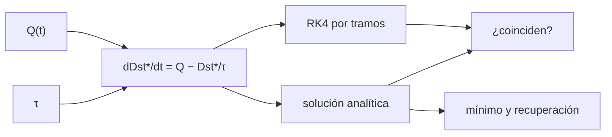

# B30-C18 — Tormentas geomagnéticas

<!-- nav:top -->
[🏠 Programa](../../../../README.md) · [📚 Bloque B30](../../../tronco-comun/B30-heliofisica-y-fisica-de-plasmas.md) · [← Anterior: B30-C17 — Auroras y corrientes ionosféricas](../B30-C17-auroras-y-corrientes-ionosfericas/CLASE.md) · [Siguiente: B30-C19 — Impactos del clima espacial →](../B30-C19-impactos-del-clima-espacial/CLASE.md)
<!-- /nav -->

## 1. Ubicación, nivel y alcance

Clase 18 del bloque B30. Nivel N3. Una tormenta geomagnética es la respuesta del campo terrestre a una inyección de energía del viento solar. Aquí resuelves la **ecuación de Burton** `dDst*/dt = Q(t) − Dst*/τ` con RK4 por tramos, la comparas con su solución analítica, exploras la sensibilidad a `Q₀`, `T` y `τ` y conviertes etiquetas de Kp a la **escala G** de NOAA. Usas la integración de [B11-C08](../../B11/B11-C08-integradores-de-paso-adaptativo/CLASE.md) y [B30-C13](../B30-C13-eyecciones-de-masa-coronal/CLASE.md). Se supone una inyección constante.

## 2. Por qué esta clase existe

Prever la profundidad y la duración de una tormenta orienta la protección de redes y satélites. La decisión central: **¿qué mínimo alcanza `Dst*` y cuánto tarda en recuperarse?**

## 3. Lo que podrás hacer al terminar

1. Resolver la ecuación de Burton con RK4 por tramos.
2. Comparar con la solución analítica.
3. Calcular el mínimo `−Q₀τ(1 − e^(−T/τ))`.
4. Calcular el tiempo de recuperación al 10 %.
5. Estudiar la sensibilidad a `Q₀`, `T` y `τ`.
6. Asignar la escala G a etiquetas de Kp.

La evidencia es la **ficha de una tormenta geomagnética** del ejercicio 12 (sección 20).

## 4. Con qué llegas y cómo comprobarlo

1. ¿Qué es una ecuación diferencial lineal?
2. ¿Qué es un tiempo de decaimiento?
3. ¿Qué es el índice Dst?
4. ¿Qué es el índice Kp?
5. ¿Qué es una inyección constante?

<details>
<summary>Ver respuestas</summary>

1. Una cuya incógnita aparece linealmente. 2. El tiempo para caer un factor `e`. 3. Una medida de la perturbación ecuatorial del campo (B30-C23). 4. Un índice trihorario de actividad (B30-C23). 5. Una fuente que no cambia con el tiempo.
</details>

Con cuatro o cinco aciertos, sigue; si no, repasa los prerrequisitos.

## 5. Un caso de contexto y casos de referencia

Con la inyección **ilustrativa** `Q₀ = 15 nT/h`, `τ = 8 h` y fase principal de `T = 6 h`, el mínimo es `−63,32 nT`. Es el **ejemplo conductor**. Los estudios de la tormenta de Carrington del 2 de septiembre de 1859 (S2) y de una tormenta de tipo Carrington del 29 de octubre de 2003 observada en Tihany (S3) son el contexto, solo resumen.

## 6. Vocabulario

La **fase principal** es la de inyección. La **fase de recuperación** es el decaimiento. El **tiempo de decaimiento** `τ`. El **mínimo** de `Dst*`. La **escala G** de NOAA clasifica por Kp. Una **tormenta de tipo Carrington** es una extrema.

## 7. Modelo mental: una bañera con desagüe

Como una bañera con grifo y desagüe: mientras el grifo vierte (inyección) el nivel baja hasta un equilibrio; al cerrarlo, el nivel se recupera exponencialmente.



*Descripción textual:* la inyección y el decaimiento definen la ecuación, que se integra con RK4 y se resuelve en forma cerrada; ambas se comparan y dan el mínimo y la recuperación.

Analogía: una bañera con desagüe. Límite: un solo `τ` e inyección constante.

## 8. La explicación, paso a paso

### 8.1 Evolución

| `t` (h) | `Dst*` analítico (nT) | `Dst*` RK4 (nT) |
|---|---|---|
| 1 | −14,1004 | −14,1004 |
| 3 | −37,5253 | −37,5253 |
| 6 | −63,3160 | −63,3160 |
| 12 | −29,9084 | −29,9084 |
| 24 | −6,6735 | −6,6735 |
| 48 | −0,3323 | −0,3323 |

Los dos coinciden a `10⁻¹³`. El mínimo, en `t = 6 h`, es `−63,32 nT` (fórmula `−Q₀τ(1 − e^(−T/τ))`).

### 8.2 Recuperación

`Dst*` vuelve al 10 % del mínimo en `T + τ ln 10 = 24,4 h` (valor `−6,332 nT`).

### 8.3 Sensibilidad

| `Q₀` (nT/h) | `T` (h) | `τ` (h) | mínimo (nT) |
|---|---|---|---|
| 15 | 6 | 8 | −63,32 |
| 30 | 6 | 8 | −126,63 |
| 15 | 12 | 8 | −93,22 |
| 15 | 6 | 16 | −75,05 |
| 60 | 3 | 8 | −150,10 |

El mínimo es proporcional a `Q₀` y satura hacia `−Q₀τ = −120 nT` al crecer `T`.

### 8.4 Escala G (NOAA)

| etiqueta de Kp | G |
|---|---|
| 4+ | 0 |
| 5−, 5o, 5+ | 1 |
| 6o | 2 |
| 7−, 7+ | 3 |
| 8o, 9− | 4 |
| 9o | 5 |

## 9. Magnitudes, símbolos y unidades

| Símbolo | Qué es | Unidad | Valor / nota |
|---|---|---|---|
| `Q₀` | inyección | nT/h | 15 (ilustrativa) |
| `τ` | tiempo de decaimiento | h | 8 (ilustrativo) |
| `T` | duración de la fase principal | h | 6 (ilustrativa) |
| `Dst*` | perturbación corregida | nT | ver 8.1 |
| G | escala de NOAA | — | ver 8.4 |

## 10. Convenciones y referencias

Inyección constante y un solo tiempo de decaimiento; `Q₀`, `τ` y `T` son **ilustrativos**; ninguna tormenta real se reproduce.

## 11. De dónde sale lo que afirmamos

| ID | Fuente | Localizador | Respalda | Estado |
|---|---|---|---|---|
| S3 | NOAA, *Space Weather Scales* | https://www.spaceweather.gov/noaa-scales-explanation | escalas G1–G5 (Kp 5, 6, 7, 8 incluido 9−, 9), S1–S5 y R1–R5 | Consultada el 2026-11-09 |
| S2 | arXiv:1608.07702 | https://arxiv.org/abs/1608.07702 | estudio de la tormenta de Carrington del 2 de septiembre de 1859 | Solo resumen, consultado el 2026-11-09 |
| S4 | arXiv:1505.07028 | https://arxiv.org/abs/1505.07028 | estudio de una tormenta de tipo Carrington del 29 de octubre de 2003 en Tihany | Solo resumen, consultado el 2026-11-09 |

Límites: S2 y S4 solo resumen y no respaldan ningún cálculo; la ecuación de Burton se usa como modelo clásico, no consultado; ninguna tormenta real se compara.

## 12. Cómo ver la tormenta

| `t` (h) | `Dst*` (nT) |
|---|---|
| 3 | −37,5 |
| 6 | −63,3 |
| 12 | −29,9 |
| 24 | −6,7 |
| 48 | −0,3 |

Descripción larga: baja durante 6 horas hasta −63 nT y luego se recupera exponencialmente.

## 13. Ejemplo trabajado: mínimo de Dst*

**Paso 1 · Cociente.** `T/τ = 6/8 = 0,75`.

**Paso 2 · Exponencial.** `1 − e^(−0,75) = 0,5276`.

**Paso 3 · Producto.** `Q₀τ = 120 nT`.

**Paso 4 · Mínimo.** `−120 × 0,5276 = −63,32 nT`.

## 14. Distintas formas de describir una tormenta

**Por profundidad:** mínimo de `Dst*`. **Por duración:** recuperación. **Por intensidad:** escala G. **Por energía:** inyección.

## 15. Práctica guiada

**Ejercicio 1 · con los pasos indicados.** Mínimo con `Q₀ = 15`, `τ = 8` y `T = 6`. *Pasos:* ejemplo 13.

<details><summary>Solución comentada</summary>

`−63,32 nT`.
</details>

**Ejercicio 2 · con una pista.** `Dst*` a las 12 h. *Pista:* `Dst_min e^(−6/8)`.

<details><summary>Solución comentada</summary>

`−63,32 × 0,4724 = −29,91 nT`.
</details>

**Ejercicio 3 · casi autónomo.** Instante de recuperación al 10 %.

<details><summary>Solución comentada</summary>

`6 + 8 ln 10 = 24,4 h`.
</details>

## 16. Práctica autónoma, transferencia e integrador

**Ejercicio 4.** Mínimo si `Q₀` se duplica.

<details><summary>Solución comentada</summary>

`−126,6 nT`.
</details>

**Ejercicio 5.** Mínimo con `T = 12 h`.

<details><summary>Solución comentada</summary>

`−93,2 nT`: no se duplica por la saturación.
</details>

**Ejercicio 6.** Asíntota para `T → ∞`.

<details><summary>Solución comentada</summary>

`−Q₀τ = −120 nT`.
</details>

**Ejercicio 7.** Escala G de la etiqueta `7+`.

<details><summary>Solución comentada</summary>

G3.
</details>

**Ejercicio 8.** Escala G de `9−`.

<details><summary>Solución comentada</summary>

G4.
</details>

**Ejercicio 9 · transferencia.** **Transferencia.** Un compañero dice que una tormenta tiene un mínimo de −63 nT. Responde con la sección 10.

<details><summary>Solución comentada</summary>

Es un valor del modelo con parámetros ilustrativos.
</details>

**Ejercicio 10 · transferencia.** **Transferencia.** ¿Por qué `Dst*` y la escala G no se comparan aquí?

<details><summary>Solución comentada</summary>

Porque G se define por Kp y no se consultó una equivalencia con Dst.
</details>

**Ejercicio 11 · transferencia.** **Transferencia.** ¿Qué limita extrapolar a tormentas de tipo Carrington?

<details><summary>Solución comentada</summary>

Un solo `τ` e inyección constante; no se consultó nada que los respalde.
</details>

**Ejercicio 12.** **Integrador.** Elabora tu *ficha de una tormenta geomagnética*: evolución, mínimo, recuperación, sensibilidad y escala G.

<details><summary>Solución comentada</summary>

Secciones 8.1–8.4.
</details>

**Ejercicio 12 · integrador.** **Integrador.** Elabora tu *ficha de una tormenta geomagnética*: evolución, mínimo, recuperación, sensibilidad y escala G.

<details><summary>Solución modelo</summary>

Secciones 8.1–8.4.
</details>

## 17. Laboratorio: ecuación de Burton y escala G

El script [tormentas.py](tormentas.py) integra con RK4 por tramos, compara con la solución analítica, estudia la sensibilidad y asigna la escala G (**comprueba** `10⁻⁶` entre RK4 y la analítica).

**Datos:** escalas de NOAA; `Q₀`, `τ`, `T` **ilustrativos**. **Predice antes de ejecutar:** ¿cuál es el mínimo? (≈−63 nT.) **Ejecución del 2026-11-09 (Python 3.12.9):**

```text
Python 3.12.9 (biblioteca estandar)
 t [h]  Dst* analitico [nT]  Dst* RK4 [nT]  dif. relativa
   1.0             -14.1004       -14.1004       1.89e-14
   3.0             -37.5253       -37.5253       1.63e-14
   6.0             -63.3160       -63.3160       1.40e-14
  12.0             -29.9084       -29.9084       1.11e-16
  24.0              -6.6735        -6.6735       2.86e-14
  48.0              -0.3323        -0.3323       9.04e-14
minimo de Dst* en t = 6 h: -63.32 nT (formula -Q_0 tau (1 - e^(-T/tau)) ; RK4: -63.32)
tiempo en que Dst* vuelve al 10 % del minimo: t = T + tau ln 10 = 24.4 h ; Dst*(24.4 h) = -6.332 nT (10.0 % del minimo)
Q_0 [nT/h]  T [h]  tau [h]  minimo [nT]
        15      6        8       -63.32
        30      6        8      -126.63
        15     12        8       -93.22
        15      6       16       -75.05
        60      3        8      -150.10
etiqueta de Kp -> escala G: 4+ -> G0, 5- -> G1, 5o -> G1, 5+ -> G1, 6o -> G2, 7- -> G3, 7+ -> G3, 8o -> G4, 9- -> G4, 9o -> G5
Pruebas superadas.
```

```bash
python programa/clases/B30/B30-C18-tormentas-geomagneticas/tormentas.py
```

**Límites:** inyección constante, un solo `τ`.

## 18. Errores frecuentes y cómo corregirlos

**Integrar sin respetar la discontinuidad de `Q`.** Se corrige con el laboratorio (tramos).

**Olvidar la saturación.** Se corrige con el ejercicio 5.

**Mezclar Dst y Kp.** Se corrige con el ejercicio 10.

**Tomar los parámetros por medidos.** Se corrige con la sección 10.

## 19. Cómo sabrás que vas bien

Tras 8.1: ¿cuándo es el mínimo? Si dudas, ejemplo 13. Tras 8.2: ¿cuánto tarda la recuperación al 10 %? Tras el laboratorio: ¿qué comprueba? (RK4 frente a la analítica).

## 20. Qué entregas y cómo se evalúa

El producto es tu **ficha de una tormenta geomagnética** (ejercicio 12).

| Criterio | Inicial | En desarrollo | Logrado | Destacado |
|---|---|---|---|---|
| Conceptos | Los confunde | Parciales | Burton, mínimo, G | Explica la saturación |
| Cálculo | Sin unidades | Con errores | Tablas completas | Calcula la recuperación |
| Numérico | Sin comprobar | Un caso | RK4 y analítica | Interpreta la sensibilidad |
| Fuentes | Sin fuente | Sin fecha | S1–S4 con fecha | Declara S2 y S4 como resumen |
| Límites | No los nombra | Uno | Tres | Discute qué falta del modelo |

**Condiciones críticas (no se compensan con promedio):** rotular los parámetros ilustrativos; no presentar el mínimo como una tormenta real; citar solo lo consultado.

## 21. Ética, seguridad y límites

Clase educativa: no pronostica tormentas. Accesibilidad: tablas equivalentes a las gráficas, fórmulas en texto, ejercicios sin conexión.

## 22. Para cerrar y seguir

Una inyección de 15 nT/h durante 6 h con `τ = 8 h` da un mínimo de `−63,3 nT` y una recuperación al 10 % a las 24,4 h. Queda una pregunta: ¿qué daños causa una tormenta?

**Glosario español–inglés.** tormenta geomagnética · *geomagnetic storm*; fase principal · *main phase*; fase de recuperación · *recovery phase*; ecuación de Burton · *Burton equation*; escala G · *G scale*.

**Continuidad.** [B30-C19](../B30-C19-impactos-del-clima-espacial/CLASE.md) estudia los impactos del clima espacial.

**Referencias:** ver sección 11.

<!-- nav:bottom -->
---

[← Anterior: B30-C17 — Auroras y corrientes ionosféricas](../B30-C17-auroras-y-corrientes-ionosfericas/CLASE.md) · [📚 Bloque B30](../../../tronco-comun/B30-heliofisica-y-fisica-de-plasmas.md) · [Siguiente: B30-C19 — Impactos del clima espacial →](../B30-C19-impactos-del-clima-espacial/CLASE.md)
<!-- /nav -->
