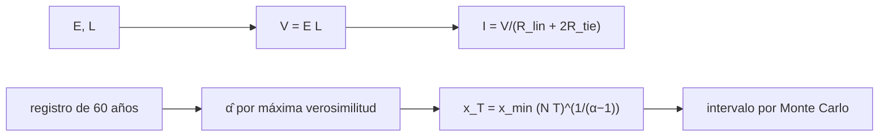

# B30-C19 — Impactos del clima espacial

<!-- nav:top -->
[🏠 Programa](../../../../README.md) · [📚 Bloque B30](../../../tronco-comun/B30-heliofisica-y-fisica-de-plasmas.md) · [← Anterior: B30-C18 — Tormentas geomagnéticas](../B30-C18-tormentas-geomagneticas/CLASE.md) · [Siguiente: B30-C20 — Análisis de alerta solar real →](../B30-C20-analisis-de-alerta-solar-real/CLASE.md)
<!-- /nav -->

## 1. Ubicación, nivel y alcance

Clase 19 del bloque B30. Nivel N3. Las tormentas inducen corrientes en conductores largos y exponen a satélites, aviones y redes eléctricas. Aquí modelas una **corriente geomagnéticamente inducida (GIC)** como un circuito sencillo y estimas **niveles de retorno** de eventos extremos con una cola de potencias, mostrando la incertidumbre al extrapolar de 60 años a 100. Usas [B05](../../../tronco-comun/B05-fisica-fundamental-para-el-espacio.md) y la estadística de [B12](../../../tronco-comun/B12-probabilidad-estadistica-e-incertidumbre.md). Se supone un campo uniforme y eventos independientes.

## 2. Por qué esta clase existe

Las infraestructuras se diseñan para eventos raros, que no están en un registro corto. La decisión central: **¿qué corriente induce un campo dado y cuán fiable es extrapolar un nivel de 100 años?**

## 3. Lo que podrás hacer al terminar

1. Calcular `I = EL/(R_línea + 2R_tierra)`.
2. Estudiar la escala con `E` y `L`.
3. Calcular el nivel de retorno `x_min(NT)^(1/(α−1))`.
4. Estimar `α` por máxima verosimilitud en registros de 60 años.
5. Propagar la incertidumbre al nivel de 100 años.
6. Reconocer el alcance de una extrapolación.

La evidencia es la **ficha de los impactos del clima espacial** del ejercicio 12 (sección 20).

## 4. Con qué llegas y cómo comprobarlo

1. ¿Qué es la ley de Ohm?
2. ¿Qué es una cola de potencias?
3. ¿Qué es un nivel de retorno?
4. ¿Qué es un intervalo del 5–95 %?
5. ¿Qué es una simulación Monte Carlo?

<details>
<summary>Ver respuestas</summary>

1. `V = IR`. 2. Una distribución cuya cola decae como potencia. 3. El valor superado una vez por periodo. 4. El rango que contiene el 90 % central. 5. Repetir con números aleatorios.
</details>

Con cuatro o cinco aciertos, sigue; si no, repasa los prerrequisitos.

## 5. Un caso de contexto y casos de referencia

Con un campo geoeléctrico **ilustrativo** de `1 V/km` en una línea de `100 km` (`R = 5 Ω` y dos tomas de `0,5 Ω`), la corriente es `16,67 A`. Es el **ejemplo conductor**. Para una cola con `α = 2,5` y 10 eventos por año, el nivel de 100 años es `100 x_min`.

## 6. Vocabulario

La **GIC** es la corriente casi continua inducida en un conductor. El **campo geoeléctrico** es el campo `E` en el suelo. El **nivel de retorno** `x_T` es el valor superado en promedio una vez cada `T` años. El **índice de la cola** `α`. La **extrapolación** va más allá del registro.

## 7. Modelo mental: el seguro de una inundación

Como estimar la inundación de cada cien años a partir de seis décadas de lluvias: con pocas observaciones extremas, la estimación es incierta y depende de la forma de la cola.



*Descripción textual:* el campo y la longitud dan la corriente por un circuito; el registro da el índice de la cola, el nivel de retorno y su intervalo.

Analogía: el seguro de una inundación. Límite: eventos independientes y cola de potencias.

## 8. La explicación, paso a paso

### 8.1 Corriente inducida

| `E` (V/km) | `L` (km) | `V = EL` (V) | `R` total (Ω) | `I` (A) |
|---|---|---|---|---|
| 1 | 100 | 100 | 6,0 | 16,67 |
| 2 | 100 | 200 | 6,0 | 33,33 |
| 1 | 200 | 200 | 6,0 | 33,33 |
| 5 | 100 | 500 | 6,0 | 83,33 |
| 5 | 400 | 2000 | 6,0 | 333,33 |

La corriente es proporcional a `E` y a `L`.

### 8.2 Niveles de retorno

Con `α = 2,5` y 10 eventos/año: `x_1 = 4,64`, `x_10 = 21,54` y `x_100 = 100,00` en unidades de `x_min`; `x_100/x_10 = 10^(2/3) = 4,64`.

### 8.3 Incertidumbre

En 500 registros sintéticos de 60 años (semilla fija):

| magnitud | mediana | intervalo del 5–95 % | verdadero |
|---|---|---|---|
| `α̂` | 2,498 | [2,402; 2,610] | 2,5 |
| nivel de 100 años | 100,29 | [72,54; 135,81] | 100,00 |

El cociente del intervalo del 95 % entre el del 5 % es `1,87`.

### 8.4 Lectura

Aun con una cola ideal y 60 años de datos, el nivel de 100 años queda incierto en un factor ≈1,9. Con `α = 2,4` sería `139` y con `α = 2,6`, `75`: una variación del índice de ±0,1 cambia el nivel de 100 años entre −25 % y +39 %.

## 9. Magnitudes, símbolos y unidades

| Símbolo | Qué es | Unidad | Valor / nota |
|---|---|---|---|
| `E` | campo geoeléctrico | V/km | 1–5 (ilustrativo) |
| `L` | longitud de la línea | km | 100–400 (ilustrativa) |
| `I` | corriente inducida | A | `EL/R` |
| `α` | índice de la cola | — | 2,5 (ilustrativo) |
| `x_T` | nivel de retorno | `x_min` | ver 8.2 |

## 10. Convenciones y referencias

Campo uniforme, circuito de corriente continua, cola de potencias con 10 eventos por año; todos los valores son **ilustrativos**; semilla `20261109`.

## 11. De dónde sale lo que afirmamos

| ID | Fuente | Localizador | Respalda | Estado |
|---|---|---|---|---|
| — | Sin fuente externa | — | el circuito y los niveles de retorno son modelos estándar que verifica el laboratorio | No se consultó una fuente para esta clase |

Límites: no se consultó ninguna fuente de impactos ni de estadística de extremos; los parámetros son ilustrativos; no se estima ningún riesgo real.

## 12. Cómo ver la incertidumbre

| Nivel | Mediana | 5–95 % |
|---|---|---|
| 100 años | 100,3 | [72,5; 135,8] |

Descripción larga: la mediana coincide con el verdadero pero el intervalo abarca casi un factor 2.

## 13. Ejemplo trabajado: corriente de una línea

**Paso 1 · Tensión.** `V = 1 V/km × 100 km = 100 V`.

**Paso 2 · Resistencia.** `5 + 2 × 0,5 = 6 Ω`.

**Paso 3 · Cociente.** `I = 100/6`.

**Paso 4 · Valor.** `16,67 A`.

## 14. Distintas formas de describir un impacto

**Por corriente:** GIC. **Por frecuencia:** nivel de retorno. **Por incertidumbre:** Monte Carlo. **Por escala:** campo y longitud.

## 15. Práctica guiada

**Ejercicio 1 · con los pasos indicados.** Corriente con `E = 1 V/km`, `L = 100 km`. *Pasos:* ejemplo 13.

<details><summary>Solución comentada</summary>

`16,67 A`.
</details>

**Ejercicio 2 · con una pista.** Corriente si la longitud se duplica. *Pista:* proporcional a `L`.

<details><summary>Solución comentada</summary>

`33,33 A`.
</details>

**Ejercicio 3 · casi autónomo.** Corriente si las tomas son de `2 Ω`.

<details><summary>Solución comentada</summary>

`100/9 = 11,1 A`.
</details>

## 16. Práctica autónoma, transferencia e integrador

**Ejercicio 4.** `x_10` para `α = 2,5` y 10 eventos/año.

<details><summary>Solución comentada</summary>

`100^0,667 = 21,54`.
</details>

**Ejercicio 5.** `x_1`.

<details><summary>Solución comentada</summary>

`10^0,667 = 4,64`.
</details>

**Ejercicio 6.** Cociente `x_100/x_10`.

<details><summary>Solución comentada</summary>

`4,64`.
</details>

**Ejercicio 7.** Cociente de los extremos del intervalo del nivel de 100 años.

<details><summary>Solución comentada</summary>

`135,81/72,54 = 1,87`.
</details>

**Ejercicio 8.** `x_100` con `α = 2,4` y con `α = 2,6`.

<details><summary>Solución comentada</summary>

`139` y `75`.
</details>

**Ejercicio 9 · transferencia.** **Transferencia.** Un compañero afirma que una GIC de 17 A es típica. Responde con la sección 10.

<details><summary>Solución comentada</summary>

Es un resultado ilustrativo; no se consultó ninguna medición.
</details>

**Ejercicio 10 · transferencia.** **Transferencia.** ¿Por qué el intervalo es tan ancho con 60 años?

<details><summary>Solución comentada</summary>

Porque el nivel de 100 años extrapola más allá del registro y depende de `α`.
</details>

**Ejercicio 11 · transferencia.** **Transferencia.** ¿Qué hace falta para estimar un riesgo real?

<details><summary>Solución comentada</summary>

Datos, una distribución justificada y la geología local; esta clase no los tiene.
</details>

**Ejercicio 12.** **Integrador.** Elabora tu *ficha de los impactos del clima espacial*: GIC, niveles de retorno e incertidumbre.

<details><summary>Solución comentada</summary>

Secciones 8.1–8.4.
</details>

**Ejercicio 12 · integrador.** **Integrador.** Elabora tu *ficha de los impactos del clima espacial*: GIC, niveles de retorno e incertidumbre.

<details><summary>Solución modelo</summary>

Secciones 8.1–8.4.
</details>

## 17. Laboratorio: GIC y niveles de retorno

El script [impactos.py](impactos.py) calcula la GIC de un circuito y estima por Monte Carlo el nivel de 100 años de una cola de potencias (**comprueba** que el valor verdadero cae en el intervalo del 5–95 %).

**Datos:** sin constantes físicas; todos los valores **ilustrativos**; semilla `20261109`. **Predice antes de ejecutar:** ¿qué amplitud tendrá el intervalo del nivel de 100 años? (casi un factor 2.) **Ejecución del 2026-11-09 (Python 3.12.9):**

```text
Python 3.12.9 (biblioteca estandar)
 E [V/km]  L [km]  V = E L [V]  R total [ohm]    I [A]
      1.0     100          100            6.0    16.67
      2.0     100          200            6.0    33.33
      1.0     200          200            6.0    33.33
      5.0     100          500            6.0    83.33
      5.0     400         2000            6.0   333.33
cola con alpha = 2.5, 10 eventos/anio: nivel de 100 anios verdadero = 100.00 x_min ; de 10 anios = 21.54 x_min ; de 1 anio = 4.64 x_min
500 registros de 60 anios: alpha estimado: mediana 2.498, intervalo 5-95 % [2.402, 2.610] (verdadero 2.5)
nivel de 100 anios estimado: mediana 100.29, intervalo 5-95 % [72.54, 135.81] x_min (verdadero 100.00)
cociente del intervalo 95/5 % para el nivel de 100 anios: 1.87
Pruebas superadas.
```

```bash
python programa/clases/B30/B30-C19-impactos-del-clima-espacial/impactos.py
```

**Límites:** campo uniforme, eventos independientes.

## 18. Errores frecuentes y cómo corregirlos

**Olvidar las tomas a tierra.** Se corrige con el ejercicio 3.

**Dar un nivel sin intervalo.** Se corrige con 8.3.

**Extrapolar sin declarar `α`.** Se corrige con el ejercicio 8.

**Tomar los números por riesgos reales.** Se corrige con la sección 10.

## 19. Cómo sabrás que vas bien

Tras 8.1: ¿cómo escala `I`? Si dudas, ejemplo 13. Tras 8.3: ¿cuán incierto es el nivel de 100 años? Tras el laboratorio: ¿qué comprueba? (el intervalo).

## 20. Qué entregas y cómo se evalúa

El producto es tu **ficha de los impactos del clima espacial** (ejercicio 12).

| Criterio | Inicial | En desarrollo | Logrado | Destacado |
|---|---|---|---|---|
| Conceptos | Los confunde | Parciales | GIC, nivel de retorno | Explica la incertidumbre de la extrapolación |
| Cálculo | Sin unidades | Con errores | Tablas completas | Calcula la sensibilidad a `α` |
| Numérico | Sin comprobar | Un caso | Intervalo por Monte Carlo | Interpreta el cociente 1,87 |
| Fuentes | Sin fuente | Sin fecha | Declara la ausencia de fuente | Distingue ilustrativo y real |
| Límites | No los nombra | Uno | Tres | Discute qué falta del modelo |

**Condiciones críticas (no se compensan con promedio):** rotular todo como ilustrativo; no estimar un riesgo real; citar solo lo consultado.

## 21. Ética, seguridad y límites

Clase educativa: no sirve para dimensionar infraestructuras. Accesibilidad: tablas equivalentes a las gráficas, fórmulas en texto, ejercicios sin conexión.

## 22. Para cerrar y seguir

Un campo de 1 V/km induce 16,7 A en una línea de 100 km y el nivel de 100 años de una cola ideal queda en un intervalo de factor 1,9 con 60 años de datos. Queda una pregunta: ¿cómo se leen los datos de una alerta real?

**Glosario español–inglés.** corriente inducida geomagnéticamente · *geomagnetically induced current*; campo geoeléctrico · *geoelectric field*; nivel de retorno · *return level*; cola de potencias · *power-law tail*; extrapolación · *extrapolation*.

**Continuidad.** [B30-C20](../B30-C20-analisis-de-alerta-solar-real/CLASE.md) analiza una alerta solar.

**Referencias:** ver sección 11.

<!-- nav:bottom -->
---

[← Anterior: B30-C18 — Tormentas geomagnéticas](../B30-C18-tormentas-geomagneticas/CLASE.md) · [📚 Bloque B30](../../../tronco-comun/B30-heliofisica-y-fisica-de-plasmas.md) · [Siguiente: B30-C20 — Análisis de alerta solar real →](../B30-C20-analisis-de-alerta-solar-real/CLASE.md)
<!-- /nav -->
