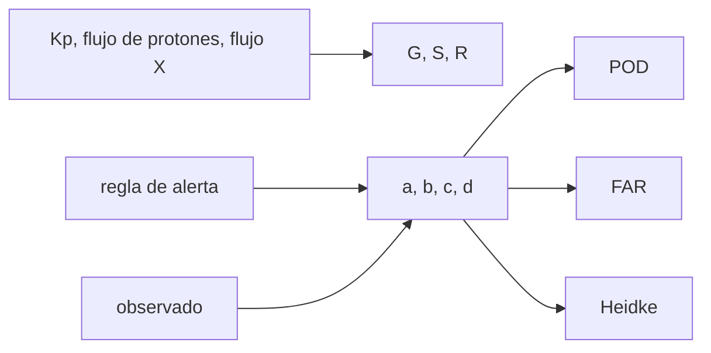

# B30-C20 — Análisis de alerta solar real

<!-- nav:top -->
[🏠 Programa](../../../../README.md) · [📚 Bloque B30](../../../tronco-comun/B30-heliofisica-y-fisica-de-plasmas.md) · [← Anterior: B30-C19 — Impactos del clima espacial](../B30-C19-impactos-del-clima-espacial/CLASE.md) · [Siguiente: B30-C21 — Radioemisión solar: estallidos de radio y su observación →](../B30-C21-radioemision-solar-estallidos-de-radio-y-su-observacion/CLASE.md)
<!-- /nav -->

## 1. Ubicación, nivel y alcance

Clase 20 del bloque B30. Nivel N3. Una alerta de clima espacial se lee con tres escalas de NOAA (G para tormentas geomagnéticas, S para tormentas de radiación solar y R para apagones de radio) y se evalúa con una **tabla de contingencia**. Aquí clasificas un **año sintético** en G, S y R y mides una regla de alerta con **POD**, **FAR**, **CSI** y la **puntuación de Heidke**. El laboratorio no usa un registro real porque no se consultó ninguno; el ejercicio integrador pide repetirlo con una serie pública que obtengas tú. Usas [B12](../../../tronco-comun/B12-probabilidad-estadistica-e-incertidumbre.md) y las clases [B30-C12](../B30-C12-erupciones-y-fulguraciones-solares/CLASE.md) y [B30-C18](../B30-C18-tormentas-geomagneticas/CLASE.md). Se supone un registro diario con persistencia gaussiana.

## 2. Por qué esta clase existe

Una alerta con muchas falsas alarmas se ignora y una con muchos fallos no sirve; medir ambas cosas es parte del oficio. La decisión central: **¿cómo se clasifica un evento y cómo se mide si una regla de alerta tiene habilidad?**

## 3. Lo que podrás hacer al terminar

1. Clasificar un valor en G, S o R con los umbrales de NOAA.
2. Leer los 28 valores de Kp en tercios.
3. Armar una tabla de contingencia `a, b, c, d`.
4. Calcular POD, FAR, CSI y la puntuación de Heidke por dos fórmulas.
5. Comparar con la regla trivial «nunca alertar».
6. Reconocer que una regla se evalúa con datos, no con la tasa de aciertos.

La evidencia es la **ficha de análisis de una alerta** del ejercicio 12 (sección 20).

## 4. Con qué llegas y cómo comprobarlo

1. ¿Qué es un umbral?
2. ¿Qué es un falso positivo?
3. ¿Qué es una tabla de contingencia?
4. ¿Qué es una tasa base?
5. ¿Qué es una puntuación de habilidad?

<details>
<summary>Ver respuestas</summary>

1. Un valor a partir del cual se declara un evento. 2. Alertar y que no ocurra. 3. Una tabla que cruza lo pronosticado con lo observado. 4. La frecuencia del evento. 5. Una medida de cuánto mejora un pronóstico sobre el azar.
</details>

Con cuatro o cinco aciertos, sigue; si no, repasa los prerrequisitos.

## 5. Un caso de contexto y casos de referencia

NOAA define G1–G5 por Kp = 5, 6, 7, 8 (incluido 9−) y 9; S1–S5 por flujos de protones de ≥10 MeV de 10, 10², 10³, 10⁴ y 10⁵ pfu; y R1–R5 por flujos de rayos X de `10⁻⁵`, `5 × 10⁻⁵`, `10⁻⁴`, `10⁻³` y `2 × 10⁻³ W/m²` (S1). Es el **ejemplo conductor**. El año de 365 días del laboratorio es **sintético**. Los estudios de tormentas de tipo Carrington (B30-C18) son el contexto de por qué importan los extremos.

## 6. Vocabulario

Una **escala** (G, S, R) traduce una medida a un nivel de 1 a 5. Un **acierto** (`a`), una **falsa alarma** (`b`), un **fallo** (`c`) y un **negativo correcto** (`d`) forman la tabla. El **POD** es la fracción de eventos detectados, el **FAR** la de alertas falsas y el **CSI** la de aciertos sobre todos los casos relevantes. La **puntuación de Heidke** mide la mejora sobre el azar.

## 7. Modelo mental: un detector de humo

Un detector de humo muy sensible suena con las tostadas (falsas alarmas) y uno muy duro no suena con el incendio (fallos). Las puntuaciones miden el equilibrio.



*Descripción textual:* las medidas se convierten en escalas G, S y R; la regla y lo observado forman la tabla de contingencia, de la que salen POD, FAR y Heidke.

Analogía: un detector de humo. Límite: eventos diarios con persistencia gaussiana.

## 8. La explicación, paso a paso

### 8.1 Un año sintético

| escala | 0 | 1 | 2 | 3 | 4 | 5 |
|---|---|---|---|---|---|---|
| G | 326 | 22 | 14 | 2 | 0 | 1 |
| S | 361 | 3 | 1 | 0 | 0 | 0 |
| R | 347 | 16 | 0 | 2 | 0 | 0 |

Cada fila suma 365 días. La escala de Kp tiene 28 valores de `0o` a `9o`.

### 8.2 Regla de alerta

Regla: pronosticar R1 o mayor mañana si hoy el flujo de rayos X es ≥ C5 (`5 × 10⁻⁶ W/m²`). En 364 pares de días:

| | observado sí | observado no |
|---|---|---|
| alerta sí | `a = 12` | `b = 24` |
| alerta no | `c = 6` | `d = 322` |

### 8.3 Puntuaciones

Tasa base `0,049`; POD `= 12/18 = 0,667`; FAR `= 24/36 = 0,667`; CSI `= 12/42 = 0,286`; Heidke `= 2(ad − bc)/[(a+c)(c+d) + (a+b)(b+d)] = 0,405`. La segunda fórmula `(PC − E)/(1 − E)` da el mismo valor.

### 8.4 Lectura

Aunque el 91,8 % de los días se pronostican bien, la regla «nunca alertar» acierta el 95,1 % (`346/364`) con habilidad nula (Heidke 0): la tasa de aciertos no sirve cuando el evento es raro, y la puntuación de Heidke sí.

## 9. Magnitudes, símbolos y unidades

| Símbolo | Qué es | Unidad | Valor / nota |
|---|---|---|---|
| G, S, R | escalas de NOAA | — | 1 a 5 |
| `a, b, c, d` | tabla de contingencia | días | ver 8.2 |
| POD | probabilidad de detección | — | `a/(a+c)` |
| FAR | razón de falsas alarmas | — | `b/(a+b)` |
| CSI | índice crítico de éxito | — | `a/(a+b+c)` |
| HSS | puntuación de Heidke | — | ver 8.3 |

## 10. Convenciones y referencias

Umbrales de NOAA; registro de 365 días con semilla `20261109`, persistencia `ρ = 0,7` en el logaritmo del flujo de rayos X y colas sintéticas en Kp y en los protones; todo es **ilustrativo**.

## 11. De dónde sale lo que afirmamos

| ID | Fuente | Localizador | Respalda | Estado |
|---|---|---|---|---|
| S1 | NOAA, *Space Weather Scales* | https://www.spaceweather.gov/noaa-scales-explanation | escalas G1–G5 (Kp 5, 6, 7, 8 incluido 9−, 9), S1–S5 (protones ≥ 10 MeV: 10 a 10⁵ pfu) y R1–R5 (M1, M5, X1, X10, X20) | Consultada el 2026-11-09 |

Límites: no se consultó ningún registro real de Kp, protones o rayos X; el comportamiento de la regla refleja el generador sintético y no el Sol.

## 12. Cómo ver la habilidad

| Puntuación | Valor |
|---|---|
| POD | 0,667 |
| FAR | 0,667 |
| CSI | 0,286 |
| Heidke | 0,405 |

Descripción larga: la regla detecta dos tercios de los eventos pero dos tercios de sus alertas son falsas.

## 13. Ejemplo trabajado: clasificar un flujo en R

**Paso 1 · Flujo.** `7 × 10⁻⁵ W/m²`.

**Paso 2 · Umbrales.** Supera `5 × 10⁻⁵` (R2) y no llega a `10⁻⁴` (R3).

**Paso 3 · Nivel.** R2.

**Paso 4 · Equivalente.** Corresponde a una fulguración M7.

## 14. Distintas formas de describir una alerta

**Por escala:** G, S, R. **Por tabla:** `a, b, c, d`. **Por puntuación:** POD, FAR, CSI, HSS. **Por referencia:** tasa base.

## 15. Práctica guiada

**Ejercicio 1 · con los pasos indicados.** Nivel R de `7 × 10⁻⁵ W/m²`. *Pasos:* ejemplo 13.

<details><summary>Solución comentada</summary>

R2.
</details>

**Ejercicio 2 · con una pista.** Nivel S de 150 pfu. *Pista:* 10, 100, 1000.

<details><summary>Solución comentada</summary>

S2.
</details>

**Ejercicio 3 · casi autónomo.** Nivel G de una etiqueta `8−`.

<details><summary>Solución comentada</summary>

G4 (dígito 8).
</details>

## 16. Práctica autónoma, transferencia e integrador

**Ejercicio 4.** POD de la regla.

<details><summary>Solución comentada</summary>

`12/18 = 0,667`.
</details>

**Ejercicio 5.** FAR.

<details><summary>Solución comentada</summary>

`24/36 = 0,667`.
</details>

**Ejercicio 6.** CSI.

<details><summary>Solución comentada</summary>

`12/42 = 0,286`.
</details>

**Ejercicio 7.** Heidke con la fórmula `(PC − E)/(1 − E)`.

<details><summary>Solución comentada</summary>

`PC = 0,9176`, `E = 0,8614`: `0,0562/0,1386 = 0,405`.
</details>

**Ejercicio 8.** Tasa de aciertos y Heidke de «nunca alertar».

<details><summary>Solución comentada</summary>

`346/364 = 95,1 %`; Heidke `= 0`.
</details>

**Ejercicio 9 · transferencia.** **Transferencia.** Un compañero concluye que la regla sirve para el Sol con HSS = 0,405. Responde con la sección 10.

<details><summary>Solución comentada</summary>

Es un resultado sobre un registro sintético; no se probó con datos reales.
</details>

**Ejercicio 10 · transferencia.** **Transferencia.** ¿Por qué no basta la tasa de aciertos?

<details><summary>Solución comentada</summary>

Porque el evento raro hace que no alertar acierte casi siempre.
</details>

**Ejercicio 11 · transferencia.** **Transferencia.** ¿Cómo cambiaría la tabla con un umbral de alerta más alto?

<details><summary>Solución comentada</summary>

Menos alertas: baja `b`, sube `c`; POD baja y FAR baja.
</details>

**Ejercicio 12.** **Integrador.** Elabora tu *ficha de análisis de una alerta*: clasifica un registro público que obtengas tú, arma la tabla y calcula las puntuaciones.

<details><summary>Solución comentada</summary>

Secciones 8.1–8.4 con tus datos.
</details>

**Ejercicio 12 · integrador.** **Integrador.** Elabora tu *ficha de análisis de una alerta*: clasifica un registro público que obtengas tú, arma la tabla y calcula las puntuaciones.

<details><summary>Solución modelo</summary>

Secciones 8.1–8.4 con tus datos.
</details>

## 17. Laboratorio: clasificación G, S, R y habilidad de una alerta

El script [alerta.py](alerta.py) clasifica un año sintético, arma la tabla de contingencia y calcula POD, FAR, CSI y Heidke por dos fórmulas (**comprueba** que las dos fórmulas de Heidke coinciden a `10⁻¹²`).

**Datos:** umbrales de NOAA; registro **sintético** con semilla `20261109`. **Predice antes de ejecutar:** ¿cuánto vale el POD? (≈2/3.) **Ejecución del 2026-11-09 (Python 3.12.9):**

```text
Python 3.12.9 (biblioteca estandar)
escala de Kp de 28 valores: 28 etiquetas, de 0o a 9o
umbrales: G G1=Kp5 G2=Kp6 G3=Kp7 G4=Kp8 G5=Kp9 ; S S1>=10 S2>=100 S3>=1000 S4>=10000 S5>=100000 pfu ; R R1>=1e-05 R2>=5e-05 R3>=0.0001 R4>=0.001 R5>=0.002 W/m2
escala       0     1     2     3     4     5
G          326    22    14     2     0     1
S          361     3     1     0     0     0
R          347    16     0     2     0     0
pares de dias: 364 ; aciertos a = 12, falsas alarmas b = 24, fallos c = 6, negativos correctos d = 322
tasa base de R1 o mayor = 0.049 ; POD = 0.667 ; FAR = 0.667 ; CSI = 0.286 ; Heidke = 0.405 (dos formulas: 0.405)
Pruebas superadas.
```

```bash
python programa/clases/B30/B30-C20-analisis-de-alerta-solar-real/alerta.py
```

**Límites:** persistencia gaussiana, generador sintético.

## 18. Errores frecuentes y cómo corregirlos

**Evaluar solo con la tasa de aciertos.** Se corrige con el ejercicio 8.

**Confundir el nivel G con el valor de Kp.** Se corrige con 8.1.

**Presentar el resultado sintético como real.** Se corrige con la sección 10.

**Olvidar la tasa base.** Se corrige con 8.3.

## 19. Cómo sabrás que vas bien

Tras 8.1: ¿cuántos días hay en G1 o más? Si dudas, ejemplo 13. Tras 8.3: ¿cuánto vale Heidke? Tras el laboratorio: ¿qué comprueba? (las dos fórmulas).

## 20. Qué entregas y cómo se evalúa

El producto es tu **ficha de análisis de una alerta** (ejercicio 12).

| Criterio | Inicial | En desarrollo | Logrado | Destacado |
|---|---|---|---|---|
| Conceptos | Los confunde | Parciales | escalas, tabla, puntuaciones | Explica la tasa de aciertos engañosa |
| Cálculo | Sin unidades | Con errores | Tablas completas | Calcula la segunda fórmula |
| Numérico | Sin comprobar | Un caso | Dos fórmulas | Interpreta la tasa base |
| Fuentes | Sin fuente | Sin fecha | S1 con fecha | Declara que no hay registro real |
| Límites | No los nombra | Uno | Tres | Discute qué falta del modelo |

**Condiciones críticas (no se compensan con promedio):** rotular el registro como sintético; no presentar las puntuaciones como del Sol; citar solo lo consultado.

## 21. Ética, seguridad y límites

Clase educativa: no emite alertas. Accesibilidad: tablas equivalentes a las gráficas, fórmulas en texto, ejercicios sin conexión.

## 22. Para cerrar y seguir

La regla ilustrativa detecta `67 %` de los eventos con `67 %` de falsas alarmas y una habilidad de Heidke de `0,41`, mientras que no alertar acierta `95 %` con habilidad nula. Queda una pregunta: ¿cómo se observa la radiación solar en radio?

**Glosario español–inglés.** escala de NOAA · *NOAA scale*; tabla de contingencia · *contingency table*; probabilidad de detección · *probability of detection*; falsa alarma · *false alarm*; puntuación de Heidke · *Heidke skill score*.

**Continuidad.** [B30-C21](../B30-C21-radioemision-solar-estallidos-de-radio-y-su-observacion/CLASE.md) estudia la radioemisión solar.

**Referencias:** ver sección 11.

<!-- nav:bottom -->
---

[← Anterior: B30-C19 — Impactos del clima espacial](../B30-C19-impactos-del-clima-espacial/CLASE.md) · [📚 Bloque B30](../../../tronco-comun/B30-heliofisica-y-fisica-de-plasmas.md) · [Siguiente: B30-C21 — Radioemisión solar: estallidos de radio y su observación →](../B30-C21-radioemision-solar-estallidos-de-radio-y-su-observacion/CLASE.md)
<!-- /nav -->
