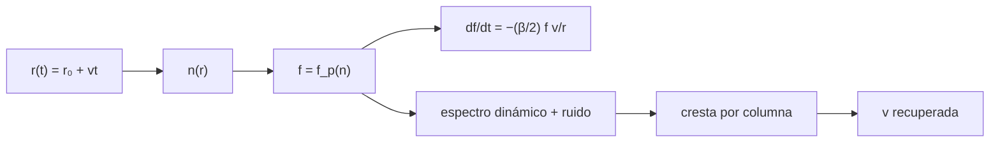

# B30-C21 — Radioemisión solar: estallidos de radio y su observación

<!-- nav:top -->
[🏠 Programa](../../../../README.md) · [📚 Bloque B30](../../../tronco-comun/B30-heliofisica-y-fisica-de-plasmas.md) · [← Anterior: B30-C20 — Análisis de alerta solar real](../B30-C20-analisis-de-alerta-solar-real/CLASE.md) · [Siguiente: B30-C22 — Anillo de corriente y corrientes magnetosféricas →](../B30-C22-anillo-de-corriente-y-corrientes-magnetosfericas/CLASE.md)
<!-- /nav -->

## 1. Ubicación, nivel y alcance

Clase 21 del bloque B30. Nivel N3. Los estallidos de radio solares revelan los electrones que escapan de la corona. En un **estallido tipo III**, un haz de electrones viaja hacia fuera y emite a la frecuencia de plasma local, por lo que la frecuencia baja con el tiempo (la **deriva en frecuencia**). Aquí calculas esa deriva con un modelo de densidad, construyes un **espectro dinámico sintético** con ruido y recuperas la **velocidad del haz**. Usas las frecuencias de [B30-C08](../B30-C08-frecuencias-y-ondas-de-plasma/CLASE.md) y el ajuste de [B12](../../../tronco-comun/B12-probabilidad-estadistica-e-incertidumbre.md). Se supone velocidad constante y densidad esférica.

## 2. Por qué esta clase existe

Una frecuencia es una altura, y la deriva en frecuencia da la velocidad del haz. La decisión central: **¿cómo se convierte un espectro dinámico en la velocidad de los electrones?**

## 3. Lo que podrás hacer al terminar

1. Calcular `f_p(r)` con un modelo `n ∝ r^(−β)`.
2. Calcular la deriva `df/dt = −(β/2)fv/r` y compararla con la numérica.
3. Construir un espectro dinámico sintético con ruido.
4. Recuperar la cresta por columna y ajustar la velocidad.
5. Distinguir fundamental y armónico.
6. Reconocer los límites del modelo.

La evidencia es la **ficha de un estallido de radio** del ejercicio 12 (sección 20).

## 4. Con qué llegas y cómo comprobarlo

1. ¿Qué es un espectro dinámico?
2. ¿Qué es una frecuencia de plasma?
3. ¿Qué es un ajuste por mínimos cuadrados?
4. ¿Qué es el ruido gaussiano?
5. ¿Qué es un armónico?

<details>
<summary>Ver respuestas</summary>

1. Una imagen de intensidad en función del tiempo y la frecuencia. 2. `f_p ∝ √n` (B30-C08). 3. El que minimiza la suma de cuadrados. 4. Una perturbación aleatoria normal. 5. Un múltiplo entero de la frecuencia fundamental.
</details>

Con cuatro o cinco aciertos, sigue; si no, repasa los prerrequisitos.

## 5. Un caso de contexto y casos de referencia

Un haz de `0,2 c` (59,96 Mm/s) que parte de `1,2 R_☉` en un medio **ilustrativo** `n = 10¹⁵(R_☉/r)^2,5 m⁻³` cruza 100 MHz a los `12,8 s`, a `2,30 R_☉`. Es el **ejemplo conductor**. Un estudio describe las clases de estallidos solares de tipo I a V (S3, solo resumen).

## 6. Vocabulario

Un **estallido tipo III** es el producido por un haz de electrones rápidos. El **espectro dinámico** muestra la deriva. La **deriva en frecuencia** es `df/dt`. La **emisión fundamental** está en `f_p`, el **armónico** en `2f_p`. El **modelo de densidad** da la altura de cada frecuencia.

## 7. Modelo mental: un tren que pasa por estaciones

El haz es como un tren que atraviesa estaciones de frecuencia decreciente: cada estación emite su nota (la frecuencia de plasma), y la velocidad se lee del ritmo con que se pasa de una a otra.



*Descripción textual:* la posición del haz fija la densidad y la frecuencia; de ahí salen la deriva y el espectro dinámico, del que se recupera la cresta y la velocidad.

Analogía: un tren que pasa por estaciones. Límite: velocidad constante.

## 8. La explicación, paso a paso

### 8.1 Frecuencia y deriva

| `t` (s) | `r` (`R_☉`) | `f_p` (MHz) | `2f_p` (MHz) | `df/dt` numérica (MHz/s) | analítica |
|---|---|---|---|---|---|
| 0 | 1,200 | 226,07 | 452,13 | −20,279 | −20,295 |
| 5 | 1,631 | 154,05 | 308,11 | −10,176 | −10,176 |
| 10 | 2,062 | 114,92 | 229,84 | −6,004 | −6,004 |
| 20 | 2,924 | 74,27 | 148,53 | −2,737 | −2,737 |
| 40 | 4,647 | 41,61 | 83,22 | −0,965 | −0,965 |

La deriva decae porque el haz recorre más distancia por unidad de frecuencia a medida que sube. El primer punto usa una diferencia lateral.

### 8.2 Cruce de 100 MHz

La frecuencia fundamental cruza 100 MHz en `t = 12,815 s`, a `r = 2,304 R_☉`. La densidad ahí es `(10⁸/8978,66)² = 1,24 × 10⁸ cm⁻³ = 1,24 × 10¹⁴ m⁻³` y la deriva `−(2,5/2)(10⁸)(5,996 × 10⁷)/(1,603 × 10⁹) = −4,68 MHz/s`.

### 8.3 Recuperación de la velocidad

El espectro tiene 121 columnas de tiempo y 200 canales de 20 a 300 MHz con ruido de `σ = 0,15` frente a una cresta de amplitud 1. La cresta recuperada da `v = 0,2001 c` (verdadera `0,2000 c`), con error `0,03 %`.

### 8.4 Lectura

Con una deriva de ≈5 a 20 MHz/s en 100–230 MHz y una densidad dada, la velocidad sale del ajuste con un error de décimas de por ciento, pero solo porque el modelo de densidad es conocido; con una densidad errónea la velocidad saldría mal en la misma proporción.

## 9. Magnitudes, símbolos y unidades

| Símbolo | Qué es | Unidad | Valor / nota |
|---|---|---|---|
| `n(r)` | densidad numérica | m⁻³ | `10¹⁵(R_☉/r)^β`, `β = 2,5` (ilustrativo) |
| `v` | velocidad del haz | km/s | `0,2c` |
| `f_p` | frecuencia de plasma | MHz | ver 8.1 |
| `df/dt` | deriva | MHz/s | `−(β/2)fv/r` |
| `r₀` | altura inicial | `R_☉` | 1,2 |

## 10. Convenciones y referencias

Velocidad constante, emisión en `f_p`, simetría esférica; el modelo de densidad, la velocidad, el ruido y la malla son **ilustrativos**; semilla `20261109`.

## 11. De dónde sale lo que afirmamos

| ID | Fuente | Localizador | Respalda | Estado |
|---|---|---|---|---|
| S1 | UAI, Resolución B3 de 2015 | https://arxiv.org/abs/1510.07674 | valores nominales (`R_☉`, `R_⊕` ecuatorial) | Consultada el 2026-11-09 |
| S2 | NIST, *Fundamental Physical Constants* (CODATA 2022) | https://physics.nist.gov/cuu/Constants/Table/allascii.txt | `μ₀`, `m_p`, `m_e`, `e`, `ε₀`, `c` | Consultada el 2026-11-09 |
| S3 | arXiv:2105.13387 | https://arxiv.org/abs/2105.13387 | descripción de las clases de estallidos de radio solares, tipos I a V | Solo resumen, consultado el 2026-11-09 |

Límites: S3 solo resumen y no respalda el modelo de densidad ni la velocidad; no se usaron espectros reales.

## 12. Cómo ver la deriva

| `t` (s) | `f_p` (MHz) |
|---|---|
| 0 | 226,1 |
| 10 | 114,9 |
| 20 | 74,3 |
| 40 | 41,6 |

Descripción larga: la frecuencia baja rápido al inicio y más despacio después.

## 13. Ejemplo trabajado: altura de la frecuencia de 100 MHz

**Paso 1 · Densidad.** `n = (10⁸/8978,66)² = 1,24 × 10⁸ cm⁻³`.

**Paso 2 · Cociente.** `n/n₀ = 1,24 × 10¹⁴/10¹⁵ = 0,124`.

**Paso 3 · Potencia.** `(R/r) = 0,124^(1/2,5) = 0,434`.

**Paso 4 · Altura.** `r = 2,30 R_☉`.

## 14. Distintas formas de describir un estallido tipo III

**Por frecuencia:** altura. **Por deriva:** velocidad. **Por armónico:** `2f_p`. **Por espectro:** cresta.

## 15. Práctica guiada

**Ejercicio 1 · con los pasos indicados.** Altura de 100 MHz. *Pasos:* ejemplo 13.

<details><summary>Solución comentada</summary>

`2,30 R_☉`.
</details>

**Ejercicio 2 · con una pista.** Tiempo para ir de `1,2` a `2,0 R_☉` a `0,2c`.

<details><summary>Solución comentada</summary>

`0,8 × 6,957 × 10⁸/5,996 × 10⁷ = 9,3 s`.
</details>

**Ejercicio 3 · casi autónomo.** Velocidad del haz en km/s.

<details><summary>Solución comentada</summary>

`59 958 km/s`.
</details>

## 16. Práctica autónoma, transferencia e integrador

**Ejercicio 4.** Frecuencia armónica en `t = 10 s`.

<details><summary>Solución comentada</summary>

`2 × 114,92 = 229,84 MHz`.
</details>

**Ejercicio 5.** Deriva analítica en 100 MHz.

<details><summary>Solución comentada</summary>

`−4,68 MHz/s`.
</details>

**Ejercicio 6.** Densidad de 100 MHz en m⁻³.

<details><summary>Solución comentada</summary>

`1,24 × 10¹⁴`.
</details>

**Ejercicio 7.** Deriva fraccional `(1/f)df/dt` en 100 MHz.

<details><summary>Solución comentada</summary>

`−0,0468 s⁻¹`.
</details>

**Ejercicio 8.** Efecto de reducir la velocidad a la mitad en la deriva.

<details><summary>Solución comentada</summary>

Se reduce a la mitad.
</details>

**Ejercicio 9 · transferencia.** **Transferencia.** Un compañero usa 0,2 c como la velocidad de los estallidos. Responde con la sección 10.

<details><summary>Solución comentada</summary>

Es un valor ilustrativo; la clase no consultó espectros reales.
</details>

**Ejercicio 10 · transferencia.** **Transferencia.** ¿Qué ocurre si el estallido está en el armónico y se interpreta como fundamental?

<details><summary>Solución comentada</summary>

Se asignaría una altura equivocada (la densidad sería cuatro veces mayor).
</details>

**Ejercicio 11 · transferencia.** **Transferencia.** ¿Por qué el ajuste depende del modelo de densidad?

<details><summary>Solución comentada</summary>

Porque la velocidad se deduce de `df/dt` y de la relación entre `f` y `r`.
</details>

**Ejercicio 12.** **Integrador.** Elabora tu *ficha de un estallido de radio*: deriva, espectro sintético, velocidad recuperada y límites.

<details><summary>Solución comentada</summary>

Secciones 8.1–8.4.
</details>

**Ejercicio 12 · integrador.** **Integrador.** Elabora tu *ficha de un estallido de radio*: deriva, espectro sintético, velocidad recuperada y límites.

<details><summary>Solución modelo</summary>

Secciones 8.1–8.4.
</details>

## 17. Laboratorio: deriva y recuperación de la velocidad

El script [radio.py](radio.py) calcula la deriva, construye un espectro dinámico con ruido y recupera la velocidad por ajuste (**comprueba** la deriva al 0,5 % y la velocidad al 2 %).

**Datos:** `e`, `m_e`, `ε₀`, `c` de NIST; `R_☉` de la UAI; modelo y ruido **ilustrativos**. **Predice antes de ejecutar:** ¿qué error tendrá la velocidad recuperada? (<1 %.) **Ejecución del 2026-11-09 (Python 3.12.9):**

```text
Python 3.12.9 (biblioteca estandar)
haz con v = 0.20 c = 59.96 Mm/s desde r_0 = 1.2 R_sol ; n(r) = 1e15 (R_sol/r)^2.5 m-3 (ilustrativo)
 t [s]  r [R_sol]  f_p [MHz]  2 f_p [MHz]  df/dt numerica [MHz/s]   analitica
   0.0      1.200     226.07       452.13                 -20.279     -20.295
   5.0      1.631     154.05       308.11                 -10.176     -10.176
  10.0      2.062     114.92       229.84                  -6.004      -6.004
  20.0      2.924      74.27       148.53                  -2.737      -2.737
  40.0      4.647      41.61        83.22                  -0.965      -0.965
la frecuencia fundamental cruza 100 MHz en t = 12.815 s, a r = 2.304 R_sol
cresta recuperada en 121 columnas ; velocidad recuperada = 0.2001 c (verdadera 0.2000 c) ; error relativo = 0.03%
Pruebas superadas.
```

```bash
python programa/clases/B30/B30-C21-radioemision-solar-estallidos-de-radio-y-su-observacion/radio.py
```

**Límites:** velocidad constante, densidad conocida.

## 18. Errores frecuentes y cómo corregirlos

**Confundir fundamental y armónico.** Se corrige con el ejercicio 10.

**Dar la velocidad sin declarar el modelo de densidad.** Se corrige con 8.4.

**Olvidar el signo de la deriva.** Se corrige con 8.1.

**Tomar el espectro por real.** Se corrige con la sección 10.

## 19. Cómo sabrás que vas bien

Tras 8.1: ¿por qué decae la deriva? Si dudas, ejemplo 13. Tras el laboratorio: ¿qué comprueba? (la deriva y la velocidad).

## 20. Qué entregas y cómo se evalúa

El producto es tu **ficha de un estallido de radio** (ejercicio 12).

| Criterio | Inicial | En desarrollo | Logrado | Destacado |
|---|---|---|---|---|
| Conceptos | Los confunde | Parciales | deriva, armónico, ajuste | Explica la dependencia del modelo de densidad |
| Cálculo | Sin unidades | Con errores | Tablas completas | Calcula casos nuevos |
| Numérico | Sin comprobar | Un caso | Numérico y analítico | Interpreta el error |
| Fuentes | Sin fuente | Sin fecha | S1–S3 con fecha | Declara S3 como resumen |
| Límites | No los nombra | Uno | Tres | Discute qué falta del modelo |

**Condiciones críticas (no se compensan con promedio):** rotular el espectro como sintético; no presentar la velocidad como medida; citar solo lo consultado.

## 21. Ética, seguridad y límites

Clase educativa: no analiza espectros reales. Accesibilidad: tablas equivalentes a las gráficas, fórmulas en texto, ejercicios sin conexión.

## 22. Para cerrar y seguir

Un haz de `0,2c` desde `1,2 R_☉` produce una deriva de `20` a `1 MHz/s` y su velocidad se recupera con un error de `0,03 %` si la densidad es conocida. Queda una pregunta: ¿qué corrientes magnetosféricas dibujan el índice Dst?

**Glosario español–inglés.** estallido de radio · *radio burst*; tipo III · *type III*; deriva en frecuencia · *frequency drift*; espectro dinámico · *dynamic spectrum*; emisión armónica · *harmonic emission*.

**Continuidad.** [B30-C22](../B30-C22-anillo-de-corriente-y-corrientes-magnetosfericas/CLASE.md) estudia el anillo de corriente.

**Referencias:** ver sección 11.

<!-- nav:bottom -->
---

[← Anterior: B30-C20 — Análisis de alerta solar real](../B30-C20-analisis-de-alerta-solar-real/CLASE.md) · [📚 Bloque B30](../../../tronco-comun/B30-heliofisica-y-fisica-de-plasmas.md) · [Siguiente: B30-C22 — Anillo de corriente y corrientes magnetosféricas →](../B30-C22-anillo-de-corriente-y-corrientes-magnetosfericas/CLASE.md)
<!-- /nav -->
