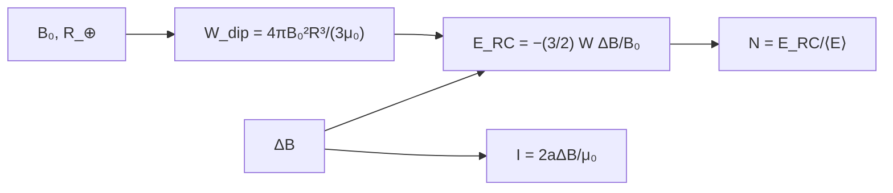

# B30-C22 — Anillo de corriente y corrientes magnetosféricas

<!-- nav:top -->
[🏠 Programa](../../../../README.md) · [📚 Bloque B30](../../../tronco-comun/B30-heliofisica-y-fisica-de-plasmas.md) · [← Anterior: B30-C21 — Radioemisión solar: estallidos de radio y su observación](../B30-C21-radioemision-solar-estallidos-de-radio-y-su-observacion/CLASE.md) · [Siguiente: B30-C23 — Índices geomagnéticos Kp y Dst →](../B30-C23-indices-geomagneticos-kp-y-dst/CLASE.md)
<!-- /nav -->

## 1. Ubicación, nivel y alcance

Clase 22 del bloque B30. Nivel N3. El anillo de corriente es la corriente de iones y electrones que rodea la Tierra en las tormentas y produce la disminución del campo en el ecuador. Aquí calculas la **energía del dipolo** terrestre (forma cerrada frente a integración 2D), aplicas la **relación de Dessler–Parker–Sckopke** `ΔB/B₀ = −(2/3)E_RC/W_dip`, estimas el número de iones y la **corriente** de un anillo equivalente. Usas [B05](../../../tronco-comun/B05-fisica-fundamental-para-el-espacio.md) y [B30-C15](../B30-C15-magnetosfera-terrestre/CLASE.md). Se supone un dipolo centrado y un anillo simétrico.

## 2. Por qué esta clase existe

El índice Dst (B30-C23) es un indicador de la energía del anillo de corriente. La decisión central: **¿qué energía y qué corriente corresponden a una disminución dada del campo?**

## 3. Lo que podrás hacer al terminar

1. Calcular `W_dip = (4π/(3μ₀))B₀²R_⊕³`.
2. Verificarlo con una integral 2D numérica.
3. Aplicar `E_RC = −(3/2)W_dip ΔB/B₀`.
4. Estimar el número de iones y su masa.
5. Calcular la corriente `I = 2aΔB/μ₀` de un anillo de radio `a`.
6. Reconocer el carácter ilustrativo de las cifras.

La evidencia es la **ficha del anillo de corriente** del ejercicio 12 (sección 20).

## 4. Con qué llegas y cómo comprobarlo

1. ¿Qué es la energía magnética?
2. ¿Qué es una integral doble?
3. ¿Qué es el campo de una espira?
4. ¿Qué es un índice Dst?
5. ¿Qué es una energía media por partícula?

<details>
<summary>Ver respuestas</summary>

1. `∫B²/(2μ₀)dV`. 2. Una integral sobre dos variables. 3. `μ₀I/(2a)` en el centro. 4. La perturbación ecuatorial del campo (B30-C23). 5. La energía total entre el número de partículas.
</details>

Con cuatro o cinco aciertos, sigue; si no, repasa los prerrequisitos.

## 5. Un caso de contexto y casos de referencia

Con `B₀ = 31 200 nT` (ilustrativo) la energía del dipolo fuera de la Tierra es `8,419 × 10¹⁷ J`. Es el **ejemplo conductor**. Una disminución de `100 nT` equivale a `4,05 × 10¹⁵ J` en el anillo. Hay trabajos que derivan un indicador del anillo de corriente a partir de magnetómetros terrestres (S3, solo resumen).

## 6. Vocabulario

La **energía del dipolo** `W_dip`. La **relación de Dessler–Parker–Sckopke** liga la energía del anillo con la perturbación del campo. La **energía del anillo** `E_RC`. La **corriente anular** es la corriente equivalente de un anillo de radio `a`. El **índice Dst** mide la perturbación.

## 7. Modelo mental: un volante de inercia

El anillo es como un volante de inercia que almacena energía: cuanta más energía, más disminuye el campo en el centro. El dipolo es la reserva de referencia con la que se compara.



*Descripción textual:* el campo y el radio terrestres dan la energía del dipolo; con la perturbación se obtiene la energía del anillo, el número de iones y la corriente.

Analogía: un volante de inercia. Límite: dipolo centrado y anillo simétrico.

## 8. La explicación, paso a paso

### 8.1 Energía del dipolo

La forma cerrada `W_dip = 8,4190 × 10¹⁷ J` y la integral 2D (punto medio, 400 × 400) `8,4191 × 10¹⁷ J` coinciden con un cociente de `1,0000036`.

### 8.2 Anillo

| `ΔB` (nT) | `E_RC` (J) | `E_RC/W_dip` | `N` (100 keV) | masa (kg) | `I` (`a = 4R_⊕`) (MA) |
|---|---|---|---|---|---|
| −30 | 1,214 × 10¹⁵ | 0,144 % | 7,579 × 10²⁸ | 126,8 | 1,22 |
| −100 | 4,048 × 10¹⁵ | 0,481 % | 2,526 × 10²⁹ | 422,6 | 4,06 |
| −300 | 1,214 × 10¹⁶ | 1,442 % | 7,579 × 10²⁹ | 1267,7 | 12,18 |

Una perturbación de `−100 nT` es el `0,321 %` del campo ecuatorial.

### 8.3 Lectura

La energía es proporcional a `|ΔB|` (triplicar `ΔB` triplica `E_RC`). Esa energía es una fracción pequeña de la del dipolo (≤ 1,4 %) y la masa de iones es de cientos de kilogramos: la corriente (megaamperios) es grande, la masa pequeña.

## 9. Magnitudes, símbolos y unidades

| Símbolo | Qué es | Unidad | Valor / nota |
|---|---|---|---|
| `W_dip` | energía del dipolo fuera de la Tierra | J | `8,419 × 10¹⁷` |
| `ΔB` | perturbación del campo | nT | −30; −100; −300 (ilustrativas) |
| `E_RC` | energía del anillo | J | ver 8.2 |
| `⟨E⟩` | energía media por ion | keV | 100 (ilustrativa) |
| `I` | corriente anular | MA | `2aΔB/μ₀` |
| `a` | radio del anillo | m | `4R_⊕` |

## 10. Convenciones y referencias

Dipolo centrado, anillo simétrico, `B₀`, `ΔB`, `⟨E⟩` y `a` **ilustrativos**; las perturbaciones no corresponden a ninguna clasificación de tormentas.

## 11. De dónde sale lo que afirmamos

| ID | Fuente | Localizador | Respalda | Estado |
|---|---|---|---|---|
| S1 | UAI, Resolución B3 de 2015 | https://arxiv.org/abs/1510.07674 | valores nominales (`R_☉`, `R_⊕` ecuatorial) | Consultada el 2026-11-09 |
| S2 | NIST, *Fundamental Physical Constants* (CODATA 2022) | https://physics.nist.gov/cuu/Constants/Table/allascii.txt | `μ₀`, `m_p`, `m_e`, `e`, `ε₀`, `c` | Consultada el 2026-11-09 |
| S3 | arXiv:2209.12571 y arXiv:2203.11001 | https://arxiv.org/abs/2209.12571 ; https://arxiv.org/abs/2203.11001 | indicadores del anillo de corriente derivados de cuatro magnetómetros terrestres | Solo resumen, consultados el 2026-11-09 |

Límites: S3 solo resumen y no respalda la relación de Dessler–Parker–Sckopke, que es estándar y no se consultó; no se contrastó con tormentas reales.

## 12. Cómo ver la energía del anillo

| `ΔB` (nT) | `E_RC` (J) |
|---|---|
| −30 | 1,2 × 10¹⁵ |
| −100 | 4,0 × 10¹⁵ |
| −300 | 1,2 × 10¹⁶ |

Descripción larga: la energía crece linealmente con la magnitud de la perturbación.

## 13. Ejemplo trabajado: energía del anillo para −100 nT

**Paso 1 · Cociente.** `ΔB/B₀ = 10⁻⁷/3,12 × 10⁻⁵ = 3,205 × 10⁻³`.

**Paso 2 · Factor.** `3/2 × 8,419 × 10¹⁷ = 1,263 × 10¹⁸ J`.

**Paso 3 · Producto.** `E_RC = 1,263 × 10¹⁸ × 3,205 × 10⁻³`.

**Paso 4 · Valor.** `4,05 × 10¹⁵ J`.

## 14. Distintas formas de describir el anillo de corriente

**Por energía:** `E_RC`. **Por campo:** `ΔB`. **Por partículas:** `N`. **Por corriente:** `I`.

## 15. Práctica guiada

**Ejercicio 1 · con los pasos indicados.** Energía del dipolo con `B₀ = 3,12 × 10⁻⁵ T`. *Pasos:* fórmula.

<details><summary>Solución comentada</summary>

`8,419 × 10¹⁷ J`.
</details>

**Ejercicio 2 · con una pista.** `E_RC` para `ΔB = −100 nT`. *Pista:* ejemplo 13.

<details><summary>Solución comentada</summary>

`4,05 × 10¹⁵ J`.
</details>

**Ejercicio 3 · casi autónomo.** `E_RC/W_dip` en ese caso.

<details><summary>Solución comentada</summary>

`0,481 %`.
</details>

## 16. Práctica autónoma, transferencia e integrador

**Ejercicio 4.** Número de iones de 100 keV.

<details><summary>Solución comentada</summary>

`4,048 × 10¹⁵/1,602 × 10⁻¹⁴ = 2,53 × 10²⁹`.
</details>

**Ejercicio 5.** Masa de esos iones (protones).

<details><summary>Solución comentada</summary>

`422,6 kg`.
</details>

**Ejercicio 6.** Corriente con `a = 4R_⊕` y `ΔB = 100 nT`.

<details><summary>Solución comentada</summary>

`4,06 MA`.
</details>

**Ejercicio 7.** `E_RC` si `ΔB` se triplica.

<details><summary>Solución comentada</summary>

Se triplica: `1,214 × 10¹⁶ J`.
</details>

**Ejercicio 8.** `ΔB` para `E_RC = 10¹⁶ J`.

<details><summary>Solución comentada</summary>

`−(2/3)(10¹⁶/8,419 × 10¹⁷)(3,12 × 10⁻⁵) = −247 nT`.
</details>

**Ejercicio 9 · transferencia.** **Transferencia.** Un compañero afirma que una tormenta de 100 nT tiene 4 × 10¹⁵ J. Responde con la sección 10.

<details><summary>Solución comentada</summary>

Es un resultado con `B₀` ilustrativo y la relación de Dessler–Parker–Sckopke, no una medición.
</details>

**Ejercicio 10 · transferencia.** **Transferencia.** ¿Por qué la masa de iones es tan pequeña frente a la corriente?

<details><summary>Solución comentada</summary>

Porque la energía por partícula es alta y la energía total moderada; pocos kilogramos bastan.
</details>

**Ejercicio 11 · transferencia.** **Transferencia.** ¿Qué supone el anillo simétrico?

<details><summary>Solución comentada</summary>

Que el campo en el centro se calcula como el de una espira; los anillos reales son asimétricos.
</details>

**Ejercicio 12.** **Integrador.** Elabora tu *ficha del anillo de corriente*: energía del dipolo, tabla del anillo y lectura.

<details><summary>Solución comentada</summary>

Secciones 8.1–8.3.
</details>

**Ejercicio 12 · integrador.** **Integrador.** Elabora tu *ficha del anillo de corriente*: energía del dipolo, tabla del anillo y lectura.

<details><summary>Solución modelo</summary>

Secciones 8.1–8.3.
</details>

## 17. Laboratorio: energía del dipolo y anillo de corriente

El script [anillo.py](anillo.py) calcula la energía del dipolo (cerrada y 2D) y aplica Dessler–Parker–Sckopke (**comprueba** `10⁻⁵` en la integral y `10⁻¹²` en la relación inversa).

**Datos:** `μ₀`, `m_p` de NIST; `R_⊕` de la UAI; `B₀`, `ΔB`, `⟨E⟩`, `a` **ilustrativos**. **Predice antes de ejecutar:** ¿qué energía corresponde a −100 nT? (≈4 × 10¹⁵ J.) **Ejecución del 2026-11-09 (Python 3.12.9):**

```text
Python 3.12.9 (biblioteca estandar)
energia del dipolo fuera de la Tierra: forma cerrada = 8.4190e+17 J ; integracion numerica 2D = 8.4191e+17 J ; cociente = 1.00000358
Delta B [nT]     E_RC [J]  E_RC/W_dip   N (100 keV)  masa [kg]  I (a = 4 R_E) [MA]
         -30    1.214e+15      0.144%     7.579e+28      126.8                1.22
        -100    4.048e+15      0.481%     2.526e+29      422.6                4.06
        -300    1.214e+16      1.442%     7.579e+29     1267.7               12.18
B_0 = 31200 nT: una perturbacion de -100 nT equivale a 0.321% del campo ecuatorial
Pruebas superadas.
```

```bash
python programa/clases/B30/B30-C22-anillo-de-corriente-y-corrientes-magnetosfericas/anillo.py
```

**Límites:** dipolo centrado, anillo simétrico.

## 18. Errores frecuentes y cómo corregirlos

**Olvidar el factor 3/2.** Se corrige con el ejemplo 13.

**Confundir `ΔB` y `B₀`.** Se corrige con 8.3.

**Presentar la masa como medida.** Se corrige con la sección 10.

**Dar la corriente sin el radio.** Se corrige con el ejercicio 6.

## 19. Cómo sabrás que vas bien

Tras 8.1: ¿cuánto vale `W_dip`? Si dudas, repasa la integral. Tras 8.2: ¿cuánto vale `E_RC` para −100 nT? Tras el laboratorio: ¿qué comprueba? (la integral 2D).

## 20. Qué entregas y cómo se evalúa

El producto es tu **ficha del anillo de corriente** (ejercicio 12).

| Criterio | Inicial | En desarrollo | Logrado | Destacado |
|---|---|---|---|---|
| Conceptos | Los confunde | Parciales | `W_dip`, DPS, corriente | Explica la proporcionalidad |
| Cálculo | Sin unidades | Con errores | Tablas completas | Calcula `ΔB` para una energía |
| Numérico | Sin comprobar | Un caso | Cerrada y numérica | Interpreta la masa |
| Fuentes | Sin fuente | Sin fecha | S1–S3 con fecha | Declara S3 como resumen |
| Límites | No los nombra | Uno | Tres | Discute qué falta del modelo |

**Condiciones críticas (no se compensan con promedio):** rotular `B₀` y las perturbaciones como ilustrativos; no vincularlas a tormentas reales; citar solo lo consultado.

## 21. Ética, seguridad y límites

Clase educativa: no estima la energía de una tormenta real. Accesibilidad: tablas equivalentes a las gráficas, fórmulas en texto, ejercicios sin conexión.

## 22. Para cerrar y seguir

El dipolo guarda `8,4 × 10¹⁷ J` fuera de la Tierra y una disminución de 100 nT corresponde a `4 × 10¹⁵ J`, el 0,5 % de esa energía y una corriente de ≈4 MA. Queda una pregunta: ¿cómo se resumen estas perturbaciones en índices?

**Glosario español–inglés.** anillo de corriente · *ring current*; Dessler–Parker–Sckopke · *Dessler–Parker–Sckopke relation*; energía del dipolo · *dipole energy*; corriente anular · *ring current intensity*; índice Dst · *Dst index*.

**Continuidad.** [B30-C23](../B30-C23-indices-geomagneticos-kp-y-dst/CLASE.md) estudia los índices Kp y Dst.

**Referencias:** ver sección 11.

<!-- nav:bottom -->
---

[← Anterior: B30-C21 — Radioemisión solar: estallidos de radio y su observación](../B30-C21-radioemision-solar-estallidos-de-radio-y-su-observacion/CLASE.md) · [📚 Bloque B30](../../../tronco-comun/B30-heliofisica-y-fisica-de-plasmas.md) · [Siguiente: B30-C23 — Índices geomagnéticos Kp y Dst →](../B30-C23-indices-geomagneticos-kp-y-dst/CLASE.md)
<!-- /nav -->
