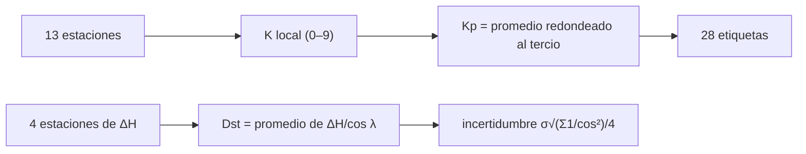

# B30-C23 — Índices geomagnéticos Kp y Dst

<!-- nav:top -->
[🏠 Programa](../../../../README.md) · [📚 Bloque B30](../../../tronco-comun/B30-heliofisica-y-fisica-de-plasmas.md) · [← Anterior: B30-C22 — Anillo de corriente y corrientes magnetosféricas](../B30-C22-anillo-de-corriente-y-corrientes-magnetosfericas/CLASE.md) · [Siguiente: B31-C01 — Dualidad onda-partícula →](../../../tronco-comun/B31-fisica-cuantica-nuclear-y-astroparticulas.md#b31-c01)
<!-- /nav -->

## 1. Ubicación, nivel y alcance

Clase 23 del bloque B30. Nivel N3. Los índices geomagnéticos resumen en pocos números lo que miden muchas estaciones. Aquí construyes un **Kp sintético de 28 valores** a partir de trece valores `K` (una por estación, con umbrales de rango ilustrativos) y un **proxy de Dst** con cuatro estaciones de latitudes bajas, y mides su incertidumbre con Monte Carlo frente a la fórmula. Usas [B12](../../../tronco-comun/B12-probabilidad-estadistica-e-incertidumbre.md), las escalas de [B30-C20](../B30-C20-analisis-de-alerta-solar-real/CLASE.md) y la energía de [B30-C22](../B30-C22-anillo-de-corriente-y-corrientes-magnetosfericas/CLASE.md). Los algoritmos oficiales no se reproducen.

## 2. Por qué esta clase existe

Kp y Dst son los índices con que se habla de tormentas. Saber cómo se construyen y con qué incertidumbre ayuda a leer un registro. La decisión central: **¿cómo se obtiene un índice a partir de estaciones y cuánta incertidumbre trae?**

## 3. Lo que podrás hacer al terminar

1. Escribir la escala de 28 valores de Kp en tercios.
2. Asignar `K` a un rango con una tabla de umbrales casi logarítmica.
3. Promediar trece `K` y redondear al tercio.
4. Construir un proxy de Dst con cuatro estaciones.
5. Calcular su desviación teórica y compararla con Monte Carlo.
6. Distinguir un indicador sintético de un índice oficial.

La evidencia es la **ficha de los índices Kp y Dst** del ejercicio 12 (sección 20).

## 4. Con qué llegas y cómo comprobarlo

1. ¿Qué es un índice?
2. ¿Qué es una escala casi logarítmica?
3. ¿Qué es una línea base?
4. ¿Qué es una desviación típica?
5. ¿Qué es la propagación de errores?

<details>
<summary>Ver respuestas</summary>

1. Un número que resume un conjunto de mediciones. 2. Una escala con umbrales que crecen casi por factores constantes. 3. El nivel de referencia sin perturbación. 4. La dispersión de una variable aleatoria. 5. Cómo los errores de las entradas se transmiten a la salida (B12).
</details>

Con cuatro o cinco aciertos, sigue; si no, repasa los prerrequisitos.

## 5. Un caso de contexto y casos de referencia

El Kp se obtiene de trece estaciones entre 48° y 63° de latitud geomagnética con un muestreo de tres horas, es casi logarítmico y va de 0 a 9 en 28 valores (S2, solo resumen); hay trabajos que construyen un proxy de Dst a partir de cuatro magnetómetros terrestres (S3, solo resumen). Es el **ejemplo conductor**. La tabla de umbrales de `K`, las latitudes de las cuatro estaciones y el ruido son **ilustrativos**.

## 6. Vocabulario

El **Kp** es un índice trihorario planetario. La **escala de 28 valores** `0o, 0+, 1−, 1o, …, 9−, 9o`. El **valor `K`** es el índice local. El **proxy de Dst** promedia la perturbación de estaciones de latitud baja corregida por `cos λ`. La **línea base** es el nivel sin perturbación.

## 7. Modelo mental: un termómetro de varias ciudades

Como promediar la temperatura de varias ciudades para tener un número del país: cada una aporta con su sesgo local y el promedio reduce el ruido.



*Descripción textual:* trece valores `K` promediados dan el Kp y su etiqueta; cuatro perturbaciones corregidas por latitud dan el proxy de Dst y su incertidumbre.

Analogía: un termómetro de varias ciudades. Límite: algoritmos simplificados.

## 8. La explicación, paso a paso

### 8.1 La escala de Kp

Hay 28 etiquetas: `0o, 0+` (2), `k−, ko, k+` para `k = 1…8` (24) y `9−, 9o` (2).

### 8.2 De rango a K (umbrales ilustrativos)

| rango (nT) | `K` |
|---|---|
| 2 | 0 |
| 5 | 1 |
| 15 | 2 |
| 45 | 4 |
| 150 | 6 |
| 250 | 7 |
| 600 | 9 |

Trece estaciones ilustrativas dan `K = [3, 4, 4, 4, 4, 5, 6, 6, 2, 4, 4, 2, 5]`, promedio `4,077` y Kp `4o` (12 tercios).

### 8.3 Proxy de Dst

Con latitudes ilustrativas de `10°, 20°, 25°, 30°` y ruido de `3 nT` por estación, la desviación teórica es `σ√(Σ1/cos²λ)/4 = 1,628 nT`.

| `Dst` verdadero (nT) | media del proxy | sesgo | desviación Monte Carlo | teórica |
|---|---|---|---|---|
| −20 | −20,017 | −0,017 | 1,6215 | 1,6284 |
| −100 | −99,990 | 0,010 | 1,6131 | 1,6284 |
| −250 | −250,021 | −0,021 | 1,6208 | 1,6284 |

### 8.4 Lectura

El proxy no tiene sesgo y su incertidumbre (≈1,6 nT) no depende del nivel de la perturbación; con más estaciones bajaría como `1/√N`. El Kp redondeado al tercio pierde información: dos conjuntos de `K` distintos pueden dar la misma etiqueta.

## 9. Magnitudes, símbolos y unidades

| Símbolo | Qué es | Unidad | Valor / nota |
|---|---|---|---|
| `K` | índice local | — | 0 a 9 |
| Kp | índice planetario | tercios | 28 valores |
| `ΔH_i` | perturbación horizontal de la estación `i` | nT | `Dst cos λ_i + ruido + base` |
| Dst | proxy | nT | `⟨(ΔH_i − base_i)/cos λ_i⟩` |
| `σ_Dst` | incertidumbre teórica | nT | `σ√(Σ1/cos²λ_i)/4` |

## 10. Convenciones y referencias

Algoritmos simplificados; los umbrales de `K` (5 a 500 nT), las latitudes, el ruido y las bases son **ilustrativos**; semilla `20261109`; no se reproducen los índices oficiales.

## 11. De dónde sale lo que afirmamos

| ID | Fuente | Localizador | Respalda | Estado |
|---|---|---|---|---|
| S1 | NOAA, *Space Weather Scales* | https://www.spaceweather.gov/noaa-scales-explanation | escalas G1–G5 (Kp 5, 6, 7, 8 incluido 9−, 9), S1–S5 (protones ≥ 10 MeV: 10 a 10⁵ pfu) y R1–R5 (M1, M5, X1, X10, X20) | Consultada el 2026-11-09 |
| S2 | arXiv:1404.2836 | https://arxiv.org/abs/1404.2836 | Kp a partir de trece estaciones de 48° a 63° de latitud geomagnética, trihorario, casi logarítmico, 0 a 9 en 28 valores | Solo resumen, consultado el 2026-11-09 |
| S3 | arXiv:2209.12571 y arXiv:2203.11001 | https://arxiv.org/abs/2209.12571 ; https://arxiv.org/abs/2203.11001 | proxy de Dst del anillo de corriente derivado de cuatro magnetómetros terrestres | Solo resumen, consultados el 2026-11-09 |

Límites: S2 y S3 solo resumen; los algoritmos reales no se reproducen y los umbrales de `K` son ilustrativos; la equivalencia entre Kp y G viene de NOAA (S1).

## 12. Cómo ver la incertidumbre del proxy

| `Dst` (nT) | sesgo | desviación |
|---|---|---|
| −20 | −0,017 | 1,62 |
| −100 | 0,010 | 1,61 |
| −250 | −0,021 | 1,62 |

Descripción larga: el sesgo es despreciable y la desviación no depende de la perturbación.

## 13. Ejemplo trabajado: Kp de un conjunto de K

**Paso 1 · Suma.** `3+4+4+4+4+5+6+6+2+4+4+2+5 = 53`.

**Paso 2 · Promedio.** `53/13 = 4,077`.

**Paso 3 · Tercios.** `3 × 4,077 = 12,23` → 12.

**Paso 4 · Etiqueta.** El tercio 12 es `4o`.

## 14. Distintas formas de describir un índice

**Por escala:** 28 etiquetas. **Por estaciones:** promedio. **Por incertidumbre:** `1/√N`. **Por alerta:** G de NOAA.

## 15. Práctica guiada

**Ejercicio 1 · con los pasos indicados.** Cuántas etiquetas tiene la escala. *Pasos:* 8.1.

<details><summary>Solución comentada</summary>

`2 + 24 + 2 = 28`.
</details>

**Ejercicio 2 · con una pista.** `K` de un rango de 45 nT. *Pista:* 8.2.

<details><summary>Solución comentada</summary>

`4`.
</details>

**Ejercicio 3 · casi autónomo.** Etiqueta de Kp para el promedio `4,077`.

<details><summary>Solución comentada</summary>

`4o`.
</details>

## 16. Práctica autónoma, transferencia e integrador

**Ejercicio 4.** Nivel G de la etiqueta `6+`.

<details><summary>Solución comentada</summary>

G2.
</details>

**Ejercicio 5.** Incertidumbre del proxy con 4 estaciones a `20°` y `σ = 3 nT`.

<details><summary>Solución comentada</summary>

`3/(2 cos 20°) = 1,60 nT`.
</details>

**Ejercicio 6.** Incertidumbre con 16 estaciones iguales.

<details><summary>Solución comentada</summary>

La mitad: `0,80 nT`.
</details>

**Ejercicio 7.** Dst del proxy con `ΔH = [−19,5; −18,8; −18,1; −17,3]` en las latitudes del laboratorio.

<details><summary>Solución comentada</summary>

`−19,94 nT`.
</details>

**Ejercicio 8.** Cociente `K` de 600 nT frente a 5 nT.

<details><summary>Solución comentada</summary>

`9` frente a `1`.
</details>

**Ejercicio 9 · transferencia.** **Transferencia.** Un compañero afirma que Kp se calcula con los umbrales de 5 a 500 nT. Responde con la sección 10.

<details><summary>Solución comentada</summary>

Son ilustrativos; la clase no reproduce el algoritmo oficial.
</details>

**Ejercicio 10 · transferencia.** **Transferencia.** ¿Por qué dos conjuntos de `K` distintos dan la misma etiqueta?

<details><summary>Solución comentada</summary>

Porque el promedio se redondea al tercio.
</details>

**Ejercicio 11 · transferencia.** **Transferencia.** ¿Qué indica que la desviación no dependa del nivel de Dst?

<details><summary>Solución comentada</summary>

Que el ruido es aditivo e independiente de la perturbación.
</details>

**Ejercicio 12.** **Integrador.** Elabora tu *ficha de los índices Kp y Dst*: escala, construcción, proxy e incertidumbre.

<details><summary>Solución comentada</summary>

Secciones 8.1–8.4.
</details>

**Ejercicio 12 · integrador.** **Integrador.** Elabora tu *ficha de los índices Kp y Dst*: escala, construcción, proxy e incertidumbre.

<details><summary>Solución modelo</summary>

Secciones 8.1–8.4.
</details>

## 17. Laboratorio: Kp sintético y proxy de Dst

El script [indices.py](indices.py) construye el Kp de 28 valores y el proxy de Dst con Monte Carlo (**comprueba** 28 etiquetas distintas, la ida y vuelta de las etiquetas, el sesgo `< 0,1 nT` y la desviación al 3 % de la teórica).

**Datos:** escala de Kp y proxy según los resúmenes consultados; todo lo demás **ilustrativo**; semilla `20261109`. **Predice antes de ejecutar:** ¿qué desviación tendrá el proxy? (≈1,6 nT.) **Ejecución del 2026-11-09 (Python 3.12.9):**

```text
Python 3.12.9 (biblioteca estandar)
escala de Kp: 28 valores: 0o 0+ 1- 1o 1+ 2- 2o 2+ 3- 3o 3+ 4- 4o 4+ 5- 5o 5+ 6- 6o 6+ 7- 7o 7+ 8- 8o 8+ 9- 9o
rango [nT]   K
         2   0
         5   1
        15   2
        45   4
       150   6
       250   7
       600   9
13 estaciones ilustrativas: K = [3, 4, 4, 4, 4, 5, 6, 6, 2, 4, 4, 2, 5] ; promedio = 4.077 ; Kp = 4o
latitudes (ilustrativas) [10, 20, 25, 30] grados ; ruido 3.0 nT ; desviacion teorica del proxy = 1.6284 nT
 Dst verdadero [nT]  media del proxy    sesgo  desviacion MC   teorica
              -20.0          -20.017   -0.017         1.6215    1.6284
             -100.0          -99.990    0.010         1.6131    1.6284
             -250.0         -250.021   -0.021         1.6208    1.6284
Pruebas superadas.
```

```bash
python programa/clases/B30/B30-C23-indices-geomagneticos-kp-y-dst/indices.py
```

**Límites:** algoritmos simplificados.

## 18. Errores frecuentes y cómo corregirlos

**Pensar que el Kp es lineal.** Se corrige con 8.2.

**Olvidar la corrección `cos λ`.** Se corrige con el ejercicio 7.

**Confundir Kp y G.** Se corrige con el ejercicio 4.

**Tomar el índice sintético por oficial.** Se corrige con la sección 10.

## 19. Cómo sabrás que vas bien

Tras 8.1: ¿cuántas etiquetas hay? Si dudas, ejemplo 13. Tras 8.3: ¿cuánto vale la incertidumbre? Tras el laboratorio: ¿qué comprueba? (el sesgo y la desviación).

## 20. Qué entregas y cómo se evalúa

El producto es tu **ficha de los índices Kp y Dst** (ejercicio 12).

| Criterio | Inicial | En desarrollo | Logrado | Destacado |
|---|---|---|---|---|
| Conceptos | Los confunde | Parciales | Kp, K, Dst | Explica el redondeo al tercio |
| Cálculo | Sin unidades | Con errores | Tablas completas | Calcula el efecto de `N` |
| Numérico | Sin comprobar | Un caso | Monte Carlo y teoría | Interpreta la ausencia de sesgo |
| Fuentes | Sin fuente | Sin fecha | S1–S3 con fecha | Declara S2 y S3 como resumen |
| Límites | No los nombra | Uno | Tres | Discute qué falta del modelo |

**Condiciones críticas (no se compensan con promedio):** rotular los índices como sintéticos; no presentar los umbrales como oficiales; citar solo lo consultado.

## 21. Ética, seguridad y límites

Clase educativa: no reproduce los índices oficiales. Accesibilidad: tablas equivalentes a las gráficas, fórmulas en texto, ejercicios sin conexión.

## 22. Para cerrar y seguir

El Kp tiene 28 etiquetas y se construye promediando trece `K`; un proxy de Dst con cuatro estaciones tiene una incertidumbre de ≈1,6 nT con ruido de 3 nT. Con esto cierra el bloque: del Sol a la alerta, cada paso se calculó, se comprobó y se rotuló como ilustrativo cuando lo era.

**Glosario español–inglés.** índice Kp · *Kp index*; índice Dst · *Dst index*; estación geomagnética · *geomagnetic station*; línea base · *baseline*; proxy · *proxy*.

**Continuidad.** Es la última clase del bloque; el siguiente trata la física cuántica, nuclear y de astropartículas.

**Referencias:** ver sección 11.

<!-- nav:bottom -->
---

[← Anterior: B30-C22 — Anillo de corriente y corrientes magnetosféricas](../B30-C22-anillo-de-corriente-y-corrientes-magnetosfericas/CLASE.md) · [📚 Bloque B30](../../../tronco-comun/B30-heliofisica-y-fisica-de-plasmas.md) · [Siguiente: B31-C01 — Dualidad onda-partícula →](../../../tronco-comun/B31-fisica-cuantica-nuclear-y-astroparticulas.md#b31-c01)
<!-- /nav -->
