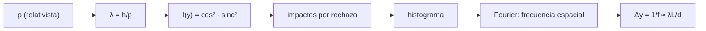

# B31-C01 — Dualidad onda-partícula

<!-- nav:top -->
[🏠 Programa](../../../../README.md) · [📚 Bloque B31](../../../tronco-comun/B31-fisica-cuantica-nuclear-y-astroparticulas.md) · [← Anterior: B30-C23 — Índices geomagnéticos Kp y Dst](../../B30/B30-C23-indices-geomagneticos-kp-y-dst/CLASE.md) · [Siguiente: B31-C02 — Ecuación de Schrödinger →](../B31-C02-ecuacion-de-schrodinger/CLASE.md)
<!-- /nav -->

## 1. Ubicación, nivel y alcance

Clase 1 del bloque B31. Nivel N3. La materia y la luz se comportan como ondas al propagarse y como partículas al detectarse. Aquí calculas la **longitud de onda de de Broglie** `λ = h/p` (con el momento relativista) de electrones, neutrones, fotones y una pelota, y simulas un **patrón de doble rendija** electrón a electrón por Monte Carlo para recuperar el espaciado de franjas `λL/d`. Usas [B05](../../../tronco-comun/B05-fisica-fundamental-para-el-espacio.md) y la estadística de [B12](../../../tronco-comun/B12-probabilidad-estadistica-e-incertidumbre.md). Se supone coherencia total y ángulos pequeños.

## 2. Por qué esta clase existe

Sin la dualidad no se entiende la difracción de electrones, los microscopios electrónicos ni la estructura atómica. La decisión central: **¿cuándo importa la longitud de onda de un objeto y cómo se ve en un experimento?**

## 3. Lo que podrás hacer al terminar

1. Calcular `λ = h/p` con `pc = √(T² + 2Tmc²)`.
2. Comparar objetos microscópicos y macroscópicos.
3. Escribir la intensidad `cos²(πdy/λL) sinc²(πay/λL)` de dos rendijas.
4. Simular impactos individuales por rechazo con semilla fija.
5. Recuperar el espaciado de franjas con una transformada de Fourier discreta.
6. Distinguir lo calculado de lo ilustrativo.

La evidencia es la **ficha de la dualidad** del ejercicio 12 (sección 20).

## 4. Con qué llegas y cómo comprobarlo

1. ¿Qué es el momento lineal?
2. ¿Qué es la constante de Planck?
3. ¿Qué es una franja de interferencia?
4. ¿Qué es un muestreo por rechazo?
5. ¿Qué es una transformada de Fourier?

<details>
<summary>Ver respuestas</summary>

1. `p = mv` (no relativista). 2. La constante `h` que relaciona energía y frecuencia. 3. Una zona de máxima intensidad entre dos mínimos. 4. Generar muestras de una densidad aceptando o rechazando puntos. 5. La descomposición en frecuencias.
</details>

Con cuatro o cinco aciertos, sigue; si no, repasa los prerrequisitos.

## 5. Un caso de contexto y casos de referencia

Un electrón de 100 eV tiene `λ = 1,2264 × 10⁻¹⁰ m`, comparable al tamaño de un átomo. Es el **ejemplo conductor** (constantes de NIST, S1). La pelota de 0,145 kg a 40 m/s tiene `1,1424 × 10⁻³⁴ m`. El montaje de doble rendija (electrones de 50 keV, `d = 1 µm`, `L = 1 m`) es **ilustrativo**.

## 6. Vocabulario

La **longitud de onda de de Broglie** `λ = h/p`. La **doble rendija** produce franjas de espaciado `λL/d`. La **envolvente** de difracción de una rendija es `sinc²`. Un **impacto** es la detección de una partícula. La **coherencia** es la fase definida entre los dos caminos.

## 7. Modelo mental: gotas de pintura en una pared

Cada electrón llega como un punto, como una gota de pintura; con miles de gotas aparece un patrón de franjas que solo una onda explica.



*Descripción textual:* el momento da la longitud de onda y la intensidad; los impactos individuales forman un histograma cuya frecuencia espacial da el espaciado de franjas.

Analogía: gotas de pintura que forman un patrón. Límite: coherencia total.

## 8. La explicación, paso a paso

### 8.1 Longitudes de onda

| objeto | energía / velocidad | `λ` (m) |
|---|---|---|
| electrón | 100 eV | 1,2264 × 10⁻¹⁰ |
| electrón | 1 keV | 3,8764 × 10⁻¹¹ |
| electrón | 100 keV | 3,7014 × 10⁻¹² |
| neutrón térmico (293 K) | 0,0379 eV | 1,4697 × 10⁻¹⁰ |
| fotón | 2 eV | 6,1992 × 10⁻⁷ |
| pelota de 0,145 kg | 40 m/s | 1,1424 × 10⁻³⁴ |

La constante no relativista es `λ√T = 1,226426 nm eV^(1/2)`; a 100 keV la fórmula relativista da un valor un 4,6 % menor que la no relativista.

### 8.2 Doble rendija

Electrones de 50 keV: `λ = 5,3553 × 10⁻¹² m`; con `d = 1 µm` y `L = 1 m`, el espaciado esperado es `5,3553 µm` y la envolvente (`a = 0,1 µm`) se anula en `53,55 µm`.

### 8.3 Recuperación

Con 120 000 impactos generados por rechazo en ±40 µm, el pico de la transformada está en `0,1875 ciclos/µm`, es decir, un espaciado de `5,3333 µm`: cociente `0,9959` respecto del analítico (la resolución espectral de la ventana es `1/80 µm`).

### 8.4 Lectura

Un solo impacto no revela nada; el patrón surge de miles. Para la pelota la longitud de onda es 10⁻¹⁹ veces el tamaño de un núcleo: ninguna rendija la haría visible.

## 9. Magnitudes, símbolos y unidades

| Símbolo | Qué es | Unidad | Valor / nota |
|---|---|---|---|
| `h`, `c`, `e` | constantes | SI | S1 |
| `m_e`, `m_n` | masas del electrón y del neutrón | kg | `9,1093837139 × 10⁻³¹`; `1,67492750056 × 10⁻²⁷` (S1) |
| `λ` | longitud de onda de de Broglie | m | `h/p` |
| `d`, `a`, `L` | separación, ancho y distancia a la pantalla | m | 1 µm; 0,1 µm; 1 m (ilustrativos) |
| `Δy` | espaciado de franjas | µm | `λL/d` |

## 10. Convenciones y referencias

Ángulos pequeños, rendijas ideales, coherencia total; las magnitudes del montaje, la temperatura del neutrón y la pelota son **ilustrativas**; semilla `20261109`.

## 11. De dónde sale lo que afirmamos

| ID | Fuente | Localizador | Respalda | Estado |
|---|---|---|---|---|
| S1 | NIST, *Fundamental Physical Constants* (CODATA 2022) | https://physics.nist.gov/cuu/Constants/Table/allascii.txt | constantes y masas citadas en la sección 9 | Consultada el 2026-11-09 |

Límites: no se consultó ningún experimento publicado de doble rendija; el patrón es una simulación del modelo ideal.

## 12. Cómo ver el patrón

| Magnitud | Valor |
|---|---|
| `λ` (50 keV) | 5,3553 pm |
| `Δy` analítico | 5,3553 µm |
| `Δy` recuperado | 5,3333 µm |
| cociente | 0,9959 |

Descripción larga: el espaciado recuperado de los impactos coincide con el analítico dentro del 0,5 %.

## 13. Ejemplo trabajado: longitud de onda de un electrón de 100 eV

**Paso 1 · Energía.** `T = 100 eV = 1,602 × 10⁻¹⁷ J`.

**Paso 2 · Momento.** `p = √(2mT) = 5,40 × 10⁻²⁴ kg m/s`.

**Paso 3 · Cociente.** `λ = h/p = 6,626 × 10⁻³⁴/5,40 × 10⁻²⁴`.

**Paso 4 · Valor.** `1,2264 × 10⁻¹⁰ m = 0,1226 nm`.

## 14. Distintas formas de describir la dualidad

**Por longitud de onda:** `h/p`. **Por interferencia:** franjas. **Por detección:** puntos. **Por escala:** microscópico frente a macroscópico.

## 15. Práctica guiada

**Ejercicio 1 · con los pasos indicados.** Calcula `λ` de un electrón de 100 eV. *Pasos:* ejemplo 13.

<details><summary>Solución comentada</summary>

`1,2264 × 10⁻¹⁰ m`.
</details>

**Ejercicio 2 · con una pista.** Calcula `λ` para 1 keV. *Pista:* `λ ∝ 1/√T`.

<details><summary>Solución comentada</summary>

`1,2264 × 10⁻¹⁰/√10 = 3,878 × 10⁻¹¹ m` (3,8764 con la fórmula relativista).
</details>

**Ejercicio 3 · casi autónomo.** `λ` de un fotón de 2 eV.

<details><summary>Solución comentada</summary>

`hc/E = 1239,84 eV nm/2 = 619,9 nm`.
</details>

## 16. Práctica autónoma, transferencia e integrador

**Ejercicio 4.** Espaciado de franjas con `λ = 5,3553 pm`, `d = 1 µm`, `L = 1 m`.

<details><summary>Solución comentada</summary>

`λL/d = 5,3553 µm`.
</details>

**Ejercicio 5.** Espaciado si `d` se duplica.

<details><summary>Solución comentada</summary>

La mitad: `2,68 µm`.
</details>

**Ejercicio 6.** `λ` de la pelota de 0,145 kg a 40 m/s.

<details><summary>Solución comentada</summary>

`6,626 × 10⁻³⁴/5,8 = 1,1424 × 10⁻³⁴ m`.
</details>

**Ejercicio 7.** Cociente relativista / no relativista a 100 keV.

<details><summary>Solución comentada</summary>

`3,7014/3,8783 = 0,954`.
</details>

**Ejercicio 8.** Número de franjas en ±40 µm.

<details><summary>Solución comentada</summary>

`80/5,3553 = 14,9`.
</details>

**Ejercicio 9 · transferencia.** **Transferencia.** Un compañero dice que el electrón es a veces onda y a veces partícula. Responde con 8.4.

<details><summary>Solución comentada</summary>

Cada electrón llega localizado; la distribución de llegadas sigue la intensidad de onda.
</details>

**Ejercicio 10 · transferencia.** **Transferencia.** ¿Por qué no se ve interferencia con una pelota?

<details><summary>Solución comentada</summary>

Su `λ ≈ 10⁻³⁴ m` es mucho menor que cualquier rendija o resolución.
</details>

**Ejercicio 11 · transferencia.** **Transferencia.** ¿Qué supone el modelo de la sección 10?

<details><summary>Solución comentada</summary>

Rendijas ideales, ángulos pequeños y coherencia total; sin ellas el patrón se pierde.
</details>

**Ejercicio 12.** **Integrador.** Elabora tu *ficha de la dualidad*: tabla de longitudes de onda, patrón simulado y límites.

<details><summary>Solución comentada</summary>

Secciones 8.1–8.4.
</details>

**Ejercicio 12 · integrador.** **Integrador.** Elabora tu *ficha de la dualidad*: tabla de longitudes de onda, patrón simulado y límites.

<details><summary>Solución modelo</summary>

Secciones 8.1–8.4.
</details>

## 17. Laboratorio: longitud de onda y doble rendija

El script [dualidad.py](dualidad.py) calcula `λ` para varios objetos y recupera el espaciado de franjas de un experimento de doble rendija simulado (**comprueba** `λ√T` a `10⁻¹²` y el espaciado al 1,5 %).

**Datos:** `h`, `c`, `e`, `m_e`, `m_n`, `k_B` de NIST; montaje **ilustrativo**; semilla `20261109`. **Predice antes de ejecutar:** ¿qué `λ` tiene un electrón de 100 eV? (≈0,12 nm.) **Ejecución del 2026-11-09 (Python 3.12.9):**

```text
Python 3.12.9 (biblioteca estandar)
objeto                       energia / velocidad      lambda [m]
electron                     100 eV                   1.2264e-10
electron                     1000 eV                  3.8764e-11
electron                     100000 eV                3.7014e-12
neutron termico (293 K)      0.0379 eV                1.4697e-10
foton de 2 eV                p = E/c                  6.1992e-07
pelota 0.145 kg              40 m/s                   1.1424e-34
constante no relativista lambda sqrt(T) = 1.226426 nm eV^(1/2) (12.264 A eV^(1/2))
electrones de 50 keV: lambda = 5.3553e-12 m ; espaciado de franjas lambda L/d = 5.3553 um ; primer cero de la envolvente en 53.55 um
120000 impactos: frecuencia espacial recuperada = 0.1875 ciclos/um -> espaciado = 5.3333 um ; analitico = 5.3553 um ; cociente = 0.9959
Pruebas superadas.
```

```bash
python programa/clases/B31/B31-C01-dualidad-onda-particula/dualidad.py
```

**Límites:** coherencia total, ángulos pequeños.

## 18. Errores frecuentes y cómo corregirlos

**Usar la fórmula no relativista a 100 keV.** Se corrige con el ejercicio 7.

**Confundir `λL/d` con `λd/L`.** Se corrige con el ejercicio 4.

**Pensar que un impacto muestra la onda.** Se corrige con 8.4.

**Tomar el montaje por real.** Se corrige con la sección 10.

## 19. Cómo sabrás que vas bien

Tras 8.1: ¿qué `λ` tiene el electrón de 100 eV? Si dudas, ejemplo 13. Tras 8.3: ¿qué espaciado se recupera? Tras el laboratorio: ¿qué comprueba? (el espaciado de franjas).

## 20. Qué entregas y cómo se evalúa

El producto es tu **ficha de la dualidad** (ejercicio 12).

| Criterio | Inicial | En desarrollo | Logrado | Destacado |
|---|---|---|---|---|
| Conceptos | Los confunde | Parciales | `h/p`, franjas, impactos | Explica el papel de la coherencia |
| Cálculo | Sin unidades | Con errores | Tablas completas | Calcula el efecto relativista |
| Numérico | Sin comprobar | Un caso | Fourier y analítico | Interpreta la resolución |
| Fuentes | Sin fuente | Sin fecha | S1 con fecha | Declara que no hay experimento consultado |
| Límites | No los nombra | Uno | Tres | Discute qué falta del modelo |

**Condiciones críticas (no se compensan con promedio):** rotular el montaje como ilustrativo; no presentar la simulación como un experimento; citar solo lo consultado.

## 21. Ética, seguridad y límites

Clase educativa: no describe un instrumento real. Accesibilidad: tablas equivalentes a las gráficas, fórmulas en texto, ejercicios sin conexión.

## 22. Para cerrar y seguir

Un electrón de 100 eV tiene `λ = 0,12 nm`, una pelota `10⁻³⁴ m`, y 120 000 impactos recuperan las franjas con un 0,4 % de diferencia. Queda una pregunta: ¿qué ecuación gobierna esa onda?

**Glosario español–inglés.** dualidad onda-partícula · *wave–particle duality*; longitud de onda de de Broglie · *de Broglie wavelength*; doble rendija · *double slit*; franja de interferencia · *interference fringe*; coherencia · *coherence*.

**Continuidad.** [B31-C02](../B31-C02-ecuacion-de-schrodinger/CLASE.md) presenta la ecuación de Schrödinger.

**Referencias:** ver sección 11.

<!-- nav:bottom -->
---

[← Anterior: B30-C23 — Índices geomagnéticos Kp y Dst](../../B30/B30-C23-indices-geomagneticos-kp-y-dst/CLASE.md) · [📚 Bloque B31](../../../tronco-comun/B31-fisica-cuantica-nuclear-y-astroparticulas.md) · [Siguiente: B31-C02 — Ecuación de Schrödinger →](../B31-C02-ecuacion-de-schrodinger/CLASE.md)
<!-- /nav -->
