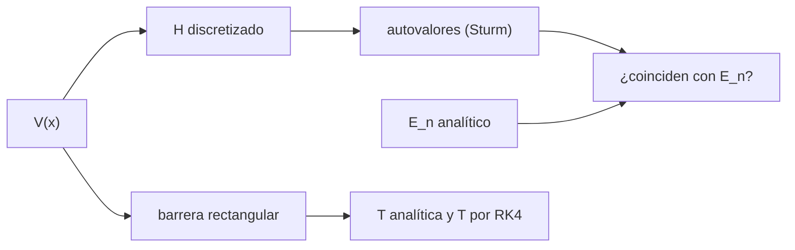

# B31-C02 — Ecuación de Schrödinger

<!-- nav:top -->
[🏠 Programa](../../../../README.md) · [📚 Bloque B31](../../../tronco-comun/B31-fisica-cuantica-nuclear-y-astroparticulas.md) · [← Anterior: B31-C01 — Dualidad onda-partícula](../B31-C01-dualidad-onda-particula/CLASE.md) · [Siguiente: B31-C03 — Estados y observables cuánticos →](../B31-C03-estados-y-observables-cuanticos/CLASE.md)
<!-- /nav -->

## 1. Ubicación, nivel y alcance

Clase 2 del bloque B31. Nivel N3. La ecuación de Schrödinger determina las funciones de onda y las energías de un sistema. Aquí discretizas el hamiltoniano en una malla, hallas sus **autovalores** con la **sucesión de Sturm**, los comparas con las energías analíticas del **pozo infinito** y del **oscilador armónico**, verificas la energía del estado fundamental del **hidrógeno** contra la de Rydberg de NIST y calculas la **transmisión por efecto túnel** de una barrera de dos formas. Usas [B10](../../../tronco-comun/B10-algebra-lineal-y-matematicas-geometricas.md), [B31-C01](../B31-C01-dualidad-onda-particula/CLASE.md) y [B11-C08](../../B11/B11-C08-integradores-de-paso-adaptativo/CLASE.md). Se supone una dimensión y masa constante.

## 2. Por qué esta clase existe

Los espectros de los átomos y los niveles de los núcleos salen de esta ecuación. La decisión central: **¿cómo se obtiene la energía de un estado ligado y cuánto atraviesa una barrera?**

## 3. Lo que podrás hacer al terminar

1. Discretizar `−(ħ²/2m)ψ'' + Vψ = Eψ` en una matriz tridiagonal.
2. Obtener autovalores por biseccion de Sturm.
3. Comparar con `E_n = n²π²ħ²/(2mL²)` y `(n + ½)ħω`.
4. Verificar `−13,6057 eV` contra NIST.
5. Calcular la transmisión de una barrera con la fórmula y con RK4 complejo.
6. Reconocer los errores de discretización.

La evidencia es la **ficha de los niveles de energía** del ejercicio 12 (sección 20).

## 4. Con qué llegas y cómo comprobarlo

1. ¿Qué es un autovalor?
2. ¿Qué es una matriz tridiagonal?
3. ¿Qué es una función de onda normalizada?
4. ¿Qué es una ecuación diferencial de segundo orden?
5. ¿Qué es una barrera de potencial?

<details>
<summary>Ver respuestas</summary>

1. Un valor `λ` tal que `Av = λv`. 2. Una con elementos no nulos solo en tres diagonales. 3. Una con `∫|ψ|² = 1`. 4. Una que contiene la segunda derivada. 5. Una región donde el potencial supera la energía.
</details>

Con cuatro o cinco aciertos, sigue; si no, repasa los prerrequisitos.

## 5. Un caso de contexto y casos de referencia

Un electrón en un pozo de 1 nm tiene `E₁ = 0,376030 eV` (analítico `0,376030`). Es el **ejemplo conductor**. El estado fundamental del hidrógeno, `13,605693123 eV`, coincide con la energía de Rydberg de NIST (S1). El ancho del pozo, `ω = 10¹⁵ rad/s` y la barrera (2 eV, 0,5 nm) son **ilustrativos**.

## 6. Vocabulario

El **hamiltoniano** es el operador de energía. Un **autovalor** es una energía permitida. El **pozo infinito** confina entre dos paredes. El **oscilador armónico** tiene `V = mω²x²/2`. El **efecto túnel** es la transmisión a través de una barrera con `E < V₀`. La **sucesión de Sturm** cuenta autovalores menores que un valor.

## 7. Modelo mental: una cuerda de guitarra

Como una cuerda de guitarra fija en sus extremos, solo ciertas ondas caben y cada una tiene su energía; la barrera es una zona donde la onda decae, pero no se anula.



*Descripción textual:* el potencial define el hamiltoniano discretizado, cuyos autovalores se comparan con los analíticos; la barrera da una transmisión que se calcula de dos formas.

Analogía: una cuerda de guitarra. Límite: una dimensión.

## 8. La explicación, paso a paso

### 8.1 Pozo infinito de 1 nm

| `n` | `E_n` numérico (eV) | analítico (eV) | dif. relativa |
|---|---|---|---|
| 1 | 0,376030 | 0,376030 | 3,7 × 10⁻⁷ |
| 2 | 1,504118 | 1,504121 | 1,5 × 10⁻⁶ |
| 3 | 3,384260 | 3,384271 | 3,3 × 10⁻⁶ |
| 4 | 6,016447 | 6,016483 | 5,8 × 10⁻⁶ |
| 5 | 9,400668 | 9,400754 | 9,1 × 10⁻⁶ |

### 8.2 Oscilador armónico

En unidades `m = ħ = ω = 1`: `0,499996; 1,499978; 2,499942; 3,499888; 4,499816`. Con `ω = 10¹⁵ rad/s` (`ħω = 0,6582 eV`): `E_n = 0,3291; 0,9873; 1,6455; 2,3037; 2,9620 eV`.

### 8.3 Hidrógeno

`−m_e e⁴/(8ε₀²h²) = 13,605693123 eV`, igual a la energía de Rydberg de NIST con cociente `1,0000000000`.

### 8.4 Efecto túnel

Para `E = 1 eV`, `V₀ = 2 eV` y `a = 0,5 nm`: `κa = 2,5616`; `T = 2,354712 × 10⁻²` por la fórmula y `2,354712 × 10⁻²` por RK4 (cociente `1,00000000`).

### 8.5 Lectura

El error de discretización crece con `n` (`∝ n²h²`), por eso hay que resolver bien la oscilación. La transmisión es pequeña pero no nula: `2,4 %`.

## 9. Magnitudes, símbolos y unidades

| Símbolo | Qué es | Unidad | Valor / nota |
|---|---|---|---|
| `ħ` | constante de Planck reducida | J s | `h/2π` |
| `E_n` | energía del nivel `n` | eV | ver 8.1 |
| `ω` | frecuencia del oscilador | rad/s | `10¹⁵` (ilustrativa) |
| `κ` | constante de decaimiento en la barrera | m⁻¹ | `√(2m(V₀−E))/ħ` |
| `T` | transmisión | — | ver 8.4 |

## 10. Convenciones y referencias

Masa constante, 1D, potenciales estacionarios; el ancho del pozo, `ω` y la barrera son **ilustrativos**; los valores del hidrógeno vienen de las constantes de NIST.

## 11. De dónde sale lo que afirmamos

| ID | Fuente | Localizador | Respalda | Estado |
|---|---|---|---|---|
| S1 | NIST, *Fundamental Physical Constants* (CODATA 2022) | https://physics.nist.gov/cuu/Constants/Table/allascii.txt | constantes y masas citadas en la sección 9 | Consultada el 2026-11-09 |

Límites: no se consultó ningún espectro medido; la comparación con la energía de Rydberg es de constantes, no de observaciones.

## 12. Cómo ver los niveles

| `n` | `E_n` (eV) |
|---|---|
| 1 | 0,3760 |
| 2 | 1,5041 |
| 3 | 3,3843 |
| 4 | 6,0164 |
| 5 | 9,4007 |

Descripción larga: las energías crecen como `n²` y el error numérico es menor que `10⁻⁵`.

## 13. Ejemplo trabajado: energía del primer nivel de un pozo de 1 nm

**Paso 1 · Constantes.** `ħ = 1,0546 × 10⁻³⁴ J s`, `m = 9,109 × 10⁻³¹ kg`.

**Paso 2 · Numerador.** `π²ħ² = 1,0976 × 10⁻⁶⁷`.

**Paso 3 · Denominador.** `2mL² = 1,8219 × 10⁻⁴⁸`.

**Paso 4 · Cociente.** `E₁ = 6,0247 × 10⁻²⁰ J = 0,3760 eV`.

## 14. Distintas formas de describir un sistema cuántico

**Por niveles:** autovalores. **Por funciones:** autofunciones. **Por transmisión:** barrera. **Por comparación:** analítico frente a numérico.

## 15. Práctica guiada

**Ejercicio 1 · con los pasos indicados.** `E₁` de un electrón en un pozo de 1 nm. *Pasos:* ejemplo 13.

<details><summary>Solución comentada</summary>

`0,3760 eV`.
</details>

**Ejercicio 2 · con una pista.** Cociente `E₂/E₁`. *Pista:* `n²`.

<details><summary>Solución comentada</summary>

`4`.
</details>

**Ejercicio 3 · casi autónomo.** `ħω` para `ω = 10¹⁵ rad/s`.

<details><summary>Solución comentada</summary>

`1,0546 × 10⁻¹⁹ J = 0,6582 eV`.
</details>

## 16. Práctica autónoma, transferencia e integrador

**Ejercicio 4.** Energía del estado fundamental del oscilador.

<details><summary>Solución comentada</summary>

`ħω/2 = 0,3291 eV`.
</details>

**Ejercicio 5.** Longitud de onda del fotón en la transición `n = 1 → 2` del pozo.

<details><summary>Solución comentada</summary>

`ΔE = 3E₁ = 1,128 eV`: `1239,84/1,128 = 1099 nm`.
</details>

**Ejercicio 6.** `κa` de la barrera.

<details><summary>Solución comentada</summary>

`2,5616`.
</details>

**Ejercicio 7.** `T` si el ancho de la barrera se duplica (`κa = 5,12`).

<details><summary>Solución comentada</summary>

`T ≈ 1,4 × 10⁻⁴`: unas 166 veces menor.
</details>

**Ejercicio 8.** Cociente entre el estado fundamental del hidrógeno y la energía de Rydberg de NIST.

<details><summary>Solución comentada</summary>

`1,0000000000`.
</details>

**Ejercicio 9 · transferencia.** **Transferencia.** Un compañero afirma que el electrón en la barrera «atraviesa» sin energía. Responde.

<details><summary>Solución comentada</summary>

La onda decae dentro de la barrera y su amplitud al otro lado da `T`; la energía no cambia.
</details>

**Ejercicio 10 · transferencia.** **Transferencia.** ¿Por qué el error numérico crece con `n`?

<details><summary>Solución comentada</summary>

Porque los niveles altos oscilan más y la malla los resuelve peor.
</details>

**Ejercicio 11 · transferencia.** **Transferencia.** ¿Qué prueba que RK4 coincida con la fórmula de `T`?

<details><summary>Solución comentada</summary>

Que ambos métodos resuelven el mismo modelo; no que el modelo describa un dispositivo real.
</details>

**Ejercicio 12.** **Integrador.** Elabora tu *ficha de los niveles de energía*: pozo, oscilador, hidrógeno y barrera.

<details><summary>Solución comentada</summary>

Secciones 8.1–8.5.
</details>

**Ejercicio 12 · integrador.** **Integrador.** Elabora tu *ficha de los niveles de energía*: pozo, oscilador, hidrógeno y barrera.

<details><summary>Solución modelo</summary>

Secciones 8.1–8.5.
</details>

## 17. Laboratorio: niveles, hidrógeno y efecto túnel

El script [schrodinger.py](schrodinger.py) calcula autovalores por Sturm, la energía del hidrógeno y la transmisión de una barrera por dos vías (**comprueba** `10⁻⁴` en los niveles, `10⁻⁹` en el hidrógeno y `10⁻⁶` en `T`).

**Datos:** `h`, `e`, `m_e`, `ε₀` y la energía de Rydberg de NIST; pozo, `ω` y barrera **ilustrativos**. **Predice antes de ejecutar:** ¿cuánto vale `E₁`? (≈0,376 eV.) **Ejecución del 2026-11-09 (Python 3.12.9):**

```text
Python 3.12.9 (biblioteca estandar)
 n  E_n numerico [eV]  E_n analitico [eV]  dif. relativa
 1           0.376030            0.376030       3.65e-07
 2           1.504118            1.504121       1.46e-06
 3           3.384260            3.384271       3.29e-06
 4           6.016447            6.016483       5.84e-06
 5           9.400668            9.400754       9.13e-06
 n  E_n numerico  n + 1/2   hbar omega [eV] (omega = 1e15 rad/s)
 0      0.499996      0.5                               0.329106
 1      1.499978      1.5                               0.987318
 2      2.499942      2.5                               1.645530
 3      3.499888      3.5                               2.303742
 4      4.499816      4.5                               2.961954
estado fundamental del hidrogeno (masa del electron, nucleo fijo): 13.605693123 eV ; energia de Rydberg de NIST = 13.605693123 eV ; cociente = 1.0000000000
barrera de 2.0 eV y 0.5 nm con E = 1.0 eV: kappa a = 2.5616 ; T analitica = 2.354712e-02 ; T numerica (RK4) = 2.354712e-02 ; cociente = 1.00000000
Pruebas superadas.
```

```bash
python programa/clases/B31/B31-C02-ecuacion-de-schrodinger/schrodinger.py
```

**Límites:** 1D, masa constante.

## 18. Errores frecuentes y cómo corregirlos

**Confundir `ħ` y `h`.** Se corrige con el ejemplo 13.

**Usar una malla gruesa.** Se corrige con 8.5.

**Pensar que `T = 0` si `E < V₀`.** Se corrige con 8.4.

**Mezclar eV y J.** Se corrige con la sección 9.

## 19. Cómo sabrás que vas bien

Tras 8.1: ¿cómo crece `E_n`? Si dudas, ejemplo 13. Tras 8.4: ¿cuánto vale `T`? Tras el laboratorio: ¿qué comprueba? (los niveles y la transmisión).

## 20. Qué entregas y cómo se evalúa

El producto es tu **ficha de los niveles de energía** (ejercicio 12).

| Criterio | Inicial | En desarrollo | Logrado | Destacado |
|---|---|---|---|---|
| Conceptos | Los confunde | Parciales | autovalores, túnel | Explica el error de discretización |
| Cálculo | Sin unidades | Con errores | Tablas completas | Calcula casos nuevos |
| Numérico | Sin comprobar | Un caso | Dos vías | Interpreta el cociente de `T` |
| Fuentes | Sin fuente | Sin fecha | S1 con fecha | Declara que no hay espectro medido |
| Límites | No los nombra | Uno | Tres | Discute qué falta del modelo |

**Condiciones críticas (no se compensan con promedio):** rotular el pozo y la barrera como ilustrativos; no presentar `T` como un dispositivo real; citar solo lo consultado.

## 21. Ética, seguridad y límites

Clase educativa: no diseña dispositivos. Accesibilidad: tablas equivalentes a las gráficas, fórmulas en texto, ejercicios sin conexión.

## 22. Para cerrar y seguir

Un pozo de 1 nm tiene `E₁ = 0,376 eV`, el hidrógeno `13,6057 eV` y una barrera de 0,5 nm transmite un 2,4 %. Queda una pregunta: ¿cómo se describen los estados y lo que se mide?

**Glosario español–inglés.** ecuación de Schrödinger · *Schrödinger equation*; pozo infinito · *infinite well*; oscilador armónico · *harmonic oscillator*; efecto túnel · *tunneling*; autovalor · *eigenvalue*.

**Continuidad.** [B31-C03](../B31-C03-estados-y-observables-cuanticos/CLASE.md) estudia los estados y observables cuánticos.

**Referencias:** ver sección 11.

<!-- nav:bottom -->
---

[← Anterior: B31-C01 — Dualidad onda-partícula](../B31-C01-dualidad-onda-particula/CLASE.md) · [📚 Bloque B31](../../../tronco-comun/B31-fisica-cuantica-nuclear-y-astroparticulas.md) · [Siguiente: B31-C03 — Estados y observables cuánticos →](../B31-C03-estados-y-observables-cuanticos/CLASE.md)
<!-- /nav -->
