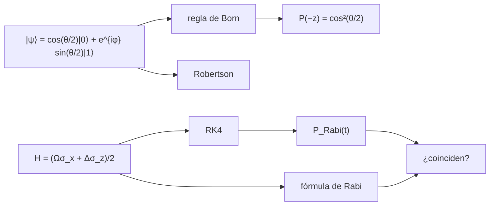

# B31-C03 — Estados y observables cuánticos

<!-- nav:top -->
[🏠 Programa](../../../../README.md) · [📚 Bloque B31](../../../tronco-comun/B31-fisica-cuantica-nuclear-y-astroparticulas.md) · [← Anterior: B31-C02 — Ecuación de Schrödinger](../B31-C02-ecuacion-de-schrodinger/CLASE.md) · [Siguiente: B31-C04 — Principio de incertidumbre →](../B31-C04-principio-de-incertidumbre/CLASE.md)
<!-- /nav -->

## 1. Ubicación, nivel y alcance

Clase 3 del bloque B31. Nivel N3. El sistema cuántico más simple tiene dos estados. Aquí usas las **matrices de Pauli**, la **regla de Born**, la **desigualdad de Robertson** y la **oscilación de Rabi** de un sistema de dos niveles integrada con RK4 y comparada con la fórmula analítica. Usas [B10](../../../tronco-comun/B10-algebra-lineal-y-matematicas-geometricas.md) y [B31-C02](../B31-C02-ecuacion-de-schrodinger/CLASE.md). Se trabaja con `ħ = 1` y un sistema cerrado.

## 2. Por qué esta clase existe

Un cúbit, un espín o un átomo de dos niveles obedecen estas reglas, y la medida cambia el estado. La decisión central: **¿cómo se calculan probabilidades y evolución en un sistema de dos niveles?**

## 3. Lo que podrás hacer al terminar

1. Escribir `σ_x`, `σ_y`, `σ_z` y comprobar `[σ_x, σ_y] = 2iσ_z`.
2. Calcular `P(+z) = cos²(θ/2)` y valores esperados.
3. Simular medidas con Monte Carlo.
4. Comprobar la desigualdad de Robertson.
5. Integrar la evolución con RK4 y comparar con la fórmula de Rabi.
6. Verificar la conservación de la norma.

La evidencia es la **ficha de un sistema de dos niveles** del ejercicio 12 (sección 20).

## 4. Con qué llegas y cómo comprobarlo

1. ¿Qué es un vector de estado?
2. ¿Qué es un observable?
3. ¿Qué es un conmutador?
4. ¿Qué es un número complejo?
5. ¿Qué es una evolución unitaria?

<details>
<summary>Ver respuestas</summary>

1. Un vector que describe el sistema. 2. Una cantidad medible, un operador hermítico. 3. `[A, B] = AB − BA`. 4. `a + ib`. 5. Una que conserva la norma.
</details>

Con cuatro o cinco aciertos, sigue; si no, repasa los prerrequisitos.

## 5. Un caso de contexto y casos de referencia

Un estado con `θ = 60°` tiene `P(+z) = 0,75`. Es el **ejemplo conductor**. En 100 000 medidas simuladas la frecuencia fue `0,74830` (error estándar `0,00137`). Con `Ω = 1` y `Δ = 0`, un pulso de duración `π` lleva la población de 0 a 1. Todos los parámetros son **ilustrativos**.

## 6. Vocabulario

Una **matriz de Pauli**. La **regla de Born** da la probabilidad como `|⟨a|ψ⟩|²`. La **oscilación de Rabi** es el vaivén de población bajo un campo resonante. El **detuning** `Δ` es la desintonía. La **desigualdad de Robertson** es `ΔA ΔB ≥ |⟨[A, B]⟩|/2`.

## 7. Modelo mental: una moneda en el aire

Como una moneda en el aire que, al caer, da cara o cruz con cierta probabilidad que depende de cómo giraba; la medida fija el resultado, y la evolución es un giro continuo.



*Descripción textual:* el estado da probabilidades por la regla de Born y cumple Robertson; el hamiltoniano se integra con RK4 y se compara con la fórmula de Rabi.

Analogía: una moneda en el aire. Límite: sistema cerrado de dos niveles.

## 8. La explicación, paso a paso

### 8.1 Matrices y valores esperados

`[σ_x, σ_y] = 2iσ_z` y `σ_x² = 1`. Para el estado con `φ = 40°`:

| `θ` | `P(+z)` | `⟨σ_z⟩` | `⟨σ_x⟩` | `⟨σ_y⟩` |
|---|---|---|---|---|
| 0° | 1,000000 | 1,0000 | 0,0000 | 0,0000 |
| 30° | 0,933013 | 0,8660 | 0,3830 | 0,3214 |
| 60° | 0,750000 | 0,5000 | 0,6634 | 0,5567 |
| 90° | 0,500000 | 0,0000 | 0,7660 | 0,6428 |
| 180° | 0,000000 | −1,0000 | 0,0000 | 0,0000 |

### 8.2 Medidas y Robertson

En 100 000 medidas con `θ = 60°`: frecuencia `0,74830`, esperada `0,75000`, desviación `1,24` errores. La desigualdad `Δσ_x Δσ_y ≥ |⟨σ_z⟩|` se cumple en 1000 estados aleatorios (mínimo de la diferencia `3 × 10⁻⁹`).

### 8.3 Oscilación de Rabi

| `Ω` | `Δ` | `t` | `P` RK4 | `P` fórmula |
|---|---|---|---|---|
| 1,0 | 0,0 | 1,000 | 0,229849 | 0,229849 |
| 1,0 | 0,0 | 3,142 | 1,000000 | 1,000000 |
| 1,0 | 0,8 | 2,000 | 0,559840 | 0,559840 |
| 1,0 | 0,8 | 3,142 | 0,498630 | 0,498630 |

La norma se conserva a `10⁻¹⁵`.

### 8.4 Lectura

Con detuning, la población máxima baja a `Ω²/(Ω² + Δ²) = 0,610` y la frecuencia sube a `√(Ω² + Δ²) = 1,281`.

## 9. Magnitudes, símbolos y unidades

| Símbolo | Qué es | Unidad | Valor / nota |
|---|---|---|---|
| `σ_x, σ_y, σ_z` | matrices de Pauli | — | ver 8.1 |
| `θ, φ` | ángulos del estado | ° | ilustrativos |
| `Ω`, `Δ` | frecuencia de Rabi y detuning | — | 1,0; 0 y 0,8 (ilustrativos) |
| `P(t)` | población del estado excitado | — | `Ω²/(Ω²+Δ²) sen²(√(Ω²+Δ²)t/2)` |

## 10. Convenciones y referencias

`ħ = 1`; sistema cerrado, medición proyectiva ideal; los valores de `Ω`, `Δ` y el número de disparos son **ilustrativos**; semilla `20261109`.

## 11. De dónde sale lo que afirmamos

| ID | Fuente | Localizador | Respalda | Estado |
|---|---|---|---|---|
| — | Sin fuente externa | — | matrices de Pauli, regla de Born, Robertson y fórmula de Rabi son resultados estándar que verifica el laboratorio | No se consultó una fuente para esta clase |

Límites: no se consultó ninguna fuente; el laboratorio valida la implementación contra fórmulas analíticas y no contra mediciones.

## 12. Cómo ver la oscilación de Rabi

| `t` | `P` (Δ = 0) | `P` (Δ = 0,8) |
|---|---|---|
| 1,0 | 0,2298 | 0,2176 |
| 2,0 | 0,7081 | 0,5598 |
| 3,14 | 1,0000 | 0,4986 |

Descripción larga: sin detuning la población llega a 1; con detuning se queda en 0,61 como máximo.

## 13. Ejemplo trabajado: probabilidad para θ = 60°

**Paso 1 · Ángulo.** `θ/2 = 30°`.

**Paso 2 · Coseno.** `cos 30° = 0,8660`.

**Paso 3 · Cuadrado.** `0,8660² = 0,7500`.

**Paso 4 · Lectura.** `P(+z) = 0,75` y `⟨σ_z⟩ = 2P − 1 = 0,5`.

## 14. Distintas formas de describir un sistema de dos niveles

**Por matrices:** Pauli. **Por probabilidad:** Born. **Por tiempo:** Rabi. **Por incertidumbre:** Robertson.

## 15. Práctica guiada

**Ejercicio 1 · con los pasos indicados.** `P(+z)` para `θ = 60°`. *Pasos:* ejemplo 13.

<details><summary>Solución comentada</summary>

`0,75`.
</details>

**Ejercicio 2 · con una pista.** `⟨σ_z⟩` para ese estado. *Pista:* `2P − 1`.

<details><summary>Solución comentada</summary>

`0,5`.
</details>

**Ejercicio 3 · casi autónomo.** `P` de Rabi con `Ω = 1`, `Δ = 0` en `t = π`.

<details><summary>Solución comentada</summary>

`sen²(π/2) = 1`.
</details>

## 16. Práctica autónoma, transferencia e integrador

**Ejercicio 4.** Población máxima con `Ω = 1`, `Δ = 0,8`.

<details><summary>Solución comentada</summary>

`1/1,64 = 0,610`.
</details>

**Ejercicio 5.** Frecuencia de Rabi generalizada con esos parámetros.

<details><summary>Solución comentada</summary>

`√1,64 = 1,281`.
</details>

**Ejercicio 6.** Instante del primer máximo con `Δ = 0` y `Ω = 1`.

<details><summary>Solución comentada</summary>

`t = π = 3,142`.
</details>

**Ejercicio 7.** ¿Qué prueba la norma conservada a `10⁻¹⁵`?

<details><summary>Solución comentada</summary>

Que el integrador es casi unitario; no que el modelo sea correcto.
</details>

**Ejercicio 8.** Cota de Robertson en un estado con `⟨σ_z⟩ = 0`.

<details><summary>Solución comentada</summary>

`0`: no restringe el producto.
</details>

**Ejercicio 9 · transferencia.** **Transferencia.** Un compañero afirma que la medida «mide» el estado previo. Responde.

<details><summary>Solución comentada</summary>

La regla de Born da probabilidades; un solo resultado no revela `θ`.
</details>

**Ejercicio 10 · transferencia.** **Transferencia.** ¿Qué parte del laboratorio es azar y cuál determinista?

<details><summary>Solución comentada</summary>

Las medidas son aleatorias (semilla fija); la evolución es determinista.
</details>

**Ejercicio 11 · transferencia.** **Transferencia.** ¿Por qué `P < 1` con detuning?

<details><summary>Solución comentada</summary>

Porque el campo no está en resonancia con la transición.
</details>

**Ejercicio 12.** **Integrador.** Elabora tu *ficha de un sistema de dos niveles*: matrices, probabilidades, Robertson y Rabi.

<details><summary>Solución comentada</summary>

Secciones 8.1–8.4.
</details>

**Ejercicio 12 · integrador.** **Integrador.** Elabora tu *ficha de un sistema de dos niveles*: matrices, probabilidades, Robertson y Rabi.

<details><summary>Solución modelo</summary>

Secciones 8.1–8.4.
</details>

## 17. Laboratorio: Pauli, Born y Rabi

El script [estados.py](estados.py) verifica el conmutador, la regla de Born por Monte Carlo, la desigualdad de Robertson y la oscilación de Rabi (**comprueba** la norma a `10⁻⁹` y RK4 frente a la fórmula a `10⁻⁸`).

**Datos:** sin constantes; parámetros **ilustrativos**; semilla `20261109`. **Predice antes de ejecutar:** ¿cuánto vale `P(+z)` para 60°? (0,75.) **Ejecución del 2026-11-09 (Python 3.12.9):**

```text
Python 3.12.9 (biblioteca estandar)
[sigma_x, sigma_y] = 2 i sigma_z: True ; sigma_x^2 = identidad: True
theta [deg]   P(+z) = cos^2(theta/2)  <sigma_z>  <sigma_x>  <sigma_y>
          0                 1.000000     1.0000     0.0000     0.0000
         30                 0.933013     0.8660     0.3830     0.3214
         60                 0.750000     0.5000     0.6634     0.5567
         90                 0.500000     0.0000     0.7660     0.6428
        120                 0.250000    -0.5000     0.6634     0.5567
        180                 0.000000    -1.0000     0.0000     0.0000
100000 medidas con theta = 60 deg: frecuencia = 0.74830 ; P = 0.75000 ; error estandar = 0.00137 ; desviacion = 1.24 errores
desigualdad de Robertson Delta sigma_x Delta sigma_y >= |<sigma_z>| en 1000 estados: minimo de (producto - cota) = 3.181e-09
 Omega  Delta      t      P_RK4  P_formula  |norma - 1|
   1.0    0.0  1.000   0.229849   0.229849     1.33e-15
   1.0    0.0  2.000   0.708073   0.708073     1.78e-15
   1.0    0.0  3.142   1.000000   1.000000     3.11e-15
   1.0    0.8  1.000   0.217647   0.217647     7.77e-16
   1.0    0.8  2.000   0.559840   0.559840     1.33e-15
   1.0    0.8  3.142   0.498630   0.498630     2.66e-15
Pruebas superadas.
```

```bash
python programa/clases/B31/B31-C03-estados-y-observables-cuanticos/estados.py
```

**Límites:** sistema cerrado, medida ideal.

## 18. Errores frecuentes y cómo corregirlos

**Olvidar el cuadrado del módulo.** Se corrige con el ejemplo 13.

**Usar `θ` en vez de `θ/2`.** Se corrige con el ejercicio 1.

**Creer que la norma conservada valida el modelo.** Se corrige con el ejercicio 7.

**Confundir `Ω` y `Δ`.** Se corrige con 8.4.

## 19. Cómo sabrás que vas bien

Tras 8.1: ¿qué vale `P(+z)` en 90°? Si dudas, ejemplo 13. Tras 8.3: ¿cuándo se alcanza el máximo? Tras el laboratorio: ¿qué comprueba? (RK4 y la norma).

## 20. Qué entregas y cómo se evalúa

El producto es tu **ficha de un sistema de dos niveles** (ejercicio 12).

| Criterio | Inicial | En desarrollo | Logrado | Destacado |
|---|---|---|---|---|
| Conceptos | Los confunde | Parciales | Pauli, Born, Rabi | Explica Robertson |
| Cálculo | Sin unidades | Con errores | Tablas completas | Calcula casos con detuning |
| Numérico | Sin comprobar | Un caso | RK4 y Monte Carlo | Interpreta los errores estándar |
| Fuentes | Sin fuente | Sin fecha | Declara la ausencia de fuente | Distingue validar y medir |
| Límites | No los nombra | Uno | Tres | Discute qué falta del modelo |

**Condiciones críticas (no se compensan con promedio):** rotular los parámetros como ilustrativos; no afirmar que se mide un sistema real; citar solo lo consultado.

## 21. Ética, seguridad y límites

Clase educativa: no modela un procesador cuántico. Accesibilidad: tablas equivalentes a las gráficas, fórmulas en texto, ejercicios sin conexión.

## 22. Para cerrar y seguir

Con `θ = 60°` la probabilidad es `0,75`, la simulación da `0,748` y la población de Rabi llega a 1 en `t = π`. Queda una pregunta: ¿qué límite pone la cuántica a conocer dos magnitudes a la vez?

**Glosario español–inglés.** matriz de Pauli · *Pauli matrix*; regla de Born · *Born rule*; oscilación de Rabi · *Rabi oscillation*; detuning · *detuning*; desigualdad de Robertson · *Robertson inequality*.

**Continuidad.** [B31-C04](../B31-C04-principio-de-incertidumbre/CLASE.md) estudia el principio de incertidumbre.

**Referencias:** ver sección 11.

<!-- nav:bottom -->
---

[← Anterior: B31-C02 — Ecuación de Schrödinger](../B31-C02-ecuacion-de-schrodinger/CLASE.md) · [📚 Bloque B31](../../../tronco-comun/B31-fisica-cuantica-nuclear-y-astroparticulas.md) · [Siguiente: B31-C04 — Principio de incertidumbre →](../B31-C04-principio-de-incertidumbre/CLASE.md)
<!-- /nav -->
