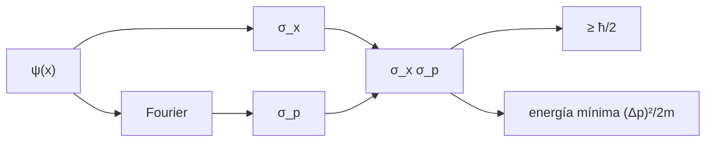

# B31-C04 — Principio de incertidumbre

<!-- nav:top -->
[🏠 Programa](../../../../README.md) · [📚 Bloque B31](../../../tronco-comun/B31-fisica-cuantica-nuclear-y-astroparticulas.md) · [← Anterior: B31-C03 — Estados y observables cuánticos](../B31-C03-estados-y-observables-cuanticos/CLASE.md) · [Siguiente: B31-C05 — Espín y momento angular →](../B31-C05-espin-y-momento-angular/CLASE.md)
<!-- /nav -->

## 1. Ubicación, nivel y alcance

Clase 4 del bloque B31. Nivel N3. El producto de las incertidumbres de la posición y del momento tiene una cota inferior `ħ/2`. Aquí lo verificas numéricamente para un **paquete gaussiano** (con una transformada de Fourier discreta) y para una **partícula en una caja** (con integrales de Simpson y la fórmula cerrada `ħ√(n²π²/12 − 1/2)`) y calculas la energía mínima de un electrón confinado a 0,1 nm. Usas [B12](../../../tronco-comun/B12-probabilidad-estadistica-e-incertidumbre.md), [B31-C02](../B31-C02-ecuacion-de-schrodinger/CLASE.md) y [B09-C11](../../B09/B09-C11-integrales-definidas/CLASE.md). Se supone una dimensión.

## 2. Por qué esta clase existe

La incertidumbre explica el tamaño de los átomos y la energía de punto cero. La decisión central: **¿cuánto vale el producto de incertidumbres de un estado y qué energía implica un confinamiento?**

## 3. Lo que podrás hacer al terminar

1. Calcular `σ_x` y `σ_p` de un paquete gaussiano con una DFT.
2. Verificar `σ_xσ_p = ħ/2`.
3. Calcular `σ_xσ_p` de los estados de la caja por Simpson.
4. Comparar con `ħ√(n²π²/12 − 1/2)`.
5. Estimar la energía mínima de un electrón confinado.
6. Distinguir incertidumbre cuántica y error de medida.

La evidencia es la **ficha de la incertidumbre** del ejercicio 12 (sección 20).

## 4. Con qué llegas y cómo comprobarlo

1. ¿Qué es una desviación típica?
2. ¿Qué es una transformada de Fourier?
3. ¿Qué es un valor esperado?
4. ¿Qué es una integral de Simpson?
5. ¿Qué es el momento de una onda?

<details>
<summary>Ver respuestas</summary>

1. La raíz de la varianza. 2. El paso entre posición y número de onda. 3. El promedio ponderado por `|ψ|²`. 4. Una regla de integración numérica de orden 4. 5. `p = ħk`.
</details>

Con cuatro o cinco aciertos, sigue; si no, repasa los prerrequisitos.

## 5. Un caso de contexto y casos de referencia

Un paquete gaussiano de `σ_x = 1` (con `ħ = 1`) tiene `σ_p = 0,50000` y producto `0,50000`: el mínimo. Es el **ejemplo conductor**. El estado fundamental de la caja da `0,567862 ħ`. Un electrón confinado a 0,1 nm tiene `Δp ≥ 5,2729 × 10⁻²⁵ kg m/s` y una energía cinética de al menos `0,9525 eV`.

## 6. Vocabulario

La **incertidumbre** `σ_A` es la desviación típica de un observable. El **paquete gaussiano** es el estado de mínima incertidumbre. La **caja** es el pozo infinito. La **energía de punto cero** es la energía mínima por confinamiento. La **DFT** es la transformada de Fourier discreta.

## 7. Modelo mental: apretar un globo

Apretar un globo para reducir su anchura lo hace crecer en otra dirección: reducir la incertidumbre en la posición aumenta la del momento.



*Descripción textual:* la función de onda da `σ_x` directamente y `σ_p` por Fourier; el producto se compara con `ħ/2` y da una energía mínima.

Analogía: apretar un globo. Límite: una dimensión.

## 8. La explicación, paso a paso

### 8.1 Paquete gaussiano

Con `ħ = 1` y una malla de 512 puntos en 40 unidades: `σ_x = 1,00000`, `σ_p = 0,50000` y `σ_xσ_p = 0,50000 = ħ/2`.

### 8.2 Caja

| `n` | `σ_x/L` | `σ_pL/ħ` | `σ_xσ_p/ħ` numérico | `√(n²π²/12 − 1/2)` |
|---|---|---|---|---|
| 1 | 0,18076 | 3,14159 | 0,567862 | 0,567862 |
| 2 | 0,26583 | 6,28319 | 1,670290 | 1,670290 |
| 3 | 0,27876 | 9,42478 | 2,627204 | 2,627204 |

### 8.3 Confinamiento

Un electrón en `Δx = 0,1 nm`: `Δp ≥ ħ/(2Δx) = 5,2729 × 10⁻²⁵ kg m/s`; velocidad típica `5,788 × 10⁵ m/s`; energía cinética mínima `(Δp)²/(2m) = 0,9525 eV`.

### 8.4 Lectura

El mínimo solo lo alcanza el paquete gaussiano; los estados de la caja tienen un producto mayor que crece con `n`. El confinamiento a escala atómica da energías de eV, como las que se ven en B31-C02.

## 9. Magnitudes, símbolos y unidades

| Símbolo | Qué es | Unidad | Valor / nota |
|---|---|---|---|
| `ħ` | constante de Planck reducida | J s | `h/2π` |
| `σ_x`, `σ_p` | incertidumbres | m; kg m/s | ver 8.1 |
| `L` | ancho de la caja | m | unidad en el cálculo |
| `Δp` | cota de momento | kg m/s | `ħ/(2Δx)` |
| `E_min` | energía mínima | eV | `(Δp)²/(2m)` |

## 10. Convenciones y referencias

Funciones de onda reales y normalizadas, 1D; la anchura del paquete, la malla y el confinamiento de 0,1 nm son **ilustrativos**; `ħ = h/2π` de NIST.

## 11. De dónde sale lo que afirmamos

| ID | Fuente | Localizador | Respalda | Estado |
|---|---|---|---|---|
| S1 | NIST, *Fundamental Physical Constants* (CODATA 2022) | https://physics.nist.gov/cuu/Constants/Table/allascii.txt | `h`, `m_e`, `e` | Consultada el 2026-11-09 |

Límites: no se consultó ningún experimento de incertidumbre; la clase verifica relaciones matemáticas.

## 12. Cómo ver el producto

| Estado | `σ_xσ_p/ħ` |
|---|---|
| gaussiano | 0,5000 |
| caja, `n = 1` | 0,5679 |
| caja, `n = 2` | 1,6703 |
| caja, `n = 3` | 2,6272 |

Descripción larga: el gaussiano alcanza el mínimo y los estados de la caja lo superan de forma creciente.

## 13. Ejemplo trabajado: producto del estado fundamental de la caja

**Paso 1 · Fórmula.** `√(n²π²/12 − 1/2)` con `n = 1`.

**Paso 2 · Cociente.** `π²/12 = 0,82247`.

**Paso 3 · Diferencia.** `0,82247 − 0,5 = 0,32247`.

**Paso 4 · Raíz.** `0,5679 ħ`.

## 14. Distintas formas de describir la incertidumbre

**Por producto:** `σ_xσ_p`. **Por estado:** gaussiano o caja. **Por energía:** punto cero. **Por escala:** confinamiento.

## 15. Práctica guiada

**Ejercicio 1 · con los pasos indicados.** `σ_p` de un gaussiano con `σ_x = 2` (`ħ = 1`). *Pasos:* `ħ/(2σ_x)`.

<details><summary>Solución comentada</summary>

`0,25`.
</details>

**Ejercicio 2 · con una pista.** Producto de la caja con `n = 1`. *Pista:* ejemplo 13.

<details><summary>Solución comentada</summary>

`0,5679 ħ`.
</details>

**Ejercicio 3 · casi autónomo.** Cociente con el mínimo.

<details><summary>Solución comentada</summary>

`0,5679/0,5 = 1,136`.
</details>

## 16. Práctica autónoma, transferencia e integrador

**Ejercicio 4.** `σ_x` del estado fundamental de una caja de 1 nm.

<details><summary>Solución comentada</summary>

`0,18076 nm`.
</details>

**Ejercicio 5.** Energía mínima de un electrón confinado a 1 nm.

<details><summary>Solución comentada</summary>

`0,9525/100 = 0,0095 eV`.
</details>

**Ejercicio 6.** Velocidad típica con `Δx = 0,1 nm`.

<details><summary>Solución comentada</summary>

`5,79 × 10⁵ m/s`, el 0,19 % de `c`.
</details>

**Ejercicio 7.** Producto para `n = 3`.

<details><summary>Solución comentada</summary>

`2,6272 ħ`.
</details>

**Ejercicio 8.** ¿Por qué el producto del gaussiano es mínimo?

<details><summary>Solución comentada</summary>

Porque su transformada es otra gaussiana y satura la desigualdad.
</details>

**Ejercicio 9 · transferencia.** **Transferencia.** Un compañero dice que la incertidumbre es un error del instrumento. Responde.

<details><summary>Solución comentada</summary>

Es una propiedad del estado: ocurre aun con instrumentos perfectos.
</details>

**Ejercicio 10 · transferencia.** **Transferencia.** ¿Por qué una DFT necesita la malla en 40 unidades?

<details><summary>Solución comentada</summary>

Para contener el paquete y resolver su transformada.
</details>

**Ejercicio 11 · transferencia.** **Transferencia.** ¿Qué valida la comparación con la fórmula cerrada?

<details><summary>Solución comentada</summary>

La implementación de las integrales, no la física.
</details>

**Ejercicio 12.** **Integrador.** Elabora tu *ficha de la incertidumbre*: gaussiano, caja, confinamiento y lectura.

<details><summary>Solución comentada</summary>

Secciones 8.1–8.4.
</details>

**Ejercicio 12 · integrador.** **Integrador.** Elabora tu *ficha de la incertidumbre*: gaussiano, caja, confinamiento y lectura.

<details><summary>Solución modelo</summary>

Secciones 8.1–8.4.
</details>

## 17. Laboratorio: incertidumbre del gaussiano y de la caja

El script [incertidumbre.py](incertidumbre.py) calcula `σ_x σ_p` del paquete gaussiano con una DFT y de la caja con Simpson (**comprueba** `10⁻³` y `10⁻⁶`).

**Datos:** `h`, `m_e`, `e` de NIST; la anchura, la malla y el confinamiento **ilustrativos**. **Predice antes de ejecutar:** ¿cuánto vale el producto del gaussiano? (ħ/2.) **Ejecución del 2026-11-09 (Python 3.12.9):**

```text
Python 3.12.9 (biblioteca estandar)
paquete gaussiano (hbar = 1): sigma_x = 1.00000 ; sigma_p = 0.50000 ; producto = 0.50000 ; hbar/2 = 0.50000
 n  sigma_x/L  sigma_p L/hbar  producto/hbar numerico   sqrt(n^2 pi^2/12 - 1/2)
 1    0.18076         3.14159                0.567862                  0.567862
 2    0.26583         6.28319                1.670290                  1.670290
 3    0.27876         9.42478                2.627204                  2.627204
electron confinado en Delta x = 0.1 nm: Delta p >= 5.2729e-25 kg m/s ; velocidad tipica 5.7884e+05 m/s ; energia cinetica minima (Delta p)^2/(2 m) = 0.9525 eV
Pruebas superadas.
```

```bash
python programa/clases/B31/B31-C04-principio-de-incertidumbre/incertidumbre.py
```

**Límites:** 1D, funciones reales.

## 18. Errores frecuentes y cómo corregirlos

**Confundir incertidumbre y error.** Se corrige con el ejercicio 9.

**Olvidar el factor 2 de `ħ/2`.** Se corrige con 8.1.

**Usar `Δp = ħ/Δx`.** Se corrige con 8.3.

**Tomar el confinamiento por una medida.** Se corrige con la sección 10.

## 19. Cómo sabrás que vas bien

Tras 8.1: ¿qué producto da el gaussiano? Si dudas, ejemplo 13. Tras el laboratorio: ¿qué comprueba? (las integrales).

## 20. Qué entregas y cómo se evalúa

El producto es tu **ficha de la incertidumbre** (ejercicio 12).

| Criterio | Inicial | En desarrollo | Logrado | Destacado |
|---|---|---|---|---|
| Conceptos | Los confunde | Parciales | producto, gaussiano, caja | Explica por qué el gaussiano es mínimo |
| Cálculo | Sin unidades | Con errores | Tablas completas | Calcula la energía mínima |
| Numérico | Sin comprobar | Un caso | DFT y Simpson | Interpreta el crecimiento con `n` |
| Fuentes | Sin fuente | Sin fecha | S1 con fecha | Declara que no hay experimento consultado |
| Límites | No los nombra | Uno | Tres | Discute qué falta del modelo |

**Condiciones críticas (no se compensan con promedio):** rotular el confinamiento como ilustrativo; no presentar la incertidumbre como error; citar solo lo consultado.

## 21. Ética, seguridad y límites

Clase educativa: no calcula errores de instrumentos. Accesibilidad: tablas equivalentes a las gráficas, fórmulas en texto, ejercicios sin conexión.

## 22. Para cerrar y seguir

El gaussiano alcanza `ħ/2` y la caja da `0,568 ħ` para `n = 1`; un electrón a 0,1 nm tiene al menos 0,95 eV. Queda una pregunta: ¿qué otra propiedad tienen las partículas además de posición y momento?

**Glosario español–inglés.** principio de incertidumbre · *uncertainty principle*; paquete gaussiano · *Gaussian wave packet*; energía de punto cero · *zero-point energy*; confinamiento · *confinement*; transformada de Fourier discreta · *discrete Fourier transform*.

**Continuidad.** [B31-C05](../B31-C05-espin-y-momento-angular/CLASE.md) estudia el espín y el momento angular.

**Referencias:** ver sección 11.

<!-- nav:bottom -->
---

[← Anterior: B31-C03 — Estados y observables cuánticos](../B31-C03-estados-y-observables-cuanticos/CLASE.md) · [📚 Bloque B31](../../../tronco-comun/B31-fisica-cuantica-nuclear-y-astroparticulas.md) · [Siguiente: B31-C05 — Espín y momento angular →](../B31-C05-espin-y-momento-angular/CLASE.md)
<!-- /nav -->
