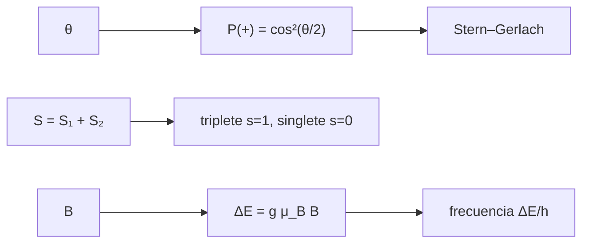

# B31-C05 — Espín y momento angular

<!-- nav:top -->
[🏠 Programa](../../../../README.md) · [📚 Bloque B31](../../../tronco-comun/B31-fisica-cuantica-nuclear-y-astroparticulas.md) · [← Anterior: B31-C04 — Principio de incertidumbre](../B31-C04-principio-de-incertidumbre/CLASE.md) · [Siguiente: B31-C06 — Estadísticas cuánticas →](../B31-C06-estadisticas-cuanticas/CLASE.md)
<!-- /nav -->

## 1. Ubicación, nivel y alcance

Clase 5 del bloque B31. Nivel N3. El espín es un momento angular intrínseco. Aquí calculas las probabilidades de un analizador de **Stern–Gerlach** a un ángulo `θ`, la secuencia de tres analizadores, la **suma de dos espines 1/2** con matrices de 4×4 (triplete y singlete), los autovalores de `L²` y el **desdoblamiento Zeeman** del electrón con los valores del magnetón de Bohr de NIST. Usas [B10](../../../tronco-comun/B10-algebra-lineal-y-matematicas-geometricas.md) y [B31-C03](../B31-C03-estados-y-observables-cuanticos/CLASE.md). Se supone analizadores ideales.

## 2. Por qué esta clase existe

El espín explica los desdoblamientos de líneas espectrales y la estructura de la materia. La decisión central: **¿qué probabilidades y qué energías resultan de un espín en un campo?**

## 3. Lo que podrás hacer al terminar

1. Calcular `P(+) = cos²(θ/2)` y comprobarlo por Monte Carlo.
2. Calcular la fracción de la secuencia z, x, z.
3. Verificar `S² = s(s + 1)` para el triplete y el singlete.
4. Tabular `l(l + 1)` y la degeneración `2l + 1`.
5. Calcular el desdoblamiento Zeeman `gμ_B B`.
6. Comparar con el magnetón de Bohr de NIST.

La evidencia es la **ficha del espín** del ejercicio 12 (sección 20).

## 4. Con qué llegas y cómo comprobarlo

1. ¿Qué es un momento angular?
2. ¿Qué es un producto de Kronecker?
3. ¿Qué es un campo magnético?
4. ¿Qué es un magnetón de Bohr?
5. ¿Qué es una degeneración?

<details>
<summary>Ver respuestas</summary>

1. Una cantidad que describe la rotación. 2. El producto de matrices que describe sistemas compuestos. 3. Una región donde una carga en movimiento siente fuerza. 4. La unidad natural del momento magnético del electrón. 5. El número de estados con la misma energía.
</details>

Con cuatro o cinco aciertos, sigue; si no, repasa los prerrequisitos.

## 5. Un caso de contexto y casos de referencia

Un analizador a `60°` del estado preparado da `P(+) = 0,75`. Es el **ejemplo conductor**. El electrón en 1 T tiene un desdoblamiento Zeeman de `g μ_B B = 1,8570 × 10⁻²³ J`, que es una frecuencia de `28,025 GHz` (S1: `μ_B/h = 1,39962449171 × 10¹⁰ Hz/T`, `g = −2,00231930436`).

## 6. Vocabulario

El **espín** `s = 1/2`. Un **analizador de Stern–Gerlach** mide la componente del espín. El **triplete** (`s = 1`) y el **singlete** (`s = 0`). La **degeneración** `2l + 1`. El **efecto Zeeman** es el desdoblamiento de niveles en un campo. El **magnetón de Bohr** `μ_B = eħ/(2m_e)`.

## 7. Modelo mental: una brújula que gira

Como una brújula cuántica: al medir su orientación respecto de un eje, solo se obtienen dos resultados, y la probabilidad depende del ángulo con que se preparó.



*Descripción textual:* el ángulo da la probabilidad en un analizador; la suma de espines da triplete y singlete; el campo da el desdoblamiento Zeeman y su frecuencia.

Analogía: una brújula cuántica. Límite: analizadores ideales.

## 8. La explicación, paso a paso

### 8.1 Analizadores

| `θ` | `P(+)` | frecuencia (100 000) | desviación (errores) |
|---|---|---|---|
| 0° | 1,00000 | 1,00000 | 0,00 |
| 30° | 0,93301 | 0,93327 | 0,33 |
| 60° | 0,75000 | 0,75096 | 0,70 |
| 90° | 0,50000 | 0,49842 | 1,00 |
| 150° | 0,06699 | 0,06557 | 1,79 |

La secuencia `z+ → x+ → z+` deja pasar `0,25010` de los átomos (teoría `0,25`); sin el analizador intermedio pasaría el 100 %.

### 8.2 Dos espines

`⟨S²⟩ = 2` para los tres estados del triplete (`s = 1`) y `0` para el singlete (`s = 0`).

### 8.3 Momento angular orbital

| `l` | `l(l + 1)` | `2l + 1` |
|---|---|---|
| 0 | 0 | 1 |
| 1 | 2 | 3 |
| 2 | 6 | 5 |
| 3 | 12 | 7 |

### 8.4 Zeeman

En 1 T: `ΔE = 1,8570 × 10⁻²³ J = 0,11590 meV`; frecuencia `28,0250 GHz` (con `g = 2`, `27,9925 GHz`).

## 9. Magnitudes, símbolos y unidades

| Símbolo | Qué es | Unidad | Valor / nota |
|---|---|---|---|
| `μ_B` | magnetón de Bohr | J/T | `9,2740100657 × 10⁻²⁴` (S1) |
| `g` | factor g del electrón | — | −2,00231930436 (S1) |
| `s`, `m_s` | espín y su proyección | — | 1/2; ±1/2 |
| `ΔE` | desdoblamiento Zeeman | J | `|g| μ_B B` |
| `f` | frecuencia | GHz | `ΔE/h` |

## 10. Convenciones y referencias

Analizadores ideales, campo uniforme de 1 T (ilustrativo); ángulos de 0° a 150° y 100 000 ensayos con semilla `20261109` ilustrativos; `ħ = 1` en las matrices.

## 11. De dónde sale lo que afirmamos

| ID | Fuente | Localizador | Respalda | Estado |
|---|---|---|---|---|
| S1 | NIST, *Fundamental Physical Constants* (CODATA 2022) | https://physics.nist.gov/cuu/Constants/Table/allascii.txt | constantes y masas citadas en la sección 9 | Consultada el 2026-11-09 |

Límites: no se consultó ningún experimento de Stern–Gerlach; los resultados son del modelo ideal.

## 12. Cómo ver el desdoblamiento

| Magnitud | Valor |
|---|---|
| `ΔE` (1 T) | 1,8570 × 10⁻²³ J |
| `ΔE` | 0,11590 meV |
| `f` | 28,025 GHz |

Descripción larga: el desdoblamiento Zeeman del electrón en 1 T corresponde a microondas.

## 13. Ejemplo trabajado: frecuencia Zeeman en 1 T

**Paso 1 · Magnetón.** `μ_B/h = 1,39962449171 × 10¹⁰ Hz/T`.

**Paso 2 · Factor g.** `|g| = 2,00231930436`.

**Paso 3 · Producto.** `2,00232 × 1,39962 × 10¹⁰`.

**Paso 4 · Frecuencia.** `28,025 GHz`.

## 14. Distintas formas de describir el espín

**Por proyección:** `m_s`. **Por suma:** triplete y singlete. **Por energía:** Zeeman. **Por probabilidad:** Born.

## 15. Práctica guiada

**Ejercicio 1 · con los pasos indicados.** `P(+)` a `150°`. *Pasos:* `cos²(θ/2)`.

<details><summary>Solución comentada</summary>

`cos²75° = 0,0670`.
</details>

**Ejercicio 2 · con una pista.** Fracción que pasa la secuencia z, x, z. *Pista:* `1/2 × 1/2`.

<details><summary>Solución comentada</summary>

`0,25`.
</details>

**Ejercicio 3 · casi autónomo.** `s` del singlete.

<details><summary>Solución comentada</summary>

`0`.
</details>

## 16. Práctica autónoma, transferencia e integrador

**Ejercicio 4.** Degeneración de `l = 2`.

<details><summary>Solución comentada</summary>

`5`.
</details>

**Ejercicio 5.** Autovalor de `L²` para `l = 3`.

<details><summary>Solución comentada</summary>

`12 ħ²`.
</details>

**Ejercicio 6.** Frecuencia Zeeman en 0,5 T.

<details><summary>Solución comentada</summary>

`14,01 GHz`.
</details>

**Ejercicio 7.** Energía Zeeman en 0,5 T en meV.

<details><summary>Solución comentada</summary>

`0,0580 meV`.
</details>

**Ejercicio 8.** Longitud de onda de 28,025 GHz.

<details><summary>Solución comentada</summary>

`c/f = 10,70 mm`.
</details>

**Ejercicio 9 · transferencia.** **Transferencia.** Un compañero afirma que el analizador x «destruye» la información de z. Responde.

<details><summary>Solución comentada</summary>

La medida de `σ_x` reprepara el estado en un autoestado de `σ_x`; la probabilidad de z vuelve a 1/2.
</details>

**Ejercicio 10 · transferencia.** **Transferencia.** ¿Por qué `g = 2` y `g = 2,0023` dan frecuencias distintas?

<details><summary>Solución comentada</summary>

El segundo incluye la corrección de 0,116 %.
</details>

**Ejercicio 11 · transferencia.** **Transferencia.** ¿Qué supone la suma de dos espines con matrices de 4×4?

<details><summary>Solución comentada</summary>

Espacio producto y espines independientes.
</details>

**Ejercicio 12.** **Integrador.** Elabora tu *ficha del espín*: probabilidades, triplete y singlete, `L²` y Zeeman.

<details><summary>Solución comentada</summary>

Secciones 8.1–8.4.
</details>

**Ejercicio 12 · integrador.** **Integrador.** Elabora tu *ficha del espín*: probabilidades, triplete y singlete, `L²` y Zeeman.

<details><summary>Solución modelo</summary>

Secciones 8.1–8.4.
</details>

## 17. Laboratorio: Stern–Gerlach, suma de espines y Zeeman

El script [espin.py](espin.py) simula analizadores, calcula `S²` en 4×4 y el desdoblamiento Zeeman (**comprueba** las frecuencias a 4 errores estándar, `S²` a `10⁻¹²` y la frecuencia a `10⁻⁴`).

**Datos:** `μ_B`, `g`, `h`, `e` de NIST; campos y ángulos **ilustrativos**; semilla `20261109`. **Predice antes de ejecutar:** ¿cuál es la frecuencia Zeeman en 1 T? (≈28 GHz.) **Ejecución del 2026-11-09 (Python 3.12.9):**

```text
Python 3.12.9 (biblioteca estandar)
theta [deg]  P(+) = cos^2(theta/2)  frecuencia  desviacion [errores]
          0                1.00000     1.00000                  0.00
         30                0.93301     0.93327                  0.33
         60                0.75000     0.75096                  0.70
         90                0.50000     0.49842                  1.00
        150                0.06699     0.06557                  1.79
secuencia z+ -> x+ -> z+: frecuencia = 0.25010 ; teoria 0.25000 (sin el analizador x seria 1)
triplete m = +1 (arriba, arriba)   <S^2> = 2.000000 -> s = 1
triplete m = 0                     <S^2> = 2.000000 -> s = 1
triplete m = -1                    <S^2> = 2.000000 -> s = 1
singlete                           <S^2> = 0.000000 -> s = 0
 l  l(l + 1)  degeneracion 2l + 1               valores de m
 0         0                    1                        [0]
 1         2                    3                 [-1, 0, 1]
 2         6                    5          [-2, -1, 0, 1, 2]
 3        12                    7   [-3, -2, -1, 0, 1, 2, 3]
desdoblamiento Zeeman del electron en 1.0 T: 1.8570e-23 J = 0.11590 meV ; frecuencia = 28.0250 GHz
cociente 2 mu_B B / h con g = 2: 27.9925 GHz (g = 2.0023: 28.0250 GHz)
Pruebas superadas.
```

```bash
python programa/clases/B31/B31-C05-espin-y-momento-angular/espin.py
```

**Límites:** analizadores ideales.

## 18. Errores frecuentes y cómo corregirlos

**Usar `θ` en lugar de `θ/2`.** Se corrige con el ejercicio 1.

**Confundir `s` con `m_s`.** Se corrige con la sección 6.

**Olvidar el factor g.** Se corrige con el ejemplo 13.

**Presentar el experimento como real.** Se corrige con la sección 10.

## 19. Cómo sabrás que vas bien

Tras 8.1: ¿qué probabilidad da 60°? Si dudas, repasa C03. Tras 8.4: ¿qué frecuencia da 1 T? Tras el laboratorio: ¿qué comprueba? (Monte Carlo y `S²`).

## 20. Qué entregas y cómo se evalúa

El producto es tu **ficha del espín** (ejercicio 12).

| Criterio | Inicial | En desarrollo | Logrado | Destacado |
|---|---|---|---|---|
| Conceptos | Los confunde | Parciales | espín, suma, Zeeman | Explica la reparación del estado |
| Cálculo | Sin unidades | Con errores | Tablas completas | Calcula otros campos |
| Numérico | Sin comprobar | Un caso | Monte Carlo y matrices | Interpreta el factor g |
| Fuentes | Sin fuente | Sin fecha | S1 con fecha | Declara que no hay experimento consultado |
| Límites | No los nombra | Uno | Tres | Discute qué falta del modelo |

**Condiciones críticas (no se compensan con promedio):** rotular el campo y los ángulos como ilustrativos; no presentar Monte Carlo como medición; citar solo lo consultado.

## 21. Ética, seguridad y límites

Clase educativa: no modela resonancia magnética. Accesibilidad: tablas equivalentes a las gráficas, fórmulas en texto, ejercicios sin conexión.

## 22. Para cerrar y seguir

Un analizador a 60° da 0,75, el triplete tiene `s = 1`, el singlete `s = 0` y el electrón en 1 T se desdobla en 28 GHz. Queda una pregunta: ¿cómo se reparten muchas partículas idénticas entre los estados?

**Glosario español–inglés.** espín · *spin*; Stern–Gerlach · *Stern–Gerlach*; triplete · *triplet*; singlete · *singlet*; efecto Zeeman · *Zeeman effect*; magnetón de Bohr · *Bohr magneton*.

**Continuidad.** [B31-C06](../B31-C06-estadisticas-cuanticas/CLASE.md) estudia las estadísticas cuánticas.

**Referencias:** ver sección 11.

<!-- nav:bottom -->
---

[← Anterior: B31-C04 — Principio de incertidumbre](../B31-C04-principio-de-incertidumbre/CLASE.md) · [📚 Bloque B31](../../../tronco-comun/B31-fisica-cuantica-nuclear-y-astroparticulas.md) · [Siguiente: B31-C06 — Estadísticas cuánticas →](../B31-C06-estadisticas-cuanticas/CLASE.md)
<!-- /nav -->
