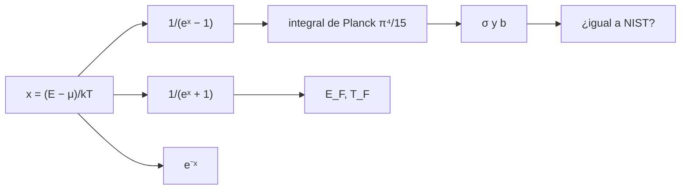

# B31-C06 — Estadísticas cuánticas

<!-- nav:top -->
[🏠 Programa](../../../../README.md) · [📚 Bloque B31](../../../tronco-comun/B31-fisica-cuantica-nuclear-y-astroparticulas.md) · [← Anterior: B31-C05 — Espín y momento angular](../B31-C05-espin-y-momento-angular/CLASE.md) · [Siguiente: B31-C07 — Estructura nuclear →](../../../tronco-comun/B31-fisica-cuantica-nuclear-y-astroparticulas.md#b31-c07)
<!-- /nav -->

## 1. Ubicación, nivel y alcance

Clase 6 del bloque B31. Nivel N3. Las partículas idénticas obedecen la estadística de **Bose–Einstein** (bosones) o de **Fermi–Dirac** (fermiones), que se reducen a la de Maxwell–Boltzmann a baja ocupación. Aquí comparas las tres distribuciones, verificas la integral de Planck `π⁴/15`, deduces las constantes de **Stefan–Boltzmann** y de **Wien** y las comparas con los valores de NIST, y calculas la **energía de Fermi** de un metal y de un gas de tipo enana blanca. Usas [B05](../../../tronco-comun/B05-fisica-fundamental-para-el-espacio.md), [B09-C11](../../B09/B09-C11-integrales-definidas/CLASE.md) y la radiación de [B24-C10](../../B24/B24-C10-espectros-y-clasificacion-estelar/CLASE.md). Se supone gas ideal.

## 2. Por qué esta clase existe

La radiación de las estrellas y la presión de degeneración de los remanentes estelares dependen de estas estadísticas. La decisión central: **¿qué distribución usar y qué constantes se derivan?**

## 3. Lo que podrás hacer al terminar

1. Evaluar `n_BE`, `n_FD` y `n_MB` y sus razones.
2. Verificar `∫x³/(eˣ − 1)dx = π⁴/15`.
3. Derivar `σ = 2π⁵k⁴/(15h³c²)` y compararla con NIST.
4. Derivar la constante de Wien resolviendo `x = 5(1 − e⁻ˣ)`.
5. Calcular la energía de Fermi y su régimen.
6. Reconocer cuándo se necesita la fórmula relativista.

La evidencia es la **ficha de las estadísticas cuánticas** del ejercicio 12 (sección 20).

## 4. Con qué llegas y cómo comprobarlo

1. ¿Qué es un bosón?
2. ¿Qué es un fermión?
3. ¿Qué es la ley de Planck?
4. ¿Qué es una energía de Fermi?
5. ¿Qué es una integral numérica?

<details>
<summary>Ver respuestas</summary>

1. Una partícula de espín entero. 2. Una de espín semientero que obedece el principio de exclusión. 3. El espectro de un cuerpo negro. 4. La energía del nivel ocupado más alto a `T = 0`. 5. Una suma que aproxima el área.
</details>

Con cuatro o cinco aciertos, sigue; si no, repasa los prerrequisitos.

## 5. Un caso de contexto y casos de referencia

La constante de Stefan–Boltzmann, derivada con `h`, `c` y `k_B` exactos, da `5,670374419 × 10⁻⁸ W m⁻² K⁻⁴`, igual a la de NIST (S1). Es el **ejemplo conductor**. La energía de Fermi de un metal con `n = 8,5 × 10²⁸ m⁻³` (ilustrativo) es `7,05 eV`; para `n = 10³⁶ m⁻³` (tipo enana blanca, ilustrativo) el parámetro `p_F/(m_ec) = 1,19` indica régimen relativista.

## 6. Vocabulario

La **distribución de Bose–Einstein**, la de **Fermi–Dirac** y la de **Maxwell–Boltzmann**. La **integral de Planck**. La **energía de Fermi** `E_F`. La **temperatura de Fermi** `T_F`. El **régimen relativista** ocurre cuando `p_F ≳ m_ec`.

## 7. Modelo mental: asientos en un teatro

Los fermiones son personas que no comparten asiento: ocupan los más bajos hasta llenar el nivel de Fermi. Los bosones se agolpan en el mismo asiento, sobre todo con baja energía.



*Descripción textual:* las tres distribuciones dependen de `x`; la de bosones da la integral de Planck y las constantes `σ` y `b`, que se comparan con NIST; la de fermiones da la energía de Fermi.

Analogía: asientos en un teatro. Límite: gas ideal.

## 8. La explicación, paso a paso

### 8.1 Las distribuciones

| `x` | BE | FD | MB | BE/MB | FD/MB |
|---|---|---|---|---|---|
| 0,1 | 9,508332 | 0,475021 | 0,904837 | 10,51 | 0,525 |
| 1 | 0,581977 | 0,268941 | 0,367879 | 1,582 | 0,731 |
| 3 | 0,052396 | 0,047426 | 0,049787 | 1,052 | 0,953 |
| 10 | 0,000045 | 0,000045 | 0,000045 | 1,000 | 1,000 |

`FD(0) = 1/2` y `FD(x) + FD(−x) = 1`.

### 8.2 Cuerpo negro

`∫x³/(eˣ − 1)dx = 6,493939402 = π⁴/15`. Con ella, `σ = 5,670374419 × 10⁻⁸` (cociente con NIST `1,0000000000`). La raíz de `x = 5(1 − e⁻ˣ)` es `4,965114232`, de donde `b = hc/(x_Wk) = 2,897771955 × 10⁻³ m K` (cociente `1,0000000001`).

### 8.3 Energía de Fermi

| `n` (m⁻³, ilustrativo) | `E_F` (eV) | `T_F` (K) | `p_F/(m_ec)` | régimen |
|---|---|---|---|---|
| 8,5 × 10²⁸ | 7,0494 | 8,18 × 10⁴ | 0,0053 | no relativista |
| 10³⁶ | 3,65 × 10⁵ (inválida) | 4,23 × 10⁹ | 1,1946 | relativista |

### 8.4 Lectura

La fórmula no relativista de `E_F` para `n = 10³⁶ m⁻³` da 0,365 MeV, pero como `p_F/(m_ec) = 1,19` esa cifra no es fiable: hace falta la relación relativista. Los bosones superan a MB a bajo `x`; los fermiones, no.

## 9. Magnitudes, símbolos y unidades

| Símbolo | Qué es | Unidad | Valor / nota |
|---|---|---|---|
| `k_B`, `h`, `c` | constantes exactas | SI | S1 |
| `σ` | constante de Stefan–Boltzmann | W m⁻² K⁻⁴ | `5,670374419 × 10⁻⁸` (S1) |
| `b` | constante de Wien | m K | `2,897771955 × 10⁻³` (S1) |
| `E_F` | energía de Fermi | eV | `ħ²(3π²n)^(2/3)/(2m)` |
| `n` | densidad de electrones | m⁻³ | 8,5 × 10²⁸; 10³⁶ (ilustrativas) |

## 10. Convenciones y referencias

Gas ideal, `T = 0` para `E_F`, ocupación media de cada estado; las densidades son **ilustrativas**; `σ` y `b` se derivan con las constantes exactas y se comparan con NIST.

## 11. De dónde sale lo que afirmamos

| ID | Fuente | Localizador | Respalda | Estado |
|---|---|---|---|---|
| S1 | NIST, *Fundamental Physical Constants* (CODATA 2022) | https://physics.nist.gov/cuu/Constants/Table/allascii.txt | constantes y masas citadas en la sección 9 | Consultada el 2026-11-09 |

Límites: no se consultó ninguna medición de gas de Fermi; `σ` y `b` son constantes definidas por las exactas `h`, `c`, `k_B`.

## 12. Cómo ver las constantes del cuerpo negro

| Constante | Derivada | NIST | Cociente |
|---|---|---|---|
| `σ` | 5,670374419 × 10⁻⁸ | 5,670374419 × 10⁻⁸ | 1,0000000000 |
| `b` | 2,897771955 × 10⁻³ | 2,897771955 × 10⁻³ | 1,0000000001 |

Descripción larga: las constantes derivadas coinciden con las de NIST en diez cifras.

## 13. Ejemplo trabajado: longitud de onda del máximo del Sol

**Paso 1 · Constante.** `b = 2,897771955 × 10⁻³ m K`.

**Paso 2 · Temperatura.** `T_eff = 5772 K` (UAI).

**Paso 3 · Cociente.** `λ_max = b/T = 5,0204 × 10⁻⁷ m`.

**Paso 4 · Lectura.** `502 nm`, en el verde.

## 14. Distintas formas de describir un gas cuántico

**Por estadística:** BE o FD. **Por radiación:** Planck. **Por degeneración:** `E_F`. **Por régimen:** relativista o no.

## 15. Práctica guiada

**Ejercicio 1 · con los pasos indicados.** `FD(0)`. *Pasos:* `1/(e⁰ + 1)`.

<details><summary>Solución comentada</summary>

`1/2`.
</details>

**Ejercicio 2 · con una pista.** `BE(1)`. *Pista:* `1/(e − 1)`.

<details><summary>Solución comentada</summary>

`0,581977`.
</details>

**Ejercicio 3 · casi autónomo.** `FD/MB` en `x = 3`.

<details><summary>Solución comentada</summary>

`0,9526`.
</details>

## 16. Práctica autónoma, transferencia e integrador

**Ejercicio 4.** Valor de `∫x³/(eˣ − 1)dx`.

<details><summary>Solución comentada</summary>

`π⁴/15 = 6,4939`.
</details>

**Ejercicio 5.** `λ_max` a 5772 K. *Pasos:* ejemplo 13.

<details><summary>Solución comentada</summary>

`502,0 nm`.
</details>

**Ejercicio 6.** `E_F` si `n` se multiplica por 8.

<details><summary>Solución comentada</summary>

`8^(2/3) = 4`: se cuadruplica a 28,2 eV.
</details>

**Ejercicio 7.** `p_F/(m_ec)` para `n = 10³⁶ m⁻³`.

<details><summary>Solución comentada</summary>

`1,1946`.
</details>

**Ejercicio 8.** ¿Es válida la `E_F` no relativista de ese caso?

<details><summary>Solución comentada</summary>

No: `p_F/(m_ec) > 0,3`.
</details>

**Ejercicio 9 · transferencia.** **Transferencia.** Un compañero dice que `E_F = 7 eV` es la de un metal. Responde con la sección 10.

<details><summary>Solución comentada</summary>

Es con una `n` ilustrativa de tipo metálico; no se consultó el valor de un metal.
</details>

**Ejercicio 10 · transferencia.** **Transferencia.** ¿Por qué `σ` coincide con NIST a diez cifras?

<details><summary>Solución comentada</summary>

Porque ambos se derivan de `h`, `c` y `k_B` exactas.
</details>

**Ejercicio 11 · transferencia.** **Transferencia.** ¿Qué distribución usarías para fotones y cuál para electrones?

<details><summary>Solución comentada</summary>

Bose–Einstein para fotones (con `μ = 0`) y Fermi–Dirac para electrones.
</details>

**Ejercicio 12.** **Integrador.** Elabora tu *ficha de las estadísticas cuánticas*: distribuciones, Planck, `σ`, `b` y `E_F`.

<details><summary>Solución comentada</summary>

Secciones 8.1–8.4.
</details>

**Ejercicio 12 · integrador.** **Integrador.** Elabora tu *ficha de las estadísticas cuánticas*: distribuciones, Planck, `σ`, `b` y `E_F`.

<details><summary>Solución modelo</summary>

Secciones 8.1–8.4.
</details>

## 17. Laboratorio: distribuciones cuánticas y constantes del cuerpo negro

El script [estadisticas.py](estadisticas.py) calcula las tres distribuciones, la integral de Planck, `σ`, `b` y la energía de Fermi (**comprueba** `10⁻⁸` en la integral y las constantes y `10⁻¹²` en FD).

**Datos:** `h`, `c`, `k_B`, `m_e`, `e`, `σ` y `b` de NIST; densidades **ilustrativas**. **Predice antes de ejecutar:** ¿cuánto vale `σ`? (5,67 × 10⁻⁸.) **Ejecución del 2026-11-09 (Python 3.12.9):**

```text
Python 3.12.9 (biblioteca estandar)
     x           BE           FD           MB    BE/MB    FD/MB
   0.1     9.508332     0.475021     0.904837  10.5083   0.5250
   0.5     1.541494     0.377541     0.606531   2.5415   0.6225
   1.0     0.581977     0.268941     0.367879   1.5820   0.7311
   3.0     0.052396     0.047426     0.049787   1.0524   0.9526
  10.0     0.000045     0.000045     0.000045   1.0000   1.0000
Int x^3/(e^x - 1) dx = 6.493939402 ; pi^4/15 = 6.493939402
sigma = 2 pi^5 k^4/(15 h^3 c^2) = 5.670374419e-08 W m^-2 K^-4 ; NIST = 5.670374419e-08 ; cociente = 1.0000000000
x_W = 4.965114232 ; b = h c/(x_W k) = 2.897771955e-03 m K ; NIST = 2.897771955e-03 ; cociente = 1.0000000001
 n [m-3] (ilustrativo)   E_F [eV]     T_F [K]  p_F/(m c)        regimen
              8.50e+28     7.0494  8.1804e+04     0.0053 no relativista
              1.00e+36 364645.0059  4.2315e+09     1.1946    relativista
Pruebas superadas.
```

```bash
python programa/clases/B31/B31-C06-estadisticas-cuanticas/estadisticas.py
```

**Límites:** gas ideal, `T = 0` para `E_F`.

## 18. Errores frecuentes y cómo corregirlos

**Usar la fórmula no relativista en el régimen relativista.** Se corrige con 8.4.

**Confundir BE y FD.** Se corrige con 8.1.

**Olvidar que `b` es de longitud de onda.** Se corrige con el ejemplo 13.

**Tomar las `n` por medidas.** Se corrige con la sección 10.

## 19. Cómo sabrás que vas bien

Tras 8.1: ¿qué distribución supera a MB? Si dudas, ejemplo 13. Tras 8.2: ¿cuánto vale `σ`? Tras el laboratorio: ¿qué comprueba? (las constantes frente a NIST).

## 20. Qué entregas y cómo se evalúa

El producto es tu **ficha de las estadísticas cuánticas** (ejercicio 12).

| Criterio | Inicial | En desarrollo | Logrado | Destacado |
|---|---|---|---|---|
| Conceptos | Los confunde | Parciales | BE, FD, Planck, `E_F` | Explica el régimen relativista |
| Cálculo | Sin unidades | Con errores | Tablas completas | Calcula `λ_max` |
| Numérico | Sin comprobar | Un caso | Contraste con NIST | Interpreta los diez dígitos |
| Fuentes | Sin fuente | Sin fecha | S1 con fecha | Declara las densidades ilustrativas |
| Límites | No los nombra | Uno | Tres | Discute qué falta del modelo |

**Condiciones críticas (no se compensan con promedio):** rotular las densidades como ilustrativas; no usar la fórmula no relativista fuera de rango; citar solo lo consultado.

## 21. Ética, seguridad y límites

Clase educativa: no modela remanentes estelares. Accesibilidad: tablas equivalentes a las gráficas, fórmulas en texto, ejercicios sin conexión.

## 22. Para cerrar y seguir

Las constantes del cuerpo negro salen de `π⁴/15` y coinciden con NIST en diez cifras; el gas de electrones de 10³⁶ m⁻³ ya es relativista. Con esto cierra el tramo cuántico; queda una pregunta: ¿qué estructura tiene el núcleo?

**Glosario español–inglés.** distribución de Bose–Einstein · *Bose–Einstein distribution*; distribución de Fermi–Dirac · *Fermi–Dirac distribution*; energía de Fermi · *Fermi energy*; constante de Stefan–Boltzmann · *Stefan–Boltzmann constant*; ley de Wien · *Wien's law*.

**Continuidad.** [B31-C07](../B31-C07-estructura-nuclear/CLASE.md) estudia la estructura nuclear.

**Referencias:** ver sección 11.

<!-- nav:bottom -->
---

[← Anterior: B31-C05 — Espín y momento angular](../B31-C05-espin-y-momento-angular/CLASE.md) · [📚 Bloque B31](../../../tronco-comun/B31-fisica-cuantica-nuclear-y-astroparticulas.md) · [Siguiente: B31-C07 — Estructura nuclear →](../../../tronco-comun/B31-fisica-cuantica-nuclear-y-astroparticulas.md#b31-c07)
<!-- /nav -->
