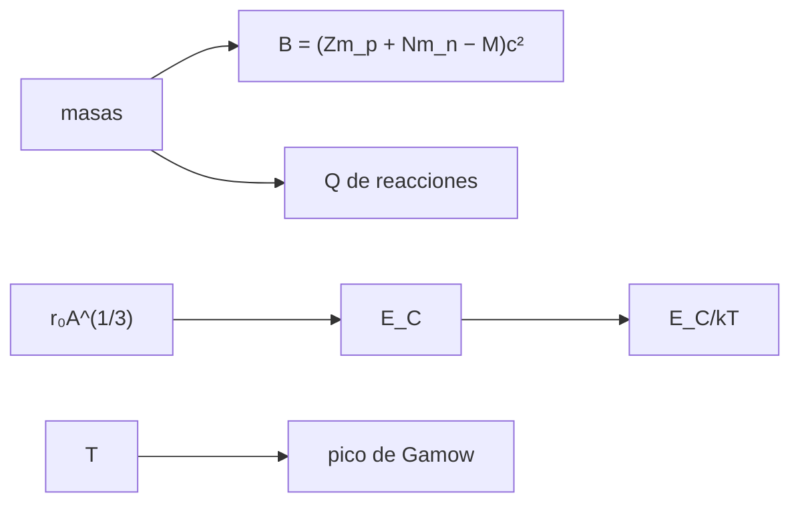

# B31-C07 — Estructura nuclear

<!-- nav:top -->
[🏠 Programa](../../../../README.md) · [📚 Bloque B31](../../../tronco-comun/B31-fisica-cuantica-nuclear-y-astroparticulas.md) · [← Anterior: B31-C06 — Estadísticas cuánticas](../B31-C06-estadisticas-cuanticas/CLASE.md) · [Siguiente: B31-C08 — Decaimiento radiactivo →](../B31-C08-decaimiento-radiactivo/CLASE.md)
<!-- /nav -->

## 1. Ubicación, nivel y alcance

Clase 7 del bloque B31. Nivel N3. La energía de ligadura de un núcleo es la diferencia entre la masa de sus partes y la del núcleo. Aquí la calculas para el deuterón, el tritón, el helión y la partícula alfa con las masas de NIST (por dos vías, en MeV y en kg), obtienes el calor `Q` de reacciones de fusión y comparas la **barrera de Coulomb** con la energía térmica y la **energía de Gamow**. Usas [B05](../../../tronco-comun/B05-fisica-fundamental-para-el-espacio.md) y [B31-C06](../B31-C06-estadisticas-cuanticas/CLASE.md). Se suponen núcleos esféricos de radio `r₀A^(1/3)`.

## 2. Por qué esta clase existe

La energía de las estrellas viene de la fusión y su cálculo parte de las masas. La decisión central: **¿cuánta energía libera una reacción y por qué ocurre pese a la barrera de Coulomb?**

## 3. Lo que podrás hacer al terminar

1. Calcular `B = (Zm_p + Nm_n − M)c²`.
2. Calcular `B/A` y comparar núcleos.
3. Calcular `Q` de `d+t`, `d+d`.
4. Calcular la barrera de Coulomb `E_C`.
5. Calcular la energía y el pico de Gamow.
6. Comparar `E_C` con `kT`.

La evidencia es la **ficha de la energía de ligadura** del ejercicio 12 (sección 20).

## 4. Con qué llegas y cómo comprobarlo

1. ¿Qué es la equivalencia masa-energía?
2. ¿Qué es un núcleo?
3. ¿Qué es el efecto túnel?
4. ¿Qué es la energía térmica `kT`?
5. ¿Qué es una reacción de fusión?

<details>
<summary>Ver respuestas</summary>

1. `E = mc²`. 2. Protones y neutrones ligados. 3. Paso a través de una barrera (B31-C02). 4. La energía típica por partícula. 5. Unión de núcleos ligeros.
</details>

Con cuatro o cinco aciertos, sigue; si no, repasa los prerrequisitos.

## 5. Un caso de contexto y casos de referencia

Con las masas de NIST (S1), el deuterón tiene `B = 2,22457 MeV` y la partícula alfa `28,29561 MeV` (`7,0739 MeV` por nucleón). Es el **ejemplo conductor**. La reacción `d + t → α + n` libera `17,58925 MeV`. La temperatura de 1,5 × 10⁷ K es **ilustrativa**.

## 6. Vocabulario

La **energía de ligadura** `B`. El **defecto de masa**. El **valor Q** es la energía liberada. La **barrera de Coulomb** `Z₁Z₂αħc/R`. La **energía de Gamow** `E_G = 2m_rc²(παZ₁Z₂)²`. El **pico de Gamow** `E₀ = (E_G(kT)²/4)^(1/3)`.

## 7. Modelo mental: subir una colina con poca energía

Dos núcleos se repelen como dos imanes iguales: casi nunca llegan a tocarse; unos pocos, los de energía intermedia, atraviesan la barrera por efecto túnel.



*Descripción textual:* las masas dan la ligadura y el valor Q; el radio da la barrera, que se compara con `kT`; la temperatura da el pico de Gamow.

Analogía: subir una colina con poca energía. Límite: núcleos esféricos.

## 8. La explicación, paso a paso

### 8.1 Energías de ligadura

| núcleo | `Z` | `N` | `B` (MeV) | `B/A` (MeV) |
|---|---|---|---|---|
| deuterón | 1 | 1 | 2,22457 | 1,11228 |
| tritón | 1 | 2 | 8,48180 | 2,82727 |
| helión | 2 | 1 | 7,71799 | 2,57266 |
| alfa | 2 | 2 | 28,29561 | 7,07390 |

La vía en kg coincide con la vía en MeV.

### 8.2 Valor Q

| reacción | `Q` (MeV) |
|---|---|
| d + t → α + n | 17,58925 |
| d + d → ³He + n | 3,26886 |
| d + d → t + p | 4,03266 |

### 8.3 Barrera de Coulomb y Gamow (`kT = 1,2926 keV`)

| par | `E_C` (MeV) | `E_C/kT` | `E_G` (keV) | `E₀` (keV) |
|---|---|---|---|---|
| p + p | 0,6000 | 464 | 493,13 | 5,906 |
| d + t | 0,4441 | 344 | 1182,16 | 7,904 |
| α + α | 1,5119 | 1170 | 31 344 | 23,57 |

### 8.4 Lectura

La alfa está mucho más ligada por nucleón que los isótopos del hidrógeno. La barrera es ≈ 300–1000 veces `kT`: la fusión depende del túnel, y el pico de Gamow (unos keV) cae muy por debajo de la barrera.

## 9. Magnitudes, símbolos y unidades

| Símbolo | Qué es | Unidad | Valor / nota |
|---|---|---|---|
| `B` | energía de ligadura | MeV | ver 8.1 |
| `Q` | calor de reacción | MeV | ver 8.2 |
| `α` | constante de estructura fina | — | `7,2973525643 × 10⁻³` (S1) |
| `ħc` | constante | MeV fm | `197,3269804` (S1) |
| `r₀` | radio nuclear | fm | 1,2 (ilustrativo) |

## 10. Convenciones y referencias

Núcleos desnudos (masas nucleares de NIST); radio `r₀A^(1/3)` con `r₀ = 1,2 fm` y `T = 1,5 × 10⁷ K` **ilustrativos**.

## 11. De dónde sale lo que afirmamos

| ID | Fuente | Localizador | Respalda | Estado |
|---|---|---|---|---|
| S1 | NIST, *Fundamental Physical Constants* (CODATA 2022) | https://physics.nist.gov/cuu/Constants/Table/allascii.txt | constantes y masas citadas en la sección 9 | Consultada el 2026-11-09 |

Límites: no se consultaron secciones eficaces ni tasas de reacción; `E_C` y `E₀` son estimaciones de orden de magnitud.

## 12. Cómo ver la ligadura

| Núcleo | `B/A` (MeV) |
|---|---|
| d | 1,112 |
| t | 2,827 |
| ³He | 2,573 |
| ⁴He | 7,074 |

Descripción larga: la partícula alfa es el núcleo ligero más ligado por nucleón.

## 13. Ejemplo trabajado: energía de ligadura del deuterón

**Paso 1 · Partes.** `938,27209 + 939,56542 = 1877,83751 MeV`.

**Paso 2 · Núcleo.** `1875,61295 MeV`.

**Paso 3 · Diferencia.** `B = 2,22457 MeV`.

**Paso 4 · Por nucleón.** `1,11228 MeV`.

## 14. Distintas formas de describir un núcleo

**Por masa:** defecto de masa. **Por energía:** `B/A`. **Por reacción:** `Q`. **Por barrera:** `E_C` y Gamow.

## 15. Práctica guiada

**Ejercicio 1 · con los pasos indicados.** `B` del deuterón. *Pasos:* ejemplo 13.

<details><summary>Solución comentada</summary>

`2,22457 MeV`.
</details>

**Ejercicio 2 · con una pista.** `B/A` de la alfa.

<details><summary>Solución comentada</summary>

`28,29561/4 = 7,0739 MeV`.
</details>

**Ejercicio 3 · casi autónomo.** `Q` de `d + t → α + n`.

<details><summary>Solución comentada</summary>

`17,589 MeV`.
</details>

## 16. Práctica autónoma, transferencia e integrador

**Ejercicio 4.** Energía de la alfa y del neutrón (no relativista, `m_α/(m_α + m_n) = 0,799`).

<details><summary>Solución comentada</summary>

Neutrón: `0,799 × 17,589 = 14,05 MeV`; alfa: `3,54 MeV`.
</details>

**Ejercicio 5.** `E_C/kT` de `d + t`.

<details><summary>Solución comentada</summary>

`0,4441 MeV/1,2926 keV = 344`.
</details>

**Ejercicio 6.** `Q` de `d + d → t + p`.

<details><summary>Solución comentada</summary>

`4,033 MeV`.
</details>

**Ejercicio 7.** Pico de Gamow de `p + p`.

<details><summary>Solución comentada</summary>

`5,906 keV`.
</details>

**Ejercicio 8.** Defecto de masa de la alfa en kg.

<details><summary>Solución comentada</summary>

`28,29561 MeV/c² = 5,044 × 10⁻²⁹ kg`.
</details>

**Ejercicio 9 · transferencia.** **Transferencia.** Un compañero usa 5,9 keV como el pico solar. Responde con la sección 10.

<details><summary>Solución comentada</summary>

Es con una temperatura ilustrativa de 1,5 × 10⁷ K.
</details>

**Ejercicio 10 · transferencia.** **Transferencia.** ¿Por qué la fusión ocurre si `E_C ≫ kT`?

<details><summary>Solución comentada</summary>

Por el efecto túnel de la cola de Maxwell.
</details>

**Ejercicio 11 · transferencia.** **Transferencia.** ¿Qué limita la estimación de `E_C`?

<details><summary>Solución comentada</summary>

El radio ilustrativo `r₀`.
</details>

**Ejercicio 12.** **Integrador.** Elabora tu *ficha de la energía de ligadura*: tabla de `B`, `Q`, barrera y lectura.

<details><summary>Solución comentada</summary>

Secciones 8.1–8.4.
</details>

**Ejercicio 12 · integrador.** **Integrador.** Elabora tu *ficha de la energía de ligadura*: tabla de `B`, `Q`, barrera y lectura.

<details><summary>Solución modelo</summary>

Secciones 8.1–8.4.
</details>

## 17. Laboratorio: ligadura, valor Q y barrera

El script [nuclear.py](nuclear.py) calcula `B`, `Q`, `E_C`, `E_G` y `E₀` (**comprueba** la vía kg frente a la vía MeV).

**Datos:** masas, `α`, `ħc`, `k_B` de NIST; `r₀`, `T` **ilustrativos**. **Predice antes de ejecutar:** ¿cuánto libera d + t? (≈17,6 MeV.) **Ejecución del 2026-11-09 (Python 3.12.9):**

```text
Python 3.12.9 (biblioteca estandar)
nucleo      Z  N    B [MeV]  B/A [MeV]  B por kg [MeV]
d           1  1    2.22457    1.11228         2.22457
t           1  2    8.48180    2.82727         8.48180
h           2  1    7.71799    2.57266         7.71799
a           2  2   28.29561    7.07390        28.29561
reaccion                  Q [MeV]
d + t -> alfa + n        17.58925
d + d -> helion + n       3.26886
d + d -> triton + p       4.03266
k T a 1.5e7 K = 1.2926 keV
par       E_C [MeV]    E_C/kT  E_G [keV]  E_0 [keV]
p + p        0.6000     464.2     493.13      5.906
d + t        0.4441     343.6    1182.16      7.904
alfa+alfa     1.5119    1169.6   31343.97     23.569
Pruebas superadas.
```

```bash
python programa/clases/B31/B31-C07-estructura-nuclear/nuclear.py
```

**Límites:** núcleos esféricos, sin secciones eficaces.

## 18. Errores frecuentes y cómo corregirlos

**Usar masas atómicas con masas nucleares.** Se corrige con la sección 10.

**Confundir `B` y `B/A`.** Se corrige con 8.1.

**Olvidar el túnel.** Se corrige con 8.4.

**Tomar `r₀` por medido.** Se corrige con la sección 10.

## 19. Cómo sabrás que vas bien

Tras 8.1: ¿qué núcleo está más ligado por nucleón? Si dudas, ejemplo 13. Tras el laboratorio: ¿qué comprueba? (kg frente a MeV).

## 20. Qué entregas y cómo se evalúa

El producto es tu **ficha de la energía de ligadura** (ejercicio 12).

| Criterio | Inicial | En desarrollo | Logrado | Destacado |
|---|---|---|---|---|
| Conceptos | Los confunde | Parciales | `B`, `Q`, barrera | Explica el papel del túnel |
| Cálculo | Sin unidades | Con errores | Tablas completas | Calcula casos nuevos |
| Numérico | Sin comprobar | Un caso | Dos vías | Interpreta Gamow |
| Fuentes | Sin fuente | Sin fecha | S1 con fecha | Declara `r₀` ilustrativo |
| Límites | No los nombra | Uno | Tres | Discute qué falta del modelo |

**Condiciones críticas (no se compensan con promedio):** rotular `r₀` y `T` ilustrativos; no presentar `E₀` como solar; citar solo lo consultado.

## 21. Ética, seguridad y límites

Clase educativa: no modela reactores. Accesibilidad: tablas equivalentes a las gráficas, fórmulas en texto, ejercicios sin conexión.

## 22. Para cerrar y seguir

La alfa liga `28,3 MeV`, d + t libera `17,6 MeV` y la barrera es ≈344 veces `kT`. Queda una pregunta: ¿cómo decaen los núcleos inestables?

**Glosario español–inglés.** energía de ligadura · *binding energy*; defecto de masa · *mass defect*; valor Q · *Q-value*; barrera de Coulomb · *Coulomb barrier*; pico de Gamow · *Gamow peak*.

**Continuidad.** [B31-C08](../B31-C08-decaimiento-radiactivo/CLASE.md) estudia el decaimiento radiactivo.

**Referencias:** ver sección 11.

<!-- nav:bottom -->
---

[← Anterior: B31-C06 — Estadísticas cuánticas](../B31-C06-estadisticas-cuanticas/CLASE.md) · [📚 Bloque B31](../../../tronco-comun/B31-fisica-cuantica-nuclear-y-astroparticulas.md) · [Siguiente: B31-C08 — Decaimiento radiactivo →](../B31-C08-decaimiento-radiactivo/CLASE.md)
<!-- /nav -->
