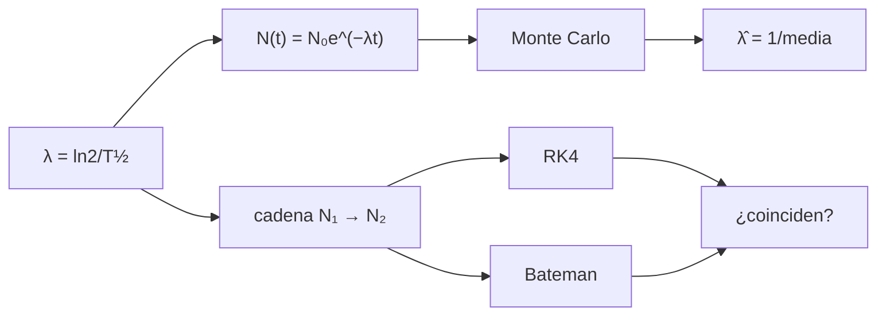

# B31-C08 — Decaimiento radiactivo

<!-- nav:top -->
[🏠 Programa](../../../../README.md) · [📚 Bloque B31](../../../tronco-comun/B31-fisica-cuantica-nuclear-y-astroparticulas.md) · [← Anterior: B31-C07 — Estructura nuclear](../B31-C07-estructura-nuclear/CLASE.md) · [Siguiente: B31-C09 — Interacciones fundamentales →](../B31-C09-interacciones-fundamentales/CLASE.md)
<!-- /nav -->

## 1. Ubicación, nivel y alcance

Clase 8 del bloque B31. Nivel N3. Un núcleo inestable decae al azar con una probabilidad constante por unidad de tiempo. Aquí simulas **100 000 decaimientos** con semilla fija, estimas `λ` por máxima verosimilitud, calculas la actividad y resuelves una **cadena de Bateman** de dos pasos con RK4 comparada con la solución analítica y con el **equilibrio transitorio**. Usas [B12](../../../tronco-comun/B12-probabilidad-estadistica-e-incertidumbre.md) y [B11-C08](../../B11/B11-C08-integradores-de-paso-adaptativo/CLASE.md). Se suponen decaimientos independientes.

## 2. Por qué esta clase existe

Fechar rocas, medir la edad de objetos y modelar la nucleosíntesis usan estas leyes. La decisión central: **¿cómo se estima una constante de decaimiento y cómo evoluciona una cadena?**

## 3. Lo que podrás hacer al terminar

1. Escribir `N = N₀e^(−λt)` y `τ = T½/ln 2`.
2. Simular y comparar los supervivientes con la binomial.
3. Estimar `λ̂ = 1/media` y su error `1/√N`.
4. Calcular la actividad `λN`.
5. Resolver la cadena de dos pasos con RK4.
6. Reconocer el equilibrio transitorio.

La evidencia es la **ficha del decaimiento** del ejercicio 12 (sección 20).

## 4. Con qué llegas y cómo comprobarlo

1. ¿Qué es una semivida?
2. ¿Qué es una distribución exponencial?
3. ¿Qué es la actividad?
4. ¿Qué es el estimador de máxima verosimilitud?
5. ¿Qué es RK4?

<details>
<summary>Ver respuestas</summary>

1. El tiempo en que decae la mitad. 2. La del tiempo de espera de un proceso sin memoria. 3. Decaimientos por segundo (Bq). 4. El parámetro que maximiza la probabilidad de los datos. 5. Un integrador de cuarto orden.
</details>

Con cuatro o cinco aciertos, sigue; si no, repasa los prerrequisitos.

## 5. Un caso de contexto y casos de referencia

Con `T½ = 10 d` (ilustrativo), `λ = 8,0225 × 10⁻⁷ s⁻¹` y vida media `14,427 d`. Es el **ejemplo conductor**. En la simulación, quedan `50 196` de 100 000 tras una semivida (esperados `50 000`). Una muestra de 10¹⁵ núcleos tendría `8,02 × 10⁸ Bq`.

## 6. Vocabulario

La **constante de decaimiento** `λ`. La **semivida** `T½`. La **vida media** `τ`. La **actividad** `A = λN`. La **cadena de Bateman**. El **equilibrio transitorio** `N₂/N₁ → λ₁/(λ₂ − λ₁)`.

## 7. Modelo mental: palomitas en una sartén

Los granos revientan al azar: no se sabe cuál, pero sí cuántos por segundo; la mitad habrá reventado en un tiempo fijo.



*Descripción textual:* `λ` da la ley exponencial, que se simula y se estima; la cadena se integra con RK4 y se compara con Bateman.

Analogía: palomitas en una sartén. Límite: decaimientos independientes.

## 8. La explicación, paso a paso

### 8.1 Supervivientes

| `t/T½` | esperados | simulados | desviación (σ) |
|---|---|---|---|
| 0 | 100 000 | 100 000 | 0,00 |
| 1 | 50 000 | 50 196 | 1,24 |
| 2 | 25 000 | 25 170 | 1,24 |
| 3 | 12 500 | 12 563 | 0,60 |
| 4 | 6250 | 6320 | 0,91 |
| 5 | 3125 | 3254 | 2,34 |

### 8.2 Estimador

`λ̂ = 7,9836 × 10⁻⁷ s⁻¹`: cociente `0,99514` con `λ`; el error esperado es `1/√N = 0,32 %`, y la diferencia es 1,5 veces ese error.

### 8.3 Cadena (T½ = 10 d y 3 d)

| `t` (d) | `N₂` RK4 | `N₂` Bateman | `N₂/N₁` | límite |
|---|---|---|---|---|
| 5 | 1,680542 × 10¹¹ | 1,680542 × 10¹¹ | 0,2377 | 0,4286 |
| 10 | 1,717660 × 10¹¹ | 1,717660 × 10¹¹ | 0,3435 | 0,4286 |
| 20 | 1,029244 × 10¹¹ | 1,029244 × 10¹¹ | 0,4117 | 0,4286 |
| 40 | 2,674419 × 10¹⁰ | 2,674419 × 10¹⁰ | 0,4279 | 0,4286 |

### 8.4 Lectura

RK4 y Bateman coinciden a `10⁻¹³`. El cociente `N₂/N₁` tiende al equilibrio transitorio `λ₁/(λ₂ − λ₁) = 0,4286`. Un desvío de `2,3σ` entre seis comparaciones no es alarmante.

## 9. Magnitudes, símbolos y unidades

| Símbolo | Qué es | Unidad | Valor / nota |
|---|---|---|---|
| `λ` | constante de decaimiento | s⁻¹ | `ln 2/T½` |
| `T½`, `τ` | semivida y vida media | d | 10 d (ilustrativa); 14,427 d |
| `A` | actividad | Bq | `λN` |
| `N₁`, `N₂` | poblaciones de la cadena | — | ver 8.3 |

## 10. Convenciones y referencias

Decaimientos independientes; semividas de 10 d y 3 d y `N` **ilustrativos**; semilla `20261109`; ningún radionúclido real.

## 11. De dónde sale lo que afirmamos

| ID | Fuente | Localizador | Respalda | Estado |
|---|---|---|---|---|
| — | Sin fuente externa | — | relaciones estándar que verifica el laboratorio | No se consultó una fuente para esta clase |

Límites: no se consultó ninguna semivida ni tabla de nucleidos; todo es ilustrativo y analítico.

## 12. Cómo ver la cadena

| `t` (d) | `N₂/N₁` |
|---|---|
| 5 | 0,238 |
| 10 | 0,344 |
| 20 | 0,412 |
| 40 | 0,428 |

Descripción larga: el cociente tiende al equilibrio transitorio.

## 13. Ejemplo trabajado: constante de decaimiento

**Paso 1 · Semivida.** `T½ = 10 d = 8,64 × 10⁵ s`.

**Paso 2 · Logaritmo.** `ln 2 = 0,693147`.

**Paso 3 · Cociente.** `λ = 0,693147/8,64 × 10⁵`.

**Paso 4 · Valor.** `8,0225 × 10⁻⁷ s⁻¹`.

## 14. Distintas formas de describir un decaimiento

**Por ley:** exponencial. **Por azar:** Poisson. **Por estimador:** `1/media`. **Por cadena:** Bateman.

## 15. Práctica guiada

**Ejercicio 1 · con los pasos indicados.** `λ` para `T½ = 10 d`. *Pasos:* ejemplo 13.

<details><summary>Solución comentada</summary>

`8,0225 × 10⁻⁷ s⁻¹`.
</details>

**Ejercicio 2 · con una pista.** Fracción tras 3 semividas.

<details><summary>Solución comentada</summary>

`1/8`.
</details>

**Ejercicio 3 · casi autónomo.** Tiempo para que quede el 1 %.

<details><summary>Solución comentada</summary>

`T½ log₂100 = 6,64 T½ = 66,4 d`.
</details>

## 16. Práctica autónoma, transferencia e integrador

**Ejercicio 4.** Actividad de 10¹⁵ núcleos.

<details><summary>Solución comentada</summary>

`8,02 × 10⁸ Bq`.
</details>

**Ejercicio 5.** Error relativo esperado de `λ̂` con `N = 10⁵`.

<details><summary>Solución comentada</summary>

`0,32 %`.
</details>

**Ejercicio 6.** Cociente de equilibrio transitorio.

<details><summary>Solución comentada</summary>

`0,1/(0,3333 − 0,1) = 0,4286`.
</details>

**Ejercicio 7.** Instante del máximo de `N₂`: `ln(λ₂/λ₁)/(λ₂ − λ₁)`.

<details><summary>Solución comentada</summary>

`7,44 d`.
</details>

**Ejercicio 8.** `τ/T½`.

<details><summary>Solución comentada</summary>

`1/ln 2 = 1,4427`.
</details>

**Ejercicio 9 · transferencia.** **Transferencia.** Un compañero afirma que 10 d es la semivida de un isótopo. Responde con la sección 10.

<details><summary>Solución comentada</summary>

Es ilustrativa.
</details>

**Ejercicio 10 · transferencia.** **Transferencia.** ¿Por qué el valor de 2,34σ no invalida el modelo?

<details><summary>Solución comentada</summary>

Entre seis comparaciones es esperable una de ~2σ.
</details>

**Ejercicio 11 · transferencia.** **Transferencia.** ¿Qué verifica Bateman con RK4?

<details><summary>Solución comentada</summary>

Que el integrador resuelve el sistema lineal.
</details>

**Ejercicio 12.** **Integrador.** Elabora tu *ficha del decaimiento*: supervivientes, estimador, actividad y cadena.

<details><summary>Solución comentada</summary>

Secciones 8.1–8.4.
</details>

**Ejercicio 12 · integrador.** **Integrador.** Elabora tu *ficha del decaimiento*: supervivientes, estimador, actividad y cadena.

<details><summary>Solución modelo</summary>

Secciones 8.1–8.4.
</details>

## 17. Laboratorio: decaimiento y cadena de Bateman

El script [decaimiento.py](decaimiento.py) simula decaimientos, estima `λ` y resuelve la cadena (**comprueba** 4 desviaciones, `4/√N` y `10⁻⁸`).

**Datos:** sin constantes; semividas **ilustrativas**; semilla `20261109`. **Predice antes de ejecutar:** ¿cuántos quedan tras una semivida? (≈50 000.) **Ejecución del 2026-11-09 (Python 3.12.9):**

```text
Python 3.12.9 (biblioteca estandar)
T_1/2 = 10 d ; lambda = 8.0225e-07 s-1 ; vida media tau = 14.4270 d = 1.4427 T_1/2
 t/T_1/2  N esperado  N simulado  desviacion [sigma]
       0    100000.0      100000                0.00
       1     50000.0       50196                1.24
       2     25000.0       25170                1.24
       3     12500.0       12563                0.60
       4      6250.0        6320                0.91
       5      3125.0        3254                2.34
estimador de maxima verosimilitud: lambda_hat = 7.9836e-07 s-1 ; cociente con lambda = 0.99514 ; error relativo esperado 1/sqrt(N) = 0.00316
actividad de 1e+15 nucleos con T_1/2 = 10 d: A = lambda N = 8.0225e+08 Bq
 t [d]         N2 RK4     N2 Bateman  dif. relativa     N2/N1  l1/(l2 - l1)
   5.0   1.680542e+11   1.680542e+11       5.06e-14    0.2377        0.4286
  10.0   1.717660e+11   1.717660e+11       3.16e-14    0.3435        0.4286
  20.0   1.029244e+11   1.029244e+11       7.99e-15    0.4117        0.4286
  40.0   2.674419e+10   2.674419e+10       4.22e-15    0.4279        0.4286
Pruebas superadas.
```

```bash
python programa/clases/B31/B31-C08-decaimiento-radiactivo/decaimiento.py
```

**Límites:** decaimientos independientes.

## 18. Errores frecuentes y cómo corregirlos

**Confundir semivida y vida media.** Se corrige con el ejercicio 8.

**Esperar el valor exacto en una simulación.** Se corrige con 8.1.

**Olvidar el equilibrio.** Se corrige con 8.3.

**Tomar la semivida por real.** Se corrige con la sección 10.

## 19. Cómo sabrás que vas bien

Tras 8.1: ¿cuántos quedan tras 2 semividas? Si dudas, ejemplo 13. Tras el laboratorio: ¿qué comprueba? (Bateman).

## 20. Qué entregas y cómo se evalúa

El producto es tu **ficha del decaimiento** (ejercicio 12).

| Criterio | Inicial | En desarrollo | Logrado | Destacado |
|---|---|---|---|---|
| Conceptos | Los confunde | Parciales | `λ`, `τ`, Bateman | Explica el equilibrio transitorio |
| Cálculo | Sin unidades | Con errores | Tablas completas | Calcula el máximo |
| Numérico | Sin comprobar | Un caso | Monte Carlo y RK4 | Interpreta la desviación |
| Fuentes | Sin fuente | Sin fecha | Declara la ausencia de fuente | Distingue ilustrativo y real |
| Límites | No los nombra | Uno | Tres | Discute qué falta del modelo |

**Condiciones críticas (no se compensan con promedio):** rotular las semividas como ilustrativas; no atribuirlas a un isótopo; citar solo lo consultado.

## 21. Ética, seguridad y límites

Clase educativa: no da instrucciones sobre material radiactivo. Accesibilidad: tablas equivalentes a las gráficas, fórmulas en texto, ejercicios sin conexión.

## 22. Para cerrar y seguir

Con `T½ = 10 d` ilustrativa quedan el 50 % tras una semivida y `N₂/N₁` tiende a `0,4286`. Queda una pregunta: ¿qué fuerzas gobiernan estos procesos?

**Glosario español–inglés.** decaimiento radiactivo · *radioactive decay*; semivida · *half-life*; vida media · *mean lifetime*; actividad · *activity*; ecuaciones de Bateman · *Bateman equations*.

**Continuidad.** [B31-C09](../B31-C09-interacciones-fundamentales/CLASE.md) estudia las interacciones fundamentales.

**Referencias:** ver sección 11.

<!-- nav:bottom -->
---

[← Anterior: B31-C07 — Estructura nuclear](../B31-C07-estructura-nuclear/CLASE.md) · [📚 Bloque B31](../../../tronco-comun/B31-fisica-cuantica-nuclear-y-astroparticulas.md) · [Siguiente: B31-C09 — Interacciones fundamentales →](../B31-C09-interacciones-fundamentales/CLASE.md)
<!-- /nav -->
