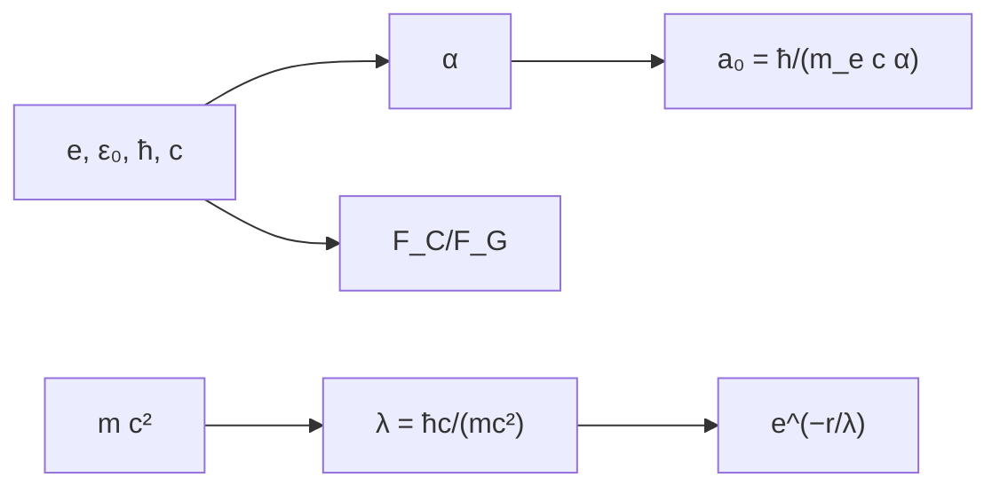

# B31-C09 — Interacciones fundamentales

<!-- nav:top -->
[🏠 Programa](../../../../README.md) · [📚 Bloque B31](../../../tronco-comun/B31-fisica-cuantica-nuclear-y-astroparticulas.md) · [← Anterior: B31-C08 — Decaimiento radiactivo](../B31-C08-decaimiento-radiactivo/CLASE.md) · [Siguiente: B31-C10 — Modelo estándar de partículas →](../B31-C10-modelo-estandar-de-particulas/CLASE.md)
<!-- /nav -->

## 1. Ubicación, nivel y alcance

Clase 9 del bloque B31. Nivel N3. Las cuatro interacciones difieren en intensidad y alcance. Aquí calculas la **constante de estructura fina**, el **radio de Bohr** y la **longitud de onda de Compton** con las constantes de NIST, la **razón entre fuerza eléctrica y gravitatoria**, y el **alcance de Yukawa** `ħc/(mc²)` para distintas masas del mediador. Usas [B05](../../../tronco-comun/B05-fisica-fundamental-para-el-espacio.md) y [B31-C07](../B31-C07-estructura-nuclear/CLASE.md). Se suponen partículas puntuales.

## 2. Por qué esta clase existe

Saber qué interacción domina en cada escala explica por qué los núcleos, los átomos y las estrellas son como son. La decisión central: **¿cuánto más fuerte es la fuerza eléctrica que la gravitatoria y qué fija el alcance de una fuerza?**

## 3. Lo que podrás hacer al terminar

1. Calcular `α = e²/(4πε₀ħc)` y compararla con NIST.
2. Calcular `a₀` y `λ_C`.
3. Calcular `F_C/F_G` entre dos protones.
4. Calcular el alcance `ħc/(mc²)`.
5. Evaluar el apantallamiento `exp(−r/λ)`.
6. Reconocer qué es independiente de la distancia.

La evidencia es la **ficha de las interacciones** del ejercicio 12 (sección 20).

## 4. Con qué llegas y cómo comprobarlo

1. ¿Qué es la ley de Coulomb?
2. ¿Qué es la gravitación de Newton?
3. ¿Qué es una constante de acoplamiento?
4. ¿Qué es un mediador?
5. ¿Qué es una longitud de onda de Compton?

<details>
<summary>Ver respuestas</summary>

1. `F = q₁q₂/(4πε₀r²)`. 2. `F = Gm₁m₂/r²`. 3. Un número que mide la intensidad. 4. La partícula que transmite la fuerza. 5. `h/(mc)`.
</details>

Con cuatro o cinco aciertos, sigue; si no, repasa los prerrequisitos.

## 5. Un caso de contexto y casos de referencia

La constante de estructura fina calculada es `7,2973525643 × 10⁻³` (`1/α = 137,036`), igual a la de NIST (S1). Es el **ejemplo conductor**. La razón entre las fuerzas eléctrica y gravitatoria entre dos protones es `1,2356 × 10³⁶`, independiente de la distancia. Las masas del mediador son **ilustrativas**.

## 6. Vocabulario

La **constante de estructura fina** `α`. El **radio de Bohr** `a₀`. La **longitud de Compton** `h/(mc)`. El **potencial de Yukawa** `e^(−r/λ)/r`. El **alcance** `λ = ħ/(mc)`.

## 7. Modelo mental: el sonido y el eco

Un mediador pesado es un grito que no llega lejos; uno sin masa (el fotón) llega a cualquier distancia.



*Descripción textual:* las constantes dan `α`, el radio de Bohr y la razón de fuerzas; la masa del mediador da el alcance y el apantallamiento.

Analogía: un grito que no llega lejos. Límite: partículas puntuales.

## 8. La explicación, paso a paso

### 8.1 Constantes

| magnitud | calculada | NIST |
|---|---|---|
| `α` | 7,2973525643 × 10⁻³ | 7,2973525643 × 10⁻³ |
| `a₀` (m) | 5,291772105 × 10⁻¹¹ | 5,291772105 × 10⁻¹¹ |
| `λ_C` (m) | 2,426310235 × 10⁻¹² | 2,426310235 × 10⁻¹² |

### 8.2 Fuerzas

`F_C/F_G` = `1,2356 × 10³⁶` entre dos protones y `2,2687 × 10³⁹` entre electrón y protón; la segunda es `m_p/m_e = 1836` veces mayor.

### 8.3 Alcance de Yukawa

| `mc²` | alcance |
|---|---|
| 1 eV | 1,9733 × 10⁻⁷ m |
| 1 MeV | 1,9733 × 10⁻¹³ m |
| 100 MeV | 1,9733 fm |
| 80 GeV | 2,4666 × 10⁻³ fm |

### 8.4 Apantallamiento

`exp(−r/λ)`: 0,607 en `0,5λ`; 0,368 en `λ`; 0,135 en `2λ`; `6,7 × 10⁻³` en `5λ`; `4,5 × 10⁻⁵` en `10λ`.

## 9. Magnitudes, símbolos y unidades

| Símbolo | Qué es | Unidad | Valor / nota |
|---|---|---|---|
| `α` | estructura fina | — | 1/137,036 |
| `a₀` | radio de Bohr | m | S1 |
| `λ_C` | longitud de Compton | m | S1 |
| `G` | constante gravitatoria | m³ kg⁻¹ s⁻² | `6,67430 × 10⁻¹¹` (S1) |
| `λ` | alcance | fm | `ħc/(mc²)` |

## 10. Convenciones y referencias

Partículas puntuales; las masas del mediador (1 eV, 1 MeV, 100 MeV, 80 GeV) son **ilustrativas**; `α`, `a₀`, `λ_C` y `G` de NIST.

## 11. De dónde sale lo que afirmamos

| ID | Fuente | Localizador | Respalda | Estado |
|---|---|---|---|---|
| S1 | NIST, *Fundamental Physical Constants* (CODATA 2022) | https://physics.nist.gov/cuu/Constants/Table/allascii.txt | constantes y masas citadas en la sección 9 | Consultada el 2026-11-09 |

Límites: no se consultaron masas de bosones mediadores; el alcance es una relación estándar.

## 12. Cómo ver las fuerzas

| Razón | Valor |
|---|---|
| `F_C/F_G` (pp) | 1,24 × 10³⁶ |
| `F_C/F_G` (ep) | 2,27 × 10³⁹ |

Descripción larga: la fuerza eléctrica supera a la gravitatoria en más de 36 órdenes de magnitud.

## 13. Ejemplo trabajado: alcance de una fuerza de 100 MeV

**Paso 1 · Constante.** `ħc = 197,3270 MeV fm`.

**Paso 2 · Masa.** `mc² = 100 MeV`.

**Paso 3 · Cociente.** `λ = 197,327/100`.

**Paso 4 · Valor.** `1,973 fm`.

## 14. Distintas formas de describir las interacciones

**Por intensidad:** `α`. **Por alcance:** Yukawa. **Por escala:** `a₀`, `λ_C`. **Por comparación:** `F_C/F_G`.

## 15. Práctica guiada

**Ejercicio 1 · con los pasos indicados.** `1/α`. *Pasos:* inversa.

<details><summary>Solución comentada</summary>

`137,036`.
</details>

**Ejercicio 2 · con una pista.** `F_C/F_G` entre dos protones.

<details><summary>Solución comentada</summary>

`1,24 × 10³⁶`.
</details>

**Ejercicio 3 · casi autónomo.** Alcance para `mc² = 100 MeV`. *Pista:* ejemplo 13.

<details><summary>Solución comentada</summary>

`1,973 fm`.
</details>

## 16. Práctica autónoma, transferencia e integrador

**Ejercicio 4.** Alcance para 80 GeV.

<details><summary>Solución comentada</summary>

`2,47 × 10⁻³ fm`.
</details>

**Ejercicio 5.** Apantallamiento a `5λ`.

<details><summary>Solución comentada</summary>

`6,74 × 10⁻³`.
</details>

**Ejercicio 6.** Cociente de las razones ep y pp.

<details><summary>Solución comentada</summary>

`1836`.
</details>

**Ejercicio 7.** `λ_C/a₀`.

<details><summary>Solución comentada</summary>

`0,04585 = 2πα`.
</details>

**Ejercicio 8.** ¿Depende `F_C/F_G` de la distancia?

<details><summary>Solución comentada</summary>

No: ambas caen como `1/r²`.
</details>

**Ejercicio 9 · transferencia.** **Transferencia.** Un compañero usa 80 GeV como la masa de un bosón real. Responde con la sección 10.

<details><summary>Solución comentada</summary>

Es ilustrativa.
</details>

**Ejercicio 10 · transferencia.** **Transferencia.** ¿Por qué el fotón tiene alcance infinito?

<details><summary>Solución comentada</summary>

Porque no tiene masa.
</details>

**Ejercicio 11 · transferencia.** **Transferencia.** ¿Qué valida la coincidencia con NIST?

<details><summary>Solución comentada</summary>

El cálculo con constantes, no una medición independiente.
</details>

**Ejercicio 12.** **Integrador.** Elabora tu *ficha de las interacciones*: constantes, razón de fuerzas y alcances.

<details><summary>Solución comentada</summary>

Secciones 8.1–8.4.
</details>

**Ejercicio 12 · integrador.** **Integrador.** Elabora tu *ficha de las interacciones*: constantes, razón de fuerzas y alcances.

<details><summary>Solución modelo</summary>

Secciones 8.1–8.4.
</details>

## 17. Laboratorio: estructura fina, razón de fuerzas y Yukawa

El script [interacciones.py](interacciones.py) calcula `α`, `a₀`, `λ_C`, `F_C/F_G` y el alcance de Yukawa (**comprueba** `10⁻⁸` frente a NIST).

**Datos:** `e`, `ε₀`, `h`, `c`, `G`, `m_p`, `m_e`, `ħc` de NIST; masas **ilustrativas**. **Predice antes de ejecutar:** ¿cuánto vale `1/α`? (≈137.) **Ejecución del 2026-11-09 (Python 3.12.9):**

```text
Python 3.12.9 (biblioteca estandar)
alpha = e^2/(4 pi eps0 hbar c) = 7.2973525643e-03 ; NIST = 7.2973525643e-03 ; 1/alpha = 137.035999 ; cociente = 1.0000000000
radio de Bohr hbar/(m_e c alpha) = 5.291772105e-11 m ; NIST = 5.291772105e-11 ; cociente = 1.000000000
longitud de onda de Compton h/(m_e c) = 2.426310235e-12 m ; NIST = 2.426310235e-12 ; cociente = 1.000000000
razon Coulomb/Newton entre dos protones = 1.2356e+36 ; entre electron y proton = 2.2687e+39 (independientes de la distancia)
mc^2         alcance hbar c/(m c^2)
1 eV                 1.9733e+08 fm = 1.9733e-07 m
1 MeV                1.9733e+02 fm = 1.9733e-13 m
100 MeV              1.9733e+00 fm = 1.9733e-15 m
80 GeV               2.4666e-03 fm = 2.4666e-18 m
 r/lambda    V_Yukawa/V_Coulomb = exp(-r/lambda)
      0.5                           6.065307e-01
      1.0                           3.678794e-01
      2.0                           1.353353e-01
      5.0                           6.737947e-03
     10.0                           4.539993e-05
Pruebas superadas.
```

```bash
python programa/clases/B31/B31-C09-interacciones-fundamentales/interacciones.py
```

**Límites:** partículas puntuales.

## 18. Errores frecuentes y cómo corregirlos

**Confundir `ħc` y `hc`.** Se corrige con el ejemplo 13.

**Creer que `F_C/F_G` depende de `r`.** Se corrige con el ejercicio 8.

**Dar un alcance sin unidades.** Se corrige con 8.3.

**Tomar las masas por reales.** Se corrige con la sección 10.

## 19. Cómo sabrás que vas bien

Tras 8.1: ¿cuánto vale `α`? Si dudas, repasa C06. Tras el laboratorio: ¿qué comprueba? (las constantes).

## 20. Qué entregas y cómo se evalúa

El producto es tu **ficha de las interacciones** (ejercicio 12).

| Criterio | Inicial | En desarrollo | Logrado | Destacado |
|---|---|---|---|---|
| Conceptos | Los confunde | Parciales | `α`, razón, alcance | Explica la independencia de la distancia |
| Cálculo | Sin unidades | Con errores | Tablas completas | Calcula casos nuevos |
| Numérico | Sin comprobar | Un caso | Contraste con NIST | Interpreta `2πα` |
| Fuentes | Sin fuente | Sin fecha | S1 con fecha | Declara las masas ilustrativas |
| Límites | No los nombra | Uno | Tres | Discute qué falta del modelo |

**Condiciones críticas (no se compensan con promedio):** rotular las masas del mediador como ilustrativas; no atribuir masas a bosones reales; citar solo lo consultado.

## 21. Ética, seguridad y límites

Clase educativa: no es una tabla de partículas. Accesibilidad: tablas equivalentes a las gráficas, fórmulas en texto, ejercicios sin conexión.

## 22. Para cerrar y seguir

`α = 1/137,036`, la fuerza eléctrica entre protones supera a la gravitatoria por `10³⁶` y un mediador de 100 MeV tiene un alcance de 2 fm. Queda una pregunta: ¿qué reglas restringen las reacciones?

**Glosario español–inglés.** constante de estructura fina · *fine-structure constant*; potencial de Yukawa · *Yukawa potential*; radio de Bohr · *Bohr radius*; longitud de onda de Compton · *Compton wavelength*; mediador · *mediator*.

**Continuidad.** [B31-C10](../B31-C10-modelo-estandar-de-particulas/CLASE.md) estudia el modelo estándar.

**Referencias:** ver sección 11.

<!-- nav:bottom -->
---

[← Anterior: B31-C08 — Decaimiento radiactivo](../B31-C08-decaimiento-radiactivo/CLASE.md) · [📚 Bloque B31](../../../tronco-comun/B31-fisica-cuantica-nuclear-y-astroparticulas.md) · [Siguiente: B31-C10 — Modelo estándar de partículas →](../B31-C10-modelo-estandar-de-particulas/CLASE.md)
<!-- /nav -->
