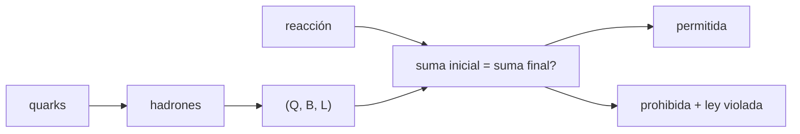

# B31-C10 — Modelo estándar de partículas

<!-- nav:top -->
[🏠 Programa](../../../../README.md) · [📚 Bloque B31](../../../tronco-comun/B31-fisica-cuantica-nuclear-y-astroparticulas.md) · [← Anterior: B31-C09 — Interacciones fundamentales](../B31-C09-interacciones-fundamentales/CLASE.md) · [Siguiente: B31-C11 — Neutrinos y oscilaciones →](../B31-C11-neutrinos-y-oscilaciones/CLASE.md)
<!-- /nav -->

## 1. Ubicación, nivel y alcance

Clase 10 del bloque B31. Nivel N3. El modelo estándar organiza las partículas en quarks y leptones con números cuánticos conservados. Aquí construyes protones, neutrones y piones a partir de **quarks** con fracciones exactas y clasificas **once reacciones** según conserven la carga, el número bariónico y los números leptónicos. Usas [B05](../../../tronco-comun/B05-fisica-fundamental-para-el-espacio.md) y [B31-C09](../B31-C09-interacciones-fundamentales/CLASE.md). Es un filtro necesario pero no suficiente.

## 2. Por qué esta clase existe

Antes de calcular una sección eficaz, una reacción debe respetar las leyes de conservación. La decisión central: **¿está permitida esta reacción por las reglas de conservación?**

## 3. Lo que podrás hacer al terminar

1. Sumar cargas y números bariónicos de quarks.
2. Asignar `(Q, B, L_e, L_μ, L_τ)`.
3. Clasificar reacciones como permitidas o prohibidas.
4. Identificar la ley violada.
5. Usar fracciones exactas.
6. Reconocer los límites del filtro.

La evidencia es la **ficha de las reglas de conservación** del ejercicio 12 (sección 20).

## 4. Con qué llegas y cómo comprobarlo

1. ¿Qué es un quark?
2. ¿Qué es un leptón?
3. ¿Qué es el número bariónico?
4. ¿Qué es una fracción exacta?
5. ¿Qué es una ley de conservación?

<details>
<summary>Ver respuestas</summary>

1. Un constituyente de los hadrones. 2. Una partícula sin interacción fuerte. 3. `1/3` por quark. 4. Un cociente de enteros. 5. Una cantidad que no cambia.
</details>

Con cuatro o cinco aciertos, sigue; si no, repasa los prerrequisitos.

## 5. Un caso de contexto y casos de referencia

El neutrón decae como `n → p + e⁻ + ν̄_e`, que conserva todo. Es el **ejemplo conductor**. En cambio `μ⁻ → e⁻ + γ` viola los números leptónicos electrónico y muónico. Las cargas de los quarks (+2/3 y −1/3) y los números cuánticos son **valores estándar no consultados**.

## 6. Vocabulario

Un **quark** `u` o `d`. Un **hadrón** como protón o pion. Un **leptón** como electrón o neutrino. El **número bariónico** `B`. El **número leptónico** `L_e`, `L_μ`, `L_τ`. Una reacción **permitida** conserva todos.

## 7. Modelo mental: una contabilidad

Como una contabilidad: lo que entra tiene que ser igual a lo que sale en cada cuenta (carga, bariones, leptones).



*Descripción textual:* los quarks forman hadrones con números cuánticos; para una reacción se comparan las sumas inicial y final y se declara permitida o prohibida.

Analogía: una contabilidad. Límite: filtro necesario, no suficiente.

## 8. La explicación, paso a paso

### 8.1 Hadrones

| hadrón | quarks | `Q` | `B` |
|---|---|---|---|
| p | uud | 1 | 1 |
| n | udd | 0 | 1 |
| π⁺ | u d̄ | 1 | 0 |
| π⁻ | d ū | −1 | 0 |

### 8.2 Reacciones

| reacción | permitida | ley violada |
|---|---|---|
| n → p e⁻ ν̄_e | sí | — |
| π⁺ → μ⁺ ν_μ | sí | — |
| e⁻ e⁺ → γγ | sí | — |
| p p → p p p p̄ | sí | — |
| μ⁻ → e⁻ ν_e ν_μ | no | `L_e` |
| μ⁻ → e⁻ ν̄_e ν_μ | sí | — |
| μ⁻ → e⁻ γ | no | `L_e`, `L_μ` |
| p → e⁺ π⁰ | no | `B`, `L_e` |
| e⁻ → ν_e γ | no | `Q` |
| π⁰ → γγ | sí | — |
| n → p e⁻ | no | `L_e` |

### 8.3 Lectura

Una reacción permitida por conservación puede estar prohibida por energía, espín o paridad, o ser muy improbable. El filtro descarta, pero no demuestra que ocurra.

## 9. Magnitudes, símbolos y unidades

| Símbolo | Qué es | Unidad | Valor / nota |
|---|---|---|---|
| `Q` | carga | e | ver 8.1 |
| `B` | número bariónico | — | 1/3 por quark |
| `L_e, L_μ, L_τ` | números leptónicos | — | ±1 o 0 |
| `u`, `d` | quarks | — | +2/3; −1/3 (estándar, no consultados) |

## 10. Convenciones y referencias

Solo carga, número bariónico y números leptónicos; las reacciones son ejemplos **ilustrativos**; aritmética exacta con `fractions`.

## 11. De dónde sale lo que afirmamos

| ID | Fuente | Localizador | Respalda | Estado |
|---|---|---|---|---|
| — | Sin fuente externa | — | cargas de los quarks y números cuánticos estándar no consultados | No se consultó una fuente para esta clase |

Límites: no se consultó la tabla de partículas; la clase no evalúa energía, espín ni paridad.

## 12. Cómo ver las reacciones

| Resultado | Cantidad |
|---|---|
| permitidas | 6 |
| prohibidas | 5 |

Descripción larga: de las once reacciones, seis cumplen todas las leyes de conservación.

## 13. Ejemplo trabajado: decaimiento del neutrón

**Paso 1 · Inicial.** `n`: `Q = 0`, `B = 1`, `L = 0`.

**Paso 2 · Final.** `p + e⁻ + ν̄_e`: `Q = 1 − 1 + 0 = 0`.

**Paso 3 · Bariones.** `1 + 0 + 0 = 1`.

**Paso 4 · Leptones.** `L_e = 0 + 1 − 1 = 0`: permitida.

## 14. Distintas formas de describir una reacción

**Por carga:** `Q`. **Por bariones:** `B`. **Por leptones:** `L`. **Por quarks:** composición.

## 15. Práctica guiada

**Ejercicio 1 · con los pasos indicados.** Carga del protón (uud). *Pasos:* suma.

<details><summary>Solución comentada</summary>

`2/3 + 2/3 − 1/3 = 1`.
</details>

**Ejercicio 2 · con una pista.** Carga del neutrón (udd).

<details><summary>Solución comentada</summary>

`0`.
</details>

**Ejercicio 3 · casi autónomo.** ¿Está permitido `π⁺ → μ⁺ + ν_μ`?

<details><summary>Solución comentada</summary>

Sí.
</details>

## 16. Práctica autónoma, transferencia e integrador

**Ejercicio 4.** ¿Qué viola `μ⁻ → e⁻ + γ`?

<details><summary>Solución comentada</summary>

`L_e` y `L_μ`.
</details>

**Ejercicio 5.** ¿Qué viola `p → e⁺ + π⁰`?

<details><summary>Solución comentada</summary>

`B` y `L_e`.
</details>

**Ejercicio 6.** ¿Qué viola `e⁻ → ν_e + γ`?

<details><summary>Solución comentada</summary>

La carga.
</details>

**Ejercicio 7.** Número bariónico de `p p → p p p p̄`.

<details><summary>Solución comentada</summary>

`2 → 1 + 1 + 1 − 1 = 2`.
</details>

**Ejercicio 8.** Corrige `n → p + e⁻` para que sea permitida.

<details><summary>Solución comentada</summary>

Añadir `ν̄_e`.
</details>

**Ejercicio 9 · transferencia.** **Transferencia.** Un compañero afirma que si la reacción conserva todo, ocurre. Responde.

<details><summary>Solución comentada</summary>

Puede estar prohibida por energía, espín o paridad.
</details>

**Ejercicio 10 · transferencia.** **Transferencia.** ¿Por qué se usan fracciones y no decimales?

<details><summary>Solución comentada</summary>

Para que 1/3 sume exacto.
</details>

**Ejercicio 11 · transferencia.** **Transferencia.** ¿Valida el laboratorio las cargas de los quarks?

<details><summary>Solución comentada</summary>

No: son valores estándar no consultados.
</details>

**Ejercicio 12.** **Integrador.** Elabora tu *ficha de las reglas de conservación*: quarks, tabla de reacciones y lectura.

<details><summary>Solución comentada</summary>

Secciones 8.1–8.3.
</details>

**Ejercicio 12 · integrador.** **Integrador.** Elabora tu *ficha de las reglas de conservación*: quarks, tabla de reacciones y lectura.

<details><summary>Solución modelo</summary>

Secciones 8.1–8.3.
</details>

## 17. Laboratorio: conservación en reacciones

El script [conservacion.py](conservacion.py) clasifica once reacciones con aritmética exacta (**comprueba** que cada clasificación coincide con la esperada).

**Datos:** sin constantes; números cuánticos **estándar no consultados**; reacciones **ilustrativas**. **Predice antes de ejecutar:** ¿cuántas de las 11 serán permitidas? (6.) **Ejecución del 2026-11-09 (Python 3.12.9):**

```text
Python 3.12.9 (biblioteca estandar)
hadron   quarks           Q     B
p        u+u+d            1     1
n        u+d+d            0     1
pi+      u+dbar           1     0
pi-      d+ubar          -1     0
reaccion                               permitida leyes violadas      
n -> p + e- + nuebar                        True -                   
pi+ -> mu+ + numu                           True -                   
e- + e+ -> gamma + gamma                    True -                   
p + p -> p + p + p + pbar                   True -                   
mu- -> e- + nue + numu                     False L_e                 
mu- -> e- + nuebar + numu                   True -                   
mu- -> e- + gamma                          False L_e, L_mu           
p -> e+ + pi0                              False B, L_e              
e- -> nue + gamma                          False Q                   
pi0 -> gamma + gamma                        True -                   
n -> p + e-                                False L_e                 
Pruebas superadas.
```

```bash
python programa/clases/B31/B31-C10-modelo-estandar-de-particulas/conservacion.py
```

**Límites:** solo conservación de `Q`, `B`, `L`.

## 18. Errores frecuentes y cómo corregirlos

**Olvidar los antineutrinos.** Se corrige con el ejercicio 8.

**Creer que conservar basta.** Se corrige con 8.3.

**Usar decimales.** Se corrige con el ejercicio 10.

**Tomar los números como consultados.** Se corrige con la sección 10.

## 19. Cómo sabrás que vas bien

Tras 8.1: ¿cuánto vale `Q` del pion? Si dudas, ejemplo 13. Tras el laboratorio: ¿qué comprueba? (la clasificación).

## 20. Qué entregas y cómo se evalúa

El producto es tu **ficha de las reglas de conservación** (ejercicio 12).

| Criterio | Inicial | En desarrollo | Logrado | Destacado |
|---|---|---|---|---|
| Conceptos | Los confunde | Parciales | `Q`, `B`, `L` | Explica por qué es necesario no suficiente |
| Cálculo | Sin unidades | Con errores | Tablas completas | Corrige reacciones |
| Numérico | Sin comprobar | Un caso | Aritmética exacta | Interpreta las violaciones |
| Fuentes | Sin fuente | Sin fecha | Declara la ausencia de fuente | Distingue estándar y consultado |
| Límites | No los nombra | Uno | Tres | Discute qué falta del modelo |

**Condiciones críticas (no se compensan con promedio):** rotular los números cuánticos como no consultados; no afirmar que una reacción permitida ocurre; citar solo lo consultado.

## 21. Ética, seguridad y límites

Clase educativa. Accesibilidad: tablas equivalentes a las gráficas, fórmulas en texto, ejercicios sin conexión.

## 22. Para cerrar y seguir

De once reacciones, seis cumplen la conservación de carga, bariones y leptones. Queda una pregunta: ¿cómo cambia el sabor de un neutrino al viajar?

**Glosario español–inglés.** modelo estándar · *Standard Model*; quark · *quark*; leptón · *lepton*; número bariónico · *baryon number*; ley de conservación · *conservation law*.

**Continuidad.** [B31-C11](../B31-C11-neutrinos-y-oscilaciones/CLASE.md) estudia los neutrinos y sus oscilaciones.

**Referencias:** ver sección 11.

<!-- nav:bottom -->
---

[← Anterior: B31-C09 — Interacciones fundamentales](../B31-C09-interacciones-fundamentales/CLASE.md) · [📚 Bloque B31](../../../tronco-comun/B31-fisica-cuantica-nuclear-y-astroparticulas.md) · [Siguiente: B31-C11 — Neutrinos y oscilaciones →](../B31-C11-neutrinos-y-oscilaciones/CLASE.md)
<!-- /nav -->
