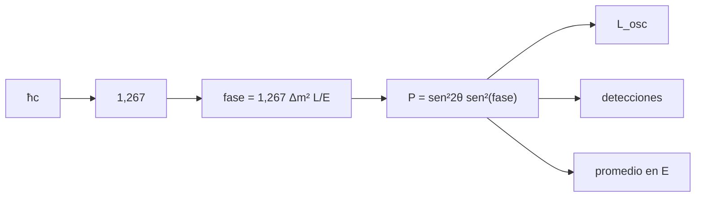

# B31-C11 — Neutrinos y oscilaciones

<!-- nav:top -->
[🏠 Programa](../../../../README.md) · [📚 Bloque B31](../../../tronco-comun/B31-fisica-cuantica-nuclear-y-astroparticulas.md) · [← Anterior: B31-C10 — Modelo estándar de partículas](../B31-C10-modelo-estandar-de-particulas/CLASE.md) · [Siguiente: B31-C12 — Antimateria y aniquilación →](../B31-C12-antimateria-y-aniquilacion/CLASE.md)
<!-- /nav -->

## 1. Ubicación, nivel y alcance

Clase 11 del bloque B31. Nivel N3. Un neutrino creado con un sabor puede detectarse con otro: oscila. Aquí calculas la **probabilidad de oscilación de dos sabores** `sen²2θ sen²(1,267 Δm²L/E)` (el coeficiente se obtiene de las constantes), la **longitud de oscilación**, una detección Monte Carlo y el efecto de **promediar sobre un espectro de energías**. Usas [B05](../../../tronco-comun/B05-fisica-fundamental-para-el-espacio.md) y [B12](../../../tronco-comun/B12-probabilidad-estadistica-e-incertidumbre.md). Se supone vacío y dos sabores; los valores son ilustrativos.

## 2. Por qué esta clase existe

Detectar neutrinos del Sol, la atmósfera y aceleradores exige saber cuánto oscilan. La decisión central: **¿cuál es la probabilidad de oscilación a cierta distancia y energía?**

## 3. Lo que podrás hacer al terminar

1. Calcular el coeficiente de la fase con `ħc`.
2. Calcular `P` de aparición y supervivencia.
3. Hallar la longitud de oscilación.
4. Simular detecciones.
5. Promediar en energía.
6. Reconocer las limitaciones.

La evidencia es la **ficha de la oscilación** del ejercicio 12 (sección 20).

## 4. Con qué llegas y cómo comprobarlo

1. ¿Qué es un sabor?
2. ¿Qué es un ángulo de mezcla?
3. ¿Qué es `Δm²`?
4. ¿Qué es un espectro de energías?
5. ¿Qué es una fase?

<details>
<summary>Ver respuestas</summary>

1. Electrónico, muónico o tauónico. 2. El que mezcla estados de masa y de sabor. 3. La diferencia de masas al cuadrado. 4. La distribución de energías. 5. El argumento del seno.
</details>

Con cuatro o cinco aciertos, sigue; si no, repasa los prerrequisitos.

## 5. Un caso de contexto y casos de referencia

Con valores **ilustrativos** `sen²2θ = 1` y `Δm² = 2,5 × 10⁻³ eV²`, a 1 GeV el primer máximo de aparición está a `495,9 km` y la longitud de oscilación es `991,9 km`. Es el **ejemplo conductor**. El coeficiente de la fase sale `1,26693` con las constantes de NIST.

## 6. Vocabulario

La **probabilidad de oscilación** `P`. El **ángulo de mezcla** `θ`. La **diferencia de masas** `Δm²`. La **longitud de oscilación** `L_osc = 4πħcE/Δm²`. El **promedio en energía** lleva `P` a `sen²2θ/2`.

## 7. Modelo mental: un péndulo que cambia de color

Como una luz que cambia de color con el tiempo según la distancia recorrida: a cierta distancia vuelve al color inicial.



*Descripción textual:* las constantes dan el coeficiente, la fase y la probabilidad, de la que salen la longitud de oscilación, las detecciones y el promedio en energía.

Analogía: una luz que cambia de color. Límite: vacío y dos sabores.

## 8. La explicación, paso a paso

### 8.1 Probabilidades (`sen²2θ = 1`, `Δm² = 2,5 × 10⁻³ eV²`)

| `L` (km) | `E` (GeV) | fase | `P` aparición | `P` supervivencia |
|---|---|---|---|---|
| 100 | 1,0 | 0,3167 | 0,09701 | 0,90299 |
| 295 | 0,6 | 1,5573 | 0,99982 | 0,00018 |
| 495 | 1,0 | 1,5678 | 0,99999 | 0,00001 |
| 1000 | 1,0 | 3,1673 | 0,00066 | 0,99934 |
| 500 | 2,0 | 0,7918 | 0,50643 | 0,49357 |

La suma siempre es 1.

### 8.2 Longitud de oscilación y detección

Para `E = 1 GeV`, `L_osc = 991,87 km` y el primer máximo ocurre en `495,94 km`. De 100 000 neutrinos a 295 km y 0,6 GeV, la frecuencia de aparición es `0,99987` (esperada `0,99982`).

### 8.3 Promedio en energía

A 5000 km con energía uniforme entre 0,5 y 2 GeV, el promedio es `0,4985`, cerca del límite `sen²2θ/2 = 0,5`.

### 8.4 Lectura

La probabilidad depende de `L/E`: una resolución de energía finita borra las oscilaciones rápidas.

## 9. Magnitudes, símbolos y unidades

| Símbolo | Qué es | Unidad | Valor / nota |
|---|---|---|---|
| `Δm²` | diferencia de masas al cuadrado | eV² | 2,5 × 10⁻³ (ilustrativa) |
| `θ` | ángulo de mezcla | ° | 45 (ilustrativo) |
| `L`, `E` | distancia y energía | km; GeV | ver 8.1 |
| `ħc` | constante | eV m | `1,973269804 × 10⁻⁷` (S1) |

## 10. Convenciones y referencias

Vacío, dos sabores, ondas planas; `Δm²`, `θ`, energías y distancias **ilustrativos**; semilla `20261109`.

## 11. De dónde sale lo que afirmamos

| ID | Fuente | Localizador | Respalda | Estado |
|---|---|---|---|---|
| S1 | NIST, *Fundamental Physical Constants* (CODATA 2022) | https://physics.nist.gov/cuu/Constants/Table/allascii.txt | constantes y masas citadas en la sección 9 | Consultada el 2026-11-09 |

Límites: no se consultó ningún experimento de neutrinos; los parámetros no son los medidos.

## 12. Cómo ver la probabilidad

| `L/E` (km/GeV) | `P` aparición |
|---|---|
| 100 | 0,097 |
| 495 | 1,000 |
| 1000 | 0,001 |

Descripción larga: la probabilidad sube a 1 en el primer máximo y vuelve a casi 0 en el siguiente cero.

## 13. Ejemplo trabajado: fase a 100 km y 1 GeV

**Paso 1 · Coeficiente.** `1,26693`.

**Paso 2 · Producto.** `1,26693 × 2,5 × 10⁻³ × 100/1`.

**Paso 3 · Valor.** `0,3167`.

**Paso 4 · Probabilidad.** `sen²0,3167 = 0,0970`.

## 14. Distintas formas de describir un neutrino

**Por fase:** `L/E`. **Por longitud:** `L_osc`. **Por azar:** detecciones. **Por promedio:** `sen²2θ/2`.

## 15. Práctica guiada

**Ejercicio 1 · con los pasos indicados.** `P` a 100 km y 1 GeV. *Pasos:* ejemplo 13.

<details><summary>Solución comentada</summary>

`0,0970`.
</details>

**Ejercicio 2 · con una pista.** Primer máximo para `E = 0,5 GeV`.

<details><summary>Solución comentada</summary>

`495,9 × 0,5 = 248 km`.
</details>

**Ejercicio 3 · casi autónomo.** `L_osc` para 2 GeV.

<details><summary>Solución comentada</summary>

`1983,7 km`.
</details>

## 16. Práctica autónoma, transferencia e integrador

**Ejercicio 4.** `P` máxima con `sen²2θ = 0,8`.

<details><summary>Solución comentada</summary>

`0,8`.
</details>

**Ejercicio 5.** `P` de supervivencia a 1000 km, 1 GeV.

<details><summary>Solución comentada</summary>

`0,99934`.
</details>

**Ejercicio 6.** Promedio esperado con rápidas oscilaciones.

<details><summary>Solución comentada</summary>

`sen²2θ/2 = 0,5`.
</details>

**Ejercicio 7.** Número esperado de apariciones entre 100 000 a 295 km y 0,6 GeV.

<details><summary>Solución comentada</summary>

`99 982`.
</details>

**Ejercicio 8.** Fase que da `P = 1`.

<details><summary>Solución comentada</summary>

`π/2 = 1,5708`.
</details>

**Ejercicio 9 · transferencia.** **Transferencia.** Un compañero usa `Δm² = 2,5 × 10⁻³` como el medido. Responde.

<details><summary>Solución comentada</summary>

Es ilustrativo.
</details>

**Ejercicio 10 · transferencia.** **Transferencia.** ¿Por qué se pierden oscilaciones con espectro ancho?

<details><summary>Solución comentada</summary>

Porque `P` promedia sobre muchas fases.
</details>

**Ejercicio 11 · transferencia.** **Transferencia.** ¿Qué omiten los efectos de materia y tres sabores?

<details><summary>Solución comentada</summary>

Cambios en `P` que este modelo no trata.
</details>

**Ejercicio 12.** **Integrador.** Elabora tu *ficha de la oscilación*: coeficiente, tabla de `P`, `L_osc` y promedio.

<details><summary>Solución comentada</summary>

Secciones 8.1–8.4.
</details>

**Ejercicio 12 · integrador.** **Integrador.** Elabora tu *ficha de la oscilación*: coeficiente, tabla de `P`, `L_osc` y promedio.

<details><summary>Solución modelo</summary>

Secciones 8.1–8.4.
</details>

## 17. Laboratorio: oscilación de dos sabores

El script [oscilaciones.py](oscilaciones.py) calcula `P`, la longitud de oscilación y el promedio en energía (**comprueba** el coeficiente a `5 × 10⁻⁴` y el promedio a 0,02).

**Datos:** `ħc` de NIST; `Δm²`, `θ`, `E`, `L` **ilustrativos**; semilla `20261109`. **Predice antes de ejecutar:** ¿en qué `L` está el primer máximo para 1 GeV? (≈496 km.) **Ejecución del 2026-11-09 (Python 3.12.9):**

```text
Python 3.12.9 (biblioteca estandar)
coeficiente de la fase Delta m^2 L/(4 hbar c E) para 1 eV^2, 1 km, 1 GeV = 1.26693 (valor habitual 1.267)
  L [km]  E [GeV]     fase  P(aparicion)  P(superv.)   suma
     100      1.0   0.3167       0.09701     0.90299    1.0
     295      0.6   1.5573       0.99982     0.00018    1.0
     495      1.0   1.5678       0.99999     0.00001    1.0
    1000      1.0   3.1673       0.00066     0.99934    1.0
    2000      1.0   6.3347       0.00265     0.99735    1.0
     500      0.5   3.1673       0.00066     0.99934    1.0
     500      2.0   0.7918       0.50643     0.49357    1.0
longitud de oscilacion para E = 1 GeV: L_osc = 991.87 km ; primer maximo en L_osc/2 = 495.94 km
100000 neutrinos a 295 km y 0.6 GeV: P = 0.99982 ; frecuencia = 0.99987 ; desviacion = 1.24 errores
promedio de P en L = 5000 km con E uniforme en [0.5, 2] GeV: 0.4985 ; limite de oscilaciones rapidas sen^2(2 theta)/2 = 0.5000
Pruebas superadas.
```

```bash
python programa/clases/B31/B31-C11-neutrinos-y-oscilaciones/oscilaciones.py
```

**Límites:** vacío, dos sabores.

## 18. Errores frecuentes y cómo corregirlos

**Usar unidades mezcladas.** Se corrige con el ejemplo 13.

**Olvidar el cuadrado del seno.** Se corrige con 8.1.

**Creer que `P = 1` es permanente.** Se corrige con 8.1.

**Tomar los parámetros por medidos.** Se corrige con la sección 10.

## 19. Cómo sabrás que vas bien

Tras 8.1: ¿cuándo `P ≈ 1`? Si dudas, ejemplo 13. Tras el laboratorio: ¿qué comprueba? (el coeficiente).

## 20. Qué entregas y cómo se evalúa

El producto es tu **ficha de la oscilación** (ejercicio 12).

| Criterio | Inicial | En desarrollo | Logrado | Destacado |
|---|---|---|---|---|
| Conceptos | Los confunde | Parciales | fase, `L_osc`, promedio | Explica la pérdida por espectro ancho |
| Cálculo | Sin unidades | Con errores | Tablas completas | Calcula casos nuevos |
| Numérico | Sin comprobar | Un caso | Monte Carlo y fórmula | Interpreta el promedio |
| Fuentes | Sin fuente | Sin fecha | S1 con fecha | Declara los parámetros ilustrativos |
| Límites | No los nombra | Uno | Tres | Discute qué falta del modelo |

**Condiciones críticas (no se compensan con promedio):** rotular los parámetros como ilustrativos; no atribuirlos a un experimento; citar solo lo consultado.

## 21. Ética, seguridad y límites

Clase educativa. Accesibilidad: tablas equivalentes a las gráficas, fórmulas en texto, ejercicios sin conexión.

## 22. Para cerrar y seguir

Con parámetros ilustrativos el primer máximo está a 496 km por GeV y el promedio en energía tiende a 0,5. Queda una pregunta: ¿qué ocurre cuando materia y antimateria se encuentran?

**Glosario español–inglés.** oscilación de neutrinos · *neutrino oscillation*; ángulo de mezcla · *mixing angle*; longitud de oscilación · *oscillation length*; sabor · *flavor*; probabilidad de supervivencia · *survival probability*.

**Continuidad.** [B31-C12](../B31-C12-antimateria-y-aniquilacion/CLASE.md) estudia la antimateria y la aniquilación.

**Referencias:** ver sección 11.

<!-- nav:bottom -->
---

[← Anterior: B31-C10 — Modelo estándar de partículas](../B31-C10-modelo-estandar-de-particulas/CLASE.md) · [📚 Bloque B31](../../../tronco-comun/B31-fisica-cuantica-nuclear-y-astroparticulas.md) · [Siguiente: B31-C12 — Antimateria y aniquilación →](../B31-C12-antimateria-y-aniquilacion/CLASE.md)
<!-- /nav -->
