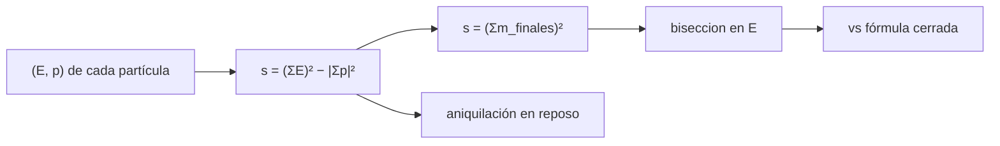

# B31-C12 — Antimateria y aniquilación

<!-- nav:top -->
[🏠 Programa](../../../../README.md) · [📚 Bloque B31](../../../tronco-comun/B31-fisica-cuantica-nuclear-y-astroparticulas.md) · [← Anterior: B31-C11 — Neutrinos y oscilaciones](../B31-C11-neutrinos-y-oscilaciones/CLASE.md) · [Siguiente: B31-C13 — Rayos cósmicos y cascadas →](../../../tronco-comun/B31-fisica-cuantica-nuclear-y-astroparticulas.md#b31-c13)
<!-- /nav -->

## 1. Ubicación, nivel y alcance

Clase 12 del bloque B31. Nivel N3. La cinemática relativista fija cuánta energía hace falta para crear partículas. Aquí calculas **umbrales** con la masa invariante `s = (ΣE)² − |Σp|²` por biseccion y con fórmulas cerradas: `e⁺e⁻ → μ⁺μ⁻` en blanco fijo, `pp → pppp̄`, y producción de pares por un fotón. También verificas la **aniquilación en reposo** y la energía de 1 g de materia con 1 g de antimateria. Usas [B05](../../../tronco-comun/B05-fisica-fundamental-para-el-espacio.md). Se supone cinemática pura.

## 2. Por qué esta clase existe

Producir antimateria o partículas pesadas requiere una energía mínima que depende de la configuración. La decisión central: **¿cuál es la energía umbral de una reacción y por qué un colisionador ahorra energía?**

## 3. Lo que podrás hacer al terminar

1. Calcular la masa invariante de un sistema.
2. Hallar umbrales por biseccion.
3. Comparar con las fórmulas cerradas.
4. Calcular la aniquilación en reposo.
5. Calcular `E = 2mc²`.
6. Comparar blanco fijo y colisionador.

La evidencia es la **ficha de la aniquilación** del ejercicio 12 (sección 20).

## 4. Con qué llegas y cómo comprobarlo

1. ¿Qué es un cuadrivector?
2. ¿Qué es la masa invariante?
3. ¿Qué es una antipartícula?
4. ¿Qué es un umbral?
5. ¿Qué es un kilotón de TNT?

<details>
<summary>Ver respuestas</summary>

1. Un vector `(E, p)`. 2. `s = E² − p²` (c = 1). 3. Una partícula con carga opuesta. 4. La energía mínima. 5. `4,184 × 10¹² J` por definición.
</details>

Con cuatro o cinco aciertos, sigue; si no, repasa los prerrequisitos.

## 5. Un caso de contexto y casos de referencia

El umbral de `e⁺e⁻ → μ⁺μ⁻` con un positrón sobre un electrón en reposo es `43,693 GeV`, mientras que en un colisionador cada haz necesita solo `105,66 MeV`. Es el **ejemplo conductor** (masas de NIST, S1). El umbral de pares sobre un núcleo pesado es `2m_ec² = 1,0220 MeV`.

## 6. Vocabulario

La **masa invariante** `s`. El **umbral** de una reacción. La **aniquilación** convierte materia y antimateria en radiación. El **blanco fijo** y el **colisionador**. La **producción de pares** crea `e⁺e⁻` a partir de un fotón.

## 7. Modelo mental: chocar dos coches

Un coche contra un muro parado desperdicia casi toda su energía en mover el muro; dos coches que chocan de frente aprovechan toda.



*Descripción textual:* los cuadrivectores dan la masa invariante, que se iguala a la masa final para hallar el umbral, que se compara con la fórmula cerrada.

Analogía: chocar dos coches. Límite: cinemática pura.

## 8. La explicación, paso a paso

### 8.1 Umbrales

| reacción | numérico (MeV) | cerrado (MeV) |
|---|---|---|
| e⁺ e⁻(blanco) → μ⁺ μ⁻ | 43 693,09 | 43 693,09 |
| p p(blanco) → p p p p̄ (E total) | 6567,90 | 6567,90 |
| γ + e⁻ → e⁻ e⁺ e⁻ | 2,04400 | 2,04400 |
| γ + núcleo pesado → e⁺ e⁻ | 1,02200 | 1,02200 |

La energía cinética del protón en el umbral es `6m_pc² = 5629,63 MeV = 5,63 GeV`.

### 8.2 Colisionador

En un colisionador `e⁺e⁻ → μ⁺μ⁻`, cada haz necesita `m_μc² = 105,66 MeV`, 413 veces menos que los 43,69 GeV en blanco fijo.

### 8.3 Aniquilación

En reposo, `e⁺e⁻ → γγ` da dos fotones de `0,51100 MeV` en sentidos opuestos (momento total 0). Un gramo de materia con un gramo de antimateria libera `2mc² = 1,7975 × 10¹⁴ J`, unos `42,96 kt` de TNT.

### 8.4 Lectura

Los umbrales de blanco fijo crecen con la masa final al cuadrado; el colisionador evita ese desperdicio.

## 9. Magnitudes, símbolos y unidades

| Símbolo | Qué es | Unidad | Valor / nota |
|---|---|---|---|
| `m_ec²` | masa del electrón | MeV | `0,51099895069` (S1) |
| `m_μc²` | masa del muón | MeV | `105,6583755` (S1) |
| `m_pc²` | masa del protón | MeV | `938,27208943` (S1) |
| `s` | masa invariante al cuadrado | MeV² | `(ΣE)² − |Σp|²` |
| `E` | energía de aniquilación | J | `2mc²` |

## 10. Convenciones y referencias

Unidades `c = 1`; núcleo infinitamente pesado en el último umbral; 1 g de materia y de antimateria **ilustrativos**.

## 11. De dónde sale lo que afirmamos

| ID | Fuente | Localizador | Respalda | Estado |
|---|---|---|---|---|
| S1 | NIST, *Fundamental Physical Constants* (CODATA 2022) | https://physics.nist.gov/cuu/Constants/Table/allascii.txt | constantes y masas citadas en la sección 9 | Consultada el 2026-11-09 |

Límites: no se consultaron secciones eficaces; el umbral no implica una tasa.

## 12. Cómo ver los umbrales

| Reacción | Umbral |
|---|---|
| γ + núcleo → e⁺e⁻ | 1,022 MeV |
| γ + e⁻ → e⁻e⁺e⁻ | 2,044 MeV |
| p p → pppp̄ (T) | 5,630 GeV |
| e⁺e⁻ → μ⁺μ⁻ (blanco) | 43,69 GeV |

Descripción larga: los umbrales crecen con la masa final y con la configuración de blanco fijo.

## 13. Ejemplo trabajado: umbral de pares en un electrón

**Paso 1 · Invariante.** `s = m_e² + 2E m_e` para un fotón de energía `E` sobre un electrón en reposo.

**Paso 2 · Objetivo.** `s = (3m_e)²`.

**Paso 3 · Resolver.** `2E m_e = 8m_e²`.

**Paso 4 · Valor.** `E = 4m_e = 2,044 MeV`.

## 14. Distintas formas de describir la antimateria

**Por masa:** `s`. **Por umbral:** biseccion. **Por energía:** `2mc²`. **Por configuración:** colisionador.

## 15. Práctica guiada

**Ejercicio 1 · con los pasos indicados.** Umbral de pares sobre un núcleo pesado. *Pasos:* `2m_e`.

<details><summary>Solución comentada</summary>

`1,0220 MeV`.
</details>

**Ejercicio 2 · con una pista.** Umbral sobre un electrón. *Pista:* ejemplo 13.

<details><summary>Solución comentada</summary>

`2,0440 MeV`.
</details>

**Ejercicio 3 · casi autónomo.** `T` de `pp → pppp̄`.

<details><summary>Solución comentada</summary>

`6m_pc² = 5,63 GeV`.
</details>

## 16. Práctica autónoma, transferencia e integrador

**Ejercicio 4.** Energía por haz en un colisionador `e⁺e⁻ → μ⁺μ⁻`.

<details><summary>Solución comentada</summary>

`105,66 MeV`.
</details>

**Ejercicio 5.** Cociente blanco fijo / colisionador.

<details><summary>Solución comentada</summary>

`43 693/105,66 = 413`.
</details>

**Ejercicio 6.** `2mc²` de 1 g.

<details><summary>Solución comentada</summary>

`1,7975 × 10¹⁴ J`.
</details>

**Ejercicio 7.** kt de TNT equivalentes.

<details><summary>Solución comentada</summary>

`1,7975 × 10¹⁴/4,184 × 10¹² = 42,96`.
</details>

**Ejercicio 8.** Momento total de los dos fotones.

<details><summary>Solución comentada</summary>

`0`.
</details>

**Ejercicio 9 · transferencia.** **Transferencia.** Un compañero dice que producir 1 g de antimateria cuesta solo `2mc²`. Responde.

<details><summary>Solución comentada</summary>

Es la energía de aniquilación, no el costo de producirla.
</details>

**Ejercicio 10 · transferencia.** **Transferencia.** ¿Por qué el umbral nuclear es `2m_e` y no `4m_e`?

<details><summary>Solución comentada</summary>

Porque el núcleo absorbe momento con energía despreciable.
</details>

**Ejercicio 11 · transferencia.** **Transferencia.** ¿Qué no dice el umbral?

<details><summary>Solución comentada</summary>

La probabilidad de la reacción.
</details>

**Ejercicio 12.** **Integrador.** Elabora tu *ficha de la aniquilación*: umbrales, aniquilación y energía.

<details><summary>Solución comentada</summary>

Secciones 8.1–8.4.
</details>

**Ejercicio 12 · integrador.** **Integrador.** Elabora tu *ficha de la aniquilación*: umbrales, aniquilación y energía.

<details><summary>Solución modelo</summary>

Secciones 8.1–8.4.
</details>

## 17. Laboratorio: umbrales cinemáticos y aniquilación

El script [aniquilacion.py](aniquilacion.py) calcula umbrales por biseccion y los compara con fórmulas cerradas (**comprueba** `10⁻⁶` y el momento total `10⁻¹²`).

**Datos:** masas de NIST; muestras de 1 g **ilustrativas**. **Predice antes de ejecutar:** ¿cuánto vale el umbral nuclear de pares? (1,022 MeV.) **Ejecución del 2026-11-09 (Python 3.12.9):**

```text
Python 3.12.9 (biblioteca estandar)
reaccion                        umbral numerico [MeV]  formula cerrada [MeV]   cociente
e+ e- (blanco) -> mu+ mu-                43693.090713           43693.090713 1.000000000
p p (blanco) -> p p p pbar (E total)            6567.904626            6567.904626 1.000000000
gamma + e- -> e- e+ e-                       2.043996               2.043996 1.000000000
gamma + M(infinito) -> e+ e-                 1.021998               1.021998 0.999999968
energia cinetica del proyectil en el umbral de p p -> p p p pbar: T = 6 m_p c^2 = 5629.633 MeV = 5.6296 GeV
energia de cada haz en un colisionador e+ e- -> mu+ mu-: m_mu c^2 = 105.6584 MeV (frente a 43.69 GeV en blanco fijo)
aniquilacion en reposo: dos fotones de 0.51100 MeV en sentidos opuestos ; momento total = 0.0e+00 ; energia total = 1.02200 MeV = 2 m_e c^2
1 g de materia con 1 g de antimateria: E = 2 m c^2 = 1.7975e+14 J = 42.96 kt de TNT equivalente (1 kt = 4.184e12 J, definicion)
Pruebas superadas.
```

```bash
python programa/clases/B31/B31-C12-antimateria-y-aniquilacion/aniquilacion.py
```

**Límites:** cinemática pura.

## 18. Errores frecuentes y cómo corregirlos

**Confundir energía total y cinética.** Se corrige con 8.1.

**Olvidar el retroceso del blanco.** Se corrige con el ejemplo 13.

**Confundir aniquilación y producción.** Se corrige con el ejercicio 9.

**Mezclar MeV y J.** Se corrige con la sección 9.

## 19. Cómo sabrás que vas bien

Tras 8.1: ¿cuál es el menor umbral? Si dudas, ejemplo 13. Tras el laboratorio: ¿qué comprueba? (biseccion frente a cerrada).

## 20. Qué entregas y cómo se evalúa

El producto es tu **ficha de la aniquilación** (ejercicio 12).

| Criterio | Inicial | En desarrollo | Logrado | Destacado |
|---|---|---|---|---|
| Conceptos | Los confunde | Parciales | `s`, umbral, aniquilación | Explica la ventaja del colisionador |
| Cálculo | Sin unidades | Con errores | Tablas completas | Calcula casos nuevos |
| Numérico | Sin comprobar | Un caso | Biseccion y cerrada | Interpreta los cocientes |
| Fuentes | Sin fuente | Sin fecha | S1 con fecha | Declara las muestras ilustrativas |
| Límites | No los nombra | Uno | Tres | Discute qué falta del modelo |

**Condiciones críticas (no se compensan con promedio):** rotular las masas de las muestras como ilustrativas; no confundir energía de aniquilación con costo de producción; citar solo lo consultado.

## 21. Ética, seguridad y límites

Clase educativa. Accesibilidad: tablas equivalentes a las gráficas, fórmulas en texto, ejercicios sin conexión.

## 22. Para cerrar y seguir

El umbral nuclear de pares es 1,022 MeV, el de `pp → pppp̄` 5,63 GeV y 1 g con 1 g libera 43 kt de TNT. Con esto cierra el tramo de partículas; queda una pregunta: ¿cómo llegan y se detectan las partículas del cosmos?

**Glosario español–inglés.** masa invariante · *invariant mass*; umbral · *threshold*; aniquilación · *annihilation*; antimateria · *antimatter*; producción de pares · *pair production*.

**Continuidad.** [B31-C13](../B31-C13-rayos-cosmicos-y-cascadas/CLASE.md) estudia los rayos cósmicos y las cascadas.

**Referencias:** ver sección 11.

<!-- nav:bottom -->
---

[← Anterior: B31-C11 — Neutrinos y oscilaciones](../B31-C11-neutrinos-y-oscilaciones/CLASE.md) · [📚 Bloque B31](../../../tronco-comun/B31-fisica-cuantica-nuclear-y-astroparticulas.md) · [Siguiente: B31-C13 — Rayos cósmicos y cascadas →](../../../tronco-comun/B31-fisica-cuantica-nuclear-y-astroparticulas.md#b31-c13)
<!-- /nav -->
