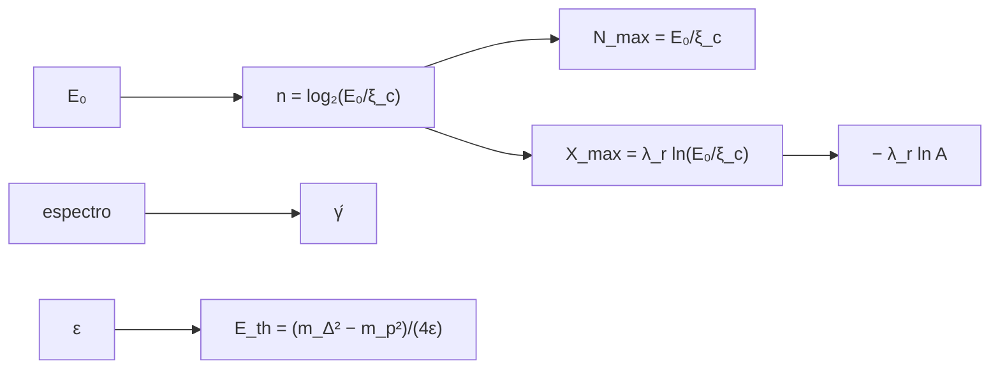

# B31-C13 — Rayos cósmicos y cascadas

<!-- nav:top -->
[🏠 Programa](../../../../README.md) · [📚 Bloque B31](../../../tronco-comun/B31-fisica-cuantica-nuclear-y-astroparticulas.md) · [← Anterior: B31-C12 — Antimateria y aniquilación](../B31-C12-antimateria-y-aniquilacion/CLASE.md) · [Siguiente: B31-C14 — Detectores de partículas →](../B31-C14-detectores-de-particulas/CLASE.md)
<!-- /nav -->

## 1. Ubicación, nivel y alcance

Clase 13 del bloque B31. Nivel N3. Un rayo cósmico que entra en la atmósfera produce una cascada de partículas. Aquí usas el **modelo de Heitler** (generaciones, número máximo de partículas y profundidad del máximo `X_max`), muestreas un **espectro de potencias** con semilla fija y estimas su índice, y calculas el **umbral de interacción con el fondo de microondas** con el invariante `s`. Usas [B05](../../../tronco-comun/B05-fisica-fundamental-para-el-espacio.md) y [B12](../../../tronco-comun/B12-probabilidad-estadistica-e-incertidumbre.md). Se suponen parámetros ilustrativos.

## 2. Por qué esta clase existe

La energía y la composición de un rayo cósmico se infieren de la forma de su cascada, y el fondo de microondas limita la energía que llega. La decisión central: **¿qué profundidad y tamaño tiene una cascada y a qué energía aparece un corte?**

## 3. Lo que podrás hacer al terminar

1. Calcular `n = log₂(E₀/ξ_c)` y `N_max = E₀/ξ_c`.
2. Calcular `X_max = λ_r ln(E₀/ξ_c)` y la tasa de elongación.
3. Estimar el desplazamiento por masa `−λ_r ln A`.
4. Estimar el índice de un espectro por máxima verosimilitud.
5. Calcular el umbral `(m_Δ² − m_p²)/(4ε)`.
6. Distinguir lo ilustrativo.

La evidencia es la **ficha de los rayos cósmicos** del ejercicio 12 (sección 20).

## 4. Con qué llegas y cómo comprobarlo

1. ¿Qué es un rayo cósmico?
2. ¿Qué es una energía crítica?
3. ¿Qué es una ley de potencias?
4. ¿Qué es el fondo cósmico de microondas?
5. ¿Qué es una resonancia?

<details>
<summary>Ver respuestas</summary>

1. Una partícula de alta energía del espacio. 2. La energía bajo la cual cesa la multiplicación. 3. `N ∝ E^(−γ)`. 4. La radiación fósil de fotones. 5. Un estado inestable de corta vida.
</details>

Con cuatro o cinco aciertos, sigue; si no, repasa los prerrequisitos.

## 5. Un caso de contexto y casos de referencia

Para `E₀ = 10¹⁸ eV` el modelo da `N_max = 1,18 × 10¹⁰` partículas y `X_max = 858 g/cm²` (parámetros **ilustrativos**: `ξ_c = 85 MeV`, `λ_r = 37 g/cm²`). Es el **ejemplo conductor**. El umbral para producir la resonancia Δ contra un fotón del fondo es `2,51 × 10²⁰ eV`.

## 6. Vocabulario

La **cascada** se multiplica por generaciones. La **energía crítica** `ξ_c`. La **profundidad del máximo** `X_max`. La **tasa de elongación** es el cambio de `X_max` por década. El **corte GZK** es el límite por interacción con el fondo. La **superposición** trata un núcleo como `A` protones.

## 7. Modelo mental: una avalancha

Una partícula se parte en dos, cada una en dos más, hasta que la energía por partícula baja del umbral crítico y la avalancha se apaga.



*Descripción textual:* la energía primaria fija el número de generaciones, el tamaño y la profundidad; el espectro da el índice; el fotón del fondo fija el umbral.

Analogía: una avalancha. Límite: modelo de Heitler simplificado.

## 8. La explicación, paso a paso

### 8.1 Cascada

| `E₀` (eV) | generaciones | `N_max` | `X_max` (g/cm²) |
|---|---|---|---|
| 10¹⁵ | 23,49 | 1,18 × 10⁷ | 602,4 |
| 10¹⁷ | 30,13 | 1,18 × 10⁹ | 772,8 |
| 10¹⁸ | 33,45 | 1,18 × 10¹⁰ | 858,0 |
| 10¹⁹ | 36,78 | 1,18 × 10¹¹ | 943,2 |
| 10²⁰ | 40,10 | 1,18 × 10¹² | 1028,4 |

Tasa de elongación: `85,20 g/cm²` por década (`λ_r ln 10`). Para hierro (`A = 56`) a 10¹⁸ eV, `X_max = 709,0 g/cm²`, `148,9` menos que el protón.

### 8.2 Espectro

Con 5000 eventos de índice `2,7`, se estima `2,6954 ± 0,0240`. La fracción con energía mayor que 10 veces el mínimo es `0,0198` (teoría `0,0200`).

### 8.3 Umbral

Con `ε = 6,340 × 10⁻⁴ eV` (ilustrativo), `E_th = (m_Δ² − m_p²)/(4ε) = 2,5136 × 10²⁰ eV` por la fórmula y por el invariante `s = m_p² + 2ε(E + p)`.

### 8.4 Lectura

El máximo de la cascada se retrasa `85 g/cm²` por década de energía y es menos profundo para núcleos pesados; esa diferencia sirve para inferir la masa del primario.

## 9. Magnitudes, símbolos y unidades

| Símbolo | Qué es | Unidad | Valor / nota |
|---|---|---|---|
| `ξ_c` | energía crítica | MeV | 85 (ilustrativa) |
| `λ_r` | longitud de radiación | g/cm² | 37 (ilustrativa) |
| `γ` | índice del espectro | — | 2,7 (ilustrativo) |
| `ε` | energía del fotón del fondo | eV | 6,34 × 10⁻⁴ (ilustrativa) |
| `m_Δ` | masa de la resonancia | MeV | 1232 (ilustrativa) |

## 10. Convenciones y referencias

Cascada de Heitler simplificada, colisión frontal; todos los parámetros salvo `m_p` y `k_B` son **ilustrativos**; semilla `20261109`.

## 11. De dónde sale lo que afirmamos

| ID | Fuente | Localizador | Respalda | Estado |
|---|---|---|---|---|
| S1 | NIST, *Fundamental Physical Constants* (CODATA 2022) | https://physics.nist.gov/cuu/Constants/Table/allascii.txt | constantes y masas citadas en la sección 9 | Consultada el 2026-11-09 |

Límites: no se consultó ningún dato de rayos cósmicos; los números del modelo son ilustrativos.

## 12. Cómo ver la cascada

| `E₀` (eV) | `X_max` (g/cm²) |
|---|---|
| 10¹⁵ | 602 |
| 10¹⁸ | 858 |
| 10²⁰ | 1028 |

Descripción larga: el máximo se profundiza 85 g/cm² por década de energía.

## 13. Ejemplo trabajado: generaciones a 10¹⁸ eV

**Paso 1 · Cociente.** `E₀/ξ_c = 10¹⁸/8,5 × 10⁷ = 1,18 × 10¹⁰`.

**Paso 2 · Logaritmo.** `log₂ = 33,45`.

**Paso 3 · Profundidad.** `37 × ln(1,18 × 10¹⁰) = 858 g/cm²`.

**Paso 4 · Lectura.** Unas 33 generaciones.

## 14. Distintas formas de describir un rayo cósmico

**Por energía:** `N_max`. **Por profundidad:** `X_max`. **Por masa:** superposición. **Por corte:** GZK.

## 15. Práctica guiada

**Ejercicio 1 · con los pasos indicados.** `N_max` para `E₀ = 10¹⁸ eV`. *Pasos:* ejemplo 13.

<details><summary>Solución comentada</summary>

`1,18 × 10¹⁰`.
</details>

**Ejercicio 2 · con una pista.** `X_max` para `10¹⁹ eV`. *Pista:* 8.1.

<details><summary>Solución comentada</summary>

`943,2 g/cm²`.
</details>

**Ejercicio 3 · casi autónomo.** Tasa de elongación.

<details><summary>Solución comentada</summary>

`37 ln 10 = 85,2 g/cm² por década`.
</details>

## 16. Práctica autónoma, transferencia e integrador

**Ejercicio 4.** Desplazamiento para `A = 56`.

<details><summary>Solución comentada</summary>

`−37 ln 56 = −148,9 g/cm²`.
</details>

**Ejercicio 5.** Fracción con `E > 10 E_min` para `γ = 2,7`.

<details><summary>Solución comentada</summary>

`10^(−1,7) = 0,0200`.
</details>

**Ejercicio 6.** Error de `γ̂` con 5000 eventos.

<details><summary>Solución comentada</summary>

`(γ − 1)/√N = 0,024`.
</details>

**Ejercicio 7.** Umbral GZK si `ε` se duplica.

<details><summary>Solución comentada</summary>

La mitad: `1,26 × 10²⁰ eV`.
</details>

**Ejercicio 8.** Generaciones a 10²⁰ eV.

<details><summary>Solución comentada</summary>

`40,1`.
</details>

**Ejercicio 9 · transferencia.** **Transferencia.** Un compañero usa 858 g/cm² como medido. Responde con la sección 10.

<details><summary>Solución comentada</summary>

Es un valor ilustrativo del modelo.
</details>

**Ejercicio 10 · transferencia.** **Transferencia.** ¿Por qué un núcleo pesado se desarrolla antes?

<details><summary>Solución comentada</summary>

Porque su energía se reparte en `A` nucleones, cada uno con menos energía.
</details>

**Ejercicio 11 · transferencia.** **Transferencia.** ¿Qué supone la colisión frontal?

<details><summary>Solución comentada</summary>

Que da el umbral mínimo; otras geometrías exigen más energía.
</details>

**Ejercicio 12.** **Integrador.** Elabora tu *ficha de los rayos cósmicos*: cascada, espectro, umbral y límites.

<details><summary>Solución comentada</summary>

Secciones 8.1–8.4.
</details>

**Ejercicio 12 · integrador.** **Integrador.** Elabora tu *ficha de los rayos cósmicos*: cascada, espectro, umbral y límites.

<details><summary>Solución modelo</summary>

Secciones 8.1–8.4.
</details>

## 17. Laboratorio: Heitler, espectro y umbral

El script [cascadas.py](cascadas.py) calcula la cascada, estima el índice y el umbral con dos vías (**comprueba** `10⁻¹²` en `N_max`, 3 errores en `γ̂` y `10⁻⁶` en el umbral).

**Datos:** `m_p`, `k_B` de NIST; todo lo demás **ilustrativo**; semilla `20261109`. **Predice antes de ejecutar:** ¿cuánto vale `X_max` a 10¹⁸ eV? (≈860 g/cm².) **Ejecución del 2026-11-09 (Python 3.12.9):**

```text
Python 3.12.9 (biblioteca estandar)
  E_0 [eV]  generaciones n   N_max = E_0/xi_c  X_max [g/cm^2]
     1e+15          23.488         1.1765e+07           602.4
     1e+17          30.132         1.1765e+09           772.8
     1e+18          33.454         1.1765e+10           858.0
     1e+19          36.776         1.1765e+11           943.2
     1e+20          40.098         1.1765e+12          1028.4
tasa de elongacion: X_max(1e19) - X_max(1e18) = 85.20 g/cm^2 por decada ; lambda_r ln 10 = 85.20
nucleo de hierro (A = 56) a 1e18 eV: X_max = 709.0 g/cm^2 ; desplazamiento = -148.9 g/cm^2 respecto del proton (858.0)
5000 eventos con indice diferencial 2.7: estimado = 2.6954 +/- 0.0240
fraccion con energia > 10 veces el umbral: 0.0198 ; teoria 10^-(gamma - 1) = 0.0200
energia media del foton del fondo: 6.340e-4 eV ; umbral de la Delta: formula = 2.5136e+20 eV ; cuadrivectores = 2.5136e+20 eV ; cociente = 1.00000000
Pruebas superadas.
```

```bash
python programa/clases/B31/B31-C13-rayos-cosmicos-y-cascadas/cascadas.py
```

**Límites:** Heitler simplificado.

## 18. Errores frecuentes y cómo corregirlos

**Confundir `log₂` y `ln`.** Se corrige con el ejemplo 13.

**Olvidar el signo de la superposición.** Se corrige con el ejercicio 4.

**Tomar los parámetros por medidos.** Se corrige con la sección 10.

**Calcular `E²−p²` con precisión insuficiente.** Se corrige con el invariante.

## 19. Cómo sabrás que vas bien

Tras 8.1: ¿cuánto crece `X_max` por década? Si dudas, ejemplo 13. Tras el laboratorio: ¿qué comprueba? (el umbral por dos vías).

## 20. Qué entregas y cómo se evalúa

El producto es tu **ficha de los rayos cósmicos** (ejercicio 12).

| Criterio | Inicial | En desarrollo | Logrado | Destacado |
|---|---|---|---|---|
| Conceptos | Los confunde | Parciales | Heitler, espectro, umbral | Explica el desplazamiento por masa |
| Cálculo | Sin unidades | Con errores | Tablas completas | Calcula casos nuevos |
| Numérico | Sin comprobar | Un caso | Dos vías | Explica la cancelación numérica |
| Fuentes | Sin fuente | Sin fecha | S1 con fecha | Declara los parámetros ilustrativos |
| Límites | No los nombra | Uno | Tres | Discute qué falta del modelo |

**Condiciones críticas (no se compensan con promedio):** rotular los parámetros como ilustrativos; no atribuirlos a datos; citar solo lo consultado.

## 21. Ética, seguridad y límites

Clase educativa. Accesibilidad: tablas equivalentes a las gráficas, fórmulas en texto, ejercicios sin conexión.

## 22. Para cerrar y seguir

A 10¹⁸ eV el modelo da 33 generaciones y `X_max = 858 g/cm²`; el corte contra el fondo aparece en 2,5 × 10²⁰ eV. Queda una pregunta: ¿cómo se detectan estas partículas?

**Glosario español–inglés.** rayo cósmico · *cosmic ray*; cascada · *air shower*; modelo de Heitler · *Heitler model*; corte GZK · *GZK cutoff*; profundidad del máximo · *depth of shower maximum*.

**Continuidad.** [B31-C14](../B31-C14-detectores-de-particulas/CLASE.md) estudia los detectores de partículas.

**Referencias:** ver sección 11.

<!-- nav:bottom -->
---

[← Anterior: B31-C12 — Antimateria y aniquilación](../B31-C12-antimateria-y-aniquilacion/CLASE.md) · [📚 Bloque B31](../../../tronco-comun/B31-fisica-cuantica-nuclear-y-astroparticulas.md) · [Siguiente: B31-C14 — Detectores de partículas →](../B31-C14-detectores-de-particulas/CLASE.md)
<!-- /nav -->
