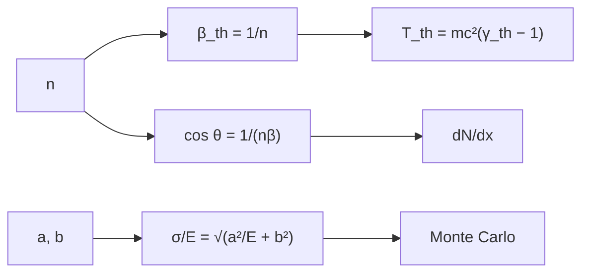

# B31-C14 — Detectores de partículas

<!-- nav:top -->
[🏠 Programa](../../../../README.md) · [📚 Bloque B31](../../../tronco-comun/B31-fisica-cuantica-nuclear-y-astroparticulas.md) · [← Anterior: B31-C13 — Rayos cósmicos y cascadas](../B31-C13-rayos-cosmicos-y-cascadas/CLASE.md) · [Siguiente: B31-C15 — Física de aceleradores →](../B31-C15-fisica-de-aceleradores/CLASE.md)
<!-- /nav -->

## 1. Ubicación, nivel y alcance

Clase 14 del bloque B31. Nivel N3. Un detector Cherenkov de agua revela partículas que van más rápido que la luz en el medio. Aquí calculas el **umbral** `β > 1/n`, las **energías cinéticas umbral** de electrones, muones y protones, el **ángulo** `cos θ = 1/(nβ)`, el **rendimiento de fotones** de Frank–Tamm y la **resolución de un calorímetro** `a/√E ⊕ b` con Monte Carlo. Usas [B05](../../../tronco-comun/B05-fisica-fundamental-para-el-espacio.md) y [B12](../../../tronco-comun/B12-probabilidad-estadistica-e-incertidumbre.md). El índice 1,33 y los parámetros del calorímetro son ilustrativos.

## 2. Por qué esta clase existe

Interpretar una señal exige saber qué partículas la producen y con qué precisión se mide su energía. La decisión central: **¿qué umbral y qué resolución tiene un detector?**

## 3. Lo que podrás hacer al terminar

1. Calcular `γ_th = 1/√(1 − 1/n²)`.
2. Calcular `T_th = mc²(γ_th − 1)`.
3. Calcular el ángulo de Cherenkov.
4. Calcular `dN/dx = 2πα sen²θ (1/λ₁ − 1/λ₂)`.
5. Simular la resolución del calorímetro.
6. Comparar con la fórmula.

La evidencia es la **ficha de un detector** del ejercicio 12 (sección 20).

## 4. Con qué llegas y cómo comprobarlo

1. ¿Qué es un índice de refracción?
2. ¿Qué es el factor de Lorentz?
3. ¿Qué es la constante de estructura fina?
4. ¿Qué es una resolución?
5. ¿Qué es una suma en cuadratura?

<details>
<summary>Ver respuestas</summary>

1. `c/v`. 2. `γ = 1/√(1−β²)`. 3. `α ≈ 1/137`. 4. La incertidumbre relativa de una medida. 5. `√(a² + b²)`.
</details>

Con cuatro o cinco aciertos, sigue; si no, repasa los prerrequisitos.

## 5. Un caso de contexto y casos de referencia

Con `n = 1,33` (ilustrativo) el umbral es `β = 0,752` y el ángulo máximo `41,25°`. Es el **ejemplo conductor**. Los umbrales cinéticos son `0,264 MeV` (electrón), `54,6 MeV` (muón) y `484,9 MeV` (protón), con masas de NIST (S1).

## 6. Vocabulario

La **radiación de Cherenkov** ocurre si `β > 1/n`. El **ángulo de Cherenkov**. El **rendimiento** es el número de fotones por unidad de longitud. Un **calorímetro** mide la energía. La **resolución** `σ/E`.

## 7. Modelo mental: la estela de una lancha

Una lancha más rápida que las olas deja una estela en forma de cono; el ángulo depende de cuánto más rápida va.



*Descripción textual:* el índice fija el umbral, el ángulo y el rendimiento; los parámetros del calorímetro fijan la resolución, que se comprueba con Monte Carlo.

Analogía: la estela de una lancha. Límite: medio no dispersivo.

## 8. La explicación, paso a paso

### 8.1 Umbrales (`n = 1,33`)

`β_th = 0,75188` y `γ_th = 1,51676`.

| partícula | `mc²` (MeV) | `T_umbral` (MeV) |
|---|---|---|
| electrón | 0,5110 | 0,2641 |
| muón | 105,6584 | 54,6000 |
| protón | 938,2721 | 484,8610 |

### 8.2 Ángulo y rendimiento

| `β` | `cos θ` | `θ` (°) |
|---|---|---|
| 0,76 | 0,98932 | 8,38 |
| 0,90 | 0,83542 | 33,34 |
| 0,99 | 0,75947 | 40,58 |
| 1,00 | 0,75188 | 41,25 |

Rendimiento de 300 a 600 nm: `33 217 por m = 332,2 por cm`.

### 8.3 Calorímetro (`a = 10 %√GeV`, `b = 1 %`)

| `E` (GeV) | `σ/E` fórmula | `σ/E` simulada | cociente |
|---|---|---|---|
| 1 | 0,10050 | 0,10119 | 1,0069 |
| 10 | 0,03317 | 0,03343 | 1,0078 |
| 100 | 0,01414 | 0,01409 | 0,9963 |

### 8.4 Lectura

Un protón necesita casi 500 MeV para radiar y un electrón apenas 0,26 MeV; la resolución mejora con la energía hasta saturarse en `b`.

## 9. Magnitudes, símbolos y unidades

| Símbolo | Qué es | Unidad | Valor / nota |
|---|---|---|---|
| `n` | índice de refracción | — | 1,33 (ilustrativo) |
| `mc²` | masas | MeV | S1 |
| `α` | estructura fina | — | S1 |
| `a`, `b` | términos de resolución | — | 10 %√GeV; 1 % (ilustrativos) |
| `dN/dx` | fotones por longitud | cm⁻¹ | 332 |

## 10. Convenciones y referencias

Medio no dispersivo, eficiencia del 100 %, errores gaussianos; `n`, la banda y `a`, `b` son **ilustrativos**; semilla `20261109`.

## 11. De dónde sale lo que afirmamos

| ID | Fuente | Localizador | Respalda | Estado |
|---|---|---|---|---|
| S1 | NIST, *Fundamental Physical Constants* (CODATA 2022) | https://physics.nist.gov/cuu/Constants/Table/allascii.txt | constantes y masas citadas en la sección 9 | Consultada el 2026-11-09 |

Límites: no se consultó ninguna hoja de datos de detectores; el índice del agua es ilustrativo.

## 12. Cómo ver la resolución

| `E` (GeV) | `σ/E` |
|---|---|
| 1 | 10,05 % |
| 10 | 3,32 % |
| 100 | 1,41 % |

Descripción larga: la resolución mejora como `1/√E` hasta acercarse al término constante.

## 13. Ejemplo trabajado: umbral del muón

**Paso 1 · `γ_th`.** `1/√(1 − 1/1,33²) = 1,51676`.

**Paso 2 · Exceso.** `γ_th − 1 = 0,51676`.

**Paso 3 · Masa.** `105,658 MeV`.

**Paso 4 · Valor.** `T_th = 54,60 MeV`.

## 14. Distintas formas de describir un detector

**Por umbral:** `β > 1/n`. **Por ángulo:** `θ_C`. **Por luz:** Frank–Tamm. **Por energía:** calorímetro.

## 15. Práctica guiada

**Ejercicio 1 · con los pasos indicados.** Umbral cinético del muón. *Pasos:* ejemplo 13.

<details><summary>Solución comentada</summary>

`54,6 MeV`.
</details>

**Ejercicio 2 · con una pista.** Umbral del electrón.

<details><summary>Solución comentada</summary>

`0,264 MeV`.
</details>

**Ejercicio 3 · casi autónomo.** Ángulo máximo con `n = 1,33`.

<details><summary>Solución comentada</summary>

`41,25°`.
</details>

## 16. Práctica autónoma, transferencia e integrador

**Ejercicio 4.** `β_th` con `n = 1,5`.

<details><summary>Solución comentada</summary>

`0,667`.
</details>

**Ejercicio 5.** `σ/E` a 25 GeV.

<details><summary>Solución comentada</summary>

`√(0,01/25 + 0,0001) = 2,24 %`.
</details>

**Ejercicio 6.** Fotones por cm de 300 a 600 nm.

<details><summary>Solución comentada</summary>

`332`.
</details>

**Ejercicio 7.** ¿Radia un protón de 300 MeV?

<details><summary>Solución comentada</summary>

No: está bajo 484,9 MeV.
</details>

**Ejercicio 8.** `θ` para `β = 0,8`.

<details><summary>Solución comentada</summary>

`19,97°`.
</details>

**Ejercicio 9 · transferencia.** **Transferencia.** Un compañero usa `n = 1,33` como exacto. Responde con la sección 10.

<details><summary>Solución comentada</summary>

Es un valor ilustrativo.
</details>

**Ejercicio 10 · transferencia.** **Transferencia.** ¿Por qué el ángulo cambia poco cerca de `β = 1`?

<details><summary>Solución comentada</summary>

Porque `cos θ = 1/(nβ)` varía lentamente.
</details>

**Ejercicio 11 · transferencia.** **Transferencia.** ¿Qué parte del error domina a 100 GeV?

<details><summary>Solución comentada</summary>

El término constante `b`.
</details>

**Ejercicio 12.** **Integrador.** Elabora tu *ficha de un detector*: umbrales, ángulo, rendimiento y resolución.

<details><summary>Solución comentada</summary>

Secciones 8.1–8.4.
</details>

**Ejercicio 12 · integrador.** **Integrador.** Elabora tu *ficha de un detector*: umbrales, ángulo, rendimiento y resolución.

<details><summary>Solución modelo</summary>

Secciones 8.1–8.4.
</details>

## 17. Laboratorio: Cherenkov y resolución

El script [detectores.py](detectores.py) calcula umbrales, ángulo, rendimiento y resolución del calorímetro (**comprueba** el ángulo a `10⁻¹²` y la resolución al 3 %).

**Datos:** masas y `α` de NIST; `n`, banda, `a`, `b` **ilustrativos**; semilla `20261109`. **Predice antes de ejecutar:** ¿qué umbral tiene el muón? (≈55 MeV.) **Ejecución del 2026-11-09 (Python 3.12.9):**

```text
Python 3.12.9 (biblioteca estandar)
n = 1.33 (ilustrativo): beta_th = 0.75188 ; gamma_th = 1.51676
particula   m c^2 [MeV]  T_umbral [MeV]
electron         0.5110          0.2641
muon           105.6584         54.6000
proton         938.2721        484.8610
angulo de Cherenkov para beta -> 1: 41.247 grados
   beta  cos(theta) = 1/(n beta)  theta [deg]
   0.76                  0.98932        8.383
   0.80                  0.93985       19.974
   0.90                  0.83542       33.340
   0.99                  0.75947       40.582
   1.00                  0.75188       41.247
rendimiento de fotones (300 a 600 nm, beta = 1): dN/dx = 33217.0 por m = 332.2 por cm
 E [GeV]  sigma/E formula  sigma/E simulada  cociente
     1.0          0.10050           0.10119    1.0069
    10.0          0.03317           0.03343    1.0078
   100.0          0.01414           0.01409    0.9963
Pruebas superadas.
```

```bash
python programa/clases/B31/B31-C14-detectores-de-particulas/detectores.py
```

**Límites:** medio no dispersivo.

## 18. Errores frecuentes y cómo corregirlos

**Confundir energía total y cinética.** Se corrige con el ejemplo 13.

**Olvidar el cuadrado del seno.** Se corrige con 8.2.

**Sumar `a` y `b` linealmente.** Se corrige con el ejercicio 5.

**Tomar `n` por medido.** Se corrige con la sección 10.

## 19. Cómo sabrás que vas bien

Tras 8.1: ¿qué partícula radia primero? Si dudas, ejemplo 13. Tras el laboratorio: ¿qué comprueba? (la resolución simulada).

## 20. Qué entregas y cómo se evalúa

El producto es tu **ficha de un detector** (ejercicio 12).

| Criterio | Inicial | En desarrollo | Logrado | Destacado |
|---|---|---|---|---|
| Conceptos | Los confunde | Parciales | umbral, ángulo, resolución | Explica el término constante |
| Cálculo | Sin unidades | Con errores | Tablas completas | Calcula casos nuevos |
| Numérico | Sin comprobar | Un caso | Fórmula y Monte Carlo | Interpreta los cocientes |
| Fuentes | Sin fuente | Sin fecha | S1 con fecha | Declara `n` ilustrativo |
| Límites | No los nombra | Uno | Tres | Discute qué falta del modelo |

**Condiciones críticas (no se compensan con promedio):** rotular `n`, `a` y `b` ilustrativos; no atribuirlos a un detector; citar solo lo consultado.

## 21. Ética, seguridad y límites

Clase educativa. Accesibilidad: tablas equivalentes a las gráficas, fórmulas en texto, ejercicios sin conexión.

## 22. Para cerrar y seguir

Con `n = 1,33` el muón radia desde 54,6 MeV, el ángulo máximo es 41,2° y hay 332 fotones por cm. Queda una pregunta: ¿cómo se aceleran las partículas para estudiarlas?

**Glosario español–inglés.** radiación de Cherenkov · *Cherenkov radiation*; umbral · *threshold*; calorímetro · *calorimeter*; resolución en energía · *energy resolution*; rendimiento de fotones · *photon yield*.

**Continuidad.** [B31-C15](../B31-C15-fisica-de-aceleradores/CLASE.md) estudia la física de aceleradores.

**Referencias:** ver sección 11.

<!-- nav:bottom -->
---

[← Anterior: B31-C13 — Rayos cósmicos y cascadas](../B31-C13-rayos-cosmicos-y-cascadas/CLASE.md) · [📚 Bloque B31](../../../tronco-comun/B31-fisica-cuantica-nuclear-y-astroparticulas.md) · [Siguiente: B31-C15 — Física de aceleradores →](../B31-C15-fisica-de-aceleradores/CLASE.md)
<!-- /nav -->
