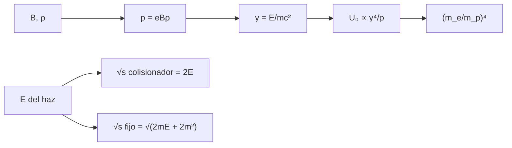

# B31-C15 — Física de aceleradores

<!-- nav:top -->
[🏠 Programa](../../../../README.md) · [📚 Bloque B31](../../../tronco-comun/B31-fisica-cuantica-nuclear-y-astroparticulas.md) · [← Anterior: B31-C14 — Detectores de partículas](../B31-C14-detectores-de-particulas/CLASE.md) · [Siguiente: B31-C16 — Astropartículas de alta energía →](../B31-C16-astroparticulas-de-alta-energia/CLASE.md)
<!-- /nav -->

## 1. Ubicación, nivel y alcance

Clase 15 del bloque B31. Nivel N3. Un acelerador circular dobla las partículas con un campo magnético y las repone con radiofrecuencia. Aquí calculas la **rigidez magnética** `p = eBρ`, las **pérdidas por sincrotrón** de electrones y protones, el **ciclotrón** relativista y la **energía en el centro de masas** de un colisionador frente a un blanco fijo. Usas [B05](../../../tronco-comun/B05-fisica-fundamental-para-el-espacio.md) y [B31-C12](../B31-C12-antimateria-y-aniquilacion/CLASE.md). Los parámetros del anillo son ilustrativos.

## 2. Por qué esta clase existe

El diseño de un acelerador depende de cuánta energía se pierde por radiación y de cuánta energía útil se obtiene. La decisión central: **¿qué campo y qué radio se necesitan y por qué los electrones pierden tanto?**

## 3. Lo que podrás hacer al terminar

1. Calcular `pc[GeV] = 0,299792458 B[T] ρ[m]`.
2. Calcular `U₀ = eβ³γ⁴/(3ε₀ρ)`.
3. Comparar protones y electrones.
4. Calcular la frecuencia del ciclotrón relativista.
5. Calcular `√s` de colisionador y blanco fijo.
6. Reconocer los límites.

La evidencia es la **ficha de un acelerador** del ejercicio 12 (sección 20).

## 4. Con qué llegas y cómo comprobarlo

1. ¿Qué es la fuerza de Lorentz?
2. ¿Qué es la radiación de sincrotrón?
3. ¿Qué es el factor de Lorentz?
4. ¿Qué es el centro de masas?
5. ¿Qué es un ciclotrón?

<details>
<summary>Ver respuestas</summary>

1. `q(E + v×B)`. 2. La emitida por cargas aceleradas en curva. 3. `γ = E/mc²`. 4. El sistema donde el momento total es cero. 5. Un acelerador de trayectoria espiral.
</details>

Con cuatro o cinco aciertos, sigue; si no, repasa los prerrequisitos.

## 5. Un caso de contexto y casos de referencia

Con `B = 8 T` y `ρ = 2800 m` (ilustrativos) el momento es `6,715 TeV/c`. Es el **ejemplo conductor**. Un electrón de 100 GeV en `ρ = 3000 m` pierde `2,949 GeV` por vuelta; un protón de la misma energía, `2,6 × 10⁻¹³ GeV`.

## 6. Vocabulario

La **rigidez magnética** `Bρ = p/e`. La **pérdida por vuelta** `U₀`. El **ciclotrón** gira a `f = eB/(2πγm)`. El **colisionador** enfrenta dos haces. El **blanco fijo** usa un haz sobre materia en reposo. El **centro de masas** `√s`.

## 7. Modelo mental: una honda

Como una honda: cuanto más rápido gira la piedra, más tensión necesita el cordón (el campo), y si la piedra es muy ligera pierde energía radiando.



*Descripción textual:* el campo y el radio fijan el momento; este fija `γ` y la pérdida por sincrotrón, que escala como la cuarta potencia de la masa inversa; la energía del haz da `√s` en las dos configuraciones.

Analogía: una honda. Límite: campo uniforme.

## 8. La explicación, paso a paso

### 8.1 Rigidez

`B = 8 T`, `ρ = 2800 m`: `pc = 6715,35 GeV = 6,7154 TeV`.

### 8.2 Pérdidas por sincrotrón

| partícula | `E` (GeV) | `γ` | `U₀` (GeV/vuelta) |
|---|---|---|---|
| electrón | 100 | 1,957 × 10⁵ | 2,949 |
| protón | 100 | 106,6 | 2,59 × 10⁻¹³ |
| protón | 6500 | 6928 | 4,96 × 10⁻⁶ |

El cociente protón/electrón es `8,7965 × 10⁻¹⁴`, frente a `(m_e/m_p)⁴ = 8,7976 × 10⁻¹⁴` (la diferencia es el factor `β³` del protón).

### 8.3 Ciclotrón y centro de masas

Un protón de 10 MeV en 1,5 T: `f = 22,868 MHz` no relativista y `22,627 MHz` relativista (reducción `1,055 %`). Con un haz de `6500 GeV`: colisionador `√s = 13 000 GeV`; blanco fijo `110,45 GeV`.

### 8.4 Lectura

Los electrones radian tanto que los anillos de electrones grandes necesitan reponer varios GeV por vuelta; los protones casi nada. El colisionador aprovecha toda la energía.

## 9. Magnitudes, símbolos y unidades

| Símbolo | Qué es | Unidad | Valor / nota |
|---|---|---|---|
| `B`, `ρ` | campo y radio | T; m | 8; 2800 (ilustrativos) |
| `p` | momento | GeV/c | `0,2998 Bρ` |
| `U₀` | pérdida por vuelta | GeV | ver 8.2 |
| `f` | frecuencia de ciclotrón | MHz | `eB/(2πγm)` |
| `√s` | energía en el centro de masas | GeV | ver 8.3 |

## 10. Convenciones y referencias

Campo uniforme, anillo isomagnético, sin radiofrecuencia; `B`, `ρ`, energías **ilustrativos**; `c`, `e`, `ε₀` y masas de NIST.

## 11. De dónde sale lo que afirmamos

| ID | Fuente | Localizador | Respalda | Estado |
|---|---|---|---|---|
| S1 | NIST, *Fundamental Physical Constants* (CODATA 2022) | https://physics.nist.gov/cuu/Constants/Table/allascii.txt | constantes y masas citadas en la sección 9 | Consultada el 2026-11-09 |

Límites: no se describe ninguna máquina real; los parámetros son ilustrativos.

## 12. Cómo ver las pérdidas

| Partícula | `U₀` (GeV) |
|---|---|
| electrón 100 GeV | 2,95 |
| protón 100 GeV | 2,6 × 10⁻¹³ |

Descripción larga: a igual energía, el electrón pierde 13 órdenes de magnitud más.

## 13. Ejemplo trabajado: momento a 8 T y 2800 m

**Paso 1 · Coeficiente.** `0,299792458`.

**Paso 2 · Producto.** `8 × 2800 = 22 400`.

**Paso 3 · Valor.** `0,299792458 × 22 400`.

**Paso 4 · Resultado.** `6715,35 GeV/c`.

## 14. Distintas formas de describir un acelerador

**Por momento:** `Bρ`. **Por pérdida:** `γ⁴/ρ`. **Por frecuencia:** ciclotrón. **Por energía útil:** `√s`.

## 15. Práctica guiada

**Ejercicio 1 · con los pasos indicados.** `pc` con `B = 5 T`, `ρ = 1000 m`. *Pasos:* ejemplo 13.

<details><summary>Solución comentada</summary>

`1498,96 GeV`.
</details>

**Ejercicio 2 · con una pista.** `γ` de un electrón de 100 GeV.

<details><summary>Solución comentada</summary>

`1,957 × 10⁵`.
</details>

**Ejercicio 3 · casi autónomo.** Cociente de pérdidas protón/electrón.

<details><summary>Solución comentada</summary>

`(m_e/m_p)⁴ = 8,8 × 10⁻¹⁴`.
</details>

## 16. Práctica autónoma, transferencia e integrador

**Ejercicio 4.** Reducción relativista de la frecuencia a 10 MeV.

<details><summary>Solución comentada</summary>

`1/γ → 1,055 %`.
</details>

**Ejercicio 5.** `√s` de un colisionador de 6500 GeV por haz.

<details><summary>Solución comentada</summary>

`13 000 GeV`.
</details>

**Ejercicio 6.** `√s` en blanco fijo con 6500 GeV.

<details><summary>Solución comentada</summary>

`110,45 GeV`.
</details>

**Ejercicio 7.** `U₀` si `ρ` se duplica.

<details><summary>Solución comentada</summary>

La mitad: `1,47 GeV`.
</details>

**Ejercicio 8.** `U₀` si `γ` se duplica.

<details><summary>Solución comentada</summary>

Se multiplica por 16.
</details>

**Ejercicio 9 · transferencia.** **Transferencia.** Un compañero identifica estos números con una máquina concreta. Responde.

<details><summary>Solución comentada</summary>

Son parámetros ilustrativos.
</details>

**Ejercicio 10 · transferencia.** **Transferencia.** ¿Por qué un colisionador de electrones es lineal?

<details><summary>Solución comentada</summary>

Para evitar las pérdidas por sincrotrón.
</details>

**Ejercicio 11 · transferencia.** **Transferencia.** ¿Qué omite el modelo?

<details><summary>Solución comentada</summary>

La radiofrecuencia, la focalización y la dinámica del haz.
</details>

**Ejercicio 12.** **Integrador.** Elabora tu *ficha de un acelerador*: rigidez, pérdidas, ciclotrón y `√s`.

<details><summary>Solución comentada</summary>

Secciones 8.1–8.4.
</details>

**Ejercicio 12 · integrador.** **Integrador.** Elabora tu *ficha de un acelerador*: rigidez, pérdidas, ciclotrón y `√s`.

<details><summary>Solución modelo</summary>

Secciones 8.1–8.4.
</details>

## 17. Laboratorio: rigidez, sincrotrón y centro de masas

El script [aceleradores.py](aceleradores.py) calcula el momento, las pérdidas y la energía en el centro de masas (**comprueba** el coeficiente a `10⁻¹²` y el cociente de pérdidas a `5 × 10⁻⁴`).

**Datos:** `c`, `e`, `ε₀`, masas de NIST; `B`, `ρ`, energías **ilustrativos**. **Predice antes de ejecutar:** ¿cuánto pierde un electrón de 100 GeV por vuelta? (≈3 GeV.) **Ejecución del 2026-11-09 (Python 3.12.9):**

```text
Python 3.12.9 (biblioteca estandar)
coeficiente p c = 0.299 792 458 B rho: c/1e9 = 0.299792458
B = 8.0 T, rho = 2800 m: p c = 6715.351 GeV = 6.7154 TeV
particula   E [GeV]        gamma   U_0 por vuelta [GeV]
electron      100.0   1.9570e+05             2.9488e+00
proton        100.0   1.0658e+02             2.5939e-13
proton       6500.0   6.9276e+03             4.9616e-06
cociente protones/electrones de igual energia y radio: 8.7965e-14 ; (m_e/m_p)^4 = 8.7976e-14
ciclotron de protones de 10.0 MeV en 1.5 T: f(no relativista) = 22.8678 MHz ; f(relativista) = 22.6266 MHz ; reduccion = 1.055 %
 E del haz [GeV]  colisionador sqrt(s) [GeV]   blanco fijo sqrt(s) [GeV]
          6500.0                     13000.0                      110.45
Pruebas superadas.
```

```bash
python programa/clases/B31/B31-C15-fisica-de-aceleradores/aceleradores.py
```

**Límites:** campo uniforme, anillo ideal.

## 18. Errores frecuentes y cómo corregirlos

**Olvidar el factor `γ⁴`.** Se corrige con el ejercicio 8.

**Confundir `E` y `T`.** Se corrige con 8.3.

**Tomar los parámetros por reales.** Se corrige con la sección 10.

**Usar `β = 1` para protones lentos.** Se corrige con la tolerancia.

## 19. Cómo sabrás que vas bien

Tras 8.1: ¿cuánto vale `pc`? Si dudas, ejemplo 13. Tras el laboratorio: ¿qué comprueba? (el cociente de pérdidas).

## 20. Qué entregas y cómo se evalúa

El producto es tu **ficha de un acelerador** (ejercicio 12).

| Criterio | Inicial | En desarrollo | Logrado | Destacado |
|---|---|---|---|---|
| Conceptos | Los confunde | Parciales | rigidez, sincrotrón, `√s` | Explica por qué los electrones pierden más |
| Cálculo | Sin unidades | Con errores | Tablas completas | Calcula casos nuevos |
| Numérico | Sin comprobar | Un caso | Cocientes comprobados | Interpreta `β³` |
| Fuentes | Sin fuente | Sin fecha | S1 con fecha | Declara los parámetros ilustrativos |
| Límites | No los nombra | Uno | Tres | Discute qué falta del modelo |

**Condiciones críticas (no se compensan con promedio):** rotular los parámetros como ilustrativos; no describir una máquina real; citar solo lo consultado.

## 21. Ética, seguridad y límites

Clase educativa. Accesibilidad: tablas equivalentes a las gráficas, fórmulas en texto, ejercicios sin conexión.

## 22. Para cerrar y seguir

Con 8 T y 2800 m el momento es 6,7 TeV/c; un electrón de 100 GeV pierde 2,9 GeV por vuelta y un protón nada; el colisionador da 13 TeV frente a 110 GeV en blanco fijo. Queda una pregunta: ¿cuál es el límite de energía de las fuentes cósmicas?

**Glosario español–inglés.** rigidez magnética · *magnetic rigidity*; radiación de sincrotrón · *synchrotron radiation*; colisionador · *collider*; blanco fijo · *fixed target*; ciclotrón · *cyclotron*.

**Continuidad.** [B31-C16](../B31-C16-astroparticulas-de-alta-energia/CLASE.md) estudia las astropartículas de alta energía.

**Referencias:** ver sección 11.

<!-- nav:bottom -->
---

[← Anterior: B31-C14 — Detectores de partículas](../B31-C14-detectores-de-particulas/CLASE.md) · [📚 Bloque B31](../../../tronco-comun/B31-fisica-cuantica-nuclear-y-astroparticulas.md) · [Siguiente: B31-C16 — Astropartículas de alta energía →](../B31-C16-astroparticulas-de-alta-energia/CLASE.md)
<!-- /nav -->
