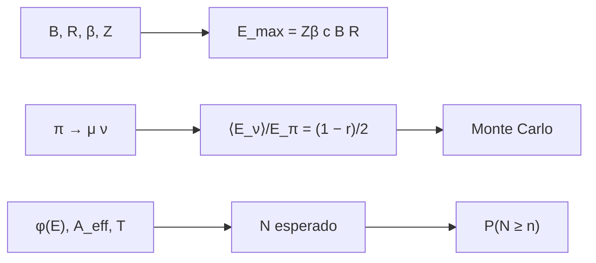

# B31-C16 — Astropartículas de alta energía

<!-- nav:top -->
[🏠 Programa](../../../../README.md) · [📚 Bloque B31](../../../tronco-comun/B31-fisica-cuantica-nuclear-y-astroparticulas.md) · [← Anterior: B31-C15 — Física de aceleradores](../B31-C15-fisica-de-aceleradores/CLASE.md) · [Siguiente: B31-C17 — Materias oscuras candidatas →](../B31-C17-materias-oscuras-candidatas/CLASE.md)
<!-- /nav -->

## 1. Ubicación, nivel y alcance

Clase 16 del bloque B31. Nivel N3. Las fuentes cósmicas aceleran partículas hasta energías enormes. Aquí aplicas el **criterio de Hillas** `E_max = Zβ c B R`, calculas la fracción de energía que lleva el neutrino en el decaimiento de un pion (analítica y por Monte Carlo) y estimas el **número de eventos** de un flujo de potencias con un área efectiva dada, con la probabilidad de observar al menos `n` eventos con fondo. Usas [B05](../../../tronco-comun/B05-fisica-fundamental-para-el-espacio.md), [B12](../../../tronco-comun/B12-probabilidad-estadistica-e-incertidumbre.md) y [B31-C13](../B31-C13-rayos-cosmicos-y-cascadas/CLASE.md). Todas las fuentes son ilustrativas.

## 2. Por qué esta clase existe

Para decir si una fuente puede producir rayos cósmicos de cierta energía y cuántos neutrinos habría, se necesitan estimaciones cuantitativas. La decisión central: **¿hasta qué energía acelera una fuente y cuántos eventos se esperan?**

## 3. Lo que podrás hacer al terminar

1. Calcular `E_max = Zβ c B R` en eV.
2. Comparar protón y hierro.
3. Calcular `E_ν* = (m_π² − m_μ²)/(2m_π)`.
4. Verificar `⟨E_ν⟩/E_π = (1 − m_μ²/m_π²)/2` por Monte Carlo.
5. Calcular `N = TΩA_eff∫φ dE`.
6. Calcular `P(N ≥ n)`.

La evidencia es la **ficha de una fuente de alta energía** del ejercicio 12 (sección 20).

## 4. Con qué llegas y cómo comprobarlo

1. ¿Qué es el radio de Larmor?
2. ¿Qué es un neutrino?
3. ¿Qué es un área efectiva?
4. ¿Qué es un flujo diferencial?
5. ¿Qué es una cola de Poisson?

<details>
<summary>Ver respuestas</summary>

1. El radio de giro (B30-C06). 2. Un lepton neutro de interacción débil. 3. La superficie equivalente de detección. 4. Partículas por energía, área, tiempo y ángulo sólido. 5. `P(N ≥ n)`.
</details>

Con cuatro o cinco aciertos, sigue; si no, repasa los prerrequisitos.

## 5. Un caso de contexto y casos de referencia

Una fuente ilustrativa con `B = 10⁻⁹ T`, `R = 10¹⁷ m` y `β = 0,01` alcanza `3,0 × 10¹⁴ eV` para protones. Es el **ejemplo conductor**. En el decaimiento `π⁺ → μ⁺ν_μ` el neutrino lleva en promedio `0,2135` de la energía del pion. Con un flujo y un área ilustrativos esperarías `19,6` eventos en 10 años.

## 6. Vocabulario

El **criterio de Hillas** limita la energía por el tamaño y el campo. La **energía del neutrino** en el decaimiento del pion. El **área efectiva** `A_eff`. El **flujo** `φ(E)`. El **fondo** `b`. Un **exceso** es la diferencia entre lo observado y `b`.

## 7. Modelo mental: un embudo

Una fuente funciona como un embudo: solo puede retener una partícula mientras su radio de giro cabe dentro; cuando ya no cabe, escapa con la energía máxima.



*Descripción textual:* el campo y el tamaño fijan la energía máxima; el decaimiento del pion da la fracción del neutrino; el flujo y el área dan el número de eventos y la probabilidad de un exceso.

Analogía: un embudo. Límite: aceleración ideal.

## 8. La explicación, paso a paso

### 8.1 Criterio de Hillas

| fuente (ilustrativa) | `B` (T) | `R` (m) | `β` | `E_max` protón (eV) | hierro (eV) |
|---|---|---|---|---|---|
| A: choque pequeño | 10⁻⁹ | 10¹⁷ | 0,01 | 3,0 × 10¹⁴ | 7,8 × 10¹⁵ |
| B: choque grande | 3 × 10⁻¹⁰ | 3 × 10¹⁹ | 0,05 | 1,35 × 10¹⁷ | 3,5 × 10¹⁸ |
| C: jet compacto | 10⁻⁵ | 10¹⁵ | 1,00 | 3,0 × 10¹⁸ | 7,8 × 10¹⁹ |

### 8.2 Neutrinos del pion

`E_ν* = 29,792 MeV`; con `m_π = 139,57 MeV` (ilustrativa) la fracción media es `0,21345`; el Monte Carlo (200 000 decaimientos, `γ = 1000`) da `0,21357` (cociente `1,00055`).

### 8.3 Eventos

Con `φ = 10⁻¹⁸ (E/100 TeV)⁻² GeV⁻¹cm⁻²s⁻¹sr⁻¹`, `A_eff = 10 m²`, 10 años y `2π sr`, entre 100 TeV y 10 PeV: `19,63` eventos (analítico y Simpson).

| `n` observados | `P(N ≥ n; b = 3)` | `P(N ≥ n; b + señal)` |
|---|---|---|
| 3 | 0,57681 | 1,00000 |
| 5 | 0,18474 | 1,00000 |
| 8 | 0,01190 | 0,99987 |
| 12 | 0,00007 | 0,99457 |

### 8.4 Lectura

Una fuente solo acelera hasta `E_max`, y el hierro llega 26 veces más lejos. Observar 12 eventos con un fondo de 3 es improbable (`7 × 10⁻⁵`) sin señal.

## 9. Magnitudes, símbolos y unidades

| Símbolo | Qué es | Unidad | Valor / nota |
|---|---|---|---|
| `E_max` | energía máxima | eV | `Zβ c B R` |
| `Z` | número atómico | — | 1 o 26 |
| `E_ν*` | energía del neutrino en reposo del pion | MeV | 29,792 |
| `A_eff` | área efectiva | cm² | 10⁵ (ilustrativa) |
| `N` | eventos esperados | — | 19,63 |

## 10. Convenciones y referencias

Aceleración ideal, área efectiva constante; `m_π`, los campos, el flujo y el fondo son **ilustrativos**; semilla `20261109`.

## 11. De dónde sale lo que afirmamos

| ID | Fuente | Localizador | Respalda | Estado |
|---|---|---|---|---|
| S1 | NIST, *Fundamental Physical Constants* (CODATA 2022) | https://physics.nist.gov/cuu/Constants/Table/allascii.txt | constantes y masas citadas en la sección 9 | Consultada el 2026-11-09 |

Límites: no se consultó ningún flujo ni detector; la masa del pion no se consultó.

## 12. Cómo ver el número de eventos

| Magnitud | Valor |
|---|---|
| `N` esperado | 19,63 |
| `P(N ≥ 12; b = 3)` | 7 × 10⁻⁵ |
| `P(N ≥ 12; b + señal)` | 0,995 |

Descripción larga: con la señal esperada, observar 12 eventos es casi seguro; sin ella es muy improbable.

## 13. Ejemplo trabajado: energía máxima de la fuente A

**Paso 1 · Producto.** `B R = 10⁻⁹ × 10¹⁷ = 10⁸ T m`.

**Paso 2 · Velocidad.** `β c = 0,01 × 3 × 10⁸ = 3 × 10⁶ m/s`.

**Paso 3 · Producto.** `E_max = 3 × 10¹⁴ V`.

**Paso 4 · Energía.** `3,0 × 10¹⁴ eV` (protón).

## 14. Distintas formas de describir una fuente

**Por tamaño:** Hillas. **Por mensajero:** neutrinos del pion. **Por flujo:** eventos esperados. **Por azar:** Poisson.

## 15. Práctica guiada

**Ejercicio 1 · con los pasos indicados.** `E_max` de la fuente A para hierro. *Pasos:* ×26.

<details><summary>Solución comentada</summary>

`7,8 × 10¹⁵ eV`.
</details>

**Ejercicio 2 · con una pista.** `E_max` de la fuente C para protón.

<details><summary>Solución comentada</summary>

`3,0 × 10¹⁸ eV`.
</details>

**Ejercicio 3 · casi autónomo.** Fracción media del neutrino.

<details><summary>Solución comentada</summary>

`(1 − 0,5732)/2 = 0,2135`.
</details>

## 16. Práctica autónoma, transferencia e integrador

**Ejercicio 4.** `E_ν*` del pion en reposo.

<details><summary>Solución comentada</summary>

`29,79 MeV`.
</details>

**Ejercicio 5.** Eventos si el área se duplica.

<details><summary>Solución comentada</summary>

`39,26`.
</details>

**Ejercicio 6.** Eventos con 5 años.

<details><summary>Solución comentada</summary>

`9,81`.
</details>

**Ejercicio 7.** `P(N ≥ 5; b = 3)`.

<details><summary>Solución comentada</summary>

`0,185`.
</details>

**Ejercicio 8.** ¿Cuánto vale `E_max` si `R` se duplica?

<details><summary>Solución comentada</summary>

Se duplica.
</details>

**Ejercicio 9 · transferencia.** **Transferencia.** Un compañero identifica la fuente C con un objeto real. Responde.

<details><summary>Solución comentada</summary>

Es ilustrativa.
</details>

**Ejercicio 10 · transferencia.** **Transferencia.** ¿Qué supone el flujo `E⁻²`?

<details><summary>Solución comentada</summary>

Igual energía por década.
</details>

**Ejercicio 11 · transferencia.** **Transferencia.** ¿Es `m_π` un valor consultado?

<details><summary>Solución comentada</summary>

No: es ilustrativo.
</details>

**Ejercicio 12.** **Integrador.** Elabora tu *ficha de una fuente de alta energía*: Hillas, neutrinos y eventos.

<details><summary>Solución comentada</summary>

Secciones 8.1–8.4.
</details>

**Ejercicio 12 · integrador.** **Integrador.** Elabora tu *ficha de una fuente de alta energía*: Hillas, neutrinos y eventos.

<details><summary>Solución modelo</summary>

Secciones 8.1–8.4.
</details>

## 17. Laboratorio: Hillas, pion y eventos esperados

El script [fuentes.py](fuentes.py) calcula `E_max`, verifica la fracción del pion por Monte Carlo e integra el número de eventos (**comprueba** 0,5 % y `10⁻⁶`).

**Datos:** `c`, `e`, masa del muón de NIST; el resto **ilustrativo**; semilla `20261109`. **Predice antes de ejecutar:** ¿cuántos eventos se esperan? (≈20.) **Ejecución del 2026-11-09 (Python 3.12.9):**

```text
Python 3.12.9 (biblioteca estandar)
fuente (ilustrativa)       B [T]     R [m]   beta  E_max proton [eV]   E_max hierro (Z = 26) [eV]
A: choque pequeno        1.0e-09   1.0e+17   0.01          2.998e+14                    7.795e+15
B: choque grande         3.0e-10   3.0e+19   0.05          1.349e+17                    3.508e+18
C: jet compacto          1.0e-05   1.0e+15   1.00          2.998e+18                    7.795e+19
decaimiento pi+ -> mu+ nu en reposo: E_nu* = 29.792 MeV ; fraccion media lab <E_nu>/E_pi = (1 - m_mu^2/m_pi^2)/2 = 0.2135
Monte Carlo (200000 decaimientos, gamma = 1000): <E_nu>/E_pi = 0.21357 ; analitica = 0.21345 ; cociente = 1.00055
eventos esperados entre 100 TeV y 10 PeV (A_eff = 1e5 cm^2 = 10 m^2, 10 anios, 2 pi sr): analitico = 19.6299 ; Simpson en ln E = 19.6299
n observados   P(N >= n | fondo = 3)   P(N >= n | fondo + senal)
           3                 0.57681                     1.00000
           5                 0.18474                     1.00000
           8                 0.01190                     0.99987
          12                 0.00007                     0.99457
Pruebas superadas.
```

```bash
python programa/clases/B31/B31-C16-astroparticulas-de-alta-energia/fuentes.py
```

**Límites:** aceleración ideal, `A_eff` constante.

## 18. Errores frecuentes y cómo corregirlos

**Olvidar `Z`.** Se corrige con el ejercicio 1.

**Confundir cm² y m².** Se corrige con la sección 9.

**Tomar el flujo por medido.** Se corrige con la sección 10.

**Ignorar el fondo.** Se corrige con 8.3.

## 19. Cómo sabrás que vas bien

Tras 8.1: ¿qué fuente llega más lejos? Si dudas, ejemplo 13. Tras el laboratorio: ¿qué comprueba? (Monte Carlo y Simpson).

## 20. Qué entregas y cómo se evalúa

El producto es tu **ficha de una fuente de alta energía** (ejercicio 12).

| Criterio | Inicial | En desarrollo | Logrado | Destacado |
|---|---|---|---|---|
| Conceptos | Los confunde | Parciales | Hillas, pion, eventos | Explica el papel de `Z` |
| Cálculo | Sin unidades | Con errores | Tablas completas | Calcula casos nuevos |
| Numérico | Sin comprobar | Un caso | MC y Simpson | Interpreta Poisson |
| Fuentes | Sin fuente | Sin fecha | S1 con fecha | Declara lo ilustrativo |
| Límites | No los nombra | Uno | Tres | Discute qué falta del modelo |

**Condiciones críticas (no se compensan con promedio):** rotular las fuentes y el flujo como ilustrativos; no atribuirlos a objetos reales; citar solo lo consultado.

## 21. Ética, seguridad y límites

Clase educativa. Accesibilidad: tablas equivalentes a las gráficas, fórmulas en texto, ejercicios sin conexión.

## 22. Para cerrar y seguir

Una fuente ilustrativa llega a 3 × 10¹⁴ eV, el neutrino se lleva 21 % del pion y 20 eventos esperados hacen improbable un fondo de 3. Queda una pregunta: ¿qué es la materia oscura?

**Glosario español–inglés.** criterio de Hillas · *Hillas criterion*; neutrino astrofísico · *astrophysical neutrino*; área efectiva · *effective area*; exceso · *excess*; fondo · *background*.

**Continuidad.** [B31-C17](../B31-C17-materias-oscuras-candidatas/CLASE.md) estudia los candidatos a materia oscura.

**Referencias:** ver sección 11.

<!-- nav:bottom -->
---

[← Anterior: B31-C15 — Física de aceleradores](../B31-C15-fisica-de-aceleradores/CLASE.md) · [📚 Bloque B31](../../../tronco-comun/B31-fisica-cuantica-nuclear-y-astroparticulas.md) · [Siguiente: B31-C17 — Materias oscuras candidatas →](../B31-C17-materias-oscuras-candidatas/CLASE.md)
<!-- /nav -->
