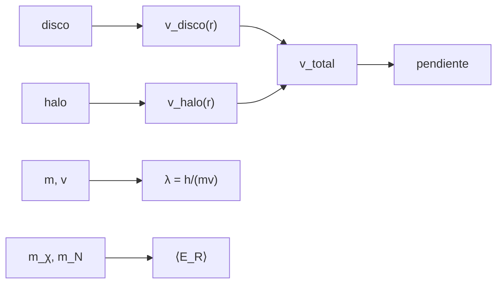

# B31-C17 — Materias oscuras candidatas

<!-- nav:top -->
[🏠 Programa](../../../../README.md) · [📚 Bloque B31](../../../tronco-comun/B31-fisica-cuantica-nuclear-y-astroparticulas.md) · [← Anterior: B31-C16 — Astropartículas de alta energía](../B31-C16-astroparticulas-de-alta-energia/CLASE.md) · [Siguiente: B31-C18 — Restricciones experimentales de teorías →](../B31-C18-restricciones-experimentales-de-teorias/CLASE.md)
<!-- /nav -->

## 1. Ubicación, nivel y alcance

Clase 17 del bloque B31. Nivel N3. La materia oscura se infiere de las curvas de rotación y se busca con candidatos muy distintos. Aquí comparas la **curva de rotación** de un disco con y sin un halo isotermo, calculas la **longitud de onda de de Broglie** de una partícula ultraligera y estimas la **energía de retroceso** de un núcleo en un detector por Monte Carlo. Usas [B05](../../../tronco-comun/B05-fisica-fundamental-para-el-espacio.md), [B31-C01](../B31-C01-dualidad-onda-particula/CLASE.md) y [B12](../../../tronco-comun/B12-probabilidad-estadistica-e-incertidumbre.md). Se suponen modelos ilustrativos.

## 2. Por qué esta clase existe

Una curva plana sin halo es inexplicable con la materia visible; cada candidato predice una escala distinta. La decisión central: **¿qué distingue la curva de rotación con halo y qué escalas predicen los candidatos?**

## 3. Lo que podrás hacer al terminar

1. Calcular `v²= GM(<r)/r` para un disco exponencial.
2. Añadir un halo isotermo.
3. Medir la pendiente kepleriana.
4. Calcular `λ = h/(mv)`.
5. Calcular `⟨E_R⟩ = μ²⟨v²⟩/m_N`.
6. Verificar con Monte Carlo.

La evidencia es la **ficha de un candidato a materia oscura** del ejercicio 12 (sección 20).

## 4. Con qué llegas y cómo comprobarlo

1. ¿Qué es una curva de rotación?
2. ¿Qué es un halo?
3. ¿Qué es una masa reducida?
4. ¿Qué es una distribución maxwelliana?
5. ¿Qué es un retroceso nuclear?

<details>
<summary>Ver respuestas</summary>

1. `v(r)` de las estrellas. 2. Una distribución extensa de masa. 3. `μ = m₁m₂/(m₁+m₂)`. 4. La de velocidades gaussianas. 5. El movimiento del núcleo tras una colisión.
</details>

Con cuatro o cinco aciertos, sigue; si no, repasa los prerrequisitos.

## 5. Un caso de contexto y casos de referencia

Con un disco de `5 × 10¹⁰ M_☉` y `R_d = 3 kpc` (ilustrativos), la velocidad cae a `51,9 km/s` a 80 kpc (pendiente `−0,500`); con el halo queda en `197,3 km/s` (pendiente `+0,014`). Es el **ejemplo conductor**. Una partícula de `10⁻²² eV` a 200 km/s tiene `λ = 0,602 kpc`.

## 6. Vocabulario

La **curva de rotación**. El **halo isotermo**. La **pendiente kepleriana** `−1/2`. La **longitud de de Broglie**. La **energía de retroceso** `E_R`. Un **candidato** es una hipótesis para la naturaleza de la materia oscura.

## 7. Modelo mental: una tapadera de ollas

Una curva plana donde esperarías caída es como una olla que sigue hirviendo con la llama apagada: algo invisible aporta.



*Descripción textual:* el disco y el halo dan la curva total y su pendiente; la masa y la velocidad dan la longitud de onda; las masas y la velocidad dan la energía de retroceso.

Analogía: una olla que sigue hirviendo. Límite: modelos esféricos.

## 8. La explicación, paso a paso

### 8.1 Curvas de rotación

| `r` (kpc) | disco (km/s) | disco + halo (km/s) |
|---|---|---|
| 2 | 124,56 | 132,16 |
| 5 | 146,11 | 173,01 |
| 10 | 134,83 | 189,83 |
| 20 | 103,19 | 193,36 |
| 40 | 73,32 | 195,30 |
| 80 | 51,85 | 197,27 |

Pendiente logarítmica entre 40 y 80 kpc: disco `−0,500` (kepleriana) y con halo `+0,014`.

### 8.2 Longitud de onda

`λ = hc/(mc²)/(v/c) = 1,8585 × 10¹⁹ m = 0,602 kpc` para `m = 10⁻²² eV` y 200 km/s.

### 8.3 Retroceso

`m_χ = 100 GeV`, blanco `A = 131` (`m_N = 122,03 GeV`, `μ = 54,96 GeV`), `v₀ = 220 km/s`: `⟨E_R⟩` analítico `19,996 keV` y Monte Carlo `19,987 keV` (cociente `0,9996`).

### 8.4 Lectura

Sin halo la velocidad cae como `r^(−1/2)`; con halo se aplana. Las masas de los candidatos van de 10⁻²² eV (escala de kpc) a 100 GeV (retrocesos de keV).

## 9. Magnitudes, símbolos y unidades

| Símbolo | Qué es | Unidad | Valor / nota |
|---|---|---|---|
| `G` | constante gravitatoria | SI | S1 |
| `M_☉` | masa solar | kg | `GM_☉/G = 1,9884 × 10³⁰` |
| `v` | velocidad circular | km/s | ver 8.1 |
| `λ` | longitud de onda | kpc | 0,602 |
| `E_R` | energía de retroceso | keV | 20,0 |

## 10. Convenciones y referencias

Aproximación esférica, halo isotermo, retroceso elástico no relativista; todos los parámetros de la galaxia y del candidato son **ilustrativos**; semilla `20261109`.

## 11. De dónde sale lo que afirmamos

| ID | Fuente | Localizador | Respalda | Estado |
|---|---|---|---|---|
| S1 | NIST, *Fundamental Physical Constants* (CODATA 2022) | https://physics.nist.gov/cuu/Constants/Table/allascii.txt | constantes y masas citadas en la sección 9 | Consultada el 2026-11-09 |
| S2 | UAI, Resolución B3 de 2015 | https://arxiv.org/abs/1510.07674 | `GM_☉` nominal | Consultada el 2026-11-09 |

Límites: no se consultó ninguna curva de rotación ni límite de detección directa; los candidatos y sus masas son ilustrativos.

## 12. Cómo ver la curva

| `r` (kpc) | disco (km/s) | con halo (km/s) |
|---|---|---|
| 10 | 134,8 | 189,8 |
| 40 | 73,3 | 195,3 |
| 80 | 51,9 | 197,3 |

Descripción larga: el disco solo decae; con halo la curva se aplana cerca de 200 km/s.

## 13. Ejemplo trabajado: longitud de onda del candidato ultraligero

**Paso 1 · `hc`.** `1,2398 × 10⁻⁶ eV m`.

**Paso 2 · Cociente.** `1,2398 × 10⁻⁶/10⁻²² eV = 1,2398 × 10¹⁶ m`.

**Paso 3 · Velocidad.** `v/c = 6,67 × 10⁻⁴`.

**Paso 4 · `λ`.** `1,86 × 10¹⁹ m = 0,60 kpc`.

## 14. Distintas formas de describir la materia oscura

**Por dinámica:** curva de rotación. **Por onda:** de Broglie. **Por colisión:** retroceso. **Por escala:** del eV a los GeV.

## 15. Práctica guiada

**Ejercicio 1 · con los pasos indicados.** Pendiente kepleriana. *Pasos:* `v ∝ r^(−1/2)`.

<details><summary>Solución comentada</summary>

`−0,5`.
</details>

**Ejercicio 2 · con una pista.** `v` del disco a 40 kpc.

<details><summary>Solución comentada</summary>

`73,3 km/s`.
</details>

**Ejercicio 3 · casi autónomo.** `v` total a 40 kpc.

<details><summary>Solución comentada</summary>

`195,3 km/s`.
</details>

## 16. Práctica autónoma, transferencia e integrador

**Ejercicio 4.** `λ` si la masa fuera `10⁻²¹ eV`.

<details><summary>Solución comentada</summary>

`0,060 kpc`.
</details>

**Ejercicio 5.** `μ` para 100 GeV y 122 GeV.

<details><summary>Solución comentada</summary>

`54,96 GeV`.
</details>

**Ejercicio 6.** `⟨E_R⟩` si `v₀` aumenta a 440 km/s.

<details><summary>Solución comentada</summary>

Cuatro veces: `80 keV`.
</details>

**Ejercicio 7.** `⟨v²⟩` para `v₀ = 220 km/s`.

<details><summary>Solución comentada</summary>

`1,5 v₀² = 7,26 × 10¹⁰ m²/s²`.
</details>

**Ejercicio 8.** Fracción de masa visible que explicaría 200 km/s a 80 kpc.

<details><summary>Solución comentada</summary>

No es posible con el disco: `51,9 km/s`.
</details>

**Ejercicio 9 · transferencia.** **Transferencia.** Un compañero identifica el halo con una galaxia real. Responde.

<details><summary>Solución comentada</summary>

Es ilustrativo.
</details>

**Ejercicio 10 · transferencia.** **Transferencia.** ¿Es la materia oscura una partícula?

<details><summary>Solución comentada</summary>

La clase no lo afirma: compara hipótesis.
</details>

**Ejercicio 11 · transferencia.** **Transferencia.** ¿Por qué el Monte Carlo coincide con el analítico?

<details><summary>Solución comentada</summary>

Porque verifica la implementación del promedio.
</details>

**Ejercicio 12.** **Integrador.** Elabora tu *ficha de un candidato a materia oscura*: curva, longitud de onda y retroceso.

<details><summary>Solución comentada</summary>

Secciones 8.1–8.4.
</details>

**Ejercicio 12 · integrador.** **Integrador.** Elabora tu *ficha de un candidato a materia oscura*: curva, longitud de onda y retroceso.

<details><summary>Solución modelo</summary>

Secciones 8.1–8.4.
</details>

## 17. Laboratorio: curva de rotación, de Broglie y retroceso

El script [candidatos.py](candidatos.py) calcula las curvas con y sin halo, la longitud de onda y el retroceso (**comprueba** la pendiente `−0,5 ± 0,05` y el retroceso al 1 %).

**Datos:** `G`, `h`, `c`, `e` de NIST y `GM_☉`, 1 pc de la UAI/IERS; la galaxia y el candidato **ilustrativos**; semilla `20261109`. **Predice antes de ejecutar:** ¿qué pendiente tiene el disco a gran radio? (−0,5.) **Ejecución del 2026-11-09 (Python 3.12.9):**

```text
Python 3.12.9 (biblioteca estandar)
M_sol = GM/G = 1.9884e+30 kg ; 1 kpc = 3.085678e+19 m
 r [kpc]  v disco [km/s]  v disco + halo [km/s]
       2          124.56                 132.16
       5          146.11                 173.01
      10          134.83                 189.83
      20          103.19                 193.36
      40           73.32                 195.30
      80           51.85                 197.27
pendiente logaritmica entre 40 y 80 kpc: solo disco = -0.500 (kepleriano -0.5) ; con halo = 0.014
longitud de onda de de Broglie de una particula de 1e-22 eV a 200 km/s: 1.8585e+19 m = 0.602 kpc
WIMP de 100 GeV sobre un blanco A = 131 (m_N = 122.03 GeV, mu = 54.96 GeV): <E_R> analitico = 19.996 keV ; Monte Carlo = 19.987 keV ; cociente = 0.9996
Pruebas superadas.
```

```bash
python programa/clases/B31/B31-C17-materias-oscuras-candidatas/candidatos.py
```

**Límites:** esfericidad, retroceso no relativista.

## 18. Errores frecuentes y cómo corregirlos

**Confundir masa encerrada y total.** Se corrige con la sección 6.

**Mezclar unidades kpc y m.** Se corrige con la sección 9.

**Tomar los candidatos por reales.** Se corrige con la sección 10.

**Usar `v₀` en vez de `⟨v²⟩`.** Se corrige con el ejercicio 7.

## 19. Cómo sabrás que vas bien

Tras 8.1: ¿qué pasa sin halo? Si dudas, ejemplo 13. Tras el laboratorio: ¿qué comprueba? (el retroceso medio).

## 20. Qué entregas y cómo se evalúa

El producto es tu **ficha de un candidato a materia oscura** (ejercicio 12).

| Criterio | Inicial | En desarrollo | Logrado | Destacado |
|---|---|---|---|---|
| Conceptos | Los confunde | Parciales | curva, de Broglie, retroceso | Explica la pendiente |
| Cálculo | Sin unidades | Con errores | Tablas completas | Calcula escalas nuevas |
| Numérico | Sin comprobar | Un caso | Monte Carlo y analítico | Interpreta los cocientes |
| Fuentes | Sin fuente | Sin fecha | S1 y S2 con fecha | Declara lo ilustrativo |
| Límites | No los nombra | Uno | Tres | Discute qué falta del modelo |

**Condiciones críticas (no se compensan con promedio):** rotular la galaxia y los candidatos como ilustrativos; no afirmar la naturaleza de la materia oscura; citar solo lo consultado.

## 21. Ética, seguridad y límites

Clase educativa. Accesibilidad: tablas equivalentes a las gráficas, fórmulas en texto, ejercicios sin conexión.

## 22. Para cerrar y seguir

Sin halo la curva cae a 52 km/s a 80 kpc; con halo queda en 197; los candidatos van de 0,6 kpc de longitud de onda a retrocesos de 20 keV. Queda una pregunta: ¿cómo se acota una teoría con datos?

**Glosario español–inglés.** materia oscura · *dark matter*; curva de rotación · *rotation curve*; halo · *halo*; retroceso nuclear · *nuclear recoil*; candidato · *candidate*.

**Continuidad.** [B31-C18](../B31-C18-restricciones-experimentales-de-teorias/CLASE.md) estudia las restricciones experimentales a las teorías.

**Referencias:** ver sección 11.

<!-- nav:bottom -->
---

[← Anterior: B31-C16 — Astropartículas de alta energía](../B31-C16-astroparticulas-de-alta-energia/CLASE.md) · [📚 Bloque B31](../../../tronco-comun/B31-fisica-cuantica-nuclear-y-astroparticulas.md) · [Siguiente: B31-C18 — Restricciones experimentales de teorías →](../B31-C18-restricciones-experimentales-de-teorias/CLASE.md)
<!-- /nav -->
