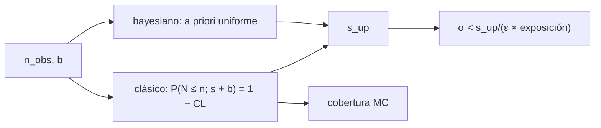

# B31-C18 — Restricciones experimentales de teorías

<!-- nav:top -->
[🏠 Programa](../../../../README.md) · [📚 Bloque B31](../../../tronco-comun/B31-fisica-cuantica-nuclear-y-astroparticulas.md) · [← Anterior: B31-C17 — Materias oscuras candidatas](../B31-C17-materias-oscuras-candidatas/CLASE.md) · [Siguiente: B31-C19 — Vacío cuántico y límites conceptuales →](../B31-C19-vacio-cuantico-y-limites-conceptuales/CLASE.md)
<!-- /nav -->

## 1. Ubicación, nivel y alcance

Clase 18 del bloque B31. Nivel N3. Cuando un experimento no ve una señal, acota la teoría. Aquí calculas **límites superiores de Poisson** con fondo por el método clásico (frecuentista) y por el bayesiano con a priori uniforme, conviertes el límite en una cota de sección eficaz y compruebas su **cobertura** por Monte Carlo. Usas [B12](../../../tronco-comun/B12-probabilidad-estadistica-e-incertidumbre.md) y [B31-C17](../B31-C17-materias-oscuras-candidatas/CLASE.md). Se suponen fondo conocido y sin incertidumbres sistemáticas.

## 2. Por qué esta clase existe

Un límite mal calculado puede excluir una teoría que no estaba excluida. La decisión central: **¿qué señal máxima es compatible con lo observado y cuán fiable es el método?**

## 3. Lo que podrás hacer al terminar

1. Resolver `P(N ≤ n_obs; s + b) = 1 − CL` por biseccion.
2. Calcular el límite bayesiano por integración.
3. Verificar el caso analítico `−ln(1 − CL)`.
4. Convertir a una cota de sección eficaz.
5. Medir la cobertura por Monte Carlo.
6. Reconocer el comportamiento con fondo.

La evidencia es la **ficha de un límite experimental** del ejercicio 12 (sección 20).

## 4. Con qué llegas y cómo comprobarlo

1. ¿Qué es una distribución de Poisson?
2. ¿Qué es un nivel de confianza?
3. ¿Qué es un a priori?
4. ¿Qué es la cobertura?
5. ¿Qué es una sección eficaz?

<details>
<summary>Ver respuestas</summary>

1. La de conteos de eventos independientes. 2. La probabilidad nominal de un intervalo. 3. La creencia previa. 4. La fracción de veces que el intervalo contiene el valor verdadero. 5. La probabilidad de una interacción.
</details>

Con cuatro o cinco aciertos, sigue; si no, repasa los prerrequisitos.

## 5. Un caso de contexto y casos de referencia

Con 0 eventos y fondo 0, el límite al 90 % es `−ln 0,1 = 2,3026` eventos por los dos métodos. Es el **ejemplo conductor**. Con 3 eventos observados y fondo 1,2 el límite clásico es `5,4808` y el bayesiano `5,5358`. El fondo y la exposición son **ilustrativos**.

## 6. Vocabulario

Un **límite superior** `s_up`. El **método clásico** y el **bayesiano**. El **fondo** `b`. La **cobertura** es la fracción de límites que superan el valor verdadero. La **cota de sección eficaz** `σ < s_up/(εΦ)`.

## 7. Modelo mental: una red de pesca

Si no se pesca nada, no se concluye que no hay peces, sino que no puede haber muchos con esa red; la red y el agua turbia (fondo) determinan cuántos.



*Descripción textual:* las observaciones y el fondo dan el límite por cada método; el límite se convierte en cota de sección eficaz y la cobertura se verifica por Monte Carlo.

Analogía: una red de pesca. Límite: sin sistemáticos.

## 8. La explicación, paso a paso

### 8.1 Límites al 90 %

| `n_obs` | `b` | clásico | bayesiano |
|---|---|---|---|
| 0 | 0 | 2,3026 | 2,3026 |
| 0 | 1,2 | 1,1026 | 2,3026 |
| 3 | 1,2 | 5,4808 | 5,5358 |
| 1 | 1,2 | 2,6897 | 3,2006 |
| 8 | 1,2 | 11,7947 | 11,7947 |

Con 0 eventos y fondo 1,2, el método clásico da un límite menor (1,10) que sin fondo (2,30): el efecto se conoce como el problema del fondo, y el bayesiano con a priori uniforme no cambia (2,30).

### 8.2 Cota de sección eficaz

Con `n_obs = 3`, `b = 1,2`, eficiencia 0,5 y exposición 1000 (unidades arbitrarias): `σ < 5,481/(0,5 × 1000) = 1,096 × 10⁻²` por unidad de exposición.

### 8.3 Cobertura

Para `s = 2`, `b = 1,2` y 20 000 experimentos, el límite clásico cubre el valor verdadero en el `96,21 %` de los casos (nominal 90 %; error estándar `0,21 %`): es conservador por la discretización de Poisson.

### 8.4 Lectura

El límite depende del método; con fondo y pocos eventos puede ser engañoso. La cobertura clásica garantiza al menos el 90 %.

## 9. Magnitudes, símbolos y unidades

| Símbolo | Qué es | Unidad | Valor / nota |
|---|---|---|---|
| `n_obs` | eventos observados | — | 0, 1, 3, 8 |
| `b` | fondo esperado | — | 1,2 (ilustrativo) |
| `s_up` | límite superior | eventos | ver 8.1 |
| CL | nivel de confianza | — | 0,90 |
| `σ` | sección eficaz | unidades de exposición⁻¹ | ver 8.2 |

## 10. Convenciones y referencias

Fondo conocido, conteo de Poisson, sin sistemáticos; los valores numéricos son **ilustrativos**; semilla `20261109`.

## 11. De dónde sale lo que afirmamos

| ID | Fuente | Localizador | Respalda | Estado |
|---|---|---|---|---|
| — | Sin fuente externa | — | relaciones estándar que verifica el laboratorio | No se consultó una fuente para esta clase |

Límites: no se consultó ningún artículo sobre límites; los métodos son estándar y los verifica el laboratorio.

## 12. Cómo ver los límites

| Caso | clásico | bayesiano |
|---|---|---|
| 0 eventos, b = 0 | 2,303 | 2,303 |
| 0 eventos, b = 1,2 | 1,103 | 2,303 |
| 3 eventos, b = 1,2 | 5,481 | 5,536 |

Descripción larga: con fondo y 0 eventos los dos métodos discrepan; con 3 o más eventos se parecen.

## 13. Ejemplo trabajado: límite con 0 eventos y sin fondo

**Paso 1 · Condición.** `P(N = 0; s) = e^(−s) = 1 − 0,90`.

**Paso 2 · Logaritmo.** `s = −ln 0,1`.

**Paso 3 · Valor.** `2,3026`.

**Paso 4 · Lectura.** Con probabilidad del 90 % la señal media es menor que 2,3 eventos.

## 14. Distintas formas de describir un límite

**Por método:** clásico o bayesiano. **Por fondo:** efecto sobre el límite. **Por conversión:** sección eficaz. **Por cobertura:** Monte Carlo.

## 15. Práctica guiada

**Ejercicio 1 · con los pasos indicados.** Límite con 0 eventos y sin fondo. *Pasos:* ejemplo 13.

<details><summary>Solución comentada</summary>

`2,3026`.
</details>

**Ejercicio 2 · con una pista.** Límite al 95 % con 0 eventos y sin fondo.

<details><summary>Solución comentada</summary>

`−ln 0,05 = 2,996`.
</details>

**Ejercicio 3 · casi autónomo.** Límite clásico con 3 eventos y fondo 1,2.

<details><summary>Solución comentada</summary>

`5,481`.
</details>

## 16. Práctica autónoma, transferencia e integrador

**Ejercicio 4.** Cota de `σ` si la exposición se duplica.

<details><summary>Solución comentada</summary>

La mitad: `5,48 × 10⁻³`.
</details>

**Ejercicio 5.** Diferencia entre bayesiano y clásico con `n = 1`.

<details><summary>Solución comentada</summary>

`3,2006 − 2,6897 = 0,511`.
</details>

**Ejercicio 6.** ¿Qué cobertura se espera como mínimo?

<details><summary>Solución comentada</summary>

`0,90`.
</details>

**Ejercicio 7.** ¿Por qué la cobertura fue 0,962?

<details><summary>Solución comentada</summary>

Por la discretización de los conteos.
</details>

**Ejercicio 8.** Señal media esperada si el límite es 5,48 y la eficiencia 0,5.

<details><summary>Solución comentada</summary>

El flujo equivalente es el doble: `10,96` eventos antes de la eficiencia.
</details>

**Ejercicio 9 · transferencia.** **Transferencia.** Un compañero afirma que el límite de 1,10 es más potente. Responde.

<details><summary>Solución comentada</summary>

Es un artefacto del fondo; el bayesiano con a priori uniforme da 2,30.
</details>

**Ejercicio 10 · transferencia.** **Transferencia.** ¿Qué omite el modelo?

<details><summary>Solución comentada</summary>

Incertidumbres sistemáticas del fondo y de la eficiencia.
</details>

**Ejercicio 11 · transferencia.** **Transferencia.** ¿Valida la cobertura el modelo físico?

<details><summary>Solución comentada</summary>

No: valida el método estadístico.
</details>

**Ejercicio 12.** **Integrador.** Elabora tu *ficha de un límite experimental*: tabla de límites, conversión y cobertura.

<details><summary>Solución comentada</summary>

Secciones 8.1–8.4.
</details>

**Ejercicio 12 · integrador.** **Integrador.** Elabora tu *ficha de un límite experimental*: tabla de límites, conversión y cobertura.

<details><summary>Solución modelo</summary>

Secciones 8.1–8.4.
</details>

## 17. Laboratorio: límites de Poisson y cobertura

El script [limites.py](limites.py) calcula límites clásico y bayesiano y mide la cobertura (**comprueba** `10⁻⁹` clásico, `10⁻³` bayesiano y cobertura ≥ 0,90).

**Datos:** sin constantes; fondo, exposición y eficiencia **ilustrativos**; semilla `20261109`. **Predice antes de ejecutar:** ¿cuánto vale el límite con 0 eventos? (2,30.) **Ejecución del 2026-11-09 (Python 3.12.9):**

```text
Python 3.12.9 (biblioteca estandar)
 n_obs  fondo b  limite clasico (90 %)  limite bayesiano (90 %)
     0      0.0                 2.3026                   2.3026
     0      1.2                 1.1026                   2.3026
     3      1.2                 5.4808                   5.5358
     1      1.2                 2.6897                   3.2006
     8      1.2                11.7947                  11.7947
caso analitico n = 0, b = 0: -ln 0.1 = 2.302585
con n_obs = 3 y b = 1.2: s_up = 5.481 sucesos -> sigma < 1.0962e-02 por kg dia (unidades arbitrarias de la exposicion)
cobertura del limite clasico con s = 2.0 y b = 1.2 en 20000 experimentos: 0.9621 (nominal 0.90, error estandar 0.0021)
Pruebas superadas.
```

```bash
python programa/clases/B31/B31-C18-restricciones-experimentales-de-teorias/limites.py
```

**Límites:** sin sistemáticos.

## 18. Errores frecuentes y cómo corregirlos

**Confundir `s` y `s + b`.** Se corrige con 8.1.

**Interpretar el límite como una medida.** Se corrige con el ejemplo 13.

**Olvidar la cobertura.** Se corrige con 8.3.

**Tomar los números por reales.** Se corrige con la sección 10.

## 19. Cómo sabrás que vas bien

Tras 8.1: ¿qué pasa con el fondo y 0 eventos? Si dudas, ejemplo 13. Tras el laboratorio: ¿qué comprueba? (la cobertura).

## 20. Qué entregas y cómo se evalúa

El producto es tu **ficha de un límite experimental** (ejercicio 12).

| Criterio | Inicial | En desarrollo | Logrado | Destacado |
|---|---|---|---|---|
| Conceptos | Los confunde | Parciales | límite, método, cobertura | Explica el problema del fondo |
| Cálculo | Sin unidades | Con errores | Tablas completas | Convierte a sección eficaz |
| Numérico | Sin comprobar | Un caso | Dos métodos y MC | Interpreta la sobrecobertura |
| Fuentes | Sin fuente | Sin fecha | Declara la ausencia de fuente | Distingue validar y medir |
| Límites | No los nombra | Uno | Tres | Discute qué falta del modelo |

**Condiciones críticas (no se compensan con promedio):** rotular fondo y exposición como ilustrativos; no presentar el límite como una medición; citar solo lo consultado.

## 21. Ética, seguridad y límites

Clase educativa. Accesibilidad: tablas equivalentes a las gráficas, fórmulas en texto, ejercicios sin conexión.

## 22. Para cerrar y seguir

Con 0 eventos el límite al 90 % es 2,30; con fondo 1,2 el clásico baja a 1,10 y el bayesiano se queda en 2,30. Queda una pregunta: ¿qué significa el vacío cuántico?

**Glosario español–inglés.** límite superior · *upper limit*; cobertura · *coverage*; nivel de confianza · *confidence level*; fondo · *background*; sección eficaz · *cross section*.

**Continuidad.** [B31-C19](../B31-C19-vacio-cuantico-y-limites-conceptuales/CLASE.md) estudia el vacío cuántico y sus límites conceptuales.

**Referencias:** ver sección 11.

<!-- nav:bottom -->
---

[← Anterior: B31-C17 — Materias oscuras candidatas](../B31-C17-materias-oscuras-candidatas/CLASE.md) · [📚 Bloque B31](../../../tronco-comun/B31-fisica-cuantica-nuclear-y-astroparticulas.md) · [Siguiente: B31-C19 — Vacío cuántico y límites conceptuales →](../B31-C19-vacio-cuantico-y-limites-conceptuales/CLASE.md)
<!-- /nav -->
