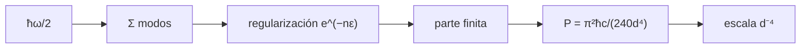

# B31-C19 — Vacío cuántico y límites conceptuales

<!-- nav:top -->
[🏠 Programa](../../../../README.md) · [📚 Bloque B31](../../../tronco-comun/B31-fisica-cuantica-nuclear-y-astroparticulas.md) · [← Anterior: B31-C18 — Restricciones experimentales de teorías](../B31-C18-restricciones-experimentales-de-teorias/CLASE.md) · [Siguiente: B31-C20 — Evaluación crítica de afirmaciones extraordinarias →](../B31-C20-evaluacion-critica-de-afirmaciones-extraordinarias/CLASE.md)
<!-- /nav -->

## 1. Ubicación, nivel y alcance

Clase 19 del bloque B31. Nivel N3. El vacío cuántico no es nada: tiene energía de punto cero que se manifiesta, por ejemplo, entre dos placas. Aquí calculas la **presión de Casimir** `π²ħc/(240d⁴)` para placas ideales con las constantes de NIST, y estudias cómo una **suma divergente** se regulariza con un corte exponencial para obtener las partes finitas `−1/12` y `1/120` que reaparecen en la función zeta. Usas [B05](../../../tronco-comun/B05-fisica-fundamental-para-el-espacio.md) y [B09-C11](../../B09/B09-C11-integrales-definidas/CLASE.md). Se suponen placas ideales y temperatura cero.

## 2. Por qué esta clase existe

Las sumas infinitas de la teoría cuántica de campos exigen regularización, y el vacío tiene consecuencias medibles. La decisión central: **¿cuánto vale la presión de Casimir y qué parte de una suma divergente es física?**

## 3. Lo que podrás hacer al terminar

1. Calcular `P = π²ħc/(240d⁴)` a varias distancias.
2. Verificar el escalado `d⁻⁴`.
3. Regularizar `Σ n e^(−nε)` y `Σ n³ e^(−nε)`.
4. Obtener las partes finitas `−1/12` y `1/120`.
5. Calcular `ħω/2`.
6. Reconocer los límites del modelo.

La evidencia es la **ficha del vacío cuántico** del ejercicio 12 (sección 20).

## 4. Con qué llegas y cómo comprobarlo

1. ¿Qué es la energía de punto cero?
2. ¿Qué es una suma divergente?
3. ¿Qué es una regularización?
4. ¿Qué es la función zeta?
5. ¿Qué es una placa conductora ideal?

<details>
<summary>Ver respuestas</summary>

1. `ħω/2` de un oscilador. 2. Una que crece sin límite. 3. Un procedimiento para extraer la parte finita. 4. `ζ(s) = Σ n⁻ˢ`. 5. Una que refleja todo el campo.
</details>

Con cuatro o cinco aciertos, sigue; si no, repasa los prerrequisitos.

## 5. Un caso de contexto y casos de referencia

Con placas ideales separadas `1 µm`, la presión es `1,3001 × 10⁻³ Pa`; a `10 nm` es `1,3001 × 10⁵ Pa` (`1,28 atm`). Es el **ejemplo conductor** (constantes de NIST, S1). La regularización con `ε = 0,02` da `−0,083332` para `Σ n e^(−nε) − 1/ε²`.

## 6. Vocabulario

La **energía de punto cero**. La **presión de Casimir**. La **regularización** con corte exponencial. La **parte finita** de una suma. La **función zeta** `ζ(−1) = −1/12`, `ζ(−3) = 1/120`.

## 7. Modelo mental: una cuerda con infinitos modos

Una cuerda con infinitos modos tiene energía infinita; lo que se mide es la diferencia entre dos configuraciones, donde los infinitos se cancelan y queda un número finito.



*Descripción textual:* la energía de punto cero suma sobre modos; la regularización aísla la parte finita, que produce la presión de Casimir con escala `d⁻⁴`.

Analogía: una cuerda con infinitos modos. Límite: placas ideales.

## 8. La explicación, paso a paso

### 8.1 Presión de Casimir

| `d` | `P` (Pa) | fuerza sobre 1 cm² (N) |
|---|---|---|
| 10 nm | 1,3001 × 10⁵ | 13,001 |
| 100 nm | 13,001 | 1,3001 × 10⁻³ |
| 1 µm | 1,3001 × 10⁻³ | 1,3001 × 10⁻⁷ |

`P ∝ d⁻⁴`: 10 veces menos distancia da 10⁴ veces más presión.

### 8.2 Regularización

| `ε` | `S₁ − 1/ε²` | `−1/12` | `S₃ − 6/ε⁴` | `1/120` |
|---|---|---|---|---|
| 0,10 | −0,083292 | −0,083333 | 0,008314 | 0,008333 |
| 0,05 | −0,083323 | −0,083333 | 0,008328 | 0,008333 |
| 0,02 | −0,083332 | −0,083333 | 0,008333 | 0,008333 |

### 8.3 Punto cero

Un oscilador con `ω = 10¹⁵ rad/s` tiene `ħω/2 = 5,2729 × 10⁻²⁰ J = 0,3291 eV`.

### 8.4 Lectura

La parte divergente depende del corte; la finita no, y es la que da la presión. La fórmula es para placas ideales: no incluye metales reales ni temperatura.

## 9. Magnitudes, símbolos y unidades

| Símbolo | Qué es | Unidad | Valor / nota |
|---|---|---|---|
| `ħ`, `c` | constantes | SI | S1 |
| `P` | presión de Casimir | Pa | ver 8.1 |
| `d` | separación | m | 10 nm–1 µm (ilustrativa) |
| `ε` | parámetro de corte | — | 0,1; 0,05; 0,02 |
| `ζ(−1)`, `ζ(−3)` | valores de la función zeta | — | −1/12; 1/120 |

## 10. Convenciones y referencias

Placas ideales, temperatura cero; las separaciones y el área son **ilustrativos**; no se contrastó con medidas.

## 11. De dónde sale lo que afirmamos

| ID | Fuente | Localizador | Respalda | Estado |
|---|---|---|---|---|
| S1 | NIST, *Fundamental Physical Constants* (CODATA 2022) | https://physics.nist.gov/cuu/Constants/Table/allascii.txt | `h`, `c` | Consultada el 2026-11-09 |

Límites: no se consultó ninguna medición de la fuerza de Casimir; la fórmula es la de placas ideales.

## 12. Cómo ver la presión

| `d` | `P` (Pa) |
|---|---|
| 10 nm | 1,3 × 10⁵ |
| 100 nm | 13 |
| 1 µm | 1,3 × 10⁻³ |

Descripción larga: la presión cae como la cuarta potencia de la distancia.

## 13. Ejemplo trabajado: presión de Casimir a 1 µm

**Paso 1 · Numerador.** `π²ħc = 9,8696 × 1,0546 × 10⁻³⁴ × 2,998 × 10⁸ = 3,120 × 10⁻²⁵ J m`.

**Paso 2 · Denominador.** `240 d⁴ = 240 × 10⁻²⁴ m⁴`.

**Paso 3 · Cociente.** `3,120 × 10⁻²⁵/2,4 × 10⁻²² `.

**Paso 4 · Valor.** `1,30 × 10⁻³ Pa`.

## 14. Distintas formas de describir el vacío cuántico

**Por energía:** punto cero. **Por fuerza:** Casimir. **Por matemática:** regularización. **Por escala:** `d⁻⁴`.

## 15. Práctica guiada

**Ejercicio 1 · con los pasos indicados.** `P` a 100 nm. *Pasos:* ejemplo 13 con `d = 10⁻⁷`.

<details><summary>Solución comentada</summary>

`13,0 Pa`.
</details>

**Ejercicio 2 · con una pista.** Cociente `P(10 nm)/P(1 µm)`.

<details><summary>Solución comentada</summary>

`10⁸`.
</details>

**Ejercicio 3 · casi autónomo.** Fuerza sobre 1 cm² a 1 µm.

<details><summary>Solución comentada</summary>

`1,3 × 10⁻⁷ N`.
</details>

## 16. Práctica autónoma, transferencia e integrador

**Ejercicio 4.** `P` a 10 nm en atmósferas.

<details><summary>Solución comentada</summary>

`1,28 atm`.
</details>

**Ejercicio 5.** Parte finita de `Σ n e^(−nε) − 1/ε²`.

<details><summary>Solución comentada</summary>

`−1/12`.
</details>

**Ejercicio 6.** Parte finita de `Σ n³ e^(−nε) − 6/ε⁴`.

<details><summary>Solución comentada</summary>

`1/120`.
</details>

**Ejercicio 7.** `ħω/2` para `ω = 2 × 10¹⁵`.

<details><summary>Solución comentada</summary>

`0,658 eV`.
</details>

**Ejercicio 8.** `P` si `d` se triplica.

<details><summary>Solución comentada</summary>

Se divide por 81.
</details>

**Ejercicio 9 · transferencia.** **Transferencia.** Un compañero afirma que extraes energía infinita del vacío. Responde.

<details><summary>Solución comentada</summary>

Solo la parte finita de una diferencia es física; los infinitos se cancelan.
</details>

**Ejercicio 10 · transferencia.** **Transferencia.** ¿Qué omite la fórmula?

<details><summary>Solución comentada</summary>

Conductividad finita, temperatura y rugosidad.
</details>

**Ejercicio 11 · transferencia.** **Transferencia.** ¿Qué prueba la suma regularizada?

<details><summary>Solución comentada</summary>

Que la parte finita no depende del corte.
</details>

**Ejercicio 12.** **Integrador.** Elabora tu *ficha del vacío cuántico*: presión, regularización y límites.

<details><summary>Solución comentada</summary>

Secciones 8.1–8.4.
</details>

**Ejercicio 12 · integrador.** **Integrador.** Elabora tu *ficha del vacío cuántico*: presión, regularización y límites.

<details><summary>Solución modelo</summary>

Secciones 8.1–8.4.
</details>

## 17. Laboratorio: Casimir y regularización

El script [vacio.py](vacio.py) calcula la presión de Casimir y las partes finitas de las sumas (**comprueba** el escalado `d⁻⁴` a `10⁻¹²` y las partes finitas a `10⁻³`).

**Datos:** `h`, `c` de NIST; separaciones y `ε` **ilustrativos**. **Predice antes de ejecutar:** ¿qué presión hay a 1 µm? (≈1,3 mPa.) **Ejecución del 2026-11-09 (Python 3.12.9):**

```text
Python 3.12.9 (biblioteca estandar)
       d   P = pi^2 hbar c/(240 d^4) [Pa]    fuerza sobre 1 cm^2 [N]
   1e-08                       1.3001e+05                 1.3001e+01
   1e-07                       1.3001e+01                 1.3001e-03
   1e-06                       1.3001e-03                 1.3001e-07
1 atm = 101325 Pa (definicion): la presion de Casimir a 10 nm equivale a 1.28 atm
 epsilon   S1 - 1/eps^2     -1/12   S3 - 6/eps^4     1/120
    0.10      -0.083292 -0.083333       0.008314  0.008333
    0.05      -0.083323 -0.083333       0.008328  0.008333
    0.02      -0.083332 -0.083333       0.008333  0.008333
energia de punto cero hbar omega/2 con omega = 1e15 rad/s: 5.2729e-20 J = 0.3291 eV
Pruebas superadas.
```

```bash
python programa/clases/B31/B31-C19-vacio-cuantico-y-limites-conceptuales/vacio.py
```

**Límites:** placas ideales, `T = 0`.

## 18. Errores frecuentes y cómo corregirlos

**Confundir energía y presión.** Se corrige con la sección 6.

**Olvidar la regularización.** Se corrige con 8.2.

**Aplicar la fórmula a metales reales.** Se corrige con 8.4.

**Creer que hay energía gratuita.** Se corrige con el ejercicio 9.

## 19. Cómo sabrás que vas bien

Tras 8.1: ¿cómo escala `P`? Si dudas, ejemplo 13. Tras el laboratorio: ¿qué comprueba? (la parte finita).

## 20. Qué entregas y cómo se evalúa

El producto es tu **ficha del vacío cuántico** (ejercicio 12).

| Criterio | Inicial | En desarrollo | Logrado | Destacado |
|---|---|---|---|---|
| Conceptos | Los confunde | Parciales | Casimir, regularización | Explica la parte finita |
| Cálculo | Sin unidades | Con errores | Tablas completas | Calcula casos nuevos |
| Numérico | Sin comprobar | Un caso | Escalado y sumas | Interpreta la independencia del corte |
| Fuentes | Sin fuente | Sin fecha | S1 con fecha | Declara que no hay medida consultada |
| Límites | No los nombra | Uno | Tres | Discute qué falta del modelo |

**Condiciones críticas (no se compensan con promedio):** rotular el modelo como de placas ideales; no afirmar extracción de energía; citar solo lo consultado.

## 21. Ética, seguridad y límites

Clase educativa: no sustenta afirmaciones sobre energía libre. Accesibilidad: tablas equivalentes a las gráficas, fórmulas en texto, ejercicios sin conexión.

## 22. Para cerrar y seguir

A 1 µm la presión de Casimir ideal es 1,3 mPa, 10⁸ veces mayor a 10 nm... y la parte finita de una suma divergente es `−1/12`. Queda una pregunta: ¿cómo se evalúa una afirmación extraordinaria?

**Glosario español–inglés.** energía de punto cero · *zero-point energy*; efecto Casimir · *Casimir effect*; regularización · *regularization*; función zeta · *zeta function*; vacío cuántico · *quantum vacuum*.

**Continuidad.** [B31-C20](../B31-C20-evaluacion-critica-de-afirmaciones-extraordinarias/CLASE.md) estudia la evaluación crítica de afirmaciones extraordinarias.

**Referencias:** ver sección 11.

<!-- nav:bottom -->
---

[← Anterior: B31-C18 — Restricciones experimentales de teorías](../B31-C18-restricciones-experimentales-de-teorias/CLASE.md) · [📚 Bloque B31](../../../tronco-comun/B31-fisica-cuantica-nuclear-y-astroparticulas.md) · [Siguiente: B31-C20 — Evaluación crítica de afirmaciones extraordinarias →](../B31-C20-evaluacion-critica-de-afirmaciones-extraordinarias/CLASE.md)
<!-- /nav -->
