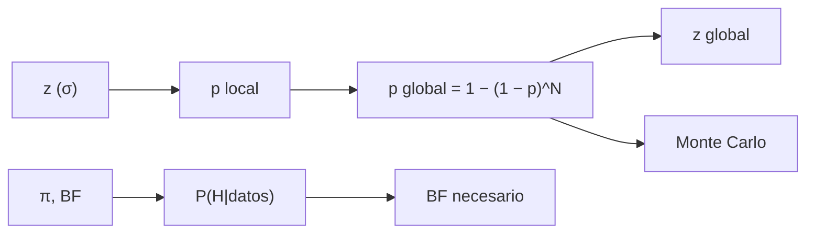

# B31-C20 — Evaluación crítica de afirmaciones extraordinarias

<!-- nav:top -->
[🏠 Programa](../../../../README.md) · [📚 Bloque B31](../../../tronco-comun/B31-fisica-cuantica-nuclear-y-astroparticulas.md) · [← Anterior: B31-C19 — Vacío cuántico y límites conceptuales](../B31-C19-vacio-cuantico-y-limites-conceptuales/CLASE.md) · [Siguiente: B32-C01 — Ecuación de transferencia radiativa en atmósferas estelares →](../../../tronco-comun/B32-atmosferas-estelares-y-espectroscopia-estelar-cuantitativa.md#b32-c01)
<!-- /nav -->

## 1. Ubicación, nivel y alcance

Clase 20 del bloque B31. Nivel N3. Antes de aceptar una afirmación extraordinaria hay que medir cuán sorprendente es el dato y cuánto cuesta haber mirado en muchos lugares. Aquí calculas el **valor p local** de una significancia en sigmas, el **valor p global** con el **efecto de mirar en otros lugares**, lo verificas por Monte Carlo y aplicas la **actualización bayesiana** con prioris pequeños para hallar el factor de Bayes necesario. Usas [B12](../../../tronco-comun/B12-probabilidad-estadistica-e-incertidumbre.md). Es una clase de método, no una evaluación de un caso real.

## 2. Por qué esta clase existe

Muchos «descubrimientos» desaparecen al contar los lugares donde se buscó o al pesar una probabilidad previa baja. La decisión central: **¿cuánta evidencia hace falta para creer una afirmación improbable?**

## 3. Lo que podrás hacer al terminar

1. Convertir sigmas en valores p y viceversa.
2. Calcular `p_global = 1 − (1 − p)^N`.
3. Verificar el efecto por Monte Carlo.
4. Aplicar `P(H|d) = BF·π/(1 − π + BF·π)`.
5. Calcular el factor de Bayes para 50 %.
6. Distinguir significancia y probabilidad de ser cierta.

La evidencia es la **ficha de evaluación de una afirmación** del ejercicio 12 (sección 20).

## 4. Con qué llegas y cómo comprobarlo

1. ¿Qué es un valor p?
2. ¿Qué es una prueba unilateral?
3. ¿Qué es un factor de Bayes?
4. ¿Qué es una probabilidad a priori?
5. ¿Qué es una distribución normal?

<details>
<summary>Ver respuestas</summary>

1. La probabilidad de datos así o más extremos si la hipótesis nula es cierta. 2. Una que mira un solo extremo. 3. La razón de verosimilitudes. 4. La creencia previa. 5. La de forma de campana.
</details>

Con cuatro o cinco aciertos, sigue; si no, repasa los prerrequisitos.

## 5. Un caso de contexto y casos de referencia

Un exceso de `3σ` local tiene `p = 1,35 × 10⁻³` (1 en 741); si se buscó en 100 zonas independientes, la probabilidad global es `0,126`, equivalente a `1,14σ`. Es el **ejemplo conductor**. Con un a priori de 10⁻⁶, hace falta un factor de Bayes de 10⁶ para llegar al 50 %. Todas las cifras son **ilustrativas**.

## 6. Vocabulario

El **valor p local**. El **efecto de mirar en otros lugares** (*look-elsewhere*). El **valor p global**. El **factor de Bayes** `BF`. La **probabilidad a priori** `π`. La **probabilidad posterior**.

## 7. Modelo mental: la lotería

Si compras 100 billetes, que alguno gane es menos sorprendente que si compraras uno; la significancia debe descontar cuántos billetes se compraron.



*Descripción textual:* la significancia local se convierte en p y, con el número de zonas, en p global y significancia global, verificada por Monte Carlo; el a priori y el factor de Bayes dan la probabilidad posterior.

Analogía: la lotería. Límite: zonas independientes y gaussianas.

## 8. La explicación, paso a paso

### 8.1 Valores p locales

| `z` | `p` unilateral | 1 en |
|---|---|---|
| 1 | 0,15866 | 6,3 |
| 2 | 0,02275 | 44 |
| 3 | 1,3499 × 10⁻³ | 741 |
| 4 | 3,1671 × 10⁻⁵ | 31 574 |
| 5 | 2,8665 × 10⁻⁷ | 3 488 556 |

### 8.2 Efecto de mirar en otros lugares

| `N` zonas | `p` global de 3σ | significancia global | `p` global de 5σ |
|---|---|---|---|
| 1 | 0,00135 | 3,000σ | 2,87 × 10⁻⁷ |
| 10 | 0,01342 | 2,214σ | 2,87 × 10⁻⁶ |
| 100 | 0,12635 | 1,144σ | 2,87 × 10⁻⁵ |
| 1000 | 0,74097 | −0,646σ | 2,87 × 10⁻⁴ |

Monte Carlo con `N = 100` (20 000 experimentos): `0,12115` frente a `0,12635`, a `2,2` errores estándar.

### 8.3 Actualización bayesiana (`P(H|datos)`)

| a priori | BF = 10 | 10³ | 10⁶ | 10⁹ |
|---|---|---|---|---|
| 10⁻³ | 9,9 × 10⁻³ | 0,500 | 0,999 | 1,000 |
| 10⁻⁶ | 1,0 × 10⁻⁵ | 1,0 × 10⁻³ | 0,500 | 0,999 |
| 10⁻⁹ | 1,0 × 10⁻⁸ | 1,0 × 10⁻⁶ | 1,0 × 10⁻³ | 0,500 |

Factor de Bayes para llegar al 50 %: `999`, `10⁶` y `10⁹` para prioris `10⁻³`, `10⁻⁶` y `10⁻⁹`.

### 8.4 Lectura

Un 3σ en 100 zonas es compatible con el azar al 12,6 %; y aun un resultado de 5σ no vuelve probable una hipótesis con a priori de 10⁻⁹ si el factor de Bayes es menor que 10⁹.

## 9. Magnitudes, símbolos y unidades

| Símbolo | Qué es | Unidad | Valor / nota |
|---|---|---|---|
| `z` | significancia | σ | 1 a 5 |
| `p` | valor p | — | ver 8.1 |
| `N` | zonas independientes | — | 1–1000 (ilustrativas) |
| `π` | probabilidad a priori | — | 10⁻³–10⁻⁹ (ilustrativa) |
| BF | factor de Bayes | — | 10–10⁹ (ilustrativo) |

## 10. Convenciones y referencias

Zonas independientes y gaussianas bajo la hipótesis nula, un único factor de Bayes; todas las cifras son **ilustrativas**; semilla `20261109`; ninguna afirmación real se evalúa.

## 11. De dónde sale lo que afirmamos

| ID | Fuente | Localizador | Respalda | Estado |
|---|---|---|---|---|
| — | Sin fuente externa | — | relaciones estándar que verifica el laboratorio | No se consultó una fuente para esta clase |

Límites: no se consultó ninguna fuente; los métodos son estándar y los verifica el laboratorio con simulación.

## 12. Cómo ver la significancia global

| `N` | significancia global de un 3σ local |
|---|---|
| 1 | 3,00σ |
| 10 | 2,21σ |
| 100 | 1,14σ |
| 1000 | −0,65σ |

Descripción larga: al crecer el número de zonas, la significancia global cae por debajo de la local.

## 13. Ejemplo trabajado: significancia global de un 3σ en 100 zonas

**Paso 1 · `p` local.** `1,35 × 10⁻³`.

**Paso 2 · Complemento.** `(1 − p)¹⁰⁰ = 0,8737`.

**Paso 3 · `p` global.** `1 − 0,8737 = 0,1263`.

**Paso 4 · Significancia.** `1,14σ`.

## 14. Distintas formas de describir una afirmación extraordinaria

**Por p:** local y global. **Por simulación:** Monte Carlo. **Por creencia:** a priori y factor de Bayes. **Por exigencia:** BF necesario.

## 15. Práctica guiada

**Ejercicio 1 · con los pasos indicados.** `p` local de 3σ. *Pasos:* `½ erfc(3/√2)`.

<details><summary>Solución comentada</summary>

`1,35 × 10⁻³`.
</details>

**Ejercicio 2 · con una pista.** `p` global con `N = 10`.

<details><summary>Solución comentada</summary>

`0,0134`.
</details>

**Ejercicio 3 · casi autónomo.** Significancia global con `N = 100`.

<details><summary>Solución comentada</summary>

`1,14σ`.
</details>

## 16. Práctica autónoma, transferencia e integrador

**Ejercicio 4.** Probabilidad posterior con `π = 10⁻³` y BF = 10³.

<details><summary>Solución comentada</summary>

`0,500`.
</details>

**Ejercicio 5.** BF para 50 % con `π = 10⁻⁶`.

<details><summary>Solución comentada</summary>

`10⁶`.
</details>

**Ejercicio 6.** `p` global de un 5σ con `N = 1000`.

<details><summary>Solución comentada</summary>

`2,87 × 10⁻⁴`.
</details>

**Ejercicio 7.** ¿A cuántos errores estaba el Monte Carlo?

<details><summary>Solución comentada</summary>

`2,2`.
</details>

**Ejercicio 8.** `1 en` de un 4σ.

<details><summary>Solución comentada</summary>

`31 574`.
</details>

**Ejercicio 9 · transferencia.** **Transferencia.** Un compañero afirma que 5σ prueba cualquier hipótesis. Responde.

<details><summary>Solución comentada</summary>

No: la probabilidad posterior depende del a priori y del factor de Bayes.
</details>

**Ejercicio 10 · transferencia.** **Transferencia.** ¿Qué supone el efecto de mirar en otros lugares?

<details><summary>Solución comentada</summary>

Zonas independientes; con correlaciones el factor efectivo es menor.
</details>

**Ejercicio 11 · transferencia.** **Transferencia.** ¿Qué hace falta para una afirmación con a priori de 10⁻⁹?

<details><summary>Solución comentada</summary>

Un BF cercano a 10⁹.
</details>

**Ejercicio 12.** **Integrador.** Elabora tu *ficha de evaluación de una afirmación*: p local y global, Monte Carlo y bayesiano.

<details><summary>Solución comentada</summary>

Secciones 8.1–8.4.
</details>

**Ejercicio 12 · integrador.** **Integrador.** Elabora tu *ficha de evaluación de una afirmación*: p local y global, Monte Carlo y bayesiano.

<details><summary>Solución modelo</summary>

Secciones 8.1–8.4.
</details>

## 17. Laboratorio: significancia y actualización bayesiana

El script [afirmaciones.py](afirmaciones.py) calcula valores p, el efecto de mirar en otros lugares y la actualización bayesiana (**comprueba** la inversa a `10⁻⁹`, Monte Carlo a 4 errores y `P = 0,5` a `10⁻¹²`).

**Datos:** sin constantes; todas las cifras **ilustrativas**; semilla `20261109`. **Predice antes de ejecutar:** ¿qué significancia global tiene un 3σ en 100 zonas? (≈1,1σ.) **Ejecución del 2026-11-09 (Python 3.12.9):**

```text
Python 3.12.9 (biblioteca estandar)
   z   p local (unilateral)           1 en
   1             1.5866e-01            6.3
   2             2.2750e-02           44.0
   3             1.3499e-03          740.8
   4             3.1671e-05        31574.4
   5             2.8665e-07      3488555.8
 N zonas   p global de un 3 sigma local   significancia global [sigma]   p global de un 5 sigma
       1                        0.00135                          3.000               2.8665e-07
      10                        0.01342                          2.214               2.8665e-06
     100                        0.12635                          1.144               2.8665e-05
    1000                        0.74097                         -0.646               2.8661e-04
Monte Carlo con N = 100: fraccion con maximo > 3 sigma = 0.12115 ; formula = 0.12635 ; desviacion = 2.22 errores
   prior    BF = 1e+01    BF = 1e+03    BF = 1e+06    BF = 1e+09
   1e-03    9.9108e-03    5.0025e-01    9.9900e-01    1.0000e+00
   1e-06    9.9999e-06    9.9900e-04    5.0000e-01    9.9900e-01
   1e-09    1.0000e-08    1.0000e-06    9.9900e-04    5.0000e-01
prior 1e-03: factor de Bayes para llegar a 50 %: 9.990e+02
prior 1e-06: factor de Bayes para llegar a 50 %: 1.000e+06
prior 1e-09: factor de Bayes para llegar a 50 %: 1.000e+09
Pruebas superadas.
```

```bash
python programa/clases/B31/B31-C20-evaluacion-critica-de-afirmaciones-extraordinarias/afirmaciones.py
```

**Límites:** zonas independientes.

## 18. Errores frecuentes y cómo corregirlos

**Confundir p con probabilidad de ser cierta.** Se corrige con 8.4.

**Olvidar el número de zonas.** Se corrige con 8.2.

**Ignorar el a priori.** Se corrige con 8.3.

**Tomar los casos por reales.** Se corrige con la sección 10.

## 19. Cómo sabrás que vas bien

Tras 8.2: ¿qué pasa al crecer `N`? Si dudas, ejemplo 13. Tras el laboratorio: ¿qué comprueba? (Monte Carlo frente a la fórmula).

## 20. Qué entregas y cómo se evalúa

El producto es tu **ficha de evaluación de una afirmación** (ejercicio 12).

| Criterio | Inicial | En desarrollo | Logrado | Destacado |
|---|---|---|---|---|
| Conceptos | Los confunde | Parciales | p, look-elsewhere, bayesiano | Explica la diferencia entre p y probabilidad |
| Cálculo | Sin unidades | Con errores | Tablas completas | Calcula el BF necesario |
| Numérico | Sin comprobar | Un caso | Monte Carlo y fórmula | Interpreta los errores |
| Fuentes | Sin fuente | Sin fecha | Declara la ausencia de fuente | Distingue ilustrativo y real |
| Límites | No los nombra | Uno | Tres | Discute qué falta del modelo |

**Condiciones críticas (no se compensan con promedio):** rotular todo como ilustrativo; no evaluar casos reales; citar solo lo consultado.

## 21. Ética, seguridad y límites

Clase educativa: no emite juicios sobre resultados concretos. Accesibilidad: tablas equivalentes a las gráficas, fórmulas en texto, ejercicios sin conexión.

## 22. Para cerrar y seguir

Un 3σ en 100 zonas vale 1,1σ globales, y una hipótesis con a priori 10⁻⁹ pide un factor de Bayes de 10⁹. Con esto cierra el bloque: de la dualidad a la evaluación crítica, cada resultado se calculó, se comprobó y se rotuló como ilustrativo cuando lo era.

**Glosario español–inglés.** valor p · *p-value*; efecto de mirar en otros lugares · *look-elsewhere effect*; factor de Bayes · *Bayes factor*; probabilidad a priori · *prior probability*; significancia · *significance*.

**Continuidad.** Es la última clase del bloque; el siguiente bloque se anunciará en su guía.

**Referencias:** ver sección 11.

<!-- nav:bottom -->
---

[← Anterior: B31-C19 — Vacío cuántico y límites conceptuales](../B31-C19-vacio-cuantico-y-limites-conceptuales/CLASE.md) · [📚 Bloque B31](../../../tronco-comun/B31-fisica-cuantica-nuclear-y-astroparticulas.md) · [Siguiente: B32-C01 — Ecuación de transferencia radiativa en atmósferas estelares →](../../../tronco-comun/B32-atmosferas-estelares-y-espectroscopia-estelar-cuantitativa.md#b32-c01)
<!-- /nav -->
