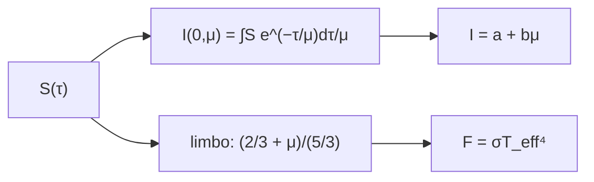

# B32-C01 — Ecuación de transferencia radiativa en atmósferas estelares

<!-- nav:top -->
<!-- /nav -->

## 1. Ubicación, nivel y alcance

Clase 1 del bloque B32. Nivel N3. La luz que sale de una estrella viene de capas con distinta temperatura. Aquí resuelves la **ecuación formal de transferencia** `I(0,μ) = ∫S(τ)e^(−τ/μ)dτ/μ` por Simpson, la comparas con las formas cerradas (relación de Eddington–Barbier) y obtienes el **oscurecimiento del limbo** y el flujo de una atmósfera gris. Usas [B05](../../../tronco-comun/B05-fisica-fundamental-para-el-espacio.md) y [B24-C10](../../B24/B24-C10-espectros-y-clasificacion-estelar/CLASE.md). Se supone atmósfera plano-paralela y equilibrio termodinámico local.

## 2. Por qué esta clase existe

El espectro depende de dónde se forma la luz. La decisión central: **¿qué capa determina la intensidad emergente y cómo cambia con el ángulo?**

## 3. Lo que podrás hacer al terminar

1. Resolver `I(0,μ)` por integración numérica.
2. Verificar `I = a + bμ` para una fuente lineal.
3. Calcular el oscurecimiento del limbo de una atmósfera gris.
4. Verificar el flujo `σT_eff⁴`.
5. Reconocer el origen de la relación de Eddington–Barbier.
6. Distinguir lo ideal de lo real.

La evidencia es la **ficha de la transferencia radiativa** del ejercicio 12 (sección 20).

## 4. Con qué llegas y cómo comprobarlo

1. ¿Qué es una intensidad específica?
2. ¿Qué es una temperatura efectiva?
3. ¿Qué es una integral numérica?
4. ¿Qué es una función fuente?
5. ¿Qué es un perfil de línea?

<details>
<summary>Ver respuestas</summary>

1. La energía por área, tiempo, frecuencia y ángulo sólido. 2. La del cuerpo negro que da el mismo flujo. 3. Una suma que aproxima un área. 4. `S = j/κ`. 5. La forma de la absorción en función de la longitud de onda.
</details>

Con cuatro o cinco aciertos, sigue; si no, repasa los prerrequisitos.

## 5. Un caso de contexto y casos de referencia

Para una función fuente `S = 0,4 + 0,6τ`, la intensidad emergente es `0,76` a `μ = 0,6`, igual a `a + bμ`. Es el **ejemplo conductor**. Con `T_eff = 5772 K` (S2) y una atmósfera gris de Eddington, `I(0,2)/I(1) = 0,52`.

## 6. Vocabulario

La **intensidad específica** `I`. La **función fuente** `S`. La **profundidad óptica** `τ`. El **ángulo** `μ = cos θ`. El **oscurecimiento del limbo** es la caída de `I` hacia el borde. La **atmósfera gris** tiene opacidad constante.

## 7. Modelo mental: mirar un bosque

Mirar un bosque desde arriba permite ver hasta el fondo; mirar de lado solo deja ver las copas: a ángulos rasantes la luz proviene de capas más altas y más frías.



*Descripción textual:* la función fuente da la intensidad emergente por integración; para una fuente lineal se obtiene `a + bμ`, de la que salen el limbo y el flujo.

Analogía: mirar un bosque desde arriba permite ver hasta el fondo; mirar de lado solo deja ver las copas: a ángulos rasantes la luz proviene de capas más altas y más frías. Límite: plano-paralela y sin dispersión.

## 8. La explicación, paso a paso

### 8.1 Intensidad emergente

| `μ` | `I` numérica (S lineal) | `a + bμ` | `I` (S exponencial) | `a/(1+μ) + b` |
|---|---|---|---|---|
| 1,0 | 1,00000000 | 1,00000000 | 0,80000000 | 0,80000000 |
| 0,6 | 0,76000000 | 0,76000000 | 0,85000000 | 0,85000000 |
| 0,2 | 0,52000000 | 0,52000000 | 0,93333333 | 0,93333333 |

### 8.2 Limbo y flujo

Para la atmósfera gris de Eddington, `I(μ)/I(1) = 1; 0,76; 0,52` para `μ = 1; 0,6; 0,2` (igual a `(2/3 + μ)/(5/3)`). El flujo emergente es `6,293878 × 10⁷ W/m²` y `σT_eff⁴ = 6,293859 × 10⁷` (cociente `1,000003`).

### 8.3 Lectura

La intensidad en `μ` refleja la función fuente en `τ ≈ μ`. El borde se ve más oscuro porque allí la luz sale de capas más frías.

## 9. Magnitudes, símbolos y unidades

| Símbolo | Qué es | Unidad | Valor / nota |
|---|---|---|---|
| `I` | intensidad específica | W m⁻² sr⁻¹ | relativa |
| `τ`, `μ` | profundidad óptica y coseno | — | ver 8 |
| `T_eff` | temperatura efectiva | K | 5772 (S2) |
| `σ` | constante de Stefan–Boltzmann | W m⁻² K⁻⁴ | S1 |

## 10. Convenciones y referencias

Plano-paralela, ETL, sin dispersión; `a`, `b` ilustrativos; `T_eff` nominal.

## 11. De dónde sale lo que afirmamos

| ID | Fuente | Localizador | Respalda | Estado |
|---|---|---|---|---|
| S1 | NIST, *Fundamental Physical Constants* (CODATA 2022) | https://physics.nist.gov/cuu/Constants/Table/allascii.txt | constantes citadas en la sección 9 | Consultada el 2026-11-09 |
| S2 | UAI, Resolución B3 de 2015 | https://arxiv.org/abs/1510.07674 | `T_eff` nominal del Sol (5772 K) | Consultada el 2026-11-09 |

Límites: no se consultó ninguna observación del limbo.

## 12. Cómo ver el limbo

| `μ` | `I/I(1)` |
|---|---|
| 1,0 | 1,00 |
| 0,6 | 0,76 |
| 0,2 | 0,52 |

Descripción larga: la intensidad cae linealmente con `μ`.

## 13. Ejemplo trabajado: intensidad a μ = 0,6

**Paso 1 · Fuente.** `S = 0,4 + 0,6τ`.

**Paso 2 · Resultado exacto.** `I = a + bμ`.

**Paso 3 · Valor.** `0,4 + 0,6 × 0,6`.

**Paso 4 · Lectura.** `0,76`.

## 14. Distintas formas de describir una atmósfera

**Por intensidad:** `I(μ)`. **Por limbo:** `(2/3 + μ)/(5/3)`. **Por flujo:** `σT_eff⁴`.

## 15. Práctica guiada

**Ejercicio 1 · con los pasos indicados.** `I` para `S = 0,4 + 0,6τ` y `μ = 1`. *Pasos:* ejemplo 13.

<details><summary>Solución comentada</summary>

`1,0`.
</details>

**Ejercicio 2 · con una pista.** `I` para `μ = 0,2`.

<details><summary>Solución comentada</summary>

`0,52`.
</details>

**Ejercicio 3 · casi autónomo.** `I(0,6)/I(1)` del limbo gris.

<details><summary>Solución comentada</summary>

`0,76`.
</details>

## 16. Práctica autónoma, transferencia e integrador

**Ejercicio 4.** `I` para `S = 0,4e^(−τ) + 0,6` y `μ = 0,6`.

<details><summary>Solución comentada</summary>

`0,4/1,6 + 0,6 = 0,85`.
</details>

**Ejercicio 5.** Cociente del flujo con `σT_eff⁴`.

<details><summary>Solución comentada</summary>

`1,000003`.
</details>

**Ejercicio 6.** `T(0)/T_eff` de Eddington.

<details><summary>Solución comentada</summary>

`2^(−1/4) = 0,841`.
</details>

**Ejercicio 7.** ¿Dónde se forma la luz en `μ = 0,2`?

<details><summary>Solución comentada</summary>

Cerca de `τ ≈ 0,2`.
</details>

**Ejercicio 8.** Valor de `(2/3 + μ)/(5/3)` en `μ = 0`.

<details><summary>Solución comentada</summary>

`0,4`.
</details>

**Ejercicio 9 · transferencia.** **Transferencia.** Un compañero afirma que el limbo del Sol sigue `0,4 + 0,6μ`. Responde con la sección 10.

<details><summary>Solución comentada</summary>

Es el resultado de un modelo gris; no se consultaron observaciones.
</details>

**Ejercicio 10 · transferencia.** **Transferencia.** ¿Por qué `I` aumenta con `μ`?

<details><summary>Solución comentada</summary>

Porque `S` crece con `τ` y a `μ` grande se ve más profundo.
</details>

**Ejercicio 11 · transferencia.** **Transferencia.** ¿Qué supone el flujo `σT_eff⁴`?

<details><summary>Solución comentada</summary>

Equilibrio radiativo y atmósfera gris.
</details>

**Ejercicio 12.** **Integrador.** Elabora tu *ficha de la transferencia radiativa*: intensidad, limbo y flujo.

<details><summary>Solución comentada</summary>

Secciones 8.1–8.3.
</details>

**Ejercicio 12 · integrador.** **Integrador.** Elabora tu *ficha de la transferencia radiativa*: intensidad, limbo y flujo.

<details><summary>Solución modelo</summary>

Secciones 8.1–8.3.
</details>

## 17. Laboratorio: integral formal, limbo y flujo

El script [transferencia.py](transferencia.py) resuelve la transferencia por Simpson y compara con formas cerradas (**comprueba** `10⁻⁸` y el flujo a `10⁻⁴`).

**Datos:** `σ` de NIST y `T_eff` de la UAI; `S` de prueba **ilustrativas**. **Predice antes de ejecutar:** ¿cuál es `I(0,6)` con la fuente lineal? (0,76.) **Ejecución del 2026-11-09 (Python 3.12.9):**

```text
Python 3.12.9 (biblioteca estandar)
   mu  I numerica (S lineal)   a + b mu   I (S = a e^-t + b)  a/(1+mu) + b
  1.0             1.00000000 1.00000000           0.80000000    0.80000000
  0.6             0.76000000 0.76000000           0.85000000    0.85000000
  0.2             0.52000000 0.52000000           0.93333333    0.93333333
   mu  I(mu)/I(1) numerico   (2/3 + mu)/(5/3)
  1.0           1.00000000         1.00000000
  0.6           0.76000000         0.76000000
  0.2           0.52000000         0.52000000
flujo emergente = 6.293878e+07 W/m2 ; sigma T_eff^4 = 6.293859e+07 W/m2 ; cociente = 1.000003
Pruebas superadas.
```

```bash
python programa/clases/B32/B32-C01-ecuacion-de-transferencia-radiativa/transferencia.py
```

**Límites:** plano-paralela, ETL.

## 18. Errores frecuentes y cómo corregirlos

**Confundir `μ` y `θ`.** Se corrige con la sección 6.

**Olvidar el `1/μ`.** Se corrige con 8.

**Tomar el limbo por observado.** Se corrige con la sección 10.

**Mezclar `I` y `F`.** Se corrige con 8.2.

## 19. Cómo sabrás que vas bien

Tras 8: ¿qué resultado esperabas y cuál obtuviste? Si dudas, repasa el ejemplo 13. Tras el laboratorio: ¿qué comprueba? (ver la sección 17).

## 20. Qué entregas y cómo se evalúa

El producto es tu **ficha de la transferencia radiativa** (ejercicio 12).

| Criterio | Inicial | En desarrollo | Logrado | Destacado |
|---|---|---|---|---|
| Conceptos | Los confunde | Parciales | conceptos de la clase | Explica los límites |
| Cálculo | Sin unidades | Con errores | Tablas completas | Calcula casos nuevos |
| Numérico | Sin comprobar | Un caso | Contraste con el análisis | Interpreta las diferencias |
| Fuentes | Sin fuente | Sin fecha | fuentes con fecha | Declara lo ilustrativo |
| Límites | No los nombra | Uno | Tres | Discute qué falta del modelo |

**Condiciones críticas (no se compensan con promedio):** rotular las funciones fuente como ilustrativas; no presentar el limbo como medido; citar solo lo consultado.

## 21. Ética, seguridad y límites

Clase educativa: los modelos son simplificados. Accesibilidad: tablas equivalentes a las gráficas, fórmulas en texto, ejercicios sin conexión.

## 22. Para cerrar y seguir

Una fuente lineal da `I = a + bμ`; la atmósfera gris da un limbo de `0,52` en `μ = 0,2` y el flujo de `σT_eff⁴`. Queda una pregunta: ¿cuándo falla el equilibrio local?

**Glosario español–inglés.** transferencia radiativa · *radiative transfer*; función fuente · *source function*; oscurecimiento del limbo · *limb darkening*; profundidad óptica · *optical depth*; atmósfera gris · *grey atmosphere*.

**Continuidad.** [B32-C02](../B32-C02-equilibrio-termodinamico-local-y-no-lte/CLASE.md) estudia el equilibrio termodinámico local y sus desviaciones.

**Referencias:** ver sección 11.

<!-- nav:bottom -->
---

<!-- /nav -->
