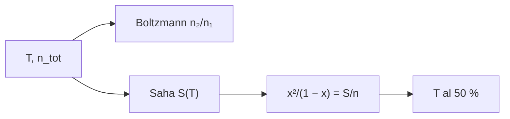

# B32-C02 — Equilibrio termodinámico local y desviaciones no LTE

<!-- nav:top -->
[🏠 Programa](../../../../README.md) · [📚 Bloque B32](../../../tronco-comun/B32-atmosferas-estelares-y-espectroscopia-estelar-cuantitativa.md) · [← Anterior: B32-C01 — Ecuación de transferencia radiativa en atmósferas estelares](../B32-C01-ecuacion-de-transferencia-radiativa-en-atmosferas-estelares/CLASE.md) · [Siguiente: B32-C03 — Opacidad continua: ligado-libre, libre-libre y H- →](../B32-C03-opacidad-continua-ligado-libre-libre-libre-y-h/CLASE.md)
<!-- /nav -->

## 1. Ubicación, nivel y alcance

Clase 2 del bloque B32. Nivel N3. El equilibrio termodinámico local permite calcular poblaciones con dos ecuaciones. Aquí aplicas **Boltzmann** (razón de poblaciones de los niveles 1 y 2 del hidrógeno) y **Saha** (fracción ionizada) con las constantes de NIST, resuelves la fracción ionizada de forma cerrada y por biseccion y hallas la temperatura de ionización del 50 %. Usas [B05](../../../tronco-comun/B05-fisica-fundamental-para-el-espacio.md) y [B31-C06](../../B31/B31-C06-estadisticas-cuanticas/CLASE.md). Se supone hidrógeno puro y ETL.

## 2. Por qué esta clase existe

Si el ETL falla, las abundancias que se derivan son erróneas. La decisión central: **¿cuánto hidrógeno está ionizado a cada temperatura y densidad?**

## 3. Lo que podrás hacer al terminar

1. Calcular `n₂/n₁` con `g_n = 2n²`.
2. Calcular `S(T)` de Saha.
3. Resolver `x²/(1 − x) = S/n_tot`.
4. Hallar la temperatura del 50 %.
5. Comparar cerrada y biseccion.
6. Reconocer los límites del ETL.

La evidencia es la **ficha del equilibrio local** del ejercicio 12 (sección 20).

## 4. Con qué llegas y cómo comprobarlo

1. ¿Qué es una intensidad específica?
2. ¿Qué es una temperatura efectiva?
3. ¿Qué es una integral numérica?
4. ¿Qué es una función fuente?
5. ¿Qué es un perfil de línea?

<details>
<summary>Ver respuestas</summary>

1. La energía por área, tiempo, frecuencia y ángulo sólido. 2. La del cuerpo negro que da el mismo flujo. 3. Una suma que aproxima un área. 4. `S = j/κ`. 5. La forma de la absorción en función de la longitud de onda.
</details>

Con cuatro o cinco aciertos, sigue; si no, repasa los prerrequisitos.

## 5. Un caso de contexto y casos de referencia

A 10 000 K con `n_tot = 10²³ m⁻³`, el hidrógeno está ionizado en un `5,6 %`; a 20 000 K, en un `96 %`. Es el **ejemplo conductor** (energía de Rydberg de NIST, S1). La densidad es **ilustrativa**.

## 6. Vocabulario

La **ecuación de Boltzmann**. La **ecuación de Saha**. La **fracción ionizada** `x`. El **ETL** supone que las poblaciones siguen la temperatura local. Una **desviación no ETL** es cualquier diferencia respecto de ellas.

## 7. Modelo mental: un baile con música

Cada átomo es una persona en una pista: la temperatura es el volumen de la música y la densidad el espacio; con música alta los pares se separan (ionizan).



*Descripción textual:* la temperatura da la razón de poblaciones y la constante de Saha, que determina la fracción ionizada y la temperatura del 50 %.

Analogía: cada átomo es una persona en una pista: la temperatura es el volumen de la música y la densidad el espacio; con música alta los pares se separan (ionizan). Límite: hidrógeno puro y ETL.

## 8. La explicación, paso a paso

### 8.1 Boltzmann (`ΔE = 10,2043 eV`, Lyα en `121,50 nm`)

| `T` (K) | `n₂/n₁` |
|---|---|
| 4000 | 5,5622 × 10⁻¹³ |
| 5772 | 4,9236 × 10⁻⁹ |
| 10 000 | 2,8796 × 10⁻⁵ |
| 20 000 | 1,0732 × 10⁻² |

### 8.2 Saha (`n_tot = 10²³ m⁻³`)

| `T` (K) | `S(T)` (m⁻³) | `x` cerrada | `x` biseccion |
|---|---|---|---|
| 4000 | 4,4008 × 10⁹ | 0,000000 | 0,000000 |
| 6000 | 4,1861 × 10¹⁵ | 0,000205 | 0,000205 |
| 8000 | 4,6375 × 10¹⁸ | 0,006787 | 0,006787 |
| 10 000 | 3,3565 × 10²⁰ | 0,056282 | 0,056282 |
| 12 000 | 6,1305 × 10²¹ | 0,218835 | 0,218835 |
| 20 000 | 2,5464 × 10²⁴ | 0,963540 | 0,963540 |

La temperatura del 50 % es `13 986,8 K`.

### 8.3 Lectura

La población del nivel 2 a 5772 K es de `5 × 10⁻⁹` y la ionización ocurre en un intervalo estrecho de temperaturas. Que la ionización sea baja no excluye que la absorción de Balmer sea relevante a mayor `T`.

## 9. Magnitudes, símbolos y unidades

| Símbolo | Qué es | Unidad | Valor / nota |
|---|---|---|---|
| `T` | temperatura | K | ilustrativa |
| `n_tot` | densidad total de H | m⁻³ | 10²³ (ilustrativa) |
| `x` | fracción ionizada | — | ver 8.2 |
| Ryd | energía de Rydberg | eV | 13,605693123 (S1) |

## 10. Convenciones y referencias

Hidrógeno puro, sin descenso del potencial de ionización; `n_tot` y las temperaturas son **ilustrativas**.

## 11. De dónde sale lo que afirmamos

| ID | Fuente | Localizador | Respalda | Estado |
|---|---|---|---|---|
| S1 | NIST, *Fundamental Physical Constants* (CODATA 2022) | https://physics.nist.gov/cuu/Constants/Table/allascii.txt | constantes citadas en la sección 9 | Consultada el 2026-11-09 |

Límites: no se consultaron abundancias reales ni correcciones no ETL.

## 12. Cómo ver la ionización

| `T` (K) | `x` |
|---|---|
| 8000 | 0,0068 |
| 10 000 | 0,0563 |
| 12 000 | 0,2188 |
| 20 000 | 0,9635 |

Descripción larga: la fracción ionizada pasa de casi cero a casi uno en pocas decenas de miles de kelvin.

## 13. Ejemplo trabajado: ionización a 10 000 K

**Paso 1 · Saha.** `S = 3,3565 × 10²⁰ m⁻³`.

**Paso 2 · Cociente.** `S/n_tot = 3,3565 × 10⁻³`.

**Paso 3 · Ecuación.** `x² + s x − s = 0`.

**Paso 4 · Solución.** `x = 0,0563`.

## 14. Distintas formas de describir un gas ionizado

**Por nivel:** Boltzmann. **Por ionización:** Saha. **Por temperatura:** T al 50 %. **Por validez:** ETL.

## 15. Práctica guiada

**Ejercicio 1 · con los pasos indicados.** `ΔE` del nivel 1 al 2. *Pasos:* `¾` de la energía de Rydberg.

<details><summary>Solución comentada</summary>

`10,204 eV`.
</details>

**Ejercicio 2 · con una pista.** `n₂/n₁` a 10 000 K.

<details><summary>Solución comentada</summary>

`2,88 × 10⁻⁵`.
</details>

**Ejercicio 3 · casi autónomo.** `x` a 10 000 K. *Pista:* ejemplo 13.

<details><summary>Solución comentada</summary>

`0,0563`.
</details>

## 16. Práctica autónoma, transferencia e integrador

**Ejercicio 4.** `x` a 20 000 K.

<details><summary>Solución comentada</summary>

`0,9635`.
</details>

**Ejercicio 5.** Temperatura del 50 %.

<details><summary>Solución comentada</summary>

`13 987 K`.
</details>

**Ejercicio 6.** `λ` de Lyα.

<details><summary>Solución comentada</summary>

`121,5 nm`.
</details>

**Ejercicio 7.** Cociente de poblaciones entre 20 000 y 10 000 K.

<details><summary>Solución comentada</summary>

`1,0732 × 10⁻²/2,8796 × 10⁻⁵ = 373`.
</details>

**Ejercicio 8.** ¿Qué pasa con `x` si `n_tot` aumenta?

<details><summary>Solución comentada</summary>

Disminuye, por la recombinación.
</details>

**Ejercicio 9 · transferencia.** **Transferencia.** Un compañero usa 13 987 K como la temperatura de ionización estelar. Responde con la sección 10.

<details><summary>Solución comentada</summary>

Es con densidad ilustrativa.
</details>

**Ejercicio 10 · transferencia.** **Transferencia.** ¿Por qué la ionización es abrupta?

<details><summary>Solución comentada</summary>

Por el factor exponencial `e^(−χ/kT)`.
</details>

**Ejercicio 11 · transferencia.** **Transferencia.** ¿Qué falla si no hay ETL?

<details><summary>Solución comentada</summary>

Las poblaciones no siguen Boltzmann ni Saha.
</details>

**Ejercicio 12.** **Integrador.** Elabora tu *ficha del equilibrio local*: Boltzmann, Saha y temperatura del 50 %.

<details><summary>Solución comentada</summary>

Secciones 8.1–8.3.
</details>

**Ejercicio 12 · integrador.** **Integrador.** Elabora tu *ficha del equilibrio local*: Boltzmann, Saha y temperatura del 50 %.

<details><summary>Solución modelo</summary>

Secciones 8.1–8.3.
</details>

## 17. Laboratorio: Boltzmann y Saha

El script [lte.py](lte.py) calcula poblaciones y fracción ionizada por dos vías (**comprueba** `10⁻¹⁰`).

**Datos:** `h`, `k_B`, `m_e`, Rydberg de NIST; `n_tot` **ilustrativa**. **Predice antes de ejecutar:** ¿qué fracción está ionizada a 10 000 K? (≈6 %.) **Ejecución del 2026-11-09 (Python 3.12.9):**

```text
Python 3.12.9 (biblioteca estandar)
DeltaE(1 -> 2) = 10.2043 eV ; lambda Lyman alfa = 121.50 nm
  T [K]   n2/n1 (Boltzmann)
   4000          5.5622e-13
   5772          4.9236e-09
  10000          2.8796e-05
  20000          1.0732e-02
  T [K]   S(T) [m-3]   x cerrada  x biseccion
   4000   4.4008e+09    0.000000     0.000000
   6000   4.1861e+15    0.000205     0.000205
   8000   4.6375e+18    0.006787     0.006787
  10000   3.3565e+20    0.056282     0.056282
  12000   6.1305e+21    0.218835     0.218835
  20000   2.5464e+24    0.963540     0.963540
temperatura de ionizacion del 50 % con n_tot = 1e23 m-3: 13986.8 K
Pruebas superadas.
```

```bash
python programa/clases/B32/B32-C02-equilibrio-termodinamico-local-y-desviaciones-no-lte/lte.py
```

**Límites:** hidrógeno puro, ETL.

## 18. Errores frecuentes y cómo corregirlos

**Olvidar los pesos estadísticos.** Se corrige con 8.1.

**Usar `kT` en J y `χ` en eV.** Se corrige con la sección 9.

**Tomar la densidad por medida.** Se corrige con la sección 10.

**Aplicar ETL sin discutirlo.** Se corrige con 8.3.

## 19. Cómo sabrás que vas bien

Tras 8: ¿qué resultado esperabas y cuál obtuviste? Si dudas, repasa el ejemplo 13. Tras el laboratorio: ¿qué comprueba? (ver la sección 17).

## 20. Qué entregas y cómo se evalúa

El producto es tu **ficha del equilibrio local** (ejercicio 12).

| Criterio | Inicial | En desarrollo | Logrado | Destacado |
|---|---|---|---|---|
| Conceptos | Los confunde | Parciales | conceptos de la clase | Explica los límites |
| Cálculo | Sin unidades | Con errores | Tablas completas | Calcula casos nuevos |
| Numérico | Sin comprobar | Un caso | Contraste con el análisis | Interpreta las diferencias |
| Fuentes | Sin fuente | Sin fecha | fuentes con fecha | Declara lo ilustrativo |
| Límites | No los nombra | Uno | Tres | Discute qué falta del modelo |

**Condiciones críticas (no se compensan con promedio):** rotular `n_tot` como ilustrativa; no usar Saha donde falla el ETL sin avisarlo; citar solo lo consultado.

## 21. Ética, seguridad y límites

Clase educativa: los modelos son simplificados. Accesibilidad: tablas equivalentes a las gráficas, fórmulas en texto, ejercicios sin conexión.

## 22. Para cerrar y seguir

A 10 000 K hay un 5,6 % de hidrógeno ionizado y la mitad a 13 987 K con `n_tot = 10²³ m⁻³`. Queda una pregunta: ¿qué absorbe la luz del continuo?

**Glosario español–inglés.** equilibrio termodinámico local · *local thermodynamic equilibrium*; ecuación de Saha · *Saha equation*; ecuación de Boltzmann · *Boltzmann equation*; fracción ionizada · *ionization fraction*; no ETL · *non-LTE*.

**Continuidad.** [B32-C03](../B32-C03-opacidad-continua-ligado-libre-libre-libre-y-h/CLASE.md) estudia la opacidad continua.

**Referencias:** ver sección 11.

<!-- nav:bottom -->
---

[← Anterior: B32-C01 — Ecuación de transferencia radiativa en atmósferas estelares](../B32-C01-ecuacion-de-transferencia-radiativa-en-atmosferas-estelares/CLASE.md) · [📚 Bloque B32](../../../tronco-comun/B32-atmosferas-estelares-y-espectroscopia-estelar-cuantitativa.md) · [Siguiente: B32-C03 — Opacidad continua: ligado-libre, libre-libre y H- →](../B32-C03-opacidad-continua-ligado-libre-libre-libre-y-h/CLASE.md)
<!-- /nav -->
