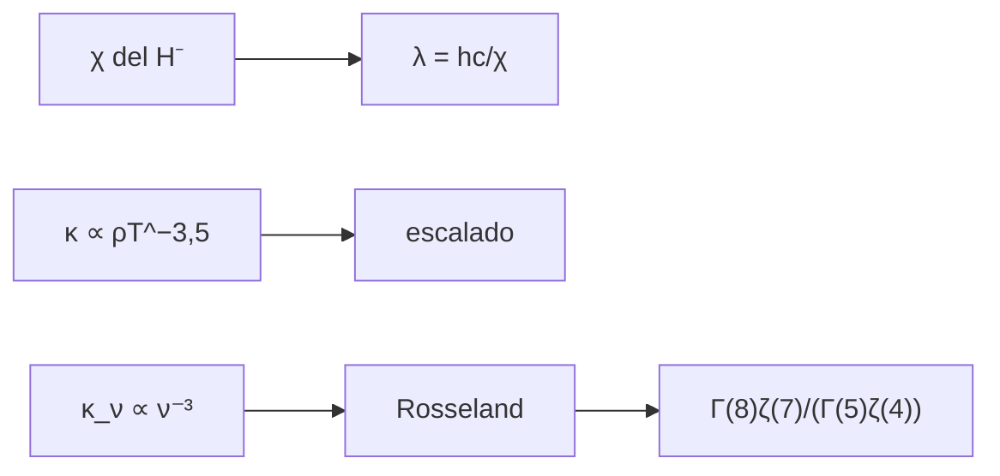

# B32-C03 — Opacidad continua: ligado-libre, libre-libre y H-

<!-- nav:top -->
<!-- /nav -->

## 1. Ubicación, nivel y alcance

Clase 3 del bloque B32. Nivel N3. La opacidad continua controla cuánta luz atraviesa la atmósfera. Aquí calculas el **umbral de fotoionización del H⁻**, el **escalado de Kramers** y la **media de Rosseland** de una opacidad de prueba `κ_ν ∝ ν⁻³` por integración numérica y por funciones zeta. Usas [B05](../../../tronco-comun/B05-fisica-fundamental-para-el-espacio.md) y [B32-C02](../B32-C02-equilibrio-termodinamico-local-y-no-lte/CLASE.md). La ley de opacidad es de prueba.

## 2. Por qué esta clase existe

La opacidad fija la profundidad desde la que escapa la luz. La decisión central: **¿cómo se promedia una opacidad que depende de la frecuencia?**

## 3. Lo que podrás hacer al terminar

1. Calcular `λ = hc/χ` del H⁻.
2. Aplicar el escalado `κ ∝ ρT^(−3,5)`.
3. Escribir la media de Rosseland.
4. Calcular las integrales con Simpson.
5. Compararlas con `Γ(n)ζ(n−1)`.
6. Reconocer el carácter de prueba.

La evidencia es la **ficha de la opacidad continua** del ejercicio 12 (sección 20).

## 4. Con qué llegas y cómo comprobarlo

1. ¿Qué es una intensidad específica?
2. ¿Qué es una temperatura efectiva?
3. ¿Qué es una integral numérica?
4. ¿Qué es una función fuente?
5. ¿Qué es un perfil de línea?

<details>
<summary>Ver respuestas</summary>

1. La energía por área, tiempo, frecuencia y ángulo sólido. 2. La del cuerpo negro que da el mismo flujo. 3. Una suma que aproxima un área. 4. `S = j/κ`. 5. La forma de la absorción en función de la longitud de onda.
</details>

Con cuatro o cinco aciertos, sigue; si no, repasa los prerrequisitos.

## 5. Un caso de contexto y casos de referencia

El umbral del H⁻ con `χ = 0,7542 eV` (valor estándar no consultado) es `1,6439 µm`. Es el **ejemplo conductor**. Para `κ_ν ∝ ν⁻³`, `1/κ_R = 195,65 (kT/h)³/κ₀`.

## 6. Vocabulario

La **opacidad continua**. El **H⁻** es el ion que domina en atmósferas frías. El **escalado de Kramers**. La **media de Rosseland** pondera `1/κ_ν` con `dB/dT`.

## 7. Modelo mental: un filtro de colores

Una atmósfera es como un filtro que deja pasar mejor unos colores que otros; la media de Rosseland dice cuánto deja pasar «en promedio» cuando el calor fluye por difusión.



*Descripción textual:* la afinidad da el umbral; una opacidad de prueba da la media de Rosseland con una integral conocida.

Analogía: una atmósfera es como un filtro que deja pasar mejor unos colores que otros; la media de rosseland dice cuánto deja pasar «en promedio» cuando el calor fluye por difusión. Límite: ley de opacidad de prueba.

## 8. La explicación, paso a paso

### 8.1 Umbral y escalado

El umbral del H⁻ es `1,6439 µm`. El escalado de Kramers da `κ(2ρ, T)/κ(ρ, T) = 2` y `κ(ρ, 2T)/κ(ρ, T) = 0,08839`.

### 8.2 Rosseland

| integral | numérica | analítica |
|---|---|---|
| `∫x⁷eˣ/(eˣ−1)²dx` | 5082,080358 | `Γ(8)ζ(7)` = 5082,080358 |
| `∫x⁴eˣ/(eˣ−1)²dx` | 25,975758 | `Γ(5)ζ(4)` = 25,975758 |

El cociente `195,65` da `1/κ_R = 195,65 (kT/h)³/κ₀`.

### 8.3 Lectura

La media de Rosseland está dominada por las frecuencias donde la opacidad es menor. Con `κ_ν ∝ ν⁻³` es mucho más sensible a las frecuencias altas.

## 9. Magnitudes, símbolos y unidades

| Símbolo | Qué es | Unidad | Valor / nota |
|---|---|---|---|
| `χ` | afinidad electrónica del H⁻ | eV | 0,7542 (estándar no consultado) |
| `κ_R` | opacidad de Rosseland | m²/kg | ver 8.2 |
| `x` | `hν/kT` | — | adimensional |

## 10. Convenciones y referencias

Opacidad de prueba y ETL; `χ` estándar no consultado.

## 11. De dónde sale lo que afirmamos

| ID | Fuente | Localizador | Respalda | Estado |
|---|---|---|---|---|
| S1 | NIST, *Fundamental Physical Constants* (CODATA 2022) | https://physics.nist.gov/cuu/Constants/Table/allascii.txt | constantes citadas en la sección 9 | Consultada el 2026-11-09 |

Límites: no se consultó ninguna tabla de opacidades.

## 12. Cómo ver las integrales

| Integral | Valor |
|---|---|
| `x⁷` | 5082,08 |
| `x⁴` | 25,976 |
| cociente | 195,65 |

Descripción larga: la integral con `x⁷` es 195 veces mayor que la de `x⁴`.

## 13. Ejemplo trabajado: umbral del H⁻

**Paso 1 · `hc`.** `1239,84 eV nm`.

**Paso 2 · Cociente.** `1239,84/0,7542`.

**Paso 3 · Valor.** `1644 nm`.

**Paso 4 · Lectura.** `1,6439 µm`, en el infrarrojo cercano.

## 14. Distintas formas de describir la opacidad

**Por umbral:** H⁻. **Por escala:** Kramers. **Por promedio:** Rosseland.

## 15. Práctica guiada

**Ejercicio 1 · con los pasos indicados.** Umbral del H⁻. *Pasos:* ejemplo 13.

<details><summary>Solución comentada</summary>

`1,644 µm`.
</details>

**Ejercicio 2 · con una pista.** `κ(2ρ)/κ(ρ)` de Kramers.

<details><summary>Solución comentada</summary>

`2`.
</details>

**Ejercicio 3 · casi autónomo.** `κ(2T)/κ(T)`.

<details><summary>Solución comentada</summary>

`2^(−3,5) = 0,0884`.
</details>

## 16. Práctica autónoma, transferencia e integrador

**Ejercicio 4.** `Γ(8)`.

<details><summary>Solución comentada</summary>

`5040`.
</details>

**Ejercicio 5.** `ζ(4)`.

<details><summary>Solución comentada</summary>

`π⁴/90 = 1,0823`.
</details>

**Ejercicio 6.** Cociente de las integrales.

<details><summary>Solución comentada</summary>

`195,65`.
</details>

**Ejercicio 7.** ¿Qué frecuencias domina la media de Rosseland?

<details><summary>Solución comentada</summary>

Las de menor opacidad.
</details>

**Ejercicio 8.** `κ_R` si `κ₀` se duplica.

<details><summary>Solución comentada</summary>

Se duplica.
</details>

**Ejercicio 9 · transferencia.** **Transferencia.** Un compañero afirma que `χ = 0,7542` fue consultado. Responde.

<details><summary>Solución comentada</summary>

No: es un valor estándar no consultado.
</details>

**Ejercicio 10 · transferencia.** **Transferencia.** ¿Por qué se usa la media de Rosseland?

<details><summary>Solución comentada</summary>

Porque describe la difusión de la radiación en medios opacos.
</details>

**Ejercicio 11 · transferencia.** **Transferencia.** ¿Qué limita `κ_ν ∝ ν⁻³`?

<details><summary>Solución comentada</summary>

Es una ley de prueba.
</details>

**Ejercicio 12.** **Integrador.** Elabora tu *ficha de la opacidad continua*: umbral, Kramers y Rosseland.

<details><summary>Solución comentada</summary>

Secciones 8.1–8.3.
</details>

**Ejercicio 12 · integrador.** **Integrador.** Elabora tu *ficha de la opacidad continua*: umbral, Kramers y Rosseland.

<details><summary>Solución modelo</summary>

Secciones 8.1–8.3.
</details>

## 17. Laboratorio: umbral y Rosseland

El script [opacidad.py](opacidad.py) calcula el umbral, el escalado y la media de Rosseland (**comprueba** `10⁻⁵`).

**Datos:** `h`, `c`, `e` de NIST; `χ` y `κ_ν` **ilustrativos**. **Predice antes de ejecutar:** ¿cuánto vale el umbral? (1,64 µm.) **Ejecución del 2026-11-09 (Python 3.12.9):**

```text
Python 3.12.9 (biblioteca estandar)
umbral del H-: lambda = hc/chi = 1.6439 um (chi = 0.7542 eV, valor estandar no consultado)
escalado de Kramers: kappa(2 rho, T)/kappa(rho, T) = 2 ; kappa(rho, 2T)/kappa(rho, T) = 0.08839
Int x^7 e^x/(e^x - 1)^2 dx: numerica = 5082.080358 ; Gamma(8) zeta(7) = 5082.080358
Int x^4 e^x/(e^x - 1)^2 dx: numerica = 25.975758 ; Gamma(5) zeta(4) = 25.975758
cociente = 195.6471: 1/kappa_R = 195.65 (kT/h)^3/kappa_0
Pruebas superadas.
```

```bash
python programa/clases/B32/B32-C03-opacidad-continua/opacidad.py
```

**Límites:** opacidad de prueba.

## 18. Errores frecuentes y cómo corregirlos

**Confundir media aritmética y de Rosseland.** Se corrige con 8.3.

**Mezclar eV y J.** Se corrige con el ejemplo 13.

**Tomar `χ` por consultado.** Se corrige con la sección 10.

**Usar la ley de prueba como real.** Se corrige con la sección 10.

## 19. Cómo sabrás que vas bien

Tras 8: ¿qué resultado esperabas y cuál obtuviste? Si dudas, repasa el ejemplo 13. Tras el laboratorio: ¿qué comprueba? (ver la sección 17).

## 20. Qué entregas y cómo se evalúa

El producto es tu **ficha de la opacidad continua** (ejercicio 12).

| Criterio | Inicial | En desarrollo | Logrado | Destacado |
|---|---|---|---|---|
| Conceptos | Los confunde | Parciales | conceptos de la clase | Explica los límites |
| Cálculo | Sin unidades | Con errores | Tablas completas | Calcula casos nuevos |
| Numérico | Sin comprobar | Un caso | Contraste con el análisis | Interpreta las diferencias |
| Fuentes | Sin fuente | Sin fecha | fuentes con fecha | Declara lo ilustrativo |
| Límites | No los nombra | Uno | Tres | Discute qué falta del modelo |

**Condiciones críticas (no se compensan con promedio):** rotular `χ` y la ley de opacidad como no consultados/de prueba; no presentar la media como la de una estrella; citar solo lo consultado.

## 21. Ética, seguridad y límites

Clase educativa: los modelos son simplificados. Accesibilidad: tablas equivalentes a las gráficas, fórmulas en texto, ejercicios sin conexión.

## 22. Para cerrar y seguir

El H⁻ absorbe hasta 1,64 µm y la media de Rosseland de una opacidad `ν⁻³` es 195,65 veces `(kT/h)³/κ₀`. Queda una pregunta: ¿cómo son las líneas?

**Glosario español–inglés.** opacidad continua · *continuum opacity*; media de Rosseland · *Rosseland mean*; ion negativo de hidrógeno · *H⁻ ion*; ley de Kramers · *Kramers' law*; fotoionización · *photoionization*.

**Continuidad.** [B32-C04](../B32-C04-opacidad-de-lineas-y-perfil-de-voigt/CLASE.md) estudia la opacidad de líneas y el perfil de Voigt.

**Referencias:** ver sección 11.

<!-- nav:bottom -->
---

<!-- /nav -->
