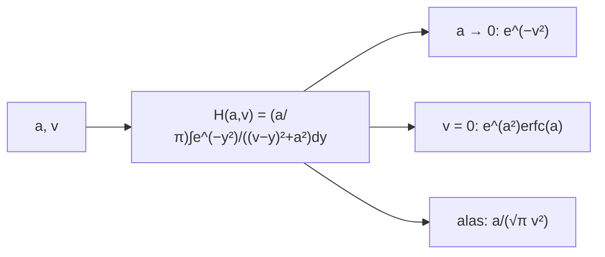

# B32-C04 — Opacidad de líneas: ensanchamiento y perfil de Voigt

<!-- nav:top -->
[🏠 Programa](../../../../README.md) · [📚 Bloque B32](../../../tronco-comun/B32-atmosferas-estelares-y-espectroscopia-estelar-cuantitativa.md) · [← Anterior: B32-C03 — Opacidad continua: ligado-libre, libre-libre y H-](../B32-C03-opacidad-continua-ligado-libre-libre-libre-y-h/CLASE.md) · [Siguiente: B32-C05 — Relación T-τ y estructura térmica de la fotosfera →](../B32-C05-relacion-t-y-estructura-termica-de-la-fotosfera/CLASE.md)
<!-- /nav -->

## 1. Ubicación, nivel y alcance

Clase 4 del bloque B32. Nivel N3. El perfil de una línea es la combinación de un ensanchamiento Doppler (gaussiano) y uno de amortiguamiento (lorentziano). Aquí calculas el **perfil de Voigt** `H(a, v)` por integración numérica, verificas sus límites y su normalización, y el **ancho Doppler** del hidrógeno a 5772 K. Usas [B05](../../../tronco-comun/B05-fisica-fundamental-para-el-espacio.md) y [B32-C03](../B32-C03-opacidad-continua-ligado-libre-libre-libre-y-h/CLASE.md). Se supone un solo absorbedor.

## 2. Por qué esta clase existe

Las alas de la línea dan la presión y las abundancias. La decisión central: **¿cuándo domina el núcleo gaussiano y cuándo las alas?**

## 3. Lo que podrás hacer al terminar

1. Calcular `H(a, v)` por Simpson.
2. Verificar `H(0, v) = e^(−v²)`.
3. Verificar `H(a, 0) = e^(a²)erfc(a)`.
4. Verificar las alas `a/(√π v²)`.
5. Calcular el ancho Doppler.
6. Comprobar la normalización.

La evidencia es la **ficha del perfil de Voigt** del ejercicio 12 (sección 20).

## 4. Con qué llegas y cómo comprobarlo

1. ¿Qué es una intensidad específica?
2. ¿Qué es una temperatura efectiva?
3. ¿Qué es una integral numérica?
4. ¿Qué es una función fuente?
5. ¿Qué es un perfil de línea?

<details>
<summary>Ver respuestas</summary>

1. La energía por área, tiempo, frecuencia y ángulo sólido. 2. La del cuerpo negro que da el mismo flujo. 3. Una suma que aproxima un área. 4. `S = j/κ`. 5. La forma de la absorción en función de la longitud de onda.
</details>

Con cuatro o cinco aciertos, sigue; si no, repasa los prerrequisitos.

## 5. Un caso de contexto y casos de referencia

A 5772 K el hidrógeno tiene una velocidad térmica de `9,762 km/s` y, en 656,28 nm, un ancho Doppler de `0,02137 nm`. Es el **ejemplo conductor**. Con `a = 0,1`, `H(0) = 0,8965`. Los parámetros `a` son **ilustrativos**.

## 6. Vocabulario

El **perfil de Voigt**. El **parámetro de amortiguamiento** `a`. El **núcleo** y las **alas**. El **ancho Doppler** `(λ/c)√(2kT/m)`. La **función de Faddeeva** equivale al perfil complejo.

## 7. Modelo mental: una campana con cola larga

El núcleo es una campana que cae rápido y las alas son una cola que cae como una potencia: lejos del centro solo queda la cola.



*Descripción textual:* la integral da el perfil, que tiende al gaussiano si `a` es pequeño, tiene un valor central conocido y alas de potencia.

Analogía: el núcleo es una campana que cae rápido y las alas son una cola que cae como una potencia: lejos del centro solo queda la cola. Límite: un solo absorbedor.

## 8. La explicación, paso a paso

### 8.1 Perfil

| `v` | `a = 0` | `a = 0,01` | `a = 0,1` | `a = 1` |
|---|---|---|---|---|
| 0 | 1,000000 | 0,988815 | 0,896457 | 0,427584 |
| 1 | 0,367879 | 0,368702 | 0,373170 | 0,304744 |
| 3 | 0,000123 | 0,000909 | 0,007943 | 0,065318 |
| 10 | 0,000000 | 0,000057 | 0,000573 | 0,005670 |

### 8.2 Límites

`H(0,1; 0) = 0,896457` coincide con `e^(a²)erfc(a)`. La normalización en `|v| < 30` es `1,76869` frente a `√π = 1,77245` (el 0,2 % que falta está en las alas). En `v = 30`, `H = 6,2792 × 10⁻⁵` y `a/(√π v²) = 6,2688 × 10⁻⁵`.

### 8.3 Lectura

En `v = 3` el perfil con `a = 0,1` es 65 veces mayor que el gaussiano: las alas dominan lejos del centro.

## 9. Magnitudes, símbolos y unidades

| Símbolo | Qué es | Unidad | Valor / nota |
|---|---|---|---|
| `a` | parámetro de amortiguamiento | — | 0–1 (ilustrativos) |
| `v` | desplazamiento en unidades Doppler | — | ver 8.1 |
| `Δλ_D` | ancho Doppler | nm | 0,02137 |

## 10. Convenciones y referencias

Un solo absorbedor, sin gradientes; `a` ilustrativo; `T = 5772 K` nominal.

## 11. De dónde sale lo que afirmamos

| ID | Fuente | Localizador | Respalda | Estado |
|---|---|---|---|---|
| S1 | NIST, *Fundamental Physical Constants* (CODATA 2022) | https://physics.nist.gov/cuu/Constants/Table/allascii.txt | constantes citadas en la sección 9 | Consultada el 2026-11-09 |
| S2 | UAI, Resolución B3 de 2015 | https://arxiv.org/abs/1510.07674 | `T_eff` nominal del Sol (5772 K) | Consultada el 2026-11-09 |

Límites: no se consultaron perfiles medidos ni constantes de amortiguamiento.

## 12. Cómo ver el perfil

| `v` | `H(0,1; v)` |
|---|---|
| 0 | 0,896 |
| 1 | 0,373 |
| 3 | 0,0079 |
| 10 | 0,00057 |

Descripción larga: el perfil cae rápido al principio y lentamente en las alas.

## 13. Ejemplo trabajado: ancho Doppler del hidrógeno

**Paso 1 · Velocidad.** `v_th = √(2kT/m_p) = 9,762 km/s`.

**Paso 2 · Cociente.** `v_th/c = 3,256 × 10⁻⁵`.

**Paso 3 · Producto.** `656,28 nm × 3,256 × 10⁻⁵`.

**Paso 4 · Valor.** `0,02137 nm`.

## 14. Distintas formas de describir una línea

**Por núcleo:** gaussiano. **Por alas:** lorentziano. **Por ancho:** Doppler.

## 15. Práctica guiada

**Ejercicio 1 · con los pasos indicados.** `H(0, 2)`. *Pasos:* `e^(−4)`.

<details><summary>Solución comentada</summary>

`0,0183`.
</details>

**Ejercicio 2 · con una pista.** `H(0,1; 0)`.

<details><summary>Solución comentada</summary>

`0,8965`.
</details>

**Ejercicio 3 · casi autónomo.** Ancho Doppler. *Pista:* ejemplo 13.

<details><summary>Solución comentada</summary>

`0,02137 nm`.
</details>

## 16. Práctica autónoma, transferencia e integrador

**Ejercicio 4.** Ala en `v = 30` con `a = 0,1`.

<details><summary>Solución comentada</summary>

`6,27 × 10⁻⁵`.
</details>

**Ejercicio 5.** Cociente `H(0,1; 3)/H(0; 3)`.

<details><summary>Solución comentada</summary>

`0,007943/0,000123 = 64,6`.
</details>

**Ejercicio 6.** `∫H dv`.

<details><summary>Solución comentada</summary>

`√π = 1,7725`.
</details>

**Ejercicio 7.** ¿Qué `a` da `H(a, 0) = 0,43`?

<details><summary>Solución comentada</summary>

`a = 1`.
</details>

**Ejercicio 8.** Velocidad térmica a 11 544 K.

<details><summary>Solución comentada</summary>

`9,762 × √2 = 13,8 km/s`.
</details>

**Ejercicio 9 · transferencia.** **Transferencia.** Un compañero usa `a = 0,1` como el de Hα. Responde.

<details><summary>Solución comentada</summary>

Es ilustrativo.
</details>

**Ejercicio 10 · transferencia.** **Transferencia.** ¿Por qué las alas no son gaussianas?

<details><summary>Solución comentada</summary>

Porque la amortiguación da un perfil lorentziano.
</details>

**Ejercicio 11 · transferencia.** **Transferencia.** ¿Qué verifica la normalización?

<details><summary>Solución comentada</summary>

La integración numérica.
</details>

**Ejercicio 12.** **Integrador.** Elabora tu *ficha del perfil de Voigt*: tabla, límites y ancho Doppler.

<details><summary>Solución comentada</summary>

Secciones 8.1–8.3.
</details>

**Ejercicio 12 · integrador.** **Integrador.** Elabora tu *ficha del perfil de Voigt*: tabla, límites y ancho Doppler.

<details><summary>Solución modelo</summary>

Secciones 8.1–8.3.
</details>

## 17. Laboratorio: perfil de Voigt

El script [voigt.py](voigt.py) integra el perfil y verifica sus límites (**comprueba** `10⁻⁹`, `10⁻⁶` y `10⁻²`).

**Datos:** `k_B`, `m_p`, `c` de NIST; `T` de la UAI; `a` **ilustrativos**. **Predice antes de ejecutar:** ¿cuánto vale `H(0,1; 0)`? (≈0,90.) **Ejecución del 2026-11-09 (Python 3.12.9):**

```text
Python 3.12.9 (biblioteca estandar)
velocidad termica del hidrogeno a 5772 K = 9.762 km/s ; Delta lambda_D (656.28 nm) = 0.02137 nm
    v        a = 0    a = 0.01     a = 0.1       a = 1
  0.0     1.000000    0.988815    0.896457    0.427584
  1.0     0.367879    0.368702    0.373170    0.304744
  3.0     0.000123    0.000909    0.007943    0.065318
 10.0     0.000000    0.000057    0.000573    0.005670
H(a, 0) frente a exp(a^2) erfc(a): a = 0.1 -> 0.896457 vs 0.896457
normalizacion Int H dv (a = 0.1, |v| < 30) = 1.76869 ; sqrt(pi) = 1.77245
ala en v = 30: H = 6.2792e-05 ; a/(sqrt(pi) v^2) = 6.2688e-05
Pruebas superadas.
```

```bash
python programa/clases/B32/B32-C04-opacidad-de-lineas-ensanchamiento-y-perfil-de-voigt/voigt.py
```

**Límites:** un solo absorbedor.

## 18. Errores frecuentes y cómo corregirlos

**Confundir `a` y el ancho.** Se corrige con la sección 6.

**Despreciar las alas.** Se corrige con 8.3.

**Tomar `a` por medido.** Se corrige con la sección 10.

**Mezclar `v` y velocidad.** Se corrige con la sección 9.

## 19. Cómo sabrás que vas bien

Tras 8: ¿qué resultado esperabas y cuál obtuviste? Si dudas, repasa el ejemplo 13. Tras el laboratorio: ¿qué comprueba? (ver la sección 17).

## 20. Qué entregas y cómo se evalúa

El producto es tu **ficha del perfil de Voigt** (ejercicio 12).

| Criterio | Inicial | En desarrollo | Logrado | Destacado |
|---|---|---|---|---|
| Conceptos | Los confunde | Parciales | conceptos de la clase | Explica los límites |
| Cálculo | Sin unidades | Con errores | Tablas completas | Calcula casos nuevos |
| Numérico | Sin comprobar | Un caso | Contraste con el análisis | Interpreta las diferencias |
| Fuentes | Sin fuente | Sin fecha | fuentes con fecha | Declara lo ilustrativo |
| Límites | No los nombra | Uno | Tres | Discute qué falta del modelo |

**Condiciones críticas (no se compensan con promedio):** rotular `a` como ilustrativo; no presentar los perfiles como medidos; citar solo lo consultado.

## 21. Ética, seguridad y límites

Clase educativa: los modelos son simplificados. Accesibilidad: tablas equivalentes a las gráficas, fórmulas en texto, ejercicios sin conexión.

## 22. Para cerrar y seguir

El hidrógeno a 5772 K tiene un ancho Doppler de 0,021 nm y, con `a = 0,1`, las alas superan 65 veces al gaussiano en `v = 3`. Queda una pregunta: ¿cómo es la estructura térmica?

**Glosario español–inglés.** perfil de Voigt · *Voigt profile*; ensanchamiento Doppler · *Doppler broadening*; amortiguamiento · *damping*; alas de la línea · *line wings*; velocidad térmica · *thermal velocity*.

**Continuidad.** [B32-C05](../B32-C05-relacion-t-y-estructura-termica-de-la-fotosfera/CLASE.md) estudia la relación T–τ.

**Referencias:** ver sección 11.

<!-- nav:bottom -->
---

[← Anterior: B32-C03 — Opacidad continua: ligado-libre, libre-libre y H-](../B32-C03-opacidad-continua-ligado-libre-libre-libre-y-h/CLASE.md) · [📚 Bloque B32](../../../tronco-comun/B32-atmosferas-estelares-y-espectroscopia-estelar-cuantitativa.md) · [Siguiente: B32-C05 — Relación T-τ y estructura térmica de la fotosfera →](../B32-C05-relacion-t-y-estructura-termica-de-la-fotosfera/CLASE.md)
<!-- /nav -->
