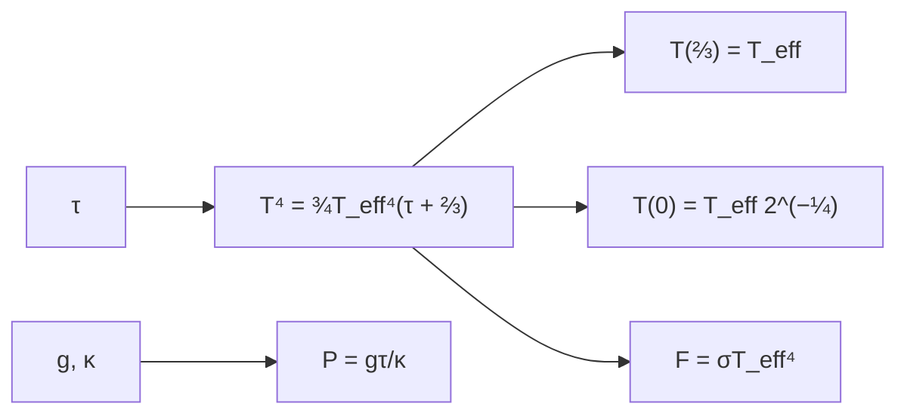

# B32-C05 — Relación T-τ y estructura térmica de la fotosfera

<!-- nav:top -->
[🏠 Programa](../../../../README.md) · [📚 Bloque B32](../../../tronco-comun/B32-atmosferas-estelares-y-espectroscopia-estelar-cuantitativa.md) · [← Anterior: B32-C04 — Opacidad de líneas: ensanchamiento y perfil de Voigt](../B32-C04-opacidad-de-lineas-ensanchamiento-y-perfil-de-voigt/CLASE.md) · [Siguiente: B32-C06 — Micro y macroturbulencia y granulación estelar →](../B32-C06-micro-y-macroturbulencia-y-granulacion-estelar/CLASE.md)
<!-- /nav -->

## 1. Ubicación, nivel y alcance

Clase 5 del bloque B32. Nivel N3. La temperatura de una atmósfera gris sigue la **relación de Eddington** `T⁴ = ¾T_eff⁴(τ + ⅔)`. Aquí la evalúas, la acompañas de un equilibrio hidrostático con opacidad constante y compruebas que el flujo emergente es `σT_eff⁴`. Usas [B05](../../../tronco-comun/B05-fisica-fundamental-para-el-espacio.md) y [B32-C01](../B32-C01-ecuacion-de-transferencia-radiativa-en-atmosferas-estelares/CLASE.md). La opacidad y la gravedad son ilustrativas.

## 2. Por qué esta clase existe

La relación T–τ da el gradiente que forma las líneas. La decisión central: **¿cuánto vale la temperatura a cada profundidad óptica?**

## 3. Lo que podrás hacer al terminar

1. Evaluar `T(τ)` de Eddington.
2. Verificar `T(⅔) = T_eff`.
3. Calcular `T(0) = T_eff2^(−1/4)`.
4. Calcular `P = gτ/κ`.
5. Verificar el flujo emergente.
6. Reconocer los límites de la atmósfera gris.

La evidencia es la **ficha de la estructura térmica** del ejercicio 12 (sección 20).

## 4. Con qué llegas y cómo comprobarlo

1. ¿Qué es una intensidad específica?
2. ¿Qué es una temperatura efectiva?
3. ¿Qué es una integral numérica?
4. ¿Qué es una función fuente?
5. ¿Qué es un perfil de línea?

<details>
<summary>Ver respuestas</summary>

1. La energía por área, tiempo, frecuencia y ángulo sólido. 2. La del cuerpo negro que da el mismo flujo. 3. Una suma que aproxima un área. 4. `S = j/κ`. 5. La forma de la absorción en función de la longitud de onda.
</details>

Con cuatro o cinco aciertos, sigue; si no, repasa los prerrequisitos.

## 5. Un caso de contexto y casos de referencia

Con `T_eff = 5772 K`, `T(τ=0) = 4853,7 K` y `T(τ=⅔) = 5772 K`. Es el **ejemplo conductor** (S2). Con `κ = 0,03 m²/kg` y `g = 274,2 m/s²` (ilustrativos), `P(τ=1) = 9140 Pa`.

## 6. Vocabulario

La **relación T–τ**. La **temperatura efectiva**. La **profundidad óptica**. El **equilibrio hidrostático** `dP/dτ = g/κ`. La **atmósfera gris**.

## 7. Modelo mental: una manta

Como una manta: cuanto más gruesa la capa por encima (mayor `τ`), más caliente debajo.



*Descripción textual:* la profundidad óptica da la temperatura y, con la gravedad y la opacidad, la presión; el flujo emergente comprueba el modelo.

Analogía: como una manta: cuanto más gruesa la capa por encima (mayor `τ`), más caliente debajo. Límite: atmósfera gris.

## 8. La explicación, paso a paso

### 8.1 Estructura

| `τ` | `T` (K) | `T/T_eff` | `P` (Pa) |
|---|---|---|---|
| 0 | 4853,7 | 0,8409 | 0 |
| 0,1 | 5026,2 | 0,8708 | 914 |
| 0,3 | 5326,1 | 0,9228 | 2742 |
| ⅔ | 5772,0 | 1,0000 | 6093 |
| 1 | 6103,1 | 1,0574 | 9140 |
| 3 | 7432,9 | 1,2878 | 27 420 |
| 10 | 9707,3 | 1,6818 | 91 400 |

### 8.2 Flujo

`T(0)/T_eff = 0,84090 = 2^(−1/4)`. El flujo emergente es `6,293845 × 10⁷ W/m²` frente a `σT_eff⁴ = 6,293859 × 10⁷` (cociente `1,00000`).

### 8.3 Lectura

La fotosfera se calienta hacia el interior: de 4854 K en la superficie a 9707 K en `τ = 10`. La línea de la capa `τ = ⅔` es donde `T = T_eff`.

## 9. Magnitudes, símbolos y unidades

| Símbolo | Qué es | Unidad | Valor / nota |
|---|---|---|---|
| `T_eff` | temperatura efectiva | K | 5772 (S2) |
| `g` | gravedad | m/s² | 274,2 |
| `κ` | opacidad | m²/kg | 0,03 (ilustrativa) |
| `P` | presión | Pa | `gτ/κ` |

## 10. Convenciones y referencias

Atmósfera gris en equilibrio radiativo; `κ` constante ilustrativa.

## 11. De dónde sale lo que afirmamos

| ID | Fuente | Localizador | Respalda | Estado |
|---|---|---|---|---|
| S1 | NIST, *Fundamental Physical Constants* (CODATA 2022) | https://physics.nist.gov/cuu/Constants/Table/allascii.txt | constantes citadas en la sección 9 | Consultada el 2026-11-09 |
| S2 | UAI, Resolución B3 de 2015 | https://arxiv.org/abs/1510.07674 | `T_eff` nominal del Sol (5772 K) | Consultada el 2026-11-09 |

Límites: no se consultó ningún modelo de atmósfera real.

## 12. Cómo ver la temperatura

| `τ` | `T` (K) |
|---|---|
| 0 | 4854 |
| ⅔ | 5772 |
| 3 | 7433 |

Descripción larga: la temperatura sube con la profundidad óptica.

## 13. Ejemplo trabajado: temperatura en τ = 1

**Paso 1 · Suma.** `τ + ⅔ = 1,6667`.

**Paso 2 · Producto.** `0,75 × 1,6667 = 1,25`.

**Paso 3 · Raíz cuarta.** `1,25^(1/4) = 1,0574`.

**Paso 4 · Valor.** `5772 × 1,0574 = 6103 K`.

## 14. Distintas formas de describir una fotosfera

**Por profundidad:** `τ`. **Por temperatura:** Eddington. **Por presión:** hidrostática. **Por flujo:** `σT_eff⁴`.

## 15. Práctica guiada

**Ejercicio 1 · con los pasos indicados.** `T(1)`. *Pasos:* ejemplo 13.

<details><summary>Solución comentada</summary>

`6103 K`.
</details>

**Ejercicio 2 · con una pista.** `T(0)`.

<details><summary>Solución comentada</summary>

`4854 K`.
</details>

**Ejercicio 3 · casi autónomo.** `T(3)`.

<details><summary>Solución comentada</summary>

`7433 K`.
</details>

## 16. Práctica autónoma, transferencia e integrador

**Ejercicio 4.** `P(τ = 3)`.

<details><summary>Solución comentada</summary>

`27 420 Pa`.
</details>

**Ejercicio 5.** `T(10)/T_eff`.

<details><summary>Solución comentada</summary>

`1,682`.
</details>

**Ejercicio 6.** Cociente de flujos.

<details><summary>Solución comentada</summary>

`1,00000`.
</details>

**Ejercicio 7.** Profundidad con `T = 2T_eff`.

<details><summary>Solución comentada</summary>

`τ = 16/0,75 − 2/3 = 20,67`.
</details>

**Ejercicio 8.** ¿Qué `τ` tiene `T = T_eff`?

<details><summary>Solución comentada</summary>

`⅔`.
</details>

**Ejercicio 9 · transferencia.** **Transferencia.** Un compañero usa `κ = 0,03` como real. Responde.

<details><summary>Solución comentada</summary>

Es ilustrativa.
</details>

**Ejercicio 10 · transferencia.** **Transferencia.** ¿Por qué la atmósfera gris no es real?

<details><summary>Solución comentada</summary>

La opacidad depende de la longitud de onda.
</details>

**Ejercicio 11 · transferencia.** **Transferencia.** ¿Qué verifica el flujo?

<details><summary>Solución comentada</summary>

Que la relación cumple el equilibrio radiativo del modelo.
</details>

**Ejercicio 12.** **Integrador.** Elabora tu *ficha de la estructura térmica*: tabla, flujo y lectura.

<details><summary>Solución comentada</summary>

Secciones 8.1–8.3.
</details>

**Ejercicio 12 · integrador.** **Integrador.** Elabora tu *ficha de la estructura térmica*: tabla, flujo y lectura.

<details><summary>Solución modelo</summary>

Secciones 8.1–8.3.
</details>

## 17. Laboratorio: relación T–τ y flujo

El script [ttau.py](ttau.py) evalúa la relación y comprueba el flujo (**comprueba** `10⁻¹²` y `10⁻²`).

**Datos:** `σ` de NIST; `T_eff` de la UAI; `κ`, `g` **ilustrativas**. **Predice antes de ejecutar:** ¿cuál es `T(0)`? (≈4854 K.) **Ejecución del 2026-11-09 (Python 3.12.9):**

```text
Python 3.12.9 (biblioteca estandar)
     tau     T [K]   T/T_eff   P = g tau/kappa [Pa]
  0.0000    4853.7    0.8409                    0.0
  0.1000    5026.2    0.8708                  914.0
  0.3000    5326.1    0.9228                 2742.0
  0.6667    5772.0    1.0000                 6093.3
  1.0000    6103.1    1.0574                 9140.0
  3.0000    7432.9    1.2878                27420.0
 10.0000    9707.3    1.6818                91400.0
T(0) = T_eff 2^(-1/4) = 4853.65 K ; cociente 0.84090 (analitico 0.84090)
flujo emergente = 6.293845e+07 W/m2 ; sigma T_eff^4 = 6.293859e+07 ; cociente = 1.00000
Pruebas superadas.
```

```bash
python programa/clases/B32/B32-C05-relacion-t-y-estructura-termica-de-la-fotosfera/ttau.py
```

**Límites:** atmósfera gris.

## 18. Errores frecuentes y cómo corregirlos

**Confundir `T_eff` y `T(τ = 1)`.** Se corrige con 8.1.

**Olvidar el `⅔`.** Se corrige con el ejemplo 13.

**Tomar `κ` por medido.** Se corrige con la sección 10.

**Extrapolar a atmósferas no grises.** Se corrige con la sección 10.

## 19. Cómo sabrás que vas bien

Tras 8: ¿qué resultado esperabas y cuál obtuviste? Si dudas, repasa el ejemplo 13. Tras el laboratorio: ¿qué comprueba? (ver la sección 17).

## 20. Qué entregas y cómo se evalúa

El producto es tu **ficha de la estructura térmica** (ejercicio 12).

| Criterio | Inicial | En desarrollo | Logrado | Destacado |
|---|---|---|---|---|
| Conceptos | Los confunde | Parciales | conceptos de la clase | Explica los límites |
| Cálculo | Sin unidades | Con errores | Tablas completas | Calcula casos nuevos |
| Numérico | Sin comprobar | Un caso | Contraste con el análisis | Interpreta las diferencias |
| Fuentes | Sin fuente | Sin fecha | fuentes con fecha | Declara lo ilustrativo |
| Límites | No los nombra | Uno | Tres | Discute qué falta del modelo |

**Condiciones críticas (no se compensan con promedio):** rotular `κ` como ilustrativa; no presentar la relación como un modelo real; citar solo lo consultado.

## 21. Ética, seguridad y límites

Clase educativa: los modelos son simplificados. Accesibilidad: tablas equivalentes a las gráficas, fórmulas en texto, ejercicios sin conexión.

## 22. Para cerrar y seguir

La atmósfera gris pasa de 4854 K en la superficie a 5772 K en `τ = ⅔` y 9707 K en `τ = 10`. Queda una pregunta: ¿qué ensanchamientos no térmicos hay?

**Glosario español–inglés.** relación T–τ · *T–τ relation*; temperatura efectiva · *effective temperature*; equilibrio radiativo · *radiative equilibrium*; atmósfera gris · *grey atmosphere*; fotosfera · *photosphere*.

**Continuidad.** [B32-C06](../B32-C06-micro-y-macroturbulencia-y-granulacion-estelar/CLASE.md) estudia la micro y macroturbulencia.

**Referencias:** ver sección 11.

<!-- nav:bottom -->
---

[← Anterior: B32-C04 — Opacidad de líneas: ensanchamiento y perfil de Voigt](../B32-C04-opacidad-de-lineas-ensanchamiento-y-perfil-de-voigt/CLASE.md) · [📚 Bloque B32](../../../tronco-comun/B32-atmosferas-estelares-y-espectroscopia-estelar-cuantitativa.md) · [Siguiente: B32-C06 — Micro y macroturbulencia y granulación estelar →](../B32-C06-micro-y-macroturbulencia-y-granulacion-estelar/CLASE.md)
<!-- /nav -->
