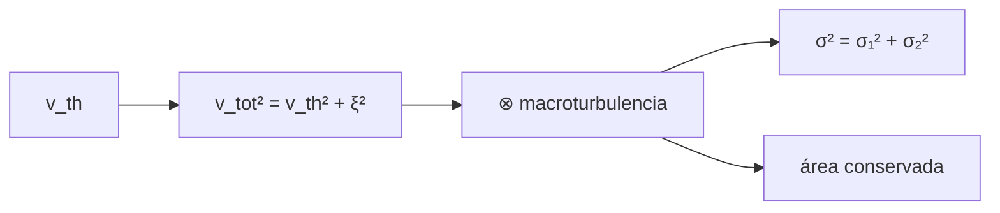

# B32-C06 — Micro y macroturbulencia y granulación estelar

<!-- nav:top -->
[🏠 Programa](../../../../README.md) · [📚 Bloque B32](../../../tronco-comun/B32-atmosferas-estelares-y-espectroscopia-estelar-cuantitativa.md) · [← Anterior: B32-C05 — Relación T-τ y estructura térmica de la fotosfera](../B32-C05-relacion-t-y-estructura-termica-de-la-fotosfera/CLASE.md) · [Siguiente: B32-C07 — Modelos de atmósferas estelares 1D y 3D hidrodinámicos →](../B32-C07-modelos-de-atmosferas-estelares-1d-y-3d-hidrodinamicos/CLASE.md)
<!-- /nav -->

## 1. Ubicación, nivel y alcance

Clase 6 del bloque B32. Nivel N3. Además del ensanchamiento térmico, los movimientos del gas ensanchan las líneas. Aquí sumas el ensanchamiento **térmico** y la **microturbulencia**, convolucionas la línea con la **macroturbulencia** gaussiana y verificas que las anchuras gaussianas se suman en cuadratura y que el área se conserva. Usas [B12](../../../tronco-comun/B12-probabilidad-estadistica-e-incertidumbre.md) y [B32-C04](../B32-C04-opacidad-de-lineas-ensanchamiento-y-perfil-de-voigt/CLASE.md). Los parámetros son ilustrativos.

## 2. Por qué esta clase existe

Atribuir mal el ensanchamiento sesga la rotación y la abundancia. La decisión central: **¿cuánto aporta cada efecto al ancho de la línea?**

## 3. Lo que podrás hacer al terminar

1. Calcular `v_th = √(2kT/m)`.
2. Sumar la microturbulencia en cuadratura.
3. Convolucionar con la macroturbulencia.
4. Verificar `σ² = σ₁² + σ₂²`.
5. Verificar la conservación del área.
6. Repartir el ensanchamiento.

La evidencia es la **ficha del ensanchamiento por turbulencia** del ejercicio 12 (sección 20).

## 4. Con qué llegas y cómo comprobarlo

1. ¿Qué es una intensidad específica?
2. ¿Qué es una temperatura efectiva?
3. ¿Qué es una integral numérica?
4. ¿Qué es una función fuente?
5. ¿Qué es un perfil de línea?

<details>
<summary>Ver respuestas</summary>

1. La energía por área, tiempo, frecuencia y ángulo sólido. 2. La del cuerpo negro que da el mismo flujo. 3. Una suma que aproxima un área. 4. `S = j/κ`. 5. La forma de la absorción en función de la longitud de onda.
</details>

Con cuatro o cinco aciertos, sigue; si no, repasa los prerrequisitos.

## 5. Un caso de contexto y casos de referencia

Una línea de Fe I (525 nm) a 5772 K tiene `v_th = 1,311 km/s`; con microturbulencia de 1 km/s, `1,649 km/s`; con macroturbulencia de 3 km/s, un ancho de `5,995 pm`. Es el **ejemplo conductor**. Los parámetros son **ilustrativos**.

## 6. Vocabulario

La **velocidad térmica**. La **microturbulencia** es a escalas menores que el recorrido de un fotón. La **macroturbulencia** es a escalas mayores. La **convolución**. La **cuadratura** suma varianzas.

## 7. Modelo mental: un coro desafinado

Cada fuente de ensanchamiento es un cantante desafinado distinto; el resultado es la suma de desafinaciones en cuadratura, y el volumen total (el área) no cambia.



*Descripción textual:* la velocidad térmica y la microturbulencia se suman en cuadratura; la macroturbulencia se convoluciona y suma otra varianza sin cambiar el área.

Analogía: cada fuente de ensanchamiento es un cantante desafinado distinto; el resultado es la suma de desafinaciones en cuadratura, y el volumen total (el área) no cambia. Límite: perfiles gaussianos.

## 8. La explicación, paso a paso

### 8.1 Anchos (Fe I, 525 nm, 5772 K)

| componente | velocidad (km/s) | `Δλ` (pm) |
|---|---|---|
| térmica | 1,311 | 2,296 |
| térmica + micro | 1,649 | 2,887 |
| + macro (3 km/s) | 3,42 | 5,995 |

### 8.2 Convolución

`σ₁ = 1,1659 km/s` y `σ₂ = 2,1213 km/s` dan `σ = 2,42059 km/s` por convolución numérica frente a `2,42061` en cuadratura; el área es `0,999999`.

### 8.3 Reparto de la varianza

Térmico `14,7 %`, micro `8,5 %`, macro `76,8 %`.

### 8.4 Lectura

La macroturbulencia domina el ancho y su efecto se confunde con el de la rotación (B32-C11).

## 9. Magnitudes, símbolos y unidades

| Símbolo | Qué es | Unidad | Valor / nota |
|---|---|---|---|
| `v_th` | velocidad térmica | km/s | 1,311 |
| `ξ` | microturbulencia | km/s | 1 (ilustrativa) |
| `ζ` | macroturbulencia | km/s | 3 (ilustrativa) |
| `m` | masa del Fe | u | 55,845 (estándar no consultado) |

## 10. Convenciones y referencias

Perfiles gaussianos; parámetros ilustrativos.

## 11. De dónde sale lo que afirmamos

| ID | Fuente | Localizador | Respalda | Estado |
|---|---|---|---|---|
| S1 | NIST, *Fundamental Physical Constants* (CODATA 2022) | https://physics.nist.gov/cuu/Constants/Table/allascii.txt | constantes citadas en la sección 9 | Consultada el 2026-11-09 |
| S2 | UAI, Resolución B3 de 2015 | https://arxiv.org/abs/1510.07674 | `T_eff` nominal del Sol (5772 K) | Consultada el 2026-11-09 |

Límites: no se consultó ninguna medida de turbulencia; la masa del Fe es estándar.

## 12. Cómo ver el reparto

| Efecto | Varianza |
|---|---|
| térmico | 14,7 % |
| micro | 8,5 % |
| macro | 76,8 % |

Descripción larga: la macroturbulencia aporta tres cuartas partes de la varianza.

## 13. Ejemplo trabajado: ancho térmico del Fe

**Paso 1 · Masa.** `m = 55,845 u`.

**Paso 2 · Velocidad.** `v_th = √(2kT/m) = 1,311 km/s`.

**Paso 3 · Ancho.** `Δλ = (λ/c)v_th`.

**Paso 4 · Valor.** `2,296 pm`.

## 14. Distintas formas de describir una línea ancha

**Por térmico:** `√(2kT/m)`. **Por micro:** cuadratura. **Por macro:** convolución.

## 15. Práctica guiada

**Ejercicio 1 · con los pasos indicados.** `v_th` del Fe. *Pasos:* ejemplo 13.

<details><summary>Solución comentada</summary>

`1,311 km/s`.
</details>

**Ejercicio 2 · con una pista.** Velocidad total con micro 1 km/s.

<details><summary>Solución comentada</summary>

`1,649 km/s`.
</details>

**Ejercicio 3 · casi autónomo.** `Δλ` total en 525 nm.

<details><summary>Solución comentada</summary>

`2,887 pm`.
</details>

## 16. Práctica autónoma, transferencia e integrador

**Ejercicio 4.** `σ` de la convolución.

<details><summary>Solución comentada</summary>

`2,4206 km/s`.
</details>

**Ejercicio 5.** Fracción macro de la varianza.

<details><summary>Solución comentada</summary>

`76,8 %`.
</details>

**Ejercicio 6.** Cociente `Δλ`(macro)/`Δλ`(total sin macro).

<details><summary>Solución comentada</summary>

`5,995/2,887 = 2,08`.
</details>

**Ejercicio 7.** ¿Qué pasa con el área al convolucionar?

<details><summary>Solución comentada</summary>

Se conserva.
</details>

**Ejercicio 8.** `v_th` del H a 5772 K.

<details><summary>Solución comentada</summary>

`9,76 km/s`.
</details>

**Ejercicio 9 · transferencia.** **Transferencia.** Un compañero usa 1 km/s como la microturbulencia solar. Responde.

<details><summary>Solución comentada</summary>

Es ilustrativa.
</details>

**Ejercicio 10 · transferencia.** **Transferencia.** ¿Por qué se suma en cuadratura?

<details><summary>Solución comentada</summary>

Porque las varianzas de gaussianas independientes se suman.
</details>

**Ejercicio 11 · transferencia.** **Transferencia.** ¿Se distingue macro de rotación?

<details><summary>Solución comentada</summary>

Solo con el perfil exacto; esta clase no lo hace.
</details>

**Ejercicio 12.** **Integrador.** Elabora tu *ficha del ensanchamiento por turbulencia*: velocidades, convolución y reparto.

<details><summary>Solución comentada</summary>

Secciones 8.1–8.4.
</details>

**Ejercicio 12 · integrador.** **Integrador.** Elabora tu *ficha del ensanchamiento por turbulencia*: velocidades, convolución y reparto.

<details><summary>Solución modelo</summary>

Secciones 8.1–8.4.
</details>

## 17. Laboratorio: ensanchamiento por turbulencia

El script [turbulencia.py](turbulencia.py) suma anchos y convoluciona (**comprueba** la cuadratura a `10⁻⁴` y el área a `10⁻⁶`).

**Datos:** `k_B`, `u`, `c` de NIST y `T` de la UAI; `ξ`, `ζ` **ilustrativos**. **Predice antes de ejecutar:** ¿qué efecto domina? (la macroturbulencia.) **Ejecución del 2026-11-09 (Python 3.12.9):**

```text
Python 3.12.9 (biblioteca estandar)
velocidad termica del Fe a 5772 K = 1.3110 km/s ; con microturbulencia de 1 km/s: 1.6489 km/s
Delta lambda_D termico = 2.296 pm ; total = 2.887 pm ; con macroturbulencia (cuadratura) = 5.995 pm
sigma_1 = 1.1659 km/s ; sigma_2 = 2.1213 km/s ; sigma convolucion = 2.42059 ; cuadratura = 2.42061 km/s ; area = 0.999999
fraccion del ensanchamiento debida a cada efecto (en varianza): termico 14.7 %, micro 8.5 %, macro 76.8 %
Pruebas superadas.
```

```bash
python programa/clases/B32/B32-C06-micro-y-macroturbulencia-y-granulacion-estelar/turbulencia.py
```

**Límites:** perfiles gaussianos.

## 18. Errores frecuentes y cómo corregirlos

**Sumar anchos linealmente.** Se corrige con 8.2.

**Confundir micro y macro.** Se corrige con la sección 6.

**Tomar los valores por medidos.** Se corrige con la sección 10.

**Olvidar la masa.** Se corrige con el ejemplo 13.

## 19. Cómo sabrás que vas bien

Tras 8: ¿qué resultado esperabas y cuál obtuviste? Si dudas, repasa el ejemplo 13. Tras el laboratorio: ¿qué comprueba? (ver la sección 17).

## 20. Qué entregas y cómo se evalúa

El producto es tu **ficha del ensanchamiento por turbulencia** (ejercicio 12).

| Criterio | Inicial | En desarrollo | Logrado | Destacado |
|---|---|---|---|---|
| Conceptos | Los confunde | Parciales | conceptos de la clase | Explica los límites |
| Cálculo | Sin unidades | Con errores | Tablas completas | Calcula casos nuevos |
| Numérico | Sin comprobar | Un caso | Contraste con el análisis | Interpreta las diferencias |
| Fuentes | Sin fuente | Sin fecha | fuentes con fecha | Declara lo ilustrativo |
| Límites | No los nombra | Uno | Tres | Discute qué falta del modelo |

**Condiciones críticas (no se compensan con promedio):** rotular `ξ` y `ζ` como ilustrativos; no atribuirlos al Sol; citar solo lo consultado.

## 21. Ética, seguridad y límites

Clase educativa: los modelos son simplificados. Accesibilidad: tablas equivalentes a las gráficas, fórmulas en texto, ejercicios sin conexión.

## 22. Para cerrar y seguir

Un ancho térmico de 2,3 pm sube a 6,0 pm con micro y macroturbulencia ilustrativas, y la macro aporta el 77 % de la varianza. Queda una pregunta: ¿cómo se modela una atmósfera completa?

**Glosario español–inglés.** microturbulencia · *microturbulence*; macroturbulencia · *macroturbulence*; velocidad térmica · *thermal velocity*; convolución · *convolution*; granulación · *granulation*.

**Continuidad.** [B32-C07](../B32-C07-modelos-de-atmosferas-estelares-1d-y-3d-hidrodinamicos/CLASE.md) estudia los modelos de atmósferas 1D y 3D.

**Referencias:** ver sección 11.

<!-- nav:bottom -->
---

[← Anterior: B32-C05 — Relación T-τ y estructura térmica de la fotosfera](../B32-C05-relacion-t-y-estructura-termica-de-la-fotosfera/CLASE.md) · [📚 Bloque B32](../../../tronco-comun/B32-atmosferas-estelares-y-espectroscopia-estelar-cuantitativa.md) · [Siguiente: B32-C07 — Modelos de atmósferas estelares 1D y 3D hidrodinámicos →](../B32-C07-modelos-de-atmosferas-estelares-1d-y-3d-hidrodinamicos/CLASE.md)
<!-- /nav -->
