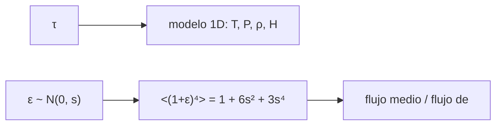

# B32-C07 — Modelos de atmósferas estelares 1D y 3D hidrodinámicos

<!-- nav:top -->
[🏠 Programa](../../../../README.md) · [📚 Bloque B32](../../../tronco-comun/B32-atmosferas-estelares-y-espectroscopia-estelar-cuantitativa.md) · [← Anterior: B32-C06 — Micro y macroturbulencia y granulación estelar](../B32-C06-micro-y-macroturbulencia-y-granulacion-estelar/CLASE.md) · [Siguiente: B32-C08 — Síntesis espectral e inversión de perfiles →](../B32-C08-sintesis-espectral-e-inversion-de-perfiles/CLASE.md)
<!-- /nav -->

## 1. Ubicación, nivel y alcance

Clase 7 del bloque B32. Nivel N3. Un modelo 1D describe la atmósfera con una sola temperatura por capa; un modelo 3D incluye fluctuaciones horizontales. Aquí integras un modelo **1D hidrostático** (presión, densidad y altura de escala) y estimas con un **juguete 3D** cuánto cambia el flujo medio cuando la temperatura fluctúa un 10 %. Usas [B05](../../../tronco-comun/B05-fisica-fundamental-para-el-espacio.md) y [B32-C05](../B32-C05-relacion-t-y-estructura-termica-de-la-fotosfera/CLASE.md). No se simula ninguna atmósfera real.

## 2. Por qué esta clase existe

Las abundancias derivadas con 1D pueden diferir de las 3D por la no linealidad del flujo con la temperatura. La decisión central: **¿cuánto sesga una fluctuación la temperatura inferida?**

## 3. Lo que podrás hacer al terminar

1. Calcular `P`, `ρ` y `H` de un modelo 1D.
2. Calcular `<T⁴>` con fluctuaciones gaussianas.
3. Comparar con `1 + 6s² + 3s⁴`.
4. Calcular el flujo medio frente al flujo de la temperatura media.
5. Calcular la temperatura equivalente.
6. Reconocer los límites del juguete.

La evidencia es la **ficha de los modelos de atmósfera** del ejercicio 12 (sección 20).

## 4. Con qué llegas y cómo comprobarlo

1. ¿Qué es una intensidad específica?
2. ¿Qué es una temperatura efectiva?
3. ¿Qué es una integral numérica?
4. ¿Qué es una función fuente?
5. ¿Qué es un perfil de línea?

<details>
<summary>Ver respuestas</summary>

1. La energía por área, tiempo, frecuencia y ángulo sólido. 2. La del cuerpo negro que da el mismo flujo. 3. Una suma que aproxima un área. 4. `S = j/κ`. 5. La forma de la absorción en función de la longitud de onda.
</details>

Con cuatro o cinco aciertos, sigue; si no, repasa los prerrequisitos.

## 5. Un caso de contexto y casos de referencia

Con `τ = ⅔`, el modelo 1D da `T = 5772 K`, `P = 6093 Pa`, `ρ = 1,65 × 10⁻⁴ kg/m³` y `H = 134,6 km`. Es el **ejemplo conductor**. Una fluctuación del 10 % aumenta el flujo medio un `6,0 %`.

## 6. Vocabulario

El **modelo 1D**. El **modelo 3D hidrodinámico**. La **altura de escala**. La **fluctuación**. La **no linealidad** de `T⁴` hace que `<T⁴> > <T>⁴`.

## 7. Modelo mental: un hervidor

En un hervidor el agua está más caliente y más fría en distintos lugares; el promedio de la radiación no es la radiación del promedio.



*Descripción textual:* la profundidad óptica define el modelo 1D; las fluctuaciones gaussianas elevan el flujo medio por encima del de la temperatura media.

Analogía: en un hervidor el agua está más caliente y más fría en distintos lugares; el promedio de la radiación no es la radiación del promedio. Límite: capas planas sin convección explícita.

## 8. La explicación, paso a paso

### 8.1 Modelo 1D

| `τ` | `T` (K) | `P` (Pa) | `ρ` (kg/m³) | `H` (km) |
|---|---|---|---|---|
| 0,01 | 4871,8 | 91,4 | 2,9334 × 10⁻⁶ | 113,6 |
| 0,1 | 5026,2 | 914 | 2,8432 × 10⁻⁵ | 117,2 |
| ⅔ | 5772,0 | 6093 | 1,6506 × 10⁻⁴ | 134,6 |
| 1 | 6103,1 | 9140 | 2,3415 × 10⁻⁴ | 142,4 |
| 3 | 7432,9 | 27 420 | 5,7679 × 10⁻⁴ | 173,4 |

### 8.2 Juguete 3D (`s = 10 %`, 400 000 muestras)

`<(1+ε)⁴> = 1,05952` frente a `1 + 6s² + 3s⁴ = 1,06030`. El flujo medio es `1,0603` veces el de la temperatura media y la temperatura equivalente `1,01475` veces la media.

### 8.3 Lectura

Una dispersión del 10 % sesga al alza el flujo un 6 % y la temperatura equivalente un 1,5 %: ese es el tipo de efecto por el que los modelos 3D y 1D difieren.

## 9. Magnitudes, símbolos y unidades

| Símbolo | Qué es | Unidad | Valor / nota |
|---|---|---|---|
| `H` | altura de escala | km | ver 8.1 |
| `s` | dispersión relativa de `T` | — | 0,10 (ilustrativa) |
| `μ` | masa molecular media | — | 1,3 (ilustrativa) |

## 10. Convenciones y referencias

Capas planas, sin convección; `s`, `μ`, `κ` ilustrativos; semilla `20261109`.

## 11. De dónde sale lo que afirmamos

| ID | Fuente | Localizador | Respalda | Estado |
|---|---|---|---|---|
| S1 | NIST, *Fundamental Physical Constants* (CODATA 2022) | https://physics.nist.gov/cuu/Constants/Table/allascii.txt | constantes citadas en la sección 9 | Consultada el 2026-11-09 |
| S2 | UAI, Resolución B3 de 2015 | https://arxiv.org/abs/1510.07674 | `T_eff` nominal del Sol (5772 K) | Consultada el 2026-11-09 |

Límites: no se consultó ningún modelo 1D ni 3D publicado.

## 12. Cómo ver el sesgo

| Magnitud | Valor |
|---|---|
| `<(1+ε)⁴>` | 1,0595 |
| flujo medio / flujo de `<T>` | 1,0603 |
| `T` equivalente / `<T>` | 1,0148 |

Descripción larga: la fluctuación del 10 % produce un 6 % más de flujo.

## 13. Ejemplo trabajado: altura de escala a τ = ⅔

**Paso 1 · `kT`.** `1,3806 × 10⁻²³ × 5772`.

**Paso 2 · Masa.** `μ u g = 1,3 × 1,6605 × 10⁻²⁷ × 274,2`.

**Paso 3 · Cociente.** `H = 1,346 × 10⁵ m`.

**Paso 4 · Lectura.** `134,6 km`.

## 14. Distintas formas de describir una atmósfera

**Por capa:** 1D. **Por fluctuación:** 3D. **Por sesgo:** no linealidad. **Por altura:** `H`.

## 15. Práctica guiada

**Ejercicio 1 · con los pasos indicados.** `H` a `τ = ⅔`. *Pasos:* ejemplo 13.

<details><summary>Solución comentada</summary>

`134,6 km`.
</details>

**Ejercicio 2 · con una pista.** `P` a `τ = 1`.

<details><summary>Solución comentada</summary>

`9140 Pa`.
</details>

**Ejercicio 3 · casi autónomo.** `<(1+ε)⁴>` con `s = 0,1`.

<details><summary>Solución comentada</summary>

`1,0603`.
</details>

## 16. Práctica autónoma, transferencia e integrador

**Ejercicio 4.** Sesgo del flujo con `s = 0,2`.

<details><summary>Solución comentada</summary>

`1 + 0,24 + 0,0048 = 1,2448`.
</details>

**Ejercicio 5.** Temperatura equivalente con `s = 0,1`.

<details><summary>Solución comentada</summary>

`1,0148` veces.
</details>

**Ejercicio 6.** Cociente `ρ(3)/ρ(0,1)`.

<details><summary>Solución comentada</summary>

`20,3`.
</details>

**Ejercicio 7.** ¿Por qué `<T⁴> ≥ <T>⁴`?

<details><summary>Solución comentada</summary>

Por la desigualdad de Jensen.
</details>

**Ejercicio 8.** `H` a `τ = 3`.

<details><summary>Solución comentada</summary>

`173,4 km`.
</details>

**Ejercicio 9 · transferencia.** **Transferencia.** Un compañero atribuye el 6 % a las granulaciones solares. Responde.

<details><summary>Solución comentada</summary>

Es un juguete con `s` ilustrativo.
</details>

**Ejercicio 10 · transferencia.** **Transferencia.** ¿Qué omite el juguete 3D?

<details><summary>Solución comentada</summary>

Correlaciones, densidad y velocidad.
</details>

**Ejercicio 11 · transferencia.** **Transferencia.** ¿Qué hace falta para validar un modelo?

<details><summary>Solución comentada</summary>

Comparación con observaciones, que no se consultó.
</details>

**Ejercicio 12.** **Integrador.** Elabora tu *ficha de los modelos de atmósfera*: tabla 1D y sesgo del juguete.

<details><summary>Solución comentada</summary>

Secciones 8.1–8.3.
</details>

**Ejercicio 12 · integrador.** **Integrador.** Elabora tu *ficha de los modelos de atmósfera*: tabla 1D y sesgo del juguete.

<details><summary>Solución modelo</summary>

Secciones 8.1–8.3.
</details>

## 17. Laboratorio: modelo 1D y juguete 3D

El script [modelos.py](modelos.py) integra un modelo 1D y estima el sesgo de las fluctuaciones (**comprueba** a 4 errores estándar).

**Datos:** `k_B`, `u`, `σ` de NIST; `T_eff` de la UAI; `s`, `κ`, `μ` **ilustrativos**; semilla `20261109`. **Predice antes de ejecutar:** ¿cuánto sube el flujo con 10 %? (≈6 %.) **Ejecución del 2026-11-09 (Python 3.12.9):**

```text
Python 3.12.9 (biblioteca estandar)
   tau    T [K]      P [Pa]  rho [kg/m3]   H [km]
 0.010   4871.8       91.40   2.9334e-06    113.6
 0.100   5026.2      914.00   2.8432e-05    117.2
 0.667   5772.0     6093.33   1.6506e-04    134.6
 1.000   6103.1     9140.00   2.3415e-04    142.4
 3.000   7432.9    27420.00   5.7679e-04    173.4
<(1 + eps)^4> = 1.05952 ; 1 + 6 s^2 + 3 s^4 = 1.06030 ; <(1 + eps)> = 0.99982
flujo medio / flujo de la temperatura media = 1.06030 ; temperatura equivalente / <T> = 1.01475
Pruebas superadas.
```

```bash
python programa/clases/B32/B32-C07-modelos-de-atmosferas-estelares-1d-y-3d-hidrodinamicos/modelos.py
```

**Límites:** capas planas.

## 18. Errores frecuentes y cómo corregirlos

**Usar `<T>⁴` en vez de `<T⁴>`.** Se corrige con 8.2.

**Olvidar `μ`.** Se corrige con el ejemplo 13.

**Presentar el juguete como un modelo 3D.** Se corrige con la sección 10.

**Tomar `s` por medido.** Se corrige con la sección 10.

## 19. Cómo sabrás que vas bien

Tras 8: ¿qué resultado esperabas y cuál obtuviste? Si dudas, repasa el ejemplo 13. Tras el laboratorio: ¿qué comprueba? (ver la sección 17).

## 20. Qué entregas y cómo se evalúa

El producto es tu **ficha de los modelos de atmósfera** (ejercicio 12).

| Criterio | Inicial | En desarrollo | Logrado | Destacado |
|---|---|---|---|---|
| Conceptos | Los confunde | Parciales | conceptos de la clase | Explica los límites |
| Cálculo | Sin unidades | Con errores | Tablas completas | Calcula casos nuevos |
| Numérico | Sin comprobar | Un caso | Contraste con el análisis | Interpreta las diferencias |
| Fuentes | Sin fuente | Sin fecha | fuentes con fecha | Declara lo ilustrativo |
| Límites | No los nombra | Uno | Tres | Discute qué falta del modelo |

**Condiciones críticas (no se compensan con promedio):** rotular el juguete como tal y `s` como ilustrativo; no atribuir el sesgo al Sol; citar solo lo consultado.

## 21. Ética, seguridad y límites

Clase educativa: los modelos son simplificados. Accesibilidad: tablas equivalentes a las gráficas, fórmulas en texto, ejercicios sin conexión.

## 22. Para cerrar y seguir

Un modelo 1D da `H = 135 km` en la fotosfera y una fluctuación del 10 % sesga al alza el flujo un 6 %. Queda una pregunta: ¿cómo se ajusta un espectro con un modelo?

**Glosario español–inglés.** modelo de atmósfera · *model atmosphere*; modelo 3D hidrodinámico · *3D hydrodynamic model*; altura de escala · *scale height*; fluctuación · *fluctuation*; desigualdad de Jensen · *Jensen's inequality*.

**Continuidad.** [B32-C08](../B32-C08-sintesis-espectral-e-inversion-de-perfiles/CLASE.md) estudia la síntesis espectral y la inversión.

**Referencias:** ver sección 11.

<!-- nav:bottom -->
---

[← Anterior: B32-C06 — Micro y macroturbulencia y granulación estelar](../B32-C06-micro-y-macroturbulencia-y-granulacion-estelar/CLASE.md) · [📚 Bloque B32](../../../tronco-comun/B32-atmosferas-estelares-y-espectroscopia-estelar-cuantitativa.md) · [Siguiente: B32-C08 — Síntesis espectral e inversión de perfiles →](../B32-C08-sintesis-espectral-e-inversion-de-perfiles/CLASE.md)
<!-- /nav -->
